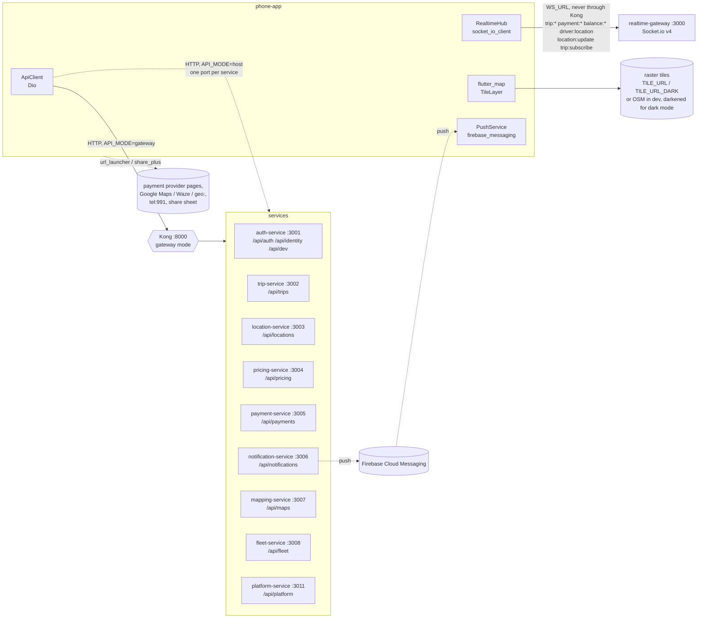

# Phone app documentation

`apps/phone-app` is one Flutter app (package `phone_app`, Flutter 3.44, Dart ^3.12) for both sides of a trip. It is built on Riverpod 3, go_router 18 and flutter_map 8, and on the shared Dart package `ride_app_core` (`packages/core`, documented in [packages/core/docs](../../../packages/core/docs/README.md)).

## What it does

**Riders** (rider mode):

- see a map around them with the anonymous cars nearby and the nearest car's ETA;
- pick a pickup and drop-off by search, from Home / Work / other saved places, recent places, a built-in list of well-known places, "use my location" or by dragging the map;
- get a fixed price per vehicle type with the road line, pickup ETA, distance and time, and the fare breakdown; choose cash, mobile money, card or (for company employees, behind a flag) the company account;
- follow the trip: finding a driver, the driver's name, photo, rating, car and plate, the car moving on the map with an ETA, the trip PIN (behind a flag), share a live link, SOS (behind a flag), cancel with a reason;
- pay mobile money or card on the provider's page after the trip, rate the driver with tags, and see past trips and receipts.

**Drivers** (driver mode):

- apply, upload documents (camera or gallery, expiry dates, upload progress), register a car and its documents, submit for review;
- choose a car and go online with a swipe; the phone streams its position over Socket.io while online (an Android foreground service keeps it going with the screen off);
- receive one offer at a time with a 15 s countdown, the route and the pickup ETA, and accept with a swipe;
- drive to the pickup and the drop-off with an in-app route, next-turn banner and turn list, or hand off to Google Maps, Waze or the system maps app; confirm each step with a swipe (on my way, arrived, start with the rider's PIN, complete), collect cash, mark a no-show after 5 minutes of waiting, rate the rider;
- see earnings for today / this week / this month, where the fare went (commission, VAT), the balance and its limits and dues, top up by mobile money, set the payout method, read the statement and past top-ups.

**Both**: phone OTP sign-in, a mode switch for people with both roles, English and Amharic, light / dark / system theme, haptics, settings (language, appearance, notifications, emergency contact, navigation, saved places, organisations and invitations, signed-in devices, payment preference), push notifications when Firebase is configured, and screens for features whose backend is not built yet (scheduled rides, support, promos, account deletion), hidden behind flags.

## The services it talks to



The app never calls audit-service, although `/api/audit` is in the host-mode port table. Which endpoint each screen uses is in [api-usage.md](api-usage.md).

## Running it

From the repo root (see also `apps/phone-app/README.md` and `docs/development/README.md` §5):

```bash
make setup-mobile                    # dart pub get for the workspace
make dev-services                    # backend on ports 3000–3011
make dev-mobile                      # flutter run --dart-define-from-file=env/dev-host.json
make dev-mobile ENV=dev-emulator     # Android emulator
make dev-mobile ENV=dev-kong         # through Kong (make dev-gateway)
```

`make dev-mobile` runs `cd apps/phone-app && flutter run --dart-define-from-file=env/$(or $(ENV),dev-host).json` (root `Makefile`). Checks: `dart run melos run analyze` and `dart run melos run test`.

## Index

| Document | Contents |
|---|---|
| [architecture.md](architecture.md) | Folder layout, boot, the provider graph, session and tokens, modes, every route and the guard order, realtime, location, maps and navigation, haptics, theming, localisation, push, feature flags |
| [screens.md](screens.md) | Every screen: what it shows, its states, actions, providers, API calls and socket events |
| [api-usage.md](api-usage.md) | Every endpoint and socket event the app uses, which feature uses it, which service serves it |
| [settings-and-storage.md](settings-and-storage.md) | Every SharedPreferences key, the secure-storage item, and the settings kept on the server |
| [configuration.md](configuration.md) | Every `--dart-define`, with its value in each `env/*.json` |
| [testing.md](testing.md) | Every test file, the shared fakes, and the conventions |
| [platforms-and-release.md](platforms-and-release.md) | Android, iOS and Linux configuration, deep links, building APKs |
