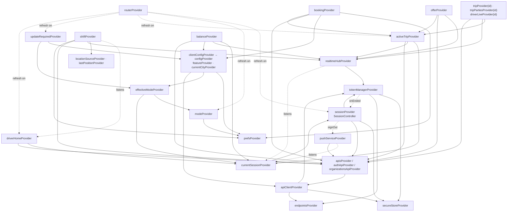
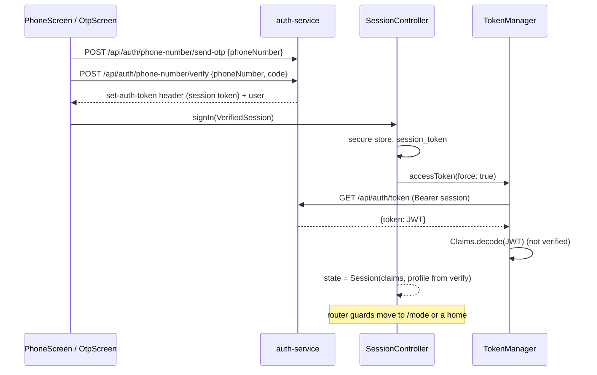

# Architecture

How the phone app is put together. Every statement points at the file it comes from; paths are relative to `apps/phone-app/` unless they start with `packages/`.

## Folder structure

```
apps/phone-app/
  lib/
    main.dart                     boot (below)
    app.dart                      AnbessaApp: MaterialApp.router, theme, locale, push/notification taps, resume hook
    core/
      config/env.dart             every --dart-define (configuration.md)
      prefs_keys.dart             every SharedPreferences key (settings-and-storage.md)
      state.dart                  ValueState / valueProvider: a plain value Notifier (Riverpod 3 has no StateProvider outside legacy)
      network/providers.dart      prefs, secure store, endpoints, TokenManager, ApiClient, the API classes
      session/                    secure_store.dart, token_manager.dart, session_controller.dart (session + mode)
      realtime/realtime_hub.dart  the Socket.io connection
      location/location_source.dart   GeolocatorSource, FakeLocationSource, lastPositionProvider
      push/                       push_service.dart (FCM), local_notifications.dart
      router/                     routes.dart (paths), app_router.dart (table + guards), transitions.dart
      l10n/                       app_en.arb, app_am.arb, l10n.dart (helpers); generated/ is not committed
      ux/haptics.dart             the haptics policy
    features/
      auth/                       welcome, phone, OTP, dev sign-in, mode switcher
      bootstrap/gates.dart        splash, update required, banners, dismissed announcements
      config/                     client config, feature flags, city, app version, update gate
      intro/                      the first-launch carousel
      shell/shells.dart           rider and driver bottom-navigation shells
      maps/                       AnbessaMap, markers, routes, tiles, MarkerAnimator, nearby cars, compass; nav/ (NavigationController, turn banner, external navigation)
      rider/                      home, booking (route editor, quote), trip, payments, rating, history, places
      driver/                     onboarding, shift (home), offers, trip, earnings, vehicles
      profile/                    account hub, profile, settings screens and their controllers
      support/                    SOS, help (tickets), lost items: repositories over SupportApi, screens
      flagged/flagged_modules.dart  account deletion (and the kTips/kMaskedCalls/kChat switches)
  test/                           testing.md
  env/                            dev-host, dev-emulator, dev-kong, stack, staging (.json)
  android/ ios/ linux/            platforms-and-release.md
  assets/fonts/                   Inter and Noto Sans Ethiopic (+ their OFL licences)
```

## Boot

`lib/main.dart`:

1. `WidgetsFlutterBinding.ensureInitialized()`.
2. `SharedPreferences.getInstance()`, injected as `prefsProvider` so every later read is synchronous.
3. A `ProviderContainer` is created with that override.
4. `installHaptics(container)` replaces `Haptics.sink` (see [Haptics](#haptics)).
5. `localNotificationsProvider.init()` (Android/iOS only, a no-op elsewhere).
6. `pushServiceProvider.init()` (only when all four `FIREBASE_*` defines are set, on Android/iOS).
7. `runApp(UncontrolledProviderScope(container, AnbessaApp()))`.

Everything else is built lazily by Riverpod the first time something reads it.

`lib/app.dart` (`AnbessaApp`):

- builds `MaterialApp.router` with `anbessaTheme()` / `anbessaTheme(brightness: dark)`, `themeModeProvider`, `localeProvider`, the two supported locales and `routerProvider`;
- on `AppLifecycleState.resumed`, calls `clientConfigProvider.notifier.refresh()` and `activeTripProvider.notifier.refresh()` (events may have been missed while paused);
- routes push taps and local-notification taps (see [Push notifications](#push-notifications)).

The first screen is `/splash`; the router's guards move on from there once the session has been read.

## Provider graph

The load-bearing providers and what each one reads. Arrows point from a provider to what it depends on.



| Provider | File | Type | What it holds |
|---|---|---|---|
| `prefsProvider` | `core/network/providers.dart` | `Provider<SharedPreferences>` | overridden at boot; throws if not |
| `secureStoreProvider` | same | `Provider<SecureStore>` | `PlatformSecureStore` |
| `endpointsProvider` | same | `Provider<ApiEndpoints>` | `Env.endpoints` (host or gateway) |
| `tokenManagerProvider` | same | `Provider<TokenManager>` | the JWT cache; has its own `ApiClient` with no token source |
| `apiClientProvider` | same | `Provider<ApiClient>` | the shared client, tokens from `TokenManager` |
| `apisProvider`, `authApiProvider`, `identityApiProvider`, `organizationsApiProvider` | same | `Provider` | the typed APIs (`identityApiProvider` has no reader) |
| `sessionProvider` | `core/session/session_controller.dart` | `AsyncNotifierProvider<SessionController, Session?>` | who is signed in |
| `currentSessionProvider` | same | `Provider<Session?>` | the session, or null (also while loading) |
| `modeProvider` | same | `NotifierProvider<ModeController, AppMode?>` | the chosen mode, persisted |
| `effectiveModeProvider` | same | `Provider<AppMode?>` | the mode in force |
| `clientConfigProvider` / `configProvider` | `features/config/client_config_provider.dart` | `AsyncNotifierProvider` / `Provider<ClientConfig>` | platform config; `configProvider` is never null (live, cached or fallback) |
| `featureProvider(Feature)` | same | `Provider.family<bool, Feature>` | one flag |
| `currentCityProvider` | same | `Provider<City>` | the **first** city in the config (the comment says "a later version picks by location") |
| `appVersionProvider`, `updateRequiredProvider` | same | `FutureProvider`, `Provider<bool>` | the forced-update gate |
| `realtimeHubProvider` | `core/realtime/realtime_hub.dart` | `Provider<RealtimeHub>` | the socket; connects and disconnects with the session |
| `realtimeStateProvider`, `realtimeEventsProvider` | same | `StreamProvider` | connection state; events (`realtimeEventsProvider` has no reader; features listen to `hub.events`) |
| `activeTripProvider` | `features/rider/trip/active_trip_controller.dart` | `AsyncNotifierProvider<ActiveTripController, Trip?>` | the trip in progress, for either side |
| `tripProvider(id)`, `tripPartiesProvider(id)`, `driverLiveProvider(id)` | same | families | one trip, the other side's name and car, the driver's live position |
| `driverHomeProvider` | `features/driver/shift/shift_controller.dart` | `AsyncNotifierProvider` | `GET /api/fleet/drivers/me` |
| `shiftProvider` | same | `NotifierProvider<ShiftController, ShiftState>` | online / offline, the car, ping counters |
| `offerProvider` | `features/driver/offers/offer_controller.dart` | `NotifierProvider` | the current offer |
| `balanceProvider` | `features/driver/earnings/earnings_controller.dart` | `AsyncNotifierProvider<…, Balance?>` | the driver's balance (null for non-drivers) |
| `bookingProvider` | `features/rider/booking/booking_controller.dart` | `NotifierProvider<BookingController, Booking>` | the booking in progress |
| `routerProvider` | `core/router/app_router.dart` | `Provider<GoRouter>` | the router |
| `safetyRepositoryProvider`, `supportRepositoryProvider` | `features/support/support_repository.dart` | `Provider` | `ApiSafetyRepository` / `ApiSupportRepository` over `apisProvider.support`; tests override them |
| `myTicketsProvider`, `myLostItemsProvider` | same | `FutureProvider` (no automatic retry) | the first 50 tickets / lost-item reports |
| `ticketThreadProvider(id)`, `lostItemThreadProvider(id)` | same | `AsyncNotifierProvider.family` | one thread, with reply, reopen, confirm-returned and found / not-found actions |
| `sosAlertsProvider` | `features/support/sos_screen.dart` | `valueProvider<Map<String, SosAlert>>` | the alert sent per trip during this app run |

Because `RouterNotifier` listens to `driverHomeProvider`, that provider is built for **every** signed-in person, so `GET /api/fleet/drivers/me` is called for riders too (`core/router/app_router.dart`, `RouterNotifier`).

## Session and tokens

Files: `core/session/secure_store.dart`, `core/session/token_manager.dart`, `core/session/session_controller.dart`.

There are two credentials:

| Credential | Lifetime | Where it lives | Used for |
|---|---|---|---|
| Session token (Better Auth bearer session) | until revoked or expired on the server | secure storage, key `session_token` | `GET /api/auth/token` and the other Better Auth routes (`sessionBearer: true`) |
| Access JWT | 15 minutes (per the `token_manager.dart` comment) | memory only, in `TokenManager` | every other API call and the socket handshake |

### Sign-in



On the OTP screen with `?driver=1`, `modeProvider` is set to driver right after sign-in (`features/auth/auth_screens.dart`).

### Cold start (`SessionController.build`)

1. No `session_token` in secure storage → `null` (signed out).
2. Otherwise `_load()`: `TokenManager.accessToken(force: true)`, then `GET /api/auth/get-session` for the profile (if that fails with a non-auth error, an empty profile is used).
3. An `AppError` that `isAuth` (401 or `session_ended`) or `isForbidden` (403) clears the token and the cache → `null`.
4. Any other `AppError` (network down): if `TokenManager.claims` is set, a session with an empty profile is returned; otherwise the error is rethrown.

At a cold start `TokenManager` has no claims yet (they only exist after a successful mint), so a network failure in step 2 leaves `sessionProvider` in an error state with no value. The router then keeps the person on the splash screen (`sessionAsync.hasError && !sessionAsync.hasValue` in `lib/core/router/app_router.dart`), not on Welcome. `SplashScreen` (`lib/features/bootstrap/gates.dart`) shows the offline text (`offlineBanner`) and a "Try again" button that invalidates `sessionProvider`. The stored token is kept. Test: "offline at start with a stored session: the splash (with retry), never welcome" in `test/router_redirect_test.dart`.

### TokenManager

- `accessToken({force})` returns the cached JWT while `claims.isFresh(now)` (more than 60 s left); otherwise it refreshes. With no session token it returns `null` without a request.
- One refresh at a time: concurrent callers share the same future (`_inFlight`).
- A refresh answered with 401, 403 or `session_ended` clears the cache and calls `onEnded`, which is `SessionController.sessionEnded`. Other errors (network) are rethrown and do not sign out.
- `refreshClaims()` forces a new JWT and returns its claims. Used after accepting an organisation invitation and when pulling to refresh the onboarding hub (a role may have changed).
- `ApiClient` asks for `accessToken(force: true)` once when a service answers 401 with a token error, and replays the request ([packages/core/docs/api-client.md](../../../packages/core/docs/api-client.md)).

### Ending a session

| Trigger | Code path | Reason shown on Welcome |
|---|---|---|
| The person signs out (Account → Sign out, confirmed) | `SessionController.signOut()`: `PushService.unregister()` (5 s timeout), `POST /api/auth/sign-out` (5 s timeout, errors ignored), clear the token and JWT | none (`SignOutReason.user`) |
| A token refresh is refused | `TokenManager` → `sessionEnded(cause)` | `suspended` when the code is `token_revoked` or the status is 403, else `sessionEnded` |
| The replay after a refresh gets 401, or the refresh fails with an auth / forbidden `AppError` | `ApiClient` → `onSessionEnded` → `sessionEnded` | same rule |
| The socket refuses the token three times | `RealtimeHub` → `sessionEnded(401 session_ended)` | `sessionEnded` |

`sessionEnded` is ignored when the person already signed out. `SessionController.endings` is a broadcast stream of reasons; nothing in `lib/` listens to it. `WelcomeScreen` shows a notice from `lastSignOut`.

### Session object

`Session(claims, profile)`: `userId`, `canDrive` (`claims.isDriver`: role `DRIVER` or `FLEET_DRIVER`), `displayName` (the profile name, or the formatted phone when the name is a phone-number placeholder).

## Modes

`AppMode { rider, driver }` (`core/session/session_controller.dart`).

| Provider | Rule |
|---|---|
| `modeProvider` | the choice, persisted under the prefs key `mode`; null until chosen |
| `effectiveModeProvider` | null when signed out; the chosen mode if any; otherwise `rider` for people who cannot drive and **null** for people who can (they must choose) |

How the mode changes:

- `/mode` (`ModeSwitcherScreen`): two cards, "Ride" and "Drive"; tapping one sets `modeProvider`.
- Account → "Switch to driver" (when `canDrive`), "Become a driver" (rider without a driver role, sets driver mode; the router then sends them to onboarding), "Switch to rider" (in driver mode).
- Sign-in from "Drive with Anbessa" (`/sign-in?driver=1`) sets driver mode.

What follows a change: the router redirects to the new mode's home; `clientConfigProvider` rebuilds because it watches `effectiveModeProvider` and refetches with `audience=<mode>`; `updateRequiredProvider` uses the new mode's minimum version. The mode is not cleared on sign-out (`ModeController.clear()` has no caller).

## Routing

Files: `core/router/routes.dart` (paths), `core/router/app_router.dart` (table and guards), `core/router/transitions.dart`.

`GoRouter(initialLocation: '/splash', refreshListenable: RouterNotifier, redirect: _redirect)`. `RouterNotifier` re-runs the redirect when `sessionProvider`, `modeProvider`, `activeTripProvider`, `updateRequiredProvider`, `driverHomeProvider` or `introSeenProvider` change.

### Transitions

| Name | Used by | Behaviour |
|---|---|---|
| default (`builder:`) | every route not listed below | the theme's page transition: `FadeForwardsPageTransitionsBuilder` (Android, Linux, desktop), Cupertino (iOS) |
| `fadeThroughPage` | `/intro` | fade in from 30 % of the animation plus a 0.98 → 1 scale, 320 ms in, 200 ms out |
| `slideUpPage` | `/rider/book/route`, `/rider/book/quote` | slide up 6 % with a fade, 380 ms in, 320 ms out |
| `instantPage` | nothing | no transition |

The comment in `transitions.dart` says the slide-up is also for pay and rating; in the route table those two use the default builder.

### Route table

| Path | Screen (file) | Transition | Notes |
|---|---|---|---|
| `/splash` | `SplashScreen` (`features/bootstrap/gates.dart`) | default | initial location |
| `/intro` | `IntroScreen` (`features/intro/intro_screen.dart`) | fade-through | |
| `/update-required` | `UpdateRequiredScreen` (`gates.dart`) | default | |
| `/welcome` | `WelcomeScreen` (`features/auth/auth_screens.dart`) | default | |
| `/sign-in` | `PhoneScreen(driver: ?driver=1)` | default | |
| `/sign-in/verify` | `OtpScreen(phone: ?phone, driver: ?driver=1)` | default | |
| `/mode` | `ModeSwitcherScreen` | default | |
| `/trip/:id` | redirect | | → `/driver/trip/:id` in driver mode, else `/rider/trip/:id` (deep links) |
| `/pay/:id` | redirect | | → `/rider/trip/:id/pay` |
| `/top-up/:id` | redirect | | → `/driver/earnings` (the id is ignored) |
| **Rider shell** (`RiderShell`, `StatefulShellRoute.indexedStack`) | | | |
| `/rider/home` | `RiderHomeScreen` | default | branch 0 (Home) |
| `/rider/home/book/pickup` | redirect | | → `/rider/book/pickup` |
| `/rider/activity` | `HistoryScreen(as: 'rider')` | default | branch 1 (Activity) |
| `/rider/activity/:id` | `ReceiptScreen(asDriver: false)` | default | |
| `/rider/account` | `AccountScreen(mode: rider)` | default | branch 2 (Account) |
| **Rider, outside the shell** | | | |
| `/rider/book/pickup` | redirect | | → `/rider/book/route?focus=pickup` |
| `/rider/book/dropoff` | redirect | | → `/rider/book/route?focus=dropoff` |
| `/rider/book/route` | `RouteEditorScreen(focus, mode, savedLabel)` | slide-up | query: `focus=pickup|dropoff` (default dropoff), `mode=savedPlace`, `label=home|work|other` |
| `/rider/book/quote` | `QuoteScreen` | slide-up | |
| `/rider/trip/:id` | `RiderTripScreen` | default | |
| `/rider/trip/:id/pay` | `PayScreen` | default | |
| `/rider/trip/:id/rate` | `RatingScreen(asDriver: false, doneRoute: /rider/home)` | default | |
| **Driver shell** (`DriverShell`) | | | |
| `/driver/home` | `DriverHomeScreen` | default | branch 0 (Home) |
| `/driver/earnings` | `EarningsScreen` | default | branch 1 (Earnings) |
| `/driver/earnings/top-up` | `TopUpScreen` | default | |
| `/driver/earnings/payout-method` | `PayoutMethodScreen` | default | |
| `/driver/earnings/statement` | `StatementScreen` | default | |
| `/driver/earnings/top-ups` | `TopUpsScreen` | default | |
| `/driver/activity` | `HistoryScreen(as: 'driver')` | default | branch 2 (Activity) |
| `/driver/activity/:id` | `ReceiptScreen(asDriver: true)` | default | |
| `/driver/account` | `AccountScreen(mode: driver)` | default | branch 3 (Account) |
| **Driver, outside the shell** | | | |
| `/driver/onboarding` | `OnboardingHubScreen` | default | |
| `/driver/onboarding/apply` | `ApplyScreen` | default | |
| `/driver/onboarding/documents/:subjectType/:subjectId` | `DocumentsScreen` | default | `subjectType` is `DRIVER` or `VEHICLE` |
| `/driver/onboarding/vehicle/new` | `VehicleFormScreen` | default | |
| `/driver/onboarding/vehicle/:id` | `VehicleScreen` | default | |
| `/driver/trip/:id` | `DriverTripScreen` | default | |
| `/driver/trip/:id/rate` | `RatingScreen(asDriver: true, doneRoute: /driver/home)` | default | |
| **Shared** | | | |
| `/account/profile` | `ProfileScreen` | default | |
| `/account/language` | `LanguageScreen` | default | |
| `/account/sessions` | `SessionsScreen` | default | |
| `/account/payments` | `PaymentPreferencesScreen` | default | |
| `/account/places` | `SavedPlacesScreen` | default | |
| `/account/appearance` | `AppearanceScreen` | default | |
| `/account/notifications` | `NotificationsScreen` | default | |
| `/account/safety` | `SafetyScreen` | default | |
| `/account/organizations` | `OrganizationsScreen` | default | |
| `/account/navigation` | `NavigationPrefsScreen` | default | |
| `/driver/vehicles` | `VehiclesScreen` | default | registered with the shared routes |
| `/account/delete` | `DeleteAccountScreen` | default | |
| `/scheduled` | `ScheduledRidesScreen` (`rider/scheduled/`) | default | |
| `/sos` | `SosScreen(tripId: ?trip)` (`features/support/sos_screen.dart`) | default | |
| `/support` | `SupportScreen` (`features/support/support_screens.dart`) | default | "Help" |
| `/support/new` | `NewTicketScreen(tripId: ?trip)` | default | |
| `/support/tickets/:id` | `TicketScreen` | default | |
| `/support/lost-items` | `DriverLostItemsScreen` (`features/support/lost_item_screens.dart`) | default | |
| `/support/lost-items/report` | `ReportLostItemScreen(tripId: ?trip)` | default | registered before `:id` |
| `/support/lost-items/:id` | `LostItemScreen` | default | |

Every route is registered whatever the feature flags say; the flags only hide the entry points.

### Redirect guards, in order (`_redirect`)

1. **Bootstrap.** While `sessionProvider` is loading and has no value: go to `/splash` (stay if already there). Same when it ended in an error with no value (offline at cold start): stay on `/splash`, which offers "Try again".
2. **Forced update.** If `updateRequiredProvider` is true: go to `/update-required`. If it is false and the path is `/update-required`: go to `/splash`.
3. **Signed out** (session value is null). If the intro was never seen: `/intro`. Otherwise `/welcome`, except that `/welcome`, `/sign-in` and `/sign-in/verify` are allowed. A signed-in person on `/intro` goes to `/splash`.
4. **Mode.** If `effectiveModeProvider` is null: `/mode`. From `/splash`, `/mode` or a sign-in path: the mode's home (`/rider/home` or `/driver/home`).
   - Paths starting with `/account`, `/sos`, `/support`, `/scheduled` are allowed in either mode and **skip the remaining guards** (so the active-trip guard does not apply to them).
   - Paths starting with `/rider/book` are allowed in driver mode and skip the remaining guards (the route editor picks saved places from the account).
   - A rider on a `/driver…` path goes to `/rider/home`; a driver on a `/rider…` path goes to `/driver/home`.
5. **Driver not approved.** In driver mode, once `driverHomeProvider` has a value: approved = `session.canDrive && (driver?.isActive ?? true)`. If not approved, every path goes to `/driver/onboarding` except paths under `/driver/onboarding`, `/driver/account`, `/driver/vehicles` and paths under `/driver/earnings`.
6. **Active trip.** If `activeTripProvider` holds a trip with `isActive`, any path that does not start with `/rider/trip/<id>` (rider) or `/driver/trip/<id>` (driver) goes there.

`redirectFor(ref, uri)` runs the same function without a GoRouter, for `test/router_redirect_test.dart`.

### Deep links

The comment in `routes.dart` says `anbessa://` and `https://app.anbessa.et` links use the same paths. Android and iOS register the `anbessa` scheme and Android an `https://app.anbessa.et` app link with Flutter deep linking enabled ([platforms-and-release.md](platforms-and-release.md)). go_router matches on the URI path. For `https://app.anbessa.et/trip/<id>` the path is `/trip/<id>`. For a custom-scheme URI such as `anbessa://trip/<id>`, `trip` is the URI host, not part of the path; how that resolves was not verified in this review.

### Shells

`features/shell/shells.dart`. Both shells are `Scaffold`s with a `NavigationBar` and the `Banners` overlay stacked over the page (see [screens.md](screens.md)). Tapping the current tab again resets that branch to its first location. The banner stack reports its height into `bannerHeightProvider`, which map screens add to their top inset.

| Shell | Tabs | Badges |
|---|---|---|
| `RiderShell` | Home, Activity, Account | a dot on Activity when `paymentDueProvider` is true |
| `DriverShell` | Home, Earnings, Activity, Account | a dot on Earnings when the balance state is not `ok`; a dot on Activity when `paymentDueProvider` is true (drivers ride too) |

`paymentDueProvider` (`features/rider/payments/payment_due_controller.dart`): true when the person's latest rider trip completed less than 24 h ago, was paid by mobile money or card, and its fare payment is open or failed. It re-runs whenever `activeTripProvider` changes and swallows every error.

## Client configuration and feature flags

`features/config/client_config_provider.dart`, model in `packages/core/lib/src/models/client_config.dart`.

- Fetched with `GET /api/platform/client-config?audience=<mode or rider>` (no bearer) when the provider builds, every 60 s (a periodic stream started in `build`), and on app resume.
- The raw JSON of each successful fetch is stored in prefs (`client_config`). If the fetch fails, the last cached copy is used, else `ClientConfig.fallback`.
- `refresh()` replaces the state when `version` changed, when the announcement list changed (compared by id, title and body, in order: announcements don't bump the settings version), or when there was none. So a new announcement shows on the next refresh, without a restart. Errors are ignored.
- `featureProvider(flag)` reads `configProvider.features[flag]`.

| Flag | Default when missing from the response | Read by |
|---|---|---|
| `phoneBooking` | on | nothing in `lib/` |
| `corporateBooking` | on | `QuoteScreen`: offers "Company account" when on **and** the JWT has an org id |
| `tripPin` | off | `RiderTripScreen` (shows the PIN), `DriverTripScreen` (asks for it before start) |
| `scheduledRides` | off | rider home chip, account tile, "Pickup time" on the quote, "Upcoming" in Activity, `scheduledRidesProvider` (no request while off) |
| `sos` | off | SOS button on both trip screens (while `sosAvailable`: an active trip with a driver, or ≤ 30 min after drop-off) |
| `support` | off | Account → Help, driver Account → Lost items, the receipt's "Help with this trip" |
| `promos` | off | promo-code row on the quote |
| `accountDeletion` | off | account tile |

With the fallback config (no response ever received) every flag is off, including the two that default to on. Compile-time switches in `features/flagged/flagged_modules.dart`: `kTipsEnabled` (rating screen tip row shows "Coming soon" while false), `kMaskedCallsEnabled` (the call button on the driver trip card is hidden while false), `kChatEnabled` (not read anywhere). All three are `false`.

The flagged module left in `flagged_modules.dart` (account deletion) has a repository interface whose default implementation throws `AppError(501, not_available)`; a real implementation would override `accountRepositoryProvider`. Scheduled rides (`features/rider/scheduled/`) and promo codes (the quote screen and `BookingController`) call trip-service and pricing-service directly through `apisProvider`. SOS and support have their backend (support-service): `safetyRepositoryProvider` and `supportRepositoryProvider` in `features/support/support_repository.dart` default to the real `SupportApi` implementations; the flags only hide the entry points.

### Forced update

`updateRequiredProvider` is true only on Android and iOS, when `minAppVersions[<mode>][<platform>]` is set and the running version (`package_info_plus`) is lower (`isBelowMinimum`). The update screen links to `https://play.google.com/store/apps/details?id=com.anbessa.phone_app` or `https://apps.apple.com/app/anbessa`.

## Realtime hub

`core/realtime/realtime_hub.dart`. Event names and payloads are in [packages/core/docs/realtime.md](../../../packages/core/docs/realtime.md).

- One `RealtimeHub` for the app, over a `SocketLink` (`SocketIoLink` in production, `FakeSocketLink` in tests).
- Socket options: transport `websocket` only, auto-connect off, `forceNew` (so the next person to sign in never reuses the previous person's socket), `auth: {token}`, reconnection delay 1 s growing to at most 16 s.
- States: `offline`, `connecting`, `connected`, `reconnecting`.

| Moment | What the hub does |
|---|---|
| `currentSessionProvider` changes to a new user id | `connect()`: get a JWT (cached if fresh), wire the handlers once, connect |
| `currentSessionProvider` becomes null | `disconnect()`: forget the rooms, state `offline` |
| connected | reset the refusal counter, state `connected`, re-send `trip:subscribe` for every remembered room |
| disconnected | `reconnecting` if a connection is wanted, else `offline` |
| reconnect attempt | state `reconnecting`, put the current JWT in `auth` (the gateway checks it only at the handshake) |
| connect error containing `unauthorized` (the gateway sends `unauthorized: <code>` for a refused token) | count it; on the third in a row, end the session; otherwise put a **forced** new JWT in `auth` |
| any other connect error, e.g. `unavailable` (the gateway couldn't check the token: Redis down) | not counted; Socket.io keeps reconnecting with its backoff |
| an event in `realtimeEventNames` | parse with `RealtimeEvent.fromSocket` and add to `events` (broadcast) |

`subscribeTrip(id)` remembers the room even when offline and returns the ack's `ok` (false after 5 s). `sendLocation(ping)` emits `location:update` and returns the `PingAck` (3 s timeout; `offline` when not connected). `inject(event)` is for tests.

Who reacts to the connection state:

- `ActiveTripController` refetches the active trip on every `connected` (events may have been missed).
- `driverLiveProvider(tripId)` joins the trip room, listens to `driver:location`, and every 5 s, while the socket is down or the join was refused, polls `GET /api/locations/trips/:id/driver` and retries the join. It also fetches one position over HTTP at start. On dispose it leaves the room.
- `Banners` shows "Reconnecting…" while signed in and `reconnecting`; the driver home shows a chip when online and not connected.

### Active trip

`ActiveTripController`:

- builds from `GET /api/trips/active` when signed in; a network error keeps the previous value;
- applies every `trip:status` event's `trip`, except an event for a different trip while the current one is still active;
- `refresh()` on reconnect and resume: if there is an active trip it replaces the state; if there is none but the app still holds an active one, it fetches that trip by id to show its final state;
- `set()` / `replace()` after the app creates or acts on a trip; `clearIfEnded()` when the person leaves an ended trip (done, rated, receipt closed).

An ended trip stays in the provider until `clearIfEnded()`, so the trip screen can show "completed" or "cancelled". The router only forces the trip screen while `isActive`.

## Location

`core/location/location_source.dart`.

`locationSourceProvider` gives `FakeLocationSource` when `Env.fakeLocationOn` (`FAKE_LOCATION=on`, or always on Linux desktop), else `GeolocatorSource`.

### GeolocatorSource

| Profile | Android | iOS | Other |
|---|---|---|---|
| `once` | high accuracy, distance filter 0 | same | same |
| `rider` | best, distance filter 10 m | same | same |
| `driverOnline` | high accuracy, distance filter 0, interval 4 s, a "location" foreground service with the notification "Anbessa is online" / "Sharing your location with riders while you drive", wake lock, launcher icon | best, distance filter 0, `automotiveNavigation`, background location updates allowed, background indicator shown | best, distance filter 0 |

- `ensurePermission`: `serviceOff` if location services are off; asks once if denied; `always` or `whileInUse` count as granted. The code never asks for "always" specifically.
- `current()`: one fix with a 12 s timeout, falling back to the last known position.
- Headings below 0 or NaN become null.

Who uses it:

| Caller | Profile | When |
|---|---|---|
| `RiderHomeScreen` | `once` | once when the screen opens (sets `lastPositionProvider`) |
| `RouteEditorScreen` "Use my location" | `once` | on tap |
| `ShiftController` | `driverOnline` | permission check before going online; a position stream while online |

Nothing uses the `rider` profile, so the rider's own dot is not updated continuously.

`lastPositionProvider` holds the last position the app saw. It is set by the rider home, the route editor and every driver position while online.

### Driver pings (`ShiftController`)

While a driving session is open, each position updates `lastPositionProvider` and is sent with `location:update` at most every **4 s when moving** (speed > 1 m/s) and every **10 s when still**. A 10 s timer re-sends the last position when the stream goes quiet. Acks are counted: accepted resets the rejection counter; rejections other than `offline`, `too_frequent` and `timeout` add one. `gpsPoor` = at least 5 rejections and more rejections than accepted pings.

### FakeLocationSource

Starts at Meskel Square (9.0107, 38.7613), accuracy 5 m, permission always granted. `set(lat, lng)` jumps (heading = bearing of the jump); `driveTo(lat, lng, speedKmh = 40)` moves one step a second until it arrives. The driver screens show a "Dev tools" chip that opens `DevLocationPanel`: jump to Bole, Meskel or Piassa, or "Drive to target", which drives to `devDriveTargetProvider` (set by the driver trip screen to the pickup, then the drop-off).

## Maps

`features/maps/`.

### Two engines, one widget

`AnbessaMap` (`anbessa_map.dart`) is what screens use. It picks an engine with `vectorMapsProvider`:

| Engine | File | Where | Draws |
|---|---|---|---|
| Vector: MapLibre (`maplibre` 0.3.6; 0.3.7 needs Flutter 3.47) | `vector_map.dart` | Android, iOS | vector tiles; flat, 3D (tilted, buildings extruded) and satellite |
| Raster: flutter_map + `flutter_map_animations` | `raster_map.dart` | Linux desktop, tests (MapLibre has no desktop or test implementation) | raster tiles; flat and satellite (3D shows flat) |

Both draw the same pins: `pinsFor()` builds one list of `MapPin`s (overlays, nearby cars, pickup, drop-off, the person, the car, callouts) and each engine places them (`MarkerLayer` / MapLibre `WidgetLayer`). Pins are Flutter widgets, so they look the same on both. Route lines share `routeStroke()`.

### Map modes (`map_mode.dart`, `map_styles.dart`)

| Mode | Vector engine | Raster engine |
|---|---|---|
| Flat (2D) | OpenFreeMap `positron` (light) / `dark` (dark theme): quiet styles so routes and cars stand out | `TILE_URL` or OpenStreetMap; dark theme darkens them (or `TILE_URL_DARK`) |
| 3D | the same style, camera pitch 55° (60° while navigating), OpenMapTiles buildings extruded under the route (`anbessa-buildings-3d`, theme-coloured); tilt by gesture | not available: flat |
| Satellite | an inline raster style over Esri World Imagery (`SATELLITE_TILE_URL` overrides) | the same imagery as a tile layer |

The chosen mode is stored in preferences (`map_mode`) and applies to every map. `effectiveMapModeProvider` turns 3D into flat where the vector engine doesn't run. The mode switch is the first map control (its label is the mode: "2D", "3D", "Sat"); it opens a sheet with the three choices. Defaults need no API key; production points `MAP_STYLE_URL` / `MAP_STYLE_URL_DARK` / `SATELLITE_TILE_URL` at its own servers (Esri imagery's terms should be checked before production use).

### AnbessaMap

| Parameter | Meaning |
|---|---|
| `fit` | points to keep in view (pickup, drop-off, car…); refitted when they change or the insets change |
| `center`, `zoom = 13` | the start when there is nothing to fit or follow; default centre is the current city's bbox centre |
| `pickup`, `dropoff` | pickup: an ink ring pin; drop-off: a filled square pin |
| `driverPose` | the animated car (`AnimatedPose` from a `MarkerAnimator`); `driver` is an older static form |
| `mePose` | the person's dot with heading cone (the raster engine also draws the accuracy circle); `me` is the older point form |
| `routes` | `RouteLine`s; `line` is an older straight dotted line |
| `cars` | anonymous nearby cars (`CarPose`) |
| `callouts` | labels above points (`MapCallout`: ETA over the car, place names over pins) |
| `overlays` | any widget at a point (`MapOverlay`), e.g. the search pulse at the pickup |
| `topInset`, `bottomInset` | pixels covered by banners and the sheet; fits and follows keep the subject in the free area, and the controls and credit sit above `bottomInset` |
| `follow`, `followZoom = 16` | `FollowMode` |
| `showControls`, `showModeSwitch`, `interactive`, `padding` | |
| `onUserGesture` | every pan, pinch or turn by the person (screens drop follow mode on it; the route editor lifts its pin) |
| `onRecenter` | the recenter control was pressed (screens follow again); with it the control always shows |
| `onTap`, `onMove` | `onMove` gets the camera centre after a gesture ends (drag-to-pick) |

Behaviour (both engines):

- `FollowMode`: `none`, `me`, `driver` (north up), `driverBearing` (map turned so the car's heading points up, the car in the lower part of the free area). The raster engine moves the camera on every rebuild; the vector engine at most ~12 times a second (each move crosses to native code).
- A gesture while following breaks the follow (and calls `onUserGesture`); recenter restores it.
- A north needle shows when the map is turned outside `driverBearing`; tapping it turns north up.
- Fits are animated (`AnbessaMotion.camera`) unless reduced motion is on; 48 px above, 32 px below and the side padding; a single point is shown at zoom 15; the vector engine never fits closer than zoom 17.
- The credit line is drawn by the app (one line, 9 px). A raster tile error sets `mapTilesDownProvider`.
- Pins add the map's rotation so headings stay true. The car is amber on a trip, green off a trip, faint when stale.

### Route lines (`route_layer.dart`)

| Kind | Drawing |
|---|---|
| `primary` | 9 px casing under a 5 px line: ink on the light map; amber on the dark map and over imagery (black disappears there) |
| `traversed` | 5 px faint line (the part already driven) |
| `secondary` | 4 px dashed line (the leg that is not the current one) |
| `straight` | 3 px dotted line (no geometry) |

`RouteLine.fromPolyline6(encoded)` decodes the services' polylines; null or empty gives an empty line, which is not drawn. The vector engine caches its line layers (MapLibre compares layers by identity) and rebuilds them only when the routes or the look change.

### MarkerAnimator (`marker_animator.dart`)

Glides a car between GPS samples. Defaults: `maxGlide` 4 s, `deadReckonFor` 8 s, `snapOverMeters` 300, `staleAfter` 20 s.

- The first sample, or a sample more than 300 m away, snaps.
- Otherwise the shown pose glides from where it is to the sample over the time between samples (capped at 4 s); the heading turns the short way (`lerpAngleDeg`). A missing heading is computed from the movement.
- After the glide, if the speed is above 0.5 m/s, the car keeps moving at that speed along its heading (`geoOffset`) for up to 8 s more. Speed comes from the sample, or is computed from the distance and time between samples.
- More than 20 s without a sample marks the pose `stale` and stops the ticker.

Used by `RiderTripScreen` (the driver's car) and, per car, by `CarsAnimator`.

### Nearby cars (`nearby_cars_layer.dart`)

`NearbyCarsController.watch(lat, lng)` starts polling `GET /api/locations/nearby` every 10 s, and polls at once when the point moved more than 150 m. `stop()` cancels. The rider home starts it when it has a position, stops it when the app is paused and restarts it on resume. `CarsAnimator` matches each new car to the nearest existing animator within 150 m (so a moving car glides instead of blinking), with `maxGlide` 3 s and no dead reckoning.

### Navigation (`nav/`)

`NavigationController` (`navigationProvider(NavTarget)`), used by `DriverTripScreen`:

- `start(from)` fetches `GET /api/maps/route?steps=1` (through `routeFetcherProvider`, overridable in tests). With no polyline it uses a straight two-point line.
- `update(position, speed)` projects the car onto the route and computes the travelled and remaining parts, metres left, the next step (the first step whose manoeuvre is at most 15 m behind the car, ignoring `depart`), the step after, and the metres to the next manoeuvre. Time left uses the average speed of the route, blended 50/50 with the measured speed when that is above 1.5 m/s.
- Off route: more than 60 m from the line. After 8 s off route it fetches a new route, but at most once every 20 s (60 s when the route is `approximate`).
- `TurnBanner` shows the next turn (icon from `maneuverIcon`, words from `maneuverLabel(l10n, maneuverKey(step), name)`), "in <distance>", and states for loading, rerouting and no route; a warning colour when off route. Tapping it opens `TurnListSheet` with every step.
- `openExternalNavigation(lat, lng, app, label)` (`nav/external_nav.dart`) tries, in order: Google Maps (`comgooglemaps://` on iOS, `google.navigation:` on Android) when chosen, Waze (`waze://`) when chosen, the system maps app (`maps://` on iOS, `geo:` on Android), then the Google Maps web URL.

The rider's ETA (`features/rider/trip/trip_eta_controller.dart`): `tripEtaProvider(tripId).track(car, target)` asks `GET /api/maps/route` (no steps) when the target moved more than 20 m or the last answer is older than 30 s; after a failure it tries again about 10 s later. With no answer the screen estimates `straight-line distance × 1.35 / 6.1 m/s`.

`heading_source.dart` defines `compassHeadingProvider` (accelerometer + magnetometer, tilt compensated, low-pass filtered, Android/iOS only). Nothing in `lib/` reads it.

The driver trip screen keeps the screen on with `wakelock_plus` while it is open, when the "Keep screen on" preference is on.

## Haptics

`core/ux/haptics.dart` and `packages/core/lib/src/ui/widgets/feedback.dart`.

Screens call `Haptics.selection()`, `light()`, `medium()`, `heavy()`, `success()`, `error()` or `offer()`. `installHaptics` (at boot) sets `Haptics.sink` from `hapticsSettingsProvider` and updates it when the settings change:

- `offer` with "Vibrate on new offer" on: on Android/iOS a vibration pattern `[0, 300, 150, 300]` ms if the device has a vibrator, otherwise a heavy impact.
- anything else: the platform haptic, only when "Haptic feedback" is on.

Both settings default to on (prefs `haptics`, `notif_vibrate_offer`).

## Theming and dark mode

- `themeModeProvider` (`features/profile/appearance_controller.dart`): `system` (default), `light` or `dark`, persisted as `theme_mode`.
- `MaterialApp.router` gets `theme`, `darkTheme` and `themeMode`; the palettes and theme are in [packages/core/docs/ui.md](../../../packages/core/docs/ui.md).
- `isDarkProvider` resolves `system` against `platformBrightnessProvider`, which hooks `PlatformDispatcher.onPlatformBrightnessChanged`. The map uses it to switch tiles.

## Localisation

- `l10n.yaml`: ARB dir `lib/core/l10n`, template `app_en.arb`, output class `AppLocalizations` in `lib/core/l10n/generated/`, `nullable-getter: false`.
- `app_en.arb` and `app_am.arb` each define 734 messages with the same keys.
- `lib/core/l10n/generated/` is git-ignored (`apps/phone-app/.gitignore`). `flutter run/build/test` regenerate it; `dart run melos run gen` (root `pubspec.yaml`, `melos exec --file-exists=l10n.yaml -- flutter gen-l10n`) does it for `flutter analyze`.
- `localeProvider` (`features/profile/account_screens.dart`): null = follow the system (Flutter's default resolution against `en`, `am`), or a chosen `Locale`, persisted as `locale`. Set from Account → Language and from the pills on the Welcome screen.
- `lib/core/l10n/l10n.dart`: `context.l10n`, `context.localeTag`; `describeError(l, error)` maps every known `ErrorCodes` value to a message (validation errors join the field messages; unknown codes use the backend message); label helpers for payment methods, trip, driver and vehicle statuses, document kinds and hints, offline reasons, statement entry kinds, cancel reasons, rating tags, manoeuvres, and payment providers (`telebirr`, `CBE Birr`, `Chapa`, `Bank`).
- Money and dates use the `locale` argument of the core helpers (`birr`, `dayAndTime`…), passed as `context.localeTag`.
- Amharic text renders with the bundled Noto Sans Ethiopic as the font fallback.

## Push notifications

`core/push/push_service.dart`, `core/push/local_notifications.dart`.

### FCM (`PushService`)

- `supported` only on Android/iOS with all four `FIREBASE_*` defines. Otherwise every method is a no-op.
- `init()`: `Firebase.initializeApp` with the defines, `requestPermission()`, listens to foreground messages (into a `foreground` stream nothing reads), opened-app taps and the initial message, and to token refreshes. Errors are printed and push stays off.
- Registration: when `currentSessionProvider` changes to a new user, `registerForCurrentUser()` gets the FCM registration token (`getToken`, deprecated API kept on purpose because notification-service sends to registration tokens) and calls `POST /api/notifications/devices {token, platform}`. Token refreshes register again.
- Sign-out calls `unregister()` first: `POST /api/notifications/devices/remove {token}`.

Tap routing (`AnbessaApp._onPushTap`, by the payload `type`; template names from `services/notification-service/src/notify/templates.ts` per the comment):

| `type` | Goes to |
|---|---|
| `payment.action_required`, `payment.failed`, `trip.receipt` | `/rider/trip/<data.tripId>/pay` |
| `driver.activated` | `/driver/home` |
| `balance.state_changed`, `balance.topped_up`, `balance.payment_due`, `payout.sent`, `payout.failed` | `/driver/earnings` |
| anything else | nothing |

### Local notifications

`PlatformLocalNotifications` on Android/iOS, `NoLocalNotifications` elsewhere and in tests.

- Android channels: `offers` ("Trip offers", max importance, sound) and `general` ("Anbessa", default importance). iOS permission prompts are not requested at init.
- `offer(TripOffer)`: notification id 1, title "New trip", body "pickup → drop-off · fare", full-screen intent, category `call`, auto-cancel after 16 s, iOS time-sensitive, payload `offer:<tripId>`. Raised by `OfferController` for every offer (the code does not check whether the app is in the background); cancelled when the offer is answered, expires or is cancelled.
- `requestPermission()` is called just before the driver goes online.
- A tap on a payload starting with `offer:` goes to `/driver/home`, both when the app is running (`onTap`) and when it was launched from the notification (`launchPayload()`).
- `show()` (general channel) has no caller.

The notification preference toggles in Account → Notifications are stored but not read by any of this code (see [settings-and-storage.md](settings-and-storage.md)).
