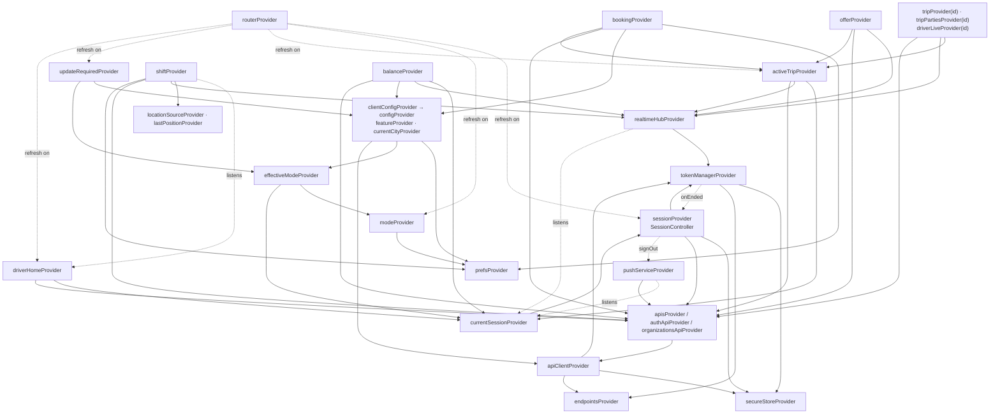
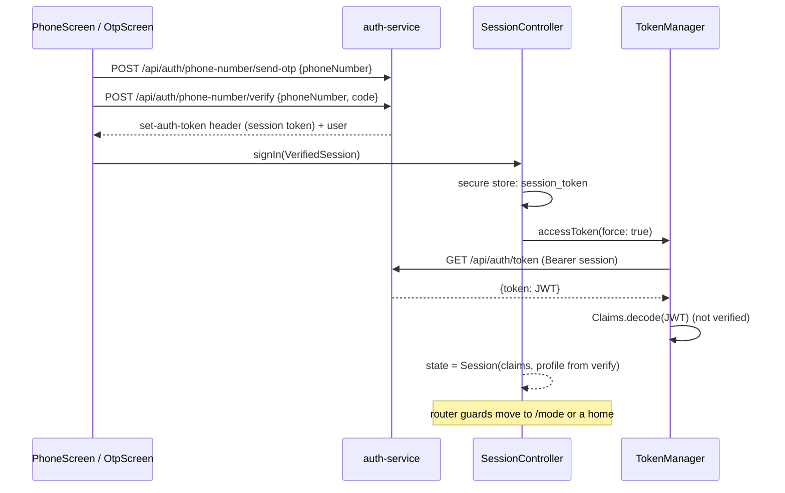

# Architecture

How the phone app is put together. Every statement points at the file it comes from; paths are relative to `apps/phone-app/` unless they start with `packages/`.

## Folder structure

```
apps/phone-app/
  lib/
    main.dart                     boot (below)
    app.dart                      AnbessaApp: MaterialApp.router, theme, locale, push/notification taps, resume hook
    core/
      config/env.dart             every --dart-define (configuration.md)
      prefs_keys.dart             every SharedPreferences key (settings-and-storage.md)
      state.dart                  ValueState / valueProvider: a plain value Notifier (Riverpod 3 has no StateProvider outside legacy)
      network/providers.dart      prefs, secure store, endpoints, TokenManager, ApiClient, the API classes
      session/                    secure_store.dart, token_manager.dart, session_controller.dart (session + mode)
      realtime/realtime_hub.dart  the Socket.io connection
      location/location_source.dart   GeolocatorSource, FakeLocationSource, lastPositionProvider
      push/                       push_service.dart (FCM), local_notifications.dart
      router/                     routes.dart (paths), app_router.dart (table + guards), transitions.dart
      l10n/                       app_en.arb, app_am.arb, l10n.dart (helpers); generated/ is not committed
      ux/haptics.dart             the haptics policy
    features/
      auth/                       welcome, phone, OTP, dev sign-in, mode switcher
      bootstrap/gates.dart        splash, update required, banners, dismissed announcements
      config/                     client config, feature flags, city, app version, update gate
      intro/                      the first-launch carousel
      shell/shells.dart           rider and driver bottom-navigation shells
      maps/                       AnbessaMap, markers, routes, tiles, MarkerAnimator, nearby cars, compass; scene/ (MapScene native layers, CameraDirector, MapBinding, RouteTrack); nav/ (NavigationController, turn banner, external navigation)
      rider/                      shell (the one-map ShellRoute and its map intents), home, booking (search, pin picker, choose ride, the account's place picker), trip, payments, rating, history, places
      driver/                     onboarding, shift (home), offers, trip, earnings, vehicles
      profile/                    account hub, profile, settings screens and their controllers
      support/                    SOS, help (tickets), lost items: repositories over SupportApi, screens
      flagged/flagged_modules.dart  account deletion (and the kTips/kMaskedCalls/kChat switches)
  test/                           testing.md
  env/                            dev-host, dev-emulator, dev-kong, stack, staging (.json)
  android/ ios/ linux/            platforms-and-release.md
  assets/fonts/                   Noto Sans Ethiopic (+ its OFL licence); Urbanist comes from ride_app_core
```

## Boot

`lib/main.dart`:

1. `Perf.start()` and the `main start` mark (see [Performance notes](#performance-notes)).
2. `WidgetsFlutterBinding.ensureInitialized()`.
3. `SharedPreferences.getInstance()`, injected as `prefsProvider` so every later read is synchronous. This is the only thing awaited before the first frame.
4. A `ProviderContainer` is created with that override.
5. `installHaptics(container)` replaces `Haptics.sink` (see [Haptics](#haptics)).
6. `AvatarImage.networkBuilder` is set once to a `CachedNetworkImage` (https profile photos from the disk cache; the initials on failure). Core stays free of that dependency.
7. The container starts listening to `sessionProvider`, so the stored session is checked (token mint and profile in parallel, see [Cold start](#cold-start-sessioncontrollerbuild)) while the first frame is drawn; its first settled value logs `session ready`.
8. `runApp(UncontrolledProviderScope(container, AnbessaApp()))`.
9. After the first frame (`first frame` mark): `localNotificationsProvider.init()` (Android/iOS only, a no-op elsewhere), then `pushServiceProvider.init()` (only when all four `FIREBASE_*` defines are set, on Android/iOS). Neither holds the splash any more. Because push may now be ready after the session, `PushService.init` registers the device itself when someone is already signed in (the `currentSessionProvider` listener only fires on changes). `AnbessaApp` subscribes to push taps in `initState`, before push is ready, so no tap is missed; the launch payload of a local notification is read the same way as before.

Everything else is built lazily by Riverpod the first time something reads it.

`lib/app.dart` (`AnbessaApp`):

- builds `MaterialApp.router` with `anbessaTheme()` / `anbessaTheme(brightness: dark)`, `themeModeProvider`, `localeProvider`, the two supported locales and `routerProvider`;
- on `AppLifecycleState.resumed`, calls `clientConfigProvider.notifier.refresh()` and `activeTripProvider.notifier.refresh()` (events may have been missed while paused);
- routes push taps and local-notification taps (see [Push notifications](#push-notifications));
- outside release builds, logs the `home shown` mark the first time the router's location is `/rider/home` or `/driver/home` (after that frame).

The first screen is `/splash`; the router's guards move on from there once the session has been read.

## Provider graph

The load-bearing providers and what each one reads. Arrows point from a provider to what it depends on.



| Provider | File | Type | What it holds |
|---|---|---|---|
| `prefsProvider` | `core/network/providers.dart` | `Provider<SharedPreferences>` | overridden at boot; throws if not |
| `secureStoreProvider` | same | `Provider<SecureStore>` | `PlatformSecureStore` |
| `endpointsProvider` | same | `Provider<ApiEndpoints>` | `Env.endpoints` (host or gateway) |
| `tokenManagerProvider` | same | `Provider<TokenManager>` | the JWT cache; has its own `ApiClient` with no token source |
| `apiClientProvider` | same | `Provider<ApiClient>` | the shared client, tokens from `TokenManager` |
| `apisProvider`, `authApiProvider`, `identityApiProvider`, `organizationsApiProvider` | same | `Provider` | the typed APIs (`identityApiProvider` has no reader) |
| `sessionProvider` | `core/session/session_controller.dart` | `AsyncNotifierProvider<SessionController, Session?>` | who is signed in |
| `currentSessionProvider` | same | `Provider<Session?>` | the session, or null (also while loading) |
| `modeProvider` | same | `NotifierProvider<ModeController, AppMode?>` | the chosen mode, persisted |
| `effectiveModeProvider` | same | `Provider<AppMode?>` | the mode in force |
| `clientConfigProvider` / `configProvider` | `features/config/client_config_provider.dart` | `AsyncNotifierProvider` / `Provider<ClientConfig>` | platform config; `configProvider` is never null (live, cached or fallback) |
| `featureProvider(Feature)` | same | `Provider.family<bool, Feature>` | one flag |
| `currentCityProvider` | same | `Provider<City>` | the **first** city in the config (the comment says "a later version picks by location") |
| `appVersionProvider`, `updateRequiredProvider` | same | `FutureProvider`, `Provider<bool>` | the forced-update gate |
| `realtimeHubProvider` | `core/realtime/realtime_hub.dart` | `Provider<RealtimeHub>` | the socket; connects and disconnects with the session |
| `realtimeStateProvider`, `realtimeEventsProvider` | same | `StreamProvider` | connection state; events (`realtimeEventsProvider` has no reader; features listen to `hub.events`) |
| `activeTripProvider` | `features/rider/trip/active_trip_controller.dart` | `AsyncNotifierProvider<ActiveTripController, Trip?>` | the trip in progress, for either side |
| `tripProvider(id)`, `tripPartiesProvider(id)`, `driverLiveProvider(id)` | same | families | one trip, the other side's name and car, the driver's live position |
| `driverHomeProvider` | `features/driver/shift/shift_controller.dart` | `AsyncNotifierProvider` | `GET /api/fleet/drivers/me` |
| `shiftProvider` | same | `NotifierProvider<ShiftController, ShiftState>` | online / offline, the car, ping counters |
| `offerProvider` | `features/driver/offers/offer_controller.dart` | `NotifierProvider` | the current offer |
| `balanceProvider` | `features/driver/earnings/earnings_controller.dart` | `AsyncNotifierProvider<…, Balance?>` | the driver's balance (null for non-drivers) |
| `bookingProvider` | `features/rider/booking/booking_controller.dart` | `NotifierProvider<BookingController, Booking>` | the booking in progress |
| `routerProvider` | `core/router/app_router.dart` | `Provider<GoRouter>` | the router |
| `safetyRepositoryProvider`, `supportRepositoryProvider` | `features/support/support_repository.dart` | `Provider` | `ApiSafetyRepository` / `ApiSupportRepository` over `apisProvider.support`; tests override them |
| `myTicketsProvider`, `myLostItemsProvider` | same | `FutureProvider` (no automatic retry) | the first 50 tickets / lost-item reports |
| `ticketThreadProvider(id)`, `lostItemThreadProvider(id)` | same | `AsyncNotifierProvider.family` | one thread, with reply, reopen, confirm-returned and found / not-found actions |
| `sosAlertsProvider` | `features/support/sos_screen.dart` | `valueProvider<Map<String, SosAlert>>` | the alert sent per trip during this app run |

Because `RouterNotifier` listens to `driverHomeProvider`, that provider is built for **every** signed-in person, so `GET /api/fleet/drivers/me` is called for riders too (`core/router/app_router.dart`, `RouterNotifier`).

## Session and tokens

Files: `core/session/secure_store.dart`, `core/session/token_manager.dart`, `core/session/session_controller.dart`.

There are two credentials:

| Credential | Lifetime | Where it lives | Used for |
|---|---|---|---|
| Session token (Better Auth bearer session) | until revoked or expired on the server | secure storage, key `session_token` | `GET /api/auth/token` and the other Better Auth routes (`sessionBearer: true`) |
| Access JWT | 15 minutes (per the `token_manager.dart` comment) | memory only, in `TokenManager` | every other API call and the socket handshake |

### Sign-in



On the OTP screen with `?driver=1`, `modeProvider` is set to driver right after sign-in (`features/auth/auth_screens.dart`).

### Cold start (`SessionController.build`)

1. No `session_token` in secure storage → `null` (signed out).
2. Otherwise `_load()`: `TokenManager.accessToken(force: true)` and `GET /api/auth/get-session` **at the same time** (get-session authorises with the session bearer, not the JWT, so it doesn't need the mint; one round trip at start instead of two). If the profile call fails with a non-auth error an empty profile is used; an auth error from either fails the load. The profile future is `ignore()`d until awaited so an early failure isn't reported as unhandled.
3. An `AppError` that `isAuth` (401 or `session_ended`) or `isForbidden` (403) clears the token and the cache → `null`.
4. Any other `AppError` (network down): if `TokenManager.claims` is set, a session with an empty profile is returned; otherwise the error is rethrown.

At a cold start `TokenManager` has no claims yet (they only exist after a successful mint), so a network failure in step 2 leaves `sessionProvider` in an error state with no value. The router then keeps the person on the splash screen (`sessionAsync.hasError && !sessionAsync.hasValue` in `lib/core/router/app_router.dart`), not on Welcome. `SplashScreen` (`lib/features/bootstrap/gates.dart`) shows the offline text (`offlineBanner`) and a "Try again" button that invalidates `sessionProvider`. The stored token is kept. Test: "offline at start with a stored session: the splash (with retry), never welcome" in `test/router_redirect_test.dart`.

### TokenManager

- `accessToken({force})` returns the cached JWT while `claims.isFresh(now)` (more than 60 s left); otherwise it refreshes. With no session token it returns `null` without a request.
- One refresh at a time: concurrent callers share the same future (`_inFlight`).
- A refresh answered with 401, 403 or `session_ended` clears the cache and calls `onEnded`, which is `SessionController.sessionEnded`. Other errors (network) are rethrown and do not sign out.
- `refreshClaims()` forces a new JWT and returns its claims. Used after accepting an organisation invitation and when pulling to refresh the onboarding hub (a role may have changed).
- `ApiClient` asks for `accessToken(force: true)` once when a service answers 401 with a token error, and replays the request ([packages/core/docs/api-client.md](../../../packages/core/docs/api-client.md)).

### Ending a session

| Trigger | Code path | Reason shown on Welcome |
|---|---|---|
| The person signs out (Account → Sign out, confirmed) | `SessionController.signOut()`: `PushService.unregister()` (5 s timeout), `POST /api/auth/sign-out` (5 s timeout, errors ignored), clear the token and JWT | none (`SignOutReason.user`) |
| A token refresh is refused | `TokenManager` → `sessionEnded(cause)` | `suspended` when the code is `token_revoked` or the status is 403, else `sessionEnded` |
| The replay after a refresh gets 401, or the refresh fails with an auth / forbidden `AppError` | `ApiClient` → `onSessionEnded` → `sessionEnded` | same rule |
| The socket refuses the token three times | `RealtimeHub` → `sessionEnded(401 session_ended)` | `sessionEnded` |

`sessionEnded` is ignored when the person already signed out. `SessionController.endings` is a broadcast stream of reasons; nothing in `lib/` listens to it. `WelcomeScreen` shows a notice from `lastSignOut`.

### Session object

`Session(claims, profile)`: `userId`, `canDrive` (`claims.isDriver`: role `DRIVER` or `FLEET_DRIVER`), `displayName` (the profile name, or the formatted phone when the name is a phone-number placeholder).

## Modes

`AppMode { rider, driver }` (`core/session/session_controller.dart`).

| Provider | Rule |
|---|---|
| `modeProvider` | the choice, persisted under the prefs key `mode`; null until chosen |
| `effectiveModeProvider` | null when signed out; the chosen mode if any; otherwise `rider` for people who cannot drive and **null** for people who can (they must choose) |

How the mode changes:

- `/mode` (`ModeSwitcherScreen`): two cards, "Ride" and "Drive"; tapping one sets `modeProvider`.
- Account → "Switch to driver" (when `canDrive`), "Become a driver" (rider without a driver role, sets driver mode; the router then sends them to onboarding), "Switch to rider" (in driver mode).
- Sign-in from "Drive with Anbessa" (`/sign-in?driver=1`) sets driver mode.

What follows a change: the router redirects to the new mode's home; `clientConfigProvider` rebuilds because it watches `effectiveModeProvider` and refetches with `audience=<mode>`; `updateRequiredProvider` uses the new mode's minimum version. The mode is not cleared on sign-out (`ModeController.clear()` has no caller).

## Routing

Files: `core/router/routes.dart` (paths), `core/router/app_router.dart` (table and guards), `core/router/transitions.dart`.

`GoRouter(initialLocation: '/splash', refreshListenable: RouterNotifier, redirect: _redirect)`. `RouterNotifier` re-runs the redirect when `sessionProvider`, `modeProvider`, `activeTripProvider`, `updateRequiredProvider`, `driverHomeProvider` or `introSeenProvider` change.

### Transitions

| Name | Used by | Behaviour |
|---|---|---|
| default (`builder:`) | every route not listed below | the theme's page transition: `FadeForwardsPageTransitionsBuilder` (Android, Linux, desktop), Cupertino (iOS) |
| `fadeThroughPage` | `/intro` | fade in from 30 % of the animation plus a 0.98 → 1 scale, 320 ms in, 200 ms out |
| `slideUpPage` | `/rider/book/route`, `/rider/book/quote` | slide up 6 % with a fade, 380 ms in, 320 ms out |
| `instantPage` | nothing | no transition |

The comment in `transitions.dart` says the slide-up is also for pay and rating; in the route table those two use the default builder.

### Route table

| Path | Screen (file) | Transition | Notes |
|---|---|---|---|
| `/splash` | `SplashScreen` (`features/bootstrap/gates.dart`) | default | initial location |
| `/intro` | `IntroScreen` (`features/intro/intro_screen.dart`) | fade-through | |
| `/update-required` | `UpdateRequiredScreen` (`gates.dart`) | default | |
| `/welcome` | `WelcomeScreen` (`features/auth/auth_screens.dart`) | default | |
| `/sign-in` | `PhoneScreen(driver: ?driver=1)` | default | |
| `/sign-in/verify` | `OtpScreen(phone: ?phone, driver: ?driver=1)` | default | |
| `/mode` | `ModeSwitcherScreen` | default | |
| `/trip/:id` | redirect | | → `/driver/trip/:id` in driver mode, else `/rider/trip/:id` (deep links) |
| `/pay/:id` | redirect | | → `/rider/trip/:id/pay` |
| `/top-up/:id` | redirect | | → `/driver/earnings` (the id is ignored) |
| **Rider shell** (`RiderShell`, `StatefulShellRoute.indexedStack`; the tab bar hides on `/rider/book…` and `/rider/trip…`) | | | |
| **Rider map shell** (`riderMapShellRoute`, a `ShellRoute` in branch 0; `RiderMapShell` draws one map and one sheet, the stage pages are empty `NoTransitionPage`s) | | | |
| `/rider/home` | home stage (`HomeSheet`) | none (the shell animates) | branch 0 (Home) |
| `/rider/home/book/pickup` | redirect | | → `/rider/book/pickup` |
| `/rider/book/route` | search stage (`SearchPage` over the shell, `PinCard`) | none | query: `focus=pickup|dropoff` (default dropoff); `mode=savedPlace&label=…` redirects to `/account/places/pick?label=…` |
| `/rider/book/quote` | choose-ride stage (`QuoteRouteCard` over the map, `QuoteSheet`, `QuoteFooter`) | none | |
| `/rider/trip/:id` | trip stage (`TripSheet`, `TripTopBar`) | none | |
| `/rider/trip/:id/pay` | `PayScreen` | slide-up | on the root navigator, over the shell |
| `/rider/trip/:id/rate` | `RatingScreen(asDriver: false, doneRoute: /rider/home)` | slide-up | on the root navigator, over the shell |
| `/rider/activity` | `HistoryScreen(as: 'rider')` | default | branch 1 (Activity) |
| `/rider/activity/:id` | `ReceiptScreen(asDriver: false)` | default | |
| `/rider/account` | `AccountScreen(mode: rider)` | default | branch 2 (Account) |
| **Rider, outside the shell** | | | |
| `/rider/book/pickup` | redirect | | → `/rider/book/route?focus=pickup` |
| `/rider/book/dropoff` | redirect | | → `/rider/book/route?focus=dropoff` |
| `/account/places/pick` | `RouteEditorScreen(mode: savedPlace, savedLabel: ?label)` | slide-up | the account's place picker (returns the place) |
| **Driver shell** (`DriverShell`) | | | |
| `/driver/home` | `DriverHomeScreen` | default | branch 0 (Home) |
| `/driver/earnings` | `EarningsScreen` | default | branch 1 (Earnings) |
| `/driver/earnings/top-up` | `TopUpScreen` | default | |
| `/driver/earnings/payout-method` | `PayoutMethodScreen` | default | |
| `/driver/earnings/statement` | `StatementScreen` | default | |
| `/driver/earnings/top-ups` | `TopUpsScreen` | default | |
| `/driver/activity` | `HistoryScreen(as: 'driver')` | default | branch 2 (Activity) |
| `/driver/activity/:id` | `ReceiptScreen(asDriver: true)` | default | |
| `/driver/account` | `AccountScreen(mode: driver)` | default | branch 3 (Account) |
| **Driver, outside the shell** | | | |
| `/driver/onboarding` | `OnboardingHubScreen` | default | |
| `/driver/onboarding/apply` | `ApplyScreen` | default | |
| `/driver/onboarding/documents/:subjectType/:subjectId` | `DocumentsScreen` | default | `subjectType` is `DRIVER` or `VEHICLE` |
| `/driver/onboarding/vehicle/new` | `VehicleFormScreen` | default | |
| `/driver/onboarding/vehicle/:id` | `VehicleScreen` | default | |
| `/driver/trip/:id` | `DriverTripScreen` | default | |
| `/driver/trip/:id/rate` | `RatingScreen(asDriver: true, doneRoute: /driver/home)` | default | |
| **Shared** | | | |
| `/account/profile` | `ProfileScreen` | default | |
| `/account/language` | `LanguageScreen` | default | |
| `/account/sessions` | `SessionsScreen` | default | |
| `/account/payments` | `PaymentPreferencesScreen` | default | |
| `/account/places` | `SavedPlacesScreen` | default | |
| `/account/appearance` | `AppearanceScreen` | default | |
| `/account/notifications` | `NotificationsScreen` | default | |
| `/account/safety` | `SafetyScreen` | default | |
| `/account/organizations` | `OrganizationsScreen` | default | |
| `/account/navigation` | `NavigationPrefsScreen` | default | |
| `/driver/vehicles` | `VehiclesScreen` | default | registered with the shared routes |
| `/account/delete` | `DeleteAccountScreen` | default | |
| `/scheduled` | `ScheduledRidesScreen` (`rider/scheduled/`) | default | |
| `/sos` | `SosScreen(tripId: ?trip)` (`features/support/sos_screen.dart`) | default | |
| `/support` | `SupportScreen` (`features/support/support_screens.dart`) | default | "Help" |
| `/support/new` | `NewTicketScreen(tripId: ?trip)` | default | |
| `/support/tickets/:id` | `TicketScreen` | default | |
| `/support/lost-items` | `DriverLostItemsScreen` (`features/support/lost_item_screens.dart`) | default | |
| `/support/lost-items/report` | `ReportLostItemScreen(tripId: ?trip)` | default | registered before `:id` |
| `/support/lost-items/:id` | `LostItemScreen` | default | |

Every route is registered whatever the feature flags say; the flags only hide the entry points.

### Redirect guards, in order (`_redirect`)

1. **Bootstrap.** While `sessionProvider` is loading and has no value: go to `/splash` (stay if already there). Same when it ended in an error with no value (offline at cold start): stay on `/splash`, which offers "Try again".
2. **Forced update.** If `updateRequiredProvider` is true: go to `/update-required`. If it is false and the path is `/update-required`: go to `/splash`.
3. **Signed out** (session value is null). If the intro was never seen: `/intro`. Otherwise `/welcome`, except that `/welcome`, `/sign-in` and `/sign-in/verify` are allowed. A signed-in person on `/intro` goes to `/splash`.
4. **Mode.** If `effectiveModeProvider` is null: `/mode`. From `/splash`, `/mode` or a sign-in path: the mode's home (`/rider/home` or `/driver/home`).
   - Paths starting with `/account`, `/sos`, `/support`, `/scheduled` are allowed in either mode and **skip the remaining guards** (so the active-trip guard does not apply to them).
   - Paths starting with `/rider/book` are allowed in driver mode and skip the remaining guards (older saved-place links, `/rider/book/route?mode=savedPlace`, which the route sends to `/account/places/pick`).
   - A rider on a `/driver…` path goes to `/rider/home`; a driver on a `/rider…` path goes to `/driver/home`.
5. **Driver not approved.** In driver mode, once `driverHomeProvider` has a value (it is only read here, and `RouterNotifier` only listens to it, in driver mode: it follows `effectiveModeProvider` and opens the `driverHomeProvider` subscription when the mode becomes driver, closing it when it leaves, so a rider's start never calls `GET /api/fleet/drivers/me`): approved = `session.canDrive && (driver?.isActive ?? true)`. If not approved, every path goes to `/driver/onboarding` except paths under `/driver/onboarding`, `/driver/account`, `/driver/vehicles` and paths under `/driver/earnings`.
6. **Active trip.** If `activeTripProvider` holds a trip with `isActive`, any path that does not start with `/rider/trip/<id>` (rider) or `/driver/trip/<id>` (driver) goes there.

`redirectFor(ref, uri)` runs the same function without a GoRouter, for `test/router_redirect_test.dart`.

### Deep links

The comment in `routes.dart` says `anbessa://` and `https://app.anbessa.et` links use the same paths. Android and iOS register the `anbessa` scheme and Android an `https://app.anbessa.et` app link with Flutter deep linking enabled ([platforms-and-release.md](platforms-and-release.md)). go_router matches on the URI path. For `https://app.anbessa.et/trip/<id>` the path is `/trip/<id>`. For a custom-scheme URI such as `anbessa://trip/<id>`, `trip` is the URI host, not part of the path; how that resolves was not verified in this review.

### Shells

`features/shell/shells.dart`. Both shells are `Scaffold`s with a `NavigationBar` and the `Banners` overlay stacked over the page (see [screens.md](screens.md)). Tapping the current tab again resets that branch to its first location. The banner stack reports its height into `bannerHeightProvider`, which map screens add to their top inset.

| Shell | Tabs | Badges |
|---|---|---|
| `RiderShell` | Home, Activity, Account (hidden on `/rider/book…` and `/rider/trip…`: `riderTabsHiddenAt`) | a dot on Activity when `paymentDueProvider` is true |
| `DriverShell` | Home, Earnings, Activity, Account | a dot on Earnings when the balance state is not `ok`; a dot on Activity when `paymentDueProvider` is true (drivers ride too) |

### The rider map shell

`features/rider/shell/` (screens: [screens.md](screens.md#the-rider-map-shell-ridershellrider_map_shelldart-ridershellmap_intentdart)).

- `riderMapShellRoute(rootNavigatorKey)` is a `ShellRoute` in the rider's Home branch with the stage routes `/rider/home`, `/rider/book/route`, `/rider/book/quote`, `/rider/trip/:id` (empty `NoTransitionPage`s; the shell's child navigator is kept in the tree, invisible and ignoring pointers, for back navigation) and, on the root navigator, `pay` and `rate` under the trip. `routerProvider` gives the `GoRouter` the `rootNavigatorKey`.
- `RiderMapShell` derives the stage from `GoRouterState.uri` (`RiderMapStage.fromUri`): no provider is written while building. It owns the frame-rate state: `CarsAnimator` (paused unless the home stage is on screen and the app in the foreground; nearby polling paused with it), a `MarkerAnimator` per trip (`carFor(tripId)`), the `AppSheetController`, the sheet height `ValueNotifier` (a height reported while the sheet rebuilds with new snap points is applied after the frame), the confetti. `RiderMapScope` (an `InheritedWidget`) hands them to the stage widgets.
- `MapIntent` (`map_intent.dart`): what the map shows, as data with `==` (so a rebuild with the same state is the same intent): `fit` + `fitKey`, pins, routes, `revealKey` (a new value draws the first route progressively), `nearby`, `car` + `carMinutes` + `carRoad`, `follow`, `callouts` (`IntentCallout.minutes` / `.arriveAt`, worded by the shell), `radarAt`, `pin` (no insets: the camera centre is the place), `controls`. One provider per stage derives it: `homeMapIntentProvider`, `searchMapIntentProvider` (pins, or pin mode from `pinPickerProvider`), `quoteMapIntentProvider` (the estimate's road or, while re-quoting, `lastQuoteRouteProvider`'s dimmed; "N min" and "Arrive HH:MM"), `tripMapIntentProvider(id)` (from `tripViewProvider(id)`: the stage, the last car sample and the ETA; the road split at the car's projection while riding).
- `_RiderMapView` watches the current stage's intent and builds the one `AnbessaMap`; the reveal is an `AnimationController` (600 ms, emphasized curve) around it, drawing `routePrefix(points, t)`.
- `RiderSheet` maps the stage to header, body and footer widgets; `sheetStopsFor` gives the snap points; after a stage change the shell animates the sheet to the stage's resting snap (the first time in 1 ms, so the sheet counts as moved and later snap changes animate instead of jumping).
- Helpers with tests: `arriveAt`, `clockHHmm`, `minutesCeil`, `routePrefix`, `sameRoutes` (`test/map_intent_test.dart`); `placeIcon` and `formatDistance` live in core (`packages/core/test/places_test.dart`).

`paymentDueProvider` (`features/rider/payments/payment_due_controller.dart`): true when the person's latest rider trip completed less than 24 h ago, was paid by mobile money or card, and its fare payment is open or failed. It re-runs whenever `activeTripProvider` changes and swallows every error.

## Client configuration and feature flags

`features/config/client_config_provider.dart`, model in `packages/core/lib/src/models/client_config.dart`.

- Fetched with `GET /api/platform/client-config?audience=<mode or rider>` (no bearer) when the provider builds, every 60 s (a periodic stream started in `build`), and on app resume.
- The raw JSON of each successful fetch is stored in prefs (`client_config`). If the fetch fails, the last cached copy is used, else `ClientConfig.fallback`.
- `refresh()` replaces the state when `version` changed, when the announcement list changed (compared by id, title and body, in order: announcements don't bump the settings version), or when there was none. So a new announcement shows on the next refresh, without a restart. Errors are ignored.
- `featureProvider(flag)` reads `configProvider.features[flag]`.

| Flag | Default when missing from the response | Read by |
|---|---|---|
| `phoneBooking` | on | nothing in `lib/` |
| `corporateBooking` | on | Choose ride (`QuoteSheet`): offers "Company account" when on **and** the JWT has an org id |
| `tripPin` | off | `TripSheet` (shows the PIN), `DriverTripScreen` (asks for it before start) |
| `scheduledRides` | off | rider home chip, account tile, "Pickup time" on the quote, "Upcoming" in Activity, `scheduledRidesProvider` (no request while off) |
| `sos` | off | SOS button on both trip screens (while `sosAvailable`: an active trip with a driver, or ≤ 30 min after drop-off) |
| `support` | off | Account → Help, driver Account → Lost items, the receipt's "Help with this trip" |
| `promos` | off | promo-code row on the quote |
| `accountDeletion` | off | account tile |

With the fallback config (no response ever received) every flag is off, including the two that default to on. Compile-time switches in `features/flagged/flagged_modules.dart`: `kTipsEnabled` (rating screen tip row shows "Coming soon" while false), `kMaskedCallsEnabled` (the call button on the driver trip card is hidden while false), `kChatEnabled` (not read anywhere). All three are `false`.

The flagged module left in `flagged_modules.dart` (account deletion) has a repository interface whose default implementation throws `AppError(501, not_available)`; a real implementation would override `accountRepositoryProvider`. Scheduled rides (`features/rider/scheduled/`) and promo codes (the quote screen and `BookingController`) call trip-service and pricing-service directly through `apisProvider`. SOS and support have their backend (support-service): `safetyRepositoryProvider` and `supportRepositoryProvider` in `features/support/support_repository.dart` default to the real `SupportApi` implementations; the flags only hide the entry points.

### Forced update

`updateRequiredProvider` is true only on Android and iOS, when `minAppVersions[<mode>][<platform>]` is set and the running version (`package_info_plus`) is lower (`isBelowMinimum`). The update screen links to `https://play.google.com/store/apps/details?id=com.anbessa.phone_app` or `https://apps.apple.com/app/anbessa`.

## Realtime hub

`core/realtime/realtime_hub.dart`. Event names and payloads are in [packages/core/docs/realtime.md](../../../packages/core/docs/realtime.md).

- One `RealtimeHub` for the app, over a `SocketLink` (`SocketIoLink` in production, `FakeSocketLink` in tests).
- Socket options: transport `websocket` only, auto-connect off, `forceNew` (so the next person to sign in never reuses the previous person's socket), `auth: {token}`, reconnection delay 1 s growing to at most 16 s.
- States: `offline`, `connecting`, `connected`, `reconnecting`.

| Moment | What the hub does |
|---|---|
| `currentSessionProvider` changes to a new user id | `connect()`: get a JWT (cached if fresh), wire the handlers once, connect |
| `currentSessionProvider` becomes null | `disconnect()`: forget the rooms, state `offline` |
| connected | reset the refusal counter, state `connected`, re-send `trip:subscribe` for every remembered room |
| disconnected | `reconnecting` if a connection is wanted, else `offline` |
| reconnect attempt | state `reconnecting`, put the current JWT in `auth` (the gateway checks it only at the handshake) |
| connect error containing `unauthorized` (the gateway sends `unauthorized: <code>` for a refused token) | count it; on the third in a row, end the session; otherwise put a **forced** new JWT in `auth` |
| any other connect error, e.g. `unavailable` (the gateway couldn't check the token: Redis down) | not counted; Socket.io keeps reconnecting with its backoff |
| an event in `realtimeEventNames` | parse with `RealtimeEvent.fromSocket` and add to `events` (broadcast) |

`subscribeTrip(id)` remembers the room even when offline and returns the ack's `ok` (false after 5 s). `sendLocation(ping)` emits `location:update` and returns the `PingAck` (3 s timeout; `offline` when not connected). `inject(event)` is for tests.

Who reacts to the connection state:

- `ActiveTripController` refetches the active trip on every `connected` (events may have been missed).
- `driverLiveProvider(tripId)` joins the trip room, listens to `driver:location`, and every 5 s, while the socket is down or the join was refused, polls `GET /api/locations/trips/:id/driver` and retries the join. It also fetches one position over HTTP at start. On dispose it leaves the room.
- `Banners` shows "Reconnecting…" while signed in and `reconnecting`; the driver home shows a chip when online and not connected.

### Active trip

`ActiveTripController`:

- builds from `GET /api/trips/active` when signed in; a network error keeps the previous value;
- applies every `trip:status` event's `trip`, except an event for a different trip while the current one is still active;
- `refresh()` on reconnect and resume: if there is an active trip it replaces the state; if there is none but the app still holds an active one, it fetches that trip by id to show its final state;
- `set()` / `replace()` after the app creates or acts on a trip; `clearIfEnded()` when the person leaves an ended trip (done, rated, receipt closed).

An ended trip stays in the provider until `clearIfEnded()`, so the trip screen can show "completed" or "cancelled". The router only forces the trip screen while `isActive`.

## Location

`core/location/location_source.dart`.

`locationSourceProvider` gives `FakeLocationSource` when `Env.fakeLocationOn` (`FAKE_LOCATION=on`, or always on Linux desktop), else `GeolocatorSource`.

### GeolocatorSource

| Profile | Android | iOS | Other |
|---|---|---|---|
| `once` | high accuracy, distance filter 0 | same | same |
| `rider` | best, distance filter 10 m | same | same |
| `driverOnline` | high accuracy, distance filter 0, interval 4 s, a "location" foreground service with the notification "Anbessa is online" / "Sharing your location with riders while you drive", wake lock, launcher icon | best, distance filter 0, `automotiveNavigation`, background location updates allowed, background indicator shown | best, distance filter 0 |

- `ensurePermission`: `serviceOff` if location services are off; asks once if denied; `always` or `whileInUse` count as granted. The code never asks for "always" specifically.
- `current()`: one fix with a 12 s timeout, falling back to the last known position.
- Headings below 0 or NaN become null.

Who uses it:

| Caller | Profile | When |
|---|---|---|
| `riderLocationProvider` (`rider/shell/map_intent.dart`) | permission with `once`, then a `rider` stream (10 m filter) | while the rider map shell is on screen (auto-dispose); every fix sets `lastPositionProvider`, so the blue dot moves |
| Search "Use my location", the place picker | `once` | on tap |
| `ShiftController` | `driverOnline` | permission check before going online; a position stream while online |

`lastPositionProvider` holds the last position the app saw. It is set by the rider's position stream, "Use my location" and every driver position while online.

### Driver pings (`ShiftController`)

While a driving session is open, each position updates `lastPositionProvider` and is sent with `location:update` at most every **4 s when moving** (speed > 1 m/s) and every **10 s when still**. A 10 s timer re-sends the last position when the stream goes quiet. Acks are counted: accepted resets the rejection counter; rejections other than `offline`, `too_frequent` and `timeout` add one. `gpsPoor` = at least 5 rejections and more rejections than accepted pings.

### FakeLocationSource

Starts at Meskel Square (9.0107, 38.7613), accuracy 5 m, permission always granted. `set(lat, lng)` jumps (heading = bearing of the jump); `driveTo(lat, lng, speedKmh = 40)` moves one step a second until it arrives. The driver screens show a "Dev tools" chip that opens `DevLocationPanel`: jump to Bole, Meskel or Piassa, or "Drive to target", which drives to `devDriveTargetProvider` (set by the driver trip screen to the pickup, then the drop-off).

## Maps

`features/maps/`.

### Two engines, one widget

`AnbessaMap` (`anbessa_map.dart`) is what screens use. It picks an engine with `vectorMapsProvider`:

| Engine | File | Where | Draws |
|---|---|---|---|
| Vector: MapLibre (`maplibre` 0.3.6; 0.3.7 needs Flutter 3.47) | `vector_map.dart` | Android, iOS | vector tiles; flat, 3D (tilted, buildings extruded) and satellite; cars, pins, the person and routes as native layers (`MapScene`) |
| Raster: flutter_map + `flutter_map_animations` | `raster_map.dart` | Linux desktop, tests (MapLibre has no desktop or test implementation) | raster tiles; flat and satellite (3D shows flat); everything as Flutter widgets / flutter_map layers |

Both engines hand every camera decision to one `CameraDirector` through a `MapBinding` (`scene/`), so they behave the same. Files:

| File | Role |
|---|---|
| `scene/map_scene.dart` | `MapScene`: owns the native GeoJSON sources, layers and images on the vector engine |
| `scene/scene_style.dart` | the layer definitions (`sceneLayers(SceneLook)`), route colours |
| `scene/scene_geojson.dart` | pure builders of each source's FeatureCollection, ids (`SceneIds`), `NearbyCarFrame` |
| `scene/scene_images.dart` | the images, painted on a canvas: the white top-down car (grey when stale) and its contact shadow, the nearby car, the avatar and destination pins, the person's dot and heading cone, label chips |
| `scene/camera_director.dart` | `CameraDirector` and `CameraPort` (what an engine gives it); pure helpers `navZoomForSpeed`, `fitZoomFor`, `lowerThirdPadding`, `followMoveDuration` |
| `scene/map_binding.dart` | turns `AnbessaMap` parameters into director calls (when is an intent new) |
| `scene/route_track.dart` | `RouteTrack`: a route with cumulative metres, point and bearing at a distance, projection onto a window of it |
| `marker_animator.dart`, `nearby_cars_layer.dart` | the animators that feed the map |

### The map scene (vector engine)

When a style has loaded, `MapScene.attach(style, look)` registers the images once (`addImageFromCanvas`, painted at the screen's pixel ratio and scaled down with `icon-size`, because the plugin's `addImage` scales bitmaps by the device pixel ratio), adds fixed GeoJSON sources (`anb-routes`, `anb-pins`, `anb-nearby`, `anb-driver`, `anb-me`) and the layers that draw them, bottom to top:

| Layer | Source | Drawing |
|---|---|---|
| `anbessa-buildings-3d` | `openmaptiles` | 3D only: extruded buildings (theme-coloured), under the routes |
| `anb-route-secondary` | routes, `kind = secondary` | dashed line (the leg that isn't the current one) |
| `anb-route-traversed` | `kind = traversed` | grey line (the part already driven) |
| `anb-route-casing`, `anb-route-fill` | `kind = primary` | amber line on an ink casing |
| `anb-route-straight` | `kind = straight` | dotted line (no road geometry) |
| `anb-nearby-shadow`, `anb-nearby-cars`, `anb-nearby-label` | nearby | each car's soft contact shadow, then the car, turned by `bearing`, `icon-opacity` from the feature's `opacity`; the label image over the `lead` car |
| `anb-pin` | pins | pickup ring / drop-off square, anchored at the bottom (the tip) |
| `anb-me-cone`, `anb-me-dot` | me | heading cone (when there is a heading) and the blue dot |
| `anb-driver-shadow`, `anb-driver-car`, `anb-driver-label` | driver | the followed car's shadow, the car turned by `bearing`; the "4 min" label above it |

Line layers use `line-cap`/`line-join: round` and zoom-interpolated widths. Labels over cars are images re-painted when their text changes, so they move with the car natively; their `icon-offset` grows with the zoom as the car does.

**Cars in 3D.** Every car layer (and its shadow layer, with the same layout) uses `icon-rotation-alignment: map` and `icon-pitch-alignment: map`, so the car lies flat on the road plane under the 55–60° tilt and turns with the map; `icon-rotate` is the feature's `bearing`, which comes only from the `HeadingFilter` (via `MarkerAnimator` / `CarsAnimator`); `icon-anchor: center`; `icon-allow-overlap`/`icon-ignore-placement`. `icon-size` is `carIconSize`: an exponential (1.5) zoom interpolation of the shown width, `driverCarWidthStops` (15 px at z12, 16 at z15, 19 at z17, 24 at z18, 32 at z19; about twice as long) and `nearbyCarWidthStops` (13 → 28), so cars grow with the streets from a readable minimum instead of staying one screen size. The car image is painted at `carImageWidth` (32, the largest shown size) times the image scale, so the layers only scale it down and it stays crisp at the device pixel ratio. The car's shadow is a separate image (`carShadowImage`: the car's footprint, blurred, with room for the whole blur), centred under the car, so it stays under it whichever way it turns. The buildings layer sits under the routes, so cars and their shadows are always drawn over the buildings, never hidden or clipped by them.

What was wrong before: the shadow was baked into the car image, offset towards the car's rear and blurred well past a 4 px pad, so it ended in a hard rectangular edge and swung around the car as it turned (very visible once tilted and enlarged); a 24 px image was magnified up to 1.2× (and more by perspective near the camera in 3D), so it was soft; the size barely followed the zoom (0.6–1.2×), so in 3D at zoom 17–18 a car was two road-widths wide, a flat sticker over the buildings; and the art's thin side windows and highlights became slivers when foreshortened. `paintTopDownCar` (core) is now a few broad shapes: a body shaded towards its sides, small mirrors, one dark cabin shape (windscreen, side and rear glass) with the roof over it, small lights.

After that, `setRoutes`, `setPins`, `setDriverCar`, `setDriverLabel`, `setNearbyCars`, `setNearbyLabel` and `setMe` only replace their own source's data with `updateGeoJsonSource`: no layer is removed and re-added for a data change (the plugin's declarative `layers:` did that on every change and is not used). Updates are coalesced per source to at most one every 33 ms (the latest wins); identical data isn't sent; routes are compared by a cheap key (kind, length, first, middle and last point). A style change (theme, satellite, a custom style) calls `detach()`; the next style-loaded callback re-creates everything from the last data. Switching flat ↔ 3D on the same style only adds or removes the buildings layer.

The map's credits are a small round "i" (`MapInfoButton` in `anbessa_map.dart`, bottom left above the sheet) that opens a sheet of the sources with links (`mapAttributionsOf`), on both engines; there is no attribution text strip. MapLibre's native logo and attribution button are disabled by the plugin (0.3.6 sets `logoEnabled(false)`/`attributionEnabled(false)` on Android and hides `logoView`/the attribution button on iOS), so nothing else is drawn.

The only Flutter widgets over the vector map are the screen's `overlays` (the search pulse, the driver's searching radar) and up to three `callouts` (`ml.WidgetLayer`, keyed, faded in with `FadeSlideIn`). `WidgetLayer` positions trail the native camera, so callouts are hidden while a gesture is in progress.

### Map modes (`map_mode.dart`, `map_styles.dart`)

| Mode | Vector engine | Raster engine |
|---|---|---|
| Flat (2D) | OpenFreeMap `positron` (light) / `dark` (dark theme): quiet styles so routes and cars stand out | `TILE_URL` or OpenStreetMap; dark theme darkens them (or `TILE_URL_DARK`) |
| 3D | the same style, camera pitch 55° (also while navigating; flat and satellite tilt 45° while navigating), OpenMapTiles buildings extruded under the route (`anbessa-buildings-3d`, theme-coloured); tilt by gesture | not available: flat |
| Satellite | an inline raster style over Esri World Imagery (`SATELLITE_TILE_URL` overrides) | the same imagery as a tile layer |

The chosen mode is stored in preferences (`map_mode`) and applies to every map. `effectiveMapModeProvider` turns 3D into flat where the vector engine doesn't run. The mode switch is the first map control (its label is the mode: "2D", "3D", "Sat"); it opens a sheet with the three choices. Defaults need no API key; production points `MAP_STYLE_URL` / `MAP_STYLE_URL_DARK` / `SATELLITE_TILE_URL` at its own servers (Esri imagery's terms should be checked before production use).

### Camera (`CameraDirector`)

Modes: `free`, `overview(points)`, `follow(subject)` (north up, `followZoom`), `navigate(subject)` (turned with the subject, tilted 55° in 3D and 45° on the flat and satellite maps, the subject at two thirds of the free height via padding, zoom by speed: 17.5 up to 20 km/h → 15.5 from 80 km/h, smoothed).

- The subject is a `ValueListenable<AnimatedPose?>` (the car's `MarkerAnimator`, or a pose made from `mePose`), never a widget rebuild. On the vector engine each new subject value sends `animateCamera` with a duration equal to the gap since the last move (300–1000 ms), at most every 300 ms (a trailing move carries the last value), so moves chain into one glide. The raster engine moves on every subject change (flutter_map moves are cheap Dart calls).
- Overview fits only on an explicit call (a new `fitKey`, a new follow mode, recenter) and when the insets settle (250 ms after the last change). A fit keeps the current bearing, and points closer than zoom 17 are centred at 17 in one move instead of `fitBounds` zooming past it first. One point is shown at zoom 15.
- Any user gesture (`MapEventStartMoveCamera` with reason `apiGesture`; drag/pinch/double tap/scroll on raster) switches to `free`, keeps the interrupted mode, and raises `showRecenter`; the map shows core's `RecenterPill` above the sheet. `recenter()` goes back to the interrupted mode. A forced overview (new `fitKey`) wins over a gesture; an unkeyed points change does not.
- Insets come from `topInset`, the live `sheetHeight` (or `bottomInset`) and `padding`'s sides; fits add 48 px above and 32 px below.

`MapBinding.sync()` runs on every widget update and decides whether the intent is new: a different `follow` → `follow()`/`navigate()`; `follow: none` with `fit` points → `overview()` when `fitKey` changed (or, without a key, the points changed); `follow: none` without points → `free()` unless the person already freed it.

### AnbessaMap

| Parameter | Meaning |
|---|---|
| `fit`, `fitKey` | points to show when nothing is followed; fitted when `fitKey` changes (without a key: when the points change), when the insets settle, and on recenter — never because the screen rebuilt |
| `center`, `zoom = 13` | the start when there is nothing to fit or follow; default centre is the current city's bbox centre |
| `pickup`, `dropoff` | pickup: an ink ring pin; drop-off: a filled square pin |
| `driverCar` | the animated car: a `MarkerAnimator` (any `ValueListenable<AnimatedPose?>`), drawn every frame without rebuilding the screen |
| `driverCarLabel` | a label above the car ("4 min") |
| `driverPose`, `driver` | older forms of the car (redrawn on rebuild) |
| `mePose` | the person's dot with heading cone (the raster engine also draws the accuracy circle); `me` is the older point form |
| `routes` | `RouteLine`s; `line` is an older straight dotted line |
| `nearbyCars`, `nearbyLabel` | the cars around the rider (`CarsAnimator.frames`) and a label above the nearest; `cars` (`CarPose`) is the older still form |
| `callouts` | labels at fixed points (`MapCallout`, at most three are drawn) |
| `overlays` | any widget at a point (`MapOverlay`), e.g. the search pulse at the pickup |
| `topInset`, `sheetHeight`, `bottomInset` | pixels covered by banners and the sheet. `sheetHeight` is a `ValueListenable<double>` the sheet writes to directly (the screen doesn't rebuild while it's dragged); it replaces `bottomInset` |
| `follow`, `followZoom = 16` | `FollowMode`: `none`, `me` (the person; falls back to the car when there is no position), `driver` (follow, north up), `driverBearing` (navigate) |
| `showControls`, `showModeSwitch`, `interactive`, `padding` | |
| `onUserGesture` | every pan, pinch or turn by the person (the pin pickers lift their pin; screens may drop their follow flag) |
| `onRecenter` | the recenter control or pill was pressed; with it the control always shows |
| `onTap`, `onMove` | `onMove` gets the camera centre after a gesture ends (drag-to-pick) |

Other behaviour:

- A north needle shows when the map is turned outside navigation; tapping it turns north up.
- The credit line is drawn by the app (one line, 9 px). A raster tile error sets `mapTilesDownProvider`.
- Raster pins add the map's rotation so headings stay true (their marker layer counter-rotates, so the car is turned by heading + map rotation, once). On the vector engine every car is a symbol with `icon-rotate` = its heading and `icon-rotation-alignment: map`: the icon turns with the map, so a camera turn never adds or removes a turn of its own. The car images point north (heading 0). The car is white, grey when stale.
- Who is a car: only the driver's car on a trip (`driverCar`, drawn only once its animator has a pose) and the cars around the rider on home (`nearbyCars`). The rider is never a car: their avatar pin on home and search (`meAsAvatar`), the pickup avatar on choose ride, the avatar in the rings while a driver is found, the blue dot (`anb-me-dot` + heading cone) while the driver comes. The `anb-me` layers only use the dot, cone and avatar images (tested in `map_scene_test.dart`, `rider_markers_test.dart`). `GET /api/locations/nearby` leaves out the caller's own car: a driver still online who switched the app to rider mode used to get their own car drawn where they stand, which looked like the rider's position being a car.

### Route lines (`route_layer.dart`)

| Kind | Drawing (both engines) |
|---|---|
| `primary` | amber line on an ink casing (5 / 9 px on raster; 3→9 px by zoom on vector) |
| `traversed` | grey line (the part already driven) |
| `secondary` | dashed line (the leg that is not the current one) |
| `straight` | dotted line (no geometry) |

`RouteLine.fromPolyline6(encoded)` decodes the services' polylines; null or empty gives an empty line, which is not drawn.

### MarkerAnimator (`marker_animator.dart`)

Glides a car between GPS samples; a `ValueListenable<AnimatedPose?>` (`lat`, `lng`, `heading`, `stale`, `speed`). Defaults: `maxGlide` 4 s, `deadReckonFor` 6 s, `snapOverMeters` 300, `staleAfter` 20 s, `parkedSpeed` 1.5 m/s, `offRouteMeters` 40, `backTolerance` 25 m.

- The first sample, or one more than 300 m from the shown pose, snaps.
- With a `route` (a `RouteTrack`), each sample is projected onto the road within a window from the last progress (25 m behind to max(200 m, 2 × speed × gap + 60 m) ahead; the whole road when that misses). Progress is monotonic: a sample up to 25 m behind is jitter and holds the car. The shown pose moves along the road's distance over the sample gap (linear in distance, so speed is continuous across samples), and its heading is the road's bearing across ±6 m (turning through corners). When the next sample is late it keeps rolling along the road at the last speed for up to 6 s, then stops. A sample more than 40 m off the road is drawn where it is.
- Without a route the glide is a straight line and there is no dead reckoning.
- Heading (`heading_filter.dart`, unit tested in `heading_filter_test.dart`): a `HeadingFilter` decides the car's actual travel heading per sample: the phone's GPS heading only while the car moves (≥ 1.5 m/s, reported or measured; a phone standing still reports 0 = north or noise, which used to turn parked cars north and back every few seconds); else the bearing of its movement since the last real sample at least 8 m away (closer fixes are jitter; the anchor stays, so slow real movement adds up); else the road's bearing where it is snapped; else the last heading is held. On a route the car takes the road's bearing as it drives along it. A `HeadingEaser` then turns the drawn heading to a new one the short way round (350° → 10° turns 20°) over 450 ms (ease-out cubic), only when the heading changes by more than 1°; the heading is never interpolated over the whole position glide or recomputed from the animated position.
- The ticker runs only while gliding, rolling or turning. More than 20 s without a sample marks the pose `stale` (a timer flips it).

Fed by the rider map shell's trip stage (the driver's car, one animator per trip owned by `RiderMapShell`; route = the ETA polyline to the pickup, or the trip's road while riding: `MapIntent.carRoad`), `DriverHomeScreen` and `DriverTripScreen` (the driver's own car from `lastPositionProvider`; on a trip the route is the guidance route), and per car by `CarsAnimator`.

### Nearby cars (`nearby_cars_layer.dart`)

`NearbyCarsController.watch(lat, lng)` starts polling `GET /api/locations/nearby` every 10 s, and polls at once when the point moved more than 150 m. `stop()` cancels; `pause()` stops polling but remembers the point, `resume()` polls at once and goes on. The rider home pauses it (and its `CarsAnimator`) while it is covered by another screen or tab (`TickerMode`), stops it when the app is paused and restarts it on resume.

`CarsAnimator` matches the polled cars (anonymous, on a ~30 m grid, sorted by distance to the rider) to the drawn ones by the least total movement within 150 m: closest pairs first, then crossed pairs undone, so a moving car glides instead of blinking and two neighbours never trade identities (which made them glide across and turn round); each car's heading comes from its own `HeadingFilter`, so a parked car whose server heading wobbles between polls keeps facing the same way; with `maxGlide` 3 s and no dead reckoning; a new car fades in and a car that left fades out (400 ms, per-feature opacity). It publishes one `List<NearbyCarFrame>` per tick on `frames` (the map draws it natively; the screen never rebuilds for it), and its ticker stops when nothing moves or while `paused`.

### Navigation (`nav/`)

`NavigationController` (`navigationProvider(NavTarget)`, auto-disposed), used by `DriverTripScreen`:

- Driven by positions, not widgets: its `build` listens to `lastPositionProvider` (the shift's location stream); the first fix calls `start`, later ones `update(position, speed, heading)`. Tests call `start` / `update` directly or set the provider.
- `NavState` is immutable with `==` / `hashCode` (the route is compared by `routeVersion`, which goes up with each fetched route). It carries the `RouteTrack` (points + cumulative metres), the steps and each step's distance along the route (`stepAlong`, matched in order so a junction passed twice gets the right pass), `progressMeters`, `snapped` (the fix matched to the route, or the raw fix off it) and `bearing` (the road's bearing there), `fixSeq`, the next step and the one after, metres to the maneuver, remaining metres and seconds, `offRoute`, `wrongWay`, `rerouting`, `approximate`, `arrived`, `error`, `loading`. `traversedAt(m)` / `remainingAt(m)` split the route anywhere (the screen splits at the animated car).
- Monotonic progress: a fix is matched inside a window from 25 m behind the last progress to max(150 m, speed × 10 + 80 m) ahead, only to segments whose bearing is within 60° of the heading (the phone's heading at ≥ 2 m/s, else the bearing between fixes ≥ 8 m apart), and never moves back. With nothing in the window it takes the nearest matching stretch further ahead within 25 m (a gap in the fixes); a fix on the road behind the progress is lagging (kept) or, when the heading is against every stretch there, the wrong way. So a route that drives the same street out and back, or a parallel or crossing road, doesn't make the car jump.
- Next step: the first non-`depart` step whose maneuver is at most 8 m behind the progress. Time left: the route's own pace (`distance / duration` at fetch), blended 70/30 with the measured speed above 1.5 m/s.
- Reroute: more than 50 m from the route for 6 s, or on it but driving against it for 5 s; at most every 15 s (60 s when the route is `approximate`); never after arriving, never while a fetch is in flight.
- Heading: `/api/maps/route` takes no bearing. When a new route starts by turning back (a `uturn` step within 150 m, or a first 40 m more than 100° off the heading), it is asked for again from a point 80 m ahead along the heading, and the one whose start matches the heading better wins (the car's position is prepended to it).
- Arrival: within 40 m of the target (or of the route's end while on it) `arrived` is set and stays for this target; the screen buzzes once and shows the stage hint.
- `nav_format.dart`: `navDistance(l10n, m)` → "Now" (< 15 m), 10 m steps below 100 m, 50 m steps below 1 km ("200 m", "850 m"), then "1.2 km" (no decimal from 10 km); `navSpokenDistance` for the voice ("200 metres"); `navOrdinal`; `navInstruction` (the street when named, "Take the 2nd exit onto X" at roundabouts from `RouteStep.exit`) and `navShortInstruction` ("Turn left"). `km()` in core is unchanged for its other users.
- `TurnBanner`: the maneuver icon on amber (`ManeuverGlyph` in `maneuver_icons.dart`, with the exit number badge at roundabouts), the distance large, the instruction under it, a "then" chip when the next turn follows within 400 m; steps change with a vertical `SharedAxisSwitcher`; loading, rerouting (spinner), no route, off the route and the wrong way have their own look (warning colours). Tapping opens `TurnListSheet`: the remaining steps with their distance and, at the bottom, `NavSummaryBar` (time left, distance left, "Arrive 14:32").
- `voice_guide.dart`: `VoiceScheduler` (pure) picks the cue for each state: a maneuver at ~500 m (only after a stretch of at least 700 m), ~200 m and ~30 m (or ~4 s before the turn at speed), each once, never a farther prompt after a nearer one; a maneuver is identified by type, modifier, exit and position (~30 m), so a reroute that keeps the same next turn repeats nothing; "Rerouting" once per reroute; the arrival once (from the geofence, not the arrive step). `VoiceGuide` builds the sentence from ARB templates (`navVoiceIn` "In {distance}, {instruction}", `navVoiceNow`, arrival at the pickup / destination) and speaks through `TtsEngine` (`ttsEngineProvider`; `FlutterTtsEngine` uses flutter_tts with Android navigation audio attributes and audio focus, iOS playback with duck-others, so music ducks under prompts). Amharic uses an `am-ET` voice when the phone has one, otherwise the guide speaks English (few phones ship an Amharic TTS voice). Muted (prefs `nav_voice`, `navVoiceProvider`, the map's speaker button) still consumes cues so unmuting doesn't replay; muting and leaving the screen stop speech. Being on a phone call is not detected (the OS audio focus usually holds prompts back).
- `openExternalNavigation(lat, lng, app, label)` (`nav/external_nav.dart`) tries, in order: Google Maps (`comgooglemaps://` on iOS, `google.navigation:` on Android) when chosen, Waze (`waze://`) when chosen, the system maps app (`maps://` on iOS, `geo:` on Android), then the Google Maps web URL.

The rider's ETA (`features/rider/trip/trip_eta_controller.dart`): `tripEtaProvider(tripId).track(car, target)` asks `GET /api/maps/route` (no steps) when the target moved more than 20 m or the last answer is older than 30 s; after a failure it tries again about 10 s later. With no answer the screen estimates `straight-line distance × 1.35 / 6.1 m/s`.

`heading_source.dart` defines `compassHeadingProvider` (accelerometer + magnetometer, tilt compensated, low-pass filtered, Android/iOS only). Nothing in `lib/` reads it.

The driver trip screen keeps the screen on with `wakelock_plus` while it is open, when the "Keep screen on" preference is on. Android declares the `TTS_SERVICE` intent query (package visibility) for flutter_tts.

## Haptics

`core/ux/haptics.dart` and `packages/core/lib/src/ui/widgets/feedback.dart`.

Screens call `Haptics.selection()`, `light()`, `medium()`, `heavy()`, `success()`, `error()` or `offer()`. `installHaptics` (at boot) sets `Haptics.sink` from `hapticsSettingsProvider` and updates it when the settings change:

- `offer` with "Vibrate on new offer" on: on Android/iOS a vibration pattern `[0, 300, 150, 300]` ms if the device has a vibrator, otherwise a heavy impact.
- anything else: the platform haptic, only when "Haptic feedback" is on.

Both settings default to on (prefs `haptics`, `notif_vibrate_offer`).

## Theming and dark mode

- `themeModeProvider` (`features/profile/appearance_controller.dart`): `system` (default), `light` or `dark`, persisted as `theme_mode`.
- `MaterialApp.router` gets `theme`, `darkTheme` and `themeMode`; the palettes and theme are in [packages/core/docs/ui.md](../../../packages/core/docs/ui.md).
- `isDarkProvider` resolves `system` against `platformBrightnessProvider`, which hooks `PlatformDispatcher.onPlatformBrightnessChanged`. The map uses it to switch tiles.

## Localisation

- `l10n.yaml`: ARB dir `lib/core/l10n`, template `app_en.arb`, output class `AppLocalizations` in `lib/core/l10n/generated/`, `nullable-getter: false`.
- `app_en.arb` and `app_am.arb` each define 734 messages with the same keys.
- `lib/core/l10n/generated/` is git-ignored (`apps/phone-app/.gitignore`). `flutter run/build/test` regenerate it; `dart run melos run gen` (root `pubspec.yaml`, `melos exec --file-exists=l10n.yaml -- flutter gen-l10n`) does it for `flutter analyze`.
- `localeProvider` (`features/profile/account_screens.dart`): null = follow the system (Flutter's default resolution against `en`, `am`), or a chosen `Locale`, persisted as `locale`. Set from Account → Language and from the pills on the Welcome screen.
- `lib/core/l10n/l10n.dart`: `context.l10n`, `context.localeTag`; `describeError(l, error)` maps every known `ErrorCodes` value to a message (validation errors join the field messages; unknown codes use the backend message); label helpers for payment methods, trip, driver and vehicle statuses, document kinds and hints, offline reasons, statement entry kinds, cancel reasons, rating tags, manoeuvres, and payment providers (`telebirr`, `CBE Birr`, `Chapa`, `Bank`).
- Money and dates use the `locale` argument of the core helpers (`birr`, `dayAndTime`…), passed as `context.localeTag`.
- Amharic text renders with the bundled Noto Sans Ethiopic as the font fallback.

## Push notifications

`core/push/push_service.dart`, `core/push/local_notifications.dart`.

### FCM (`PushService`)

- `supported` only on Android/iOS with all four `FIREBASE_*` defines. Otherwise every method is a no-op.
- `init()`: `Firebase.initializeApp` with the defines, `requestPermission()`, listens to foreground messages (into a `foreground` stream nothing reads), opened-app taps and the initial message, and to token refreshes. Errors are printed and push stays off.
- Registration: when `currentSessionProvider` changes to a new user, `registerForCurrentUser()` gets the FCM registration token (`getToken`, deprecated API kept on purpose because notification-service sends to registration tokens) and calls `POST /api/notifications/devices {token, platform}`. Token refreshes register again.
- Sign-out calls `unregister()` first: `POST /api/notifications/devices/remove {token}`.

Tap routing (`AnbessaApp._onPushTap`, by the payload `type`; template names from `services/notification-service/src/notify/templates.ts` per the comment):

| `type` | Goes to |
|---|---|
| `payment.action_required`, `payment.failed`, `trip.receipt` | `/rider/trip/<data.tripId>/pay` |
| `driver.activated` | `/driver/home` |
| `balance.state_changed`, `balance.topped_up`, `balance.payment_due`, `payout.sent`, `payout.failed` | `/driver/earnings` |
| anything else | nothing |

### Local notifications

`PlatformLocalNotifications` on Android/iOS, `NoLocalNotifications` elsewhere and in tests.

- Android channels: `offers` ("Trip offers", max importance, sound) and `general` ("Anbessa", default importance). iOS permission prompts are not requested at init.
- `offer(TripOffer)`: notification id 1, title "New trip", body "pickup → drop-off · fare", full-screen intent, category `call`, auto-cancel after 16 s, iOS time-sensitive, payload `offer:<tripId>`. Raised by `OfferController` for every offer (the code does not check whether the app is in the background); cancelled when the offer is answered, expires or is cancelled.
- `requestPermission()` is called just before the driver goes online.
- A tap on a payload starting with `offer:` goes to `/driver/home`, both when the app is running (`onTap`) and when it was launched from the notification (`launchPayload()`).
- `show()` (general channel) has no caller.

The notification preference toggles in Account → Notifications are stored but not read by any of this code (see [settings-and-storage.md](settings-and-storage.md)).

## Performance notes

- **Timing marks** (`lib/core/perf.dart`): `Perf.mark(name, {once})` logs `[perf] +412 ms first frame` (milliseconds since `Perf.start()`, the first line of `main`; the engine's own start-up comes before it) and adds an instant event to the DevTools timeline. Nothing happens in release builds; debug and profile log (profile is where the numbers mean something). Marks today: `main start`, `first frame`, `session ready` (main.dart), `home shown` (app.dart). `Perf.log` keeps the lines.
- **Cold start**: only SharedPreferences is awaited before `runApp`; notifications and push start after the first frame; the token mint and get-session run in parallel ([Boot](#boot), [Cold start](#cold-start-sessioncontrollerbuild)). The offline-at-start behaviour is unchanged (splash with "Try again").
- **Riders never fetch the driver profile at boot**: `RouterNotifier` listens to `driverHomeProvider` only in driver mode (test: "a rider start never fetches the driver profile…" in `test/router_redirect_test.dart`).
- **Payment badge** (`paymentDueProvider`, `features/rider/payments/payment_due_controller.dart`): watches `activeTripProvider.select(paymentDueKeyOf)`, i.e. only `(tripId while live, live)`. A trip starting and a trip ending re-check; `trip:status` changes of a live trip (matched → en route → in progress) and clearing a seen trip don't. Paying still invalidates it (`pay_screen.dart`).
- **Account trip count**: one light page instead of watching the whole history ([screens.md](screens.md#accountscreen-profileaccount_hub_screendart)).
- **History**: grouping and filtering live in `historyDaysProvider`; the list is a keyed `ListView.builder`.
- **Avatars** (`packages/core/lib/src/ui/widgets/avatar_image.dart`): a data-URL photo is base64-decoded once into a `MemoryImage` kept in a 32-entry LRU keyed by the string's hash (checked against the string on a hit). Rebuilds hand Flutter the same provider, so the `ImageCache` hits and the JPEG isn't decoded again either.
- **Ticking texts**: `Countdown`, `ElapsedText` and `TickingBuilder` in core (`ticking.dart`) rebuild only themselves once a second and pause in a muted `TickerMode`. The rider's choose-ride and trip stages have no screen-wide timer: the quote expiry is a `Countdown` (its end flips the button), the time searching an `ElapsedText`, the stale position and the free-cancel window `TickingBuilder`s every 5 s.
- **Rider map shell** (see [The rider map shell](#the-rider-map-shell)): one map for the whole flow, so no map reloads between stages; the sheet height, the nearby cars and the trip's car reach the map as listenables, so dragging the sheet or a car moving never rebuilds a screen; only the map widget rebuilds when a stage's intent changes (and for 600 ms while a new road draws); decoded polylines are memoised per string (`decodedRouteProvider`); nearby cars are polled and animated only on the home stage on screen; search rows are keyed in a `ListView.builder`.

