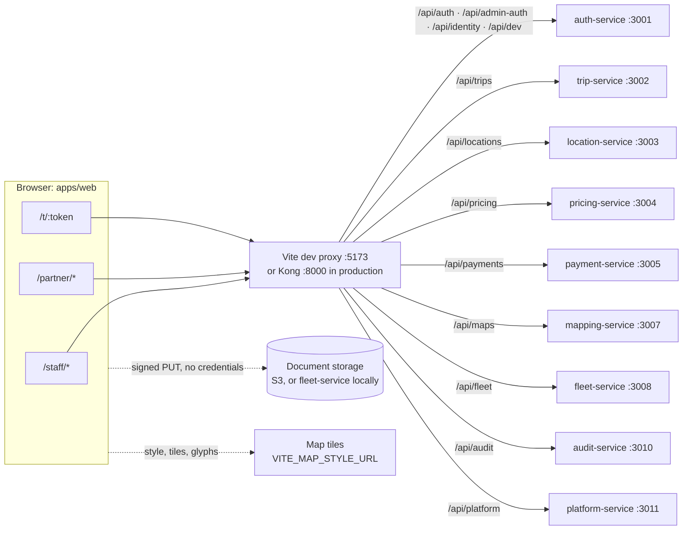

# Web app documentation

`apps/web` is the one browser app of the Anbessa platform. It is a React 19 single-page app built with Vite, routed with react-router 7, fetching with TanStack Query and drawing maps with MapLibre GL. It holds no data of its own: every page reads and writes through the platform's services under `/api/*` on the app's own origin.

This folder describes what the code does today. The product rules behind it (roles, scopes, maker–checker, sign-in surfaces) live in the design docs, which these pages link to rather than repeat.

## Who uses it

The app serves three audiences. Each has its own sign-in (or none) and its own part of the route tree.

| Audience | Routes | Signs in with | Token audience | What they do |
|---|---|---|---|---|
| **Staff**: dispatchers, call center, onboarding, safety, support, finance, operations, super admins, auditors | `/staff/*` | email + password + authenticator code on the admin surface (`/api/admin-auth`) | `ride-admin` | Live board and map, book by phone, trip lookup, driver/vehicle/company review, suspensions, money (balances, payments, payouts, rules, approvals), administration (users, roles, settings, cities, announcements, system, audit) |
| **Partners**: fleet owners, company-account admins and coordinators | `/partner/*` | phone number + 6-digit code on the app surface (`/api/auth`) | `ride-app` | Register a company, invite people by phone, fleet cars and their documents, which driver may use which car, the fleet balance, booking rides on a company account |
| **Public**: anyone with a shared-trip link | `/t/:token` | nothing; the token in the link is the key | none | Follow a trip someone shared: car position, driver, route |

Riders and drivers use the phone app (`apps/phone-app`), not this one. The dev sign-in panel even filters out accounts marked `app: "phone"` ([src/dev/DevSignIn.tsx](../src/dev/DevSignIn.tsx)).

What a staff member sees is computed from the roles in their access token, read against the live permission matrix ([src/App.tsx](../src/App.tsx) `staffSections`, [src/lib/session.tsx](../src/lib/session.tsx)). Hiding a page is a convenience only; every service checks every request again. See [Role.md](../../../docs/design/Role.md) for the roles and [Auth.md](../../../docs/design/Auth.md) for the two surfaces.

## How it talks to the platform

The browser only ever calls relative `/api/*` URLs. In development Vite's proxy forwards each prefix to a service ([vite.config.ts](../vite.config.ts)); in production Kong does the same routing ([infra/kong/kong.yml](../../../infra/kong/kong.yml)). The app does not open a WebSocket to realtime-gateway: live views poll over HTTP.

`/api/dev` exists only in development (auth-service with `DEV_LOGIN=on`); Kong's production config has no route for it.

## Index

| Doc | What's in it |
|---|---|
| [architecture.md](architecture.md) | Folder layout, the full route table with guards, the auth/session model, data fetching and polling, maps, design system, state, errors |
| [pages.md](pages.md) | Every page: what it shows, who sees it, the API calls it makes, its actions and refresh intervals |
| [api-usage.md](api-usage.md) | Every backend endpoint the app calls, with method, page and serving service |
| [integrations.md](integrations.md) | Dev proxy and Kong, the auth-service surfaces and dev sign-in, document upload, map tiles, sequence diagrams |
| [configuration.md](configuration.md) | Every environment variable and build-time value, with defaults |
| [operations.md](operations.md) | Run, build, test, lint, typecheck, deploy, troubleshooting |

## Related docs elsewhere in the repo

- [apps/web/README.md](../README.md): design notes and the "who sees what" table
- [docs/architecture/overview.md](../../../docs/architecture/overview.md): the whole platform
- [docs/design/Auth.md](../../../docs/design/Auth.md): Better Auth, surfaces, tokens, staff setup, suspension
- [docs/design/Role.md](../../../docs/design/Role.md): roles, scopes, permission matrix, organisations
- [docs/design/Payment.md](../../../docs/design/Payment.md): balances, payouts, refunds, commission rules
- [docs/development/README.md](../../../docs/development/README.md#4-web-app-staff-dashboard-fleet-and-corporate-portals): local setup
- [docs/production/README.md](../../../docs/production/README.md#web-app-staff-dashboard-fleet-and-corporate-portals): serving the build
