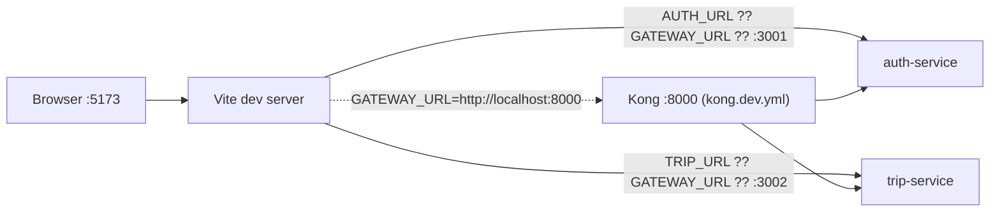
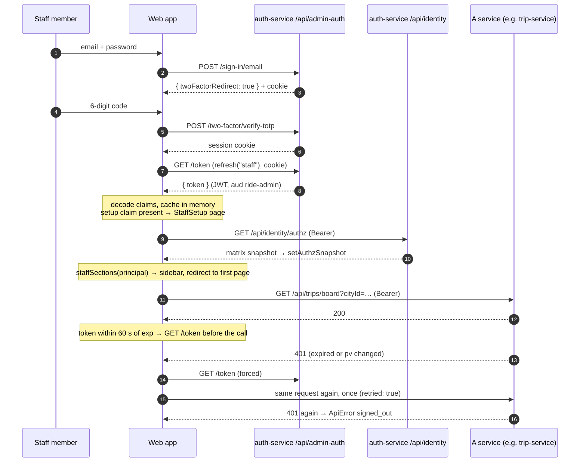
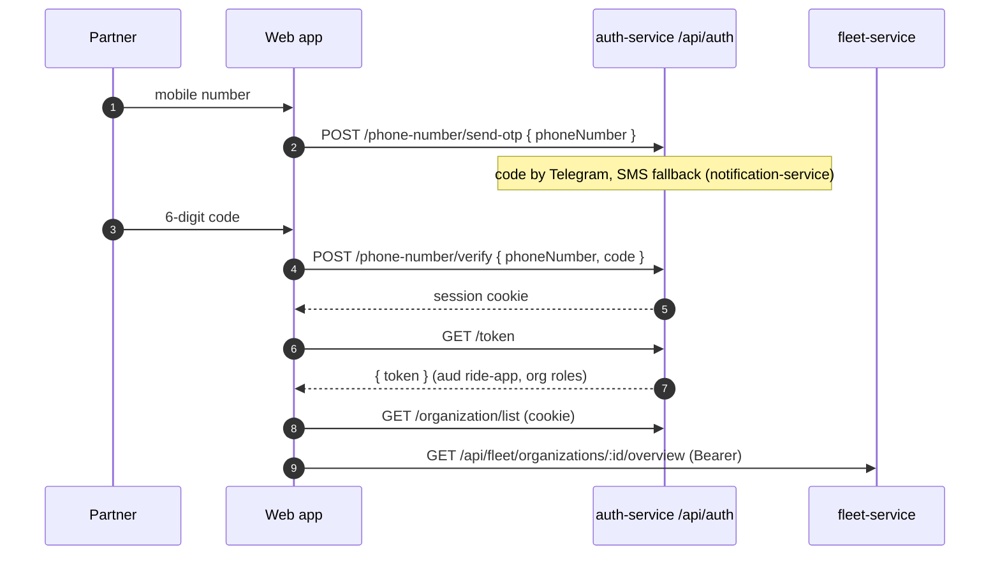
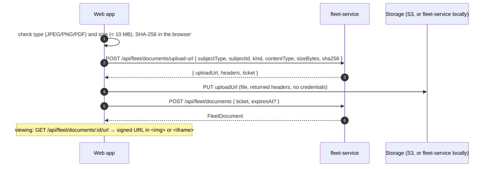

# Integrations

How the web app reaches everything outside the browser: the dev proxy, Kong, auth-service's two surfaces, the dev sign-in, document storage and map tiles.

## Contents

1. [One origin, relative URLs](#1-one-origin-relative-urls)
2. [Development proxy](#2-development-proxy)
3. [Production routing through Kong](#3-production-routing-through-kong)
4. [auth-service surfaces](#4-auth-service-surfaces)
5. [Staff sign-in to API call](#5-staff-sign-in-to-api-call)
6. [Partner sign-in](#6-partner-sign-in)
7. [Development sign-in](#7-development-sign-in)
8. [Public shared-trip page](#8-public-shared-trip-page)
9. [Document upload and viewing](#9-document-upload-and-viewing)
10. [Map tiles](#10-map-tiles)
11. [What the app does not integrate with](#11-what-the-app-does-not-integrate-with)

## 1. One origin, relative URLs

The app never builds an absolute API URL. Both axios instances in [src/lib/api.ts](../src/lib/api.ts) have no `baseURL`, so `/api/...` resolves against the page's origin. The comment in [vite.config.ts](../vite.config.ts) gives the reason: no CORS, and the auth cookies stay first-party. Something in front of the app must therefore route `/api/*`: Vite in development, Kong (behind the same origin) in production.

## 2. Development proxy

[vite.config.ts](../vite.config.ts) runs the dev server on port 5173 and proxies each prefix. Targets are read with `loadEnv(mode, process.cwd(), "")`, so they come from `apps/web/.env*` files and the shell environment, without the `VITE_` prefix.

| Prefix | Target variable | Default target | Service |
|---|---|---|---|
| `/api/auth` | `AUTH_URL` | `http://localhost:3001` | auth-service (app surface) |
| `/api/admin-auth` | `AUTH_URL` | `http://localhost:3001` | auth-service (admin surface) |
| `/api/identity` | `AUTH_URL` | `http://localhost:3001` | auth-service (identity API) |
| `/api/dev` | `AUTH_URL` | `http://localhost:3001` | auth-service (dev sign-in, `DEV_LOGIN=on`) |
| `/api/trips` | `TRIP_URL` | `http://localhost:3002` | trip-service |
| `/api/locations` | `LOCATION_URL` | `http://localhost:3003` | location-service |
| `/api/pricing` | `PRICING_URL` | `http://localhost:3004` | pricing-service |
| `/api/payments` | `PAYMENT_URL` | `http://localhost:3005` | payment-service |
| `/api/maps` | `MAPPING_URL` | `http://localhost:3007` | mapping-service |
| `/api/fleet` | `FLEET_URL` | `http://localhost:3008` | fleet-service |
| `/api/support` | `SUPPORT_URL` | `http://localhost:3009` | support-service |
| `/api/audit` | `AUDIT_URL` | `http://localhost:3010` | audit-service |
| `/api/platform` | `PLATFORM_URL` | `http://localhost:3011` | platform-service |

Resolution per prefix: `env[NAME] ?? env.GATEWAY_URL ?? http://localhost:<port>`. The proxy entries are plain strings, so Vite forwards the full path unchanged (no rewrite) and does not set `changeOrigin`.

### Through Kong in development

`make dev-gateway` runs Kong on `:8000` in front of `make dev-services` (see [docs/development/README.md](../../../docs/development/README.md#kong-in-front-of-make-dev-services)). `scripts/kong-dev-config.sh` generates `infra/kong/kong.dev.yml` from `kong.yml` with upstreams on `host.docker.internal` and adds a `/api/dev` route. Setting `GATEWAY_URL=http://localhost:8000` sends a prefix to Kong only when its own variable (`AUTH_URL`, `TRIP_URL`, …) is not set, because the per-service variable is checked first. `.env.example` sets all ten, so with a `.env` copied from it (which `make setup-web` does) `GATEWAY_URL` alone changes nothing; remove or repoint those lines.



## 3. Production routing through Kong

[infra/kong/kong.yml](../../../infra/kong/kong.yml) is DB-less declarative config. Every route uses `strip_path: false`, so services see the same `/api/...` paths the browser sends.

| Prefix | Upstream | Kong plugins |
|---|---|---|
| `/api/auth`, `/api/admin-auth`, `/api/identity` | `auth-service:3001` | rate-limiting 60/min (local), request-size-limiting 64 KB |
| `/api/maps` | `mapping-service:3007` | rate-limiting 120/min |
| `/api/locations` | `location-service:3003` | rate-limiting 120/min |
| `/api/trips` | `trip-service:3002` | rate-limiting 60/min |
| `/api/fleet` | `fleet-service:3008` | rate-limiting 120/min |
| `/api/platform` | `platform-service:3011` | rate-limiting 120/min |
| `/api/audit` | `audit-service:3010` | rate-limiting 60/min |
| `/api/support` | `support-service:3009` | rate-limiting 120/min |
| `/api/pricing` | `pricing-service:3004` | rate-limiting 120/min |
| `/api/payments` | `payment-service:3005` | rate-limiting 120/min, request-size-limiting |

Kong does not verify JWTs; each service verifies the bearer token itself (comment at the top of `kong.yml`, [Auth.md §10](../../../docs/design/Auth.md#10-verifying-tokens-in-other-services)). There is no `/api/dev` route in `kong.yml`.

Serving the static build is not defined in `infra/` (no web image, Kubernetes manifest or Terraform resource for it was found). [docs/production/README.md](../../../docs/production/README.md#web-app-staff-dashboard-fleet-and-corporate-portals) describes the intended setup: a CDN serves `dist/` with an `index.html` fallback and routes `/api/*` to Kong on the same origin, and that origin goes into auth-service's `APP_TRUSTED_ORIGINS` and `ADMIN_TRUSTED_ORIGINS`.

## 4. auth-service surfaces

auth-service runs two Better Auth instances ([Auth.md](../../../docs/design/Auth.md)). The web app uses both, chosen by `Surface` in [src/lib/api.ts](../src/lib/api.ts):

| | Admin surface | App surface |
|---|---|---|
| Base path | `/api/admin-auth` | `/api/auth` |
| Used by | `/staff/*` | `/partner/*` |
| Endpoints the app calls | `sign-in/email`, `two-factor/verify-totp`, `two-factor/enable`, `change-password`, `token`, `sign-out` | `phone-number/send-otp`, `phone-number/verify`, `token`, `sign-out`, `organization/*` |
| Token audience | `ride-admin` | `ride-app` |
| Access-token lifetime ([Auth.md §8](../../../docs/design/Auth.md#8-sessions-and-tokens)) | 10 min | 15 min |

`/api/identity/*` is auth-service's own REST API (directory, approvals, matrix, organisations, guests), called with a bearer token like any other service.

The live permission matrix comes from `GET /api/identity/authz` and is installed with `setAuthzSnapshot()` from `@ride-app/shared-authz` ([src/lib/session.tsx](../src/lib/session.tsx)). The bundled matrix in `libs/shared-authz` is used until it arrives.

## 5. Staff sign-in to API call



If `/token` answers 401 or 403 (session revoked, banned, or wrong surface), `accessToken()` returns `null` and the request fails with "Your session ended. Sign in again." The session query is not refetched automatically, so the area guard notices on the next `refresh()` or full reload.

## 6. Partner sign-in



Organisation management (`list`, `create`, `get-full-organization`, `invite-member`, `cancel-invitation`, `remove-member`) goes to Better Auth's organization endpoints with the cookie, not the bearer token. Invitations by phone are sent as an email of the form `<digits>@phone.anbessa.invalid` ([src/lib/format.ts](../src/lib/format.ts), [Auth.md §17](../../../docs/design/Auth.md#17-implementation-notes-v1)). After registering a company the page calls `refresh("partner")` so the next token carries the new owner or admin role.

## 7. Development sign-in

[src/dev/DevSignIn.tsx](../src/dev/DevSignIn.tsx), loaded by [src/pages/SignIn.tsx](../src/pages/SignIn.tsx) behind `import.meta.env.DEV`:

1. `GET /api/dev/accounts` lists seeded accounts (`seeded: false` ones are disabled).
2. Staff: `POST /api/admin-auth/sign-in/email` with the account's email and password, then `GET /api/dev/code?email=` and `POST /api/admin-auth/two-factor/verify-totp`.
3. Partner: `POST /api/auth/phone-number/send-otp`, `GET /api/dev/code?phone=`, `POST /api/auth/phone-number/verify`.
4. `refresh(surface)` and navigate to `/staff` or `/partner`.

It needs auth-service with `DEV_LOGIN=on` and `pnpm --filter @ride-app/auth-service seed:dev` ([docs/development/README.md](../../../docs/development/README.md#ready-made-accounts-web-app-dev-sign-in)). Because the module is behind `import.meta.env.DEV`, `vite build` leaves it out.

## 8. Public shared-trip page

`/t/:token` ([src/pages/public/SharedTrip.tsx](../src/pages/public/SharedTrip.tsx)) needs no account. The link token is the only credential.

```mermaid
sequenceDiagram
  autonumber
  participant V as Visitor
  participant W as Web app /t/:token
  participant T as trip-service
  V->>W: open link
  W->>T: GET /api/trips/shared/:token (no Authorization)
  T-->>W: status, pickup, dropoff, driver, vehicle, position, routePolyline, times, expiresAt
  Note over W: decodePolyline6 → RouteLine; markers; fit once
  loop every 5 s while status ∉ {completed, cancelled}
    W->>T: GET /api/trips/shared/:token
    T-->>W: new position / status
  end
  Note over W: completed or cancelled → stop, show "Link ends HH:MM"
  T-->>W: 404 → "This link has ended" (no retry on 404)
```

Polling also stops after an error (the `refetchInterval` callback returns `false` when the query has an error); "Try again" refetches by hand.

## 9. Document upload and viewing

[src/lib/fleet.ts](../src/lib/fleet.ts) `uploadDocument()` and [src/components/Documents.tsx](../src/components/Documents.tsx):



The production guide notes that the bucket's CORS must allow `PUT` from the web origin and the CSP must allow the bucket in `connect-src`, `img-src` and `frame-src` ([docs/production/README.md](../../../docs/production/README.md#web-app-staff-dashboard-fleet-and-corporate-portals)).

## 10. Map tiles

- Style URL: `import.meta.env.VITE_MAP_STYLE_URL || "https://tiles.openfreemap.org/styles/liberty"` ([src/components/map/CityMap.tsx](../src/components/map/CityMap.tsx)). It is read at build time.
- `.env.example` suggests the self-hosted TileServer GL from `make dev-infra`: `http://localhost:8081/styles/<id>/style.json`.
- MapLibre's worker is loaded from the URL Vite emits (`maplibre-gl-worker.mjs?url`), so the CSP needs `worker-src 'self' blob:` (production guide).
- The attribution control is shown in compact form; the README and production guide require the OpenStreetMap attribution to stay visible.

## 11. What the app does not integrate with

- **realtime-gateway / WebSocket**: no Socket.io or WebSocket client in `src/` or `package.json`. Live views poll (see [architecture.md §5](architecture.md#5-data-fetching)).
- **notification-service**: no calls.
- **Analytics, error reporting, feature-flag services**: none found in code. Feature flags come from `/api/platform/client-config`.
- **Service worker / PWA**: none found.
