# Architecture overview

Anbessa is a ride-hailing platform. It's built as **independently deployable microservices** in one monorepo, with one phone app (rider + driver modes) and one web app (staff dashboard, fleet portal and corporate portal).

This document describes the target architecture **and** where the code is today, so you know what you can rely on. Each section marks its status:

| Marker | Meaning |
|---|---|
| ✅ | Implemented and runnable |
| 🟡 | Partly implemented, or implemented with known defects |
| 📐 | Designed and scaffolded, not implemented yet |

Related docs: [design docs](../design/README.md) · [roles & permissions design](../design/Role.md) · [development](../development/README.md) · [testing](../testing/README.md) · [production](../production/README.md) · [API conventions](../api/README.md)

---

## Contents

1. [System context](#1-system-context)
2. [Containers](#2-containers)
3. [Services and ownership](#3-services-and-ownership)
4. [Communication](#4-communication)
5. [Key flows](#5-key-flows)
6. [Trip lifecycle](#6-trip-lifecycle)
7. [Data architecture](#7-data-architecture)
8. [Event catalog](#8-event-catalog)
9. [Security](#9-security)
10. [Mapping stack](#10-mapping-stack)
11. [Deployment topology](#11-deployment-topology)
12. [Scalability and resilience](#12-scalability-and-resilience)
13. [Observability](#13-observability)
14. [Repository map](#14-repository-map)
15. [Key decisions](#15-key-decisions)
16. [Known gaps](#16-known-gaps)

---

## 1. System context

Who uses the system and which external systems it depends on.

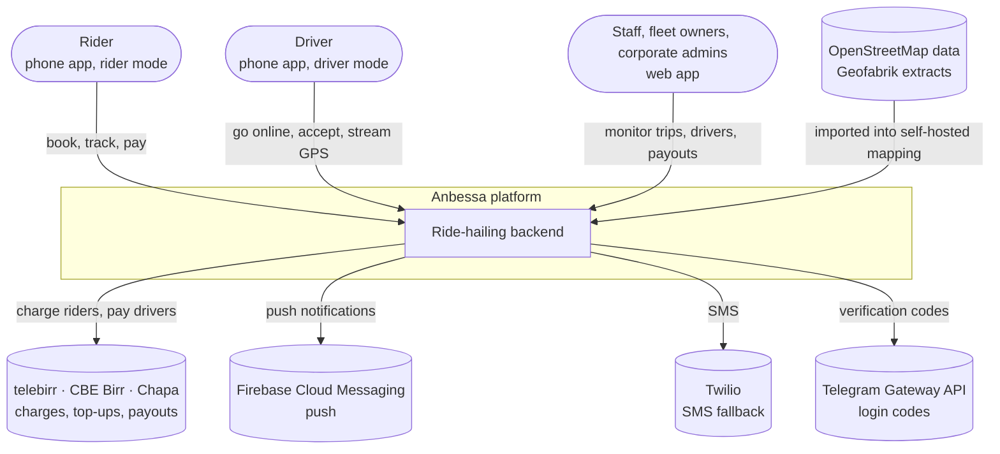

**Design goals**

- **No per-request map fees.** Routing, geocoding and tiles are self-hosted on OpenStreetMap data.
- **Real-time first.** Live driver positions reach riders within about a second.
- **Independent teams.** Mobile, backend, admin and infra each have their own entry point (`make setup-*`) and workspace.
- **Independent scaling.** The high-frequency location path scales separately from low-traffic services such as pricing.

---

## 2. Containers

The deployable pieces and how they connect.

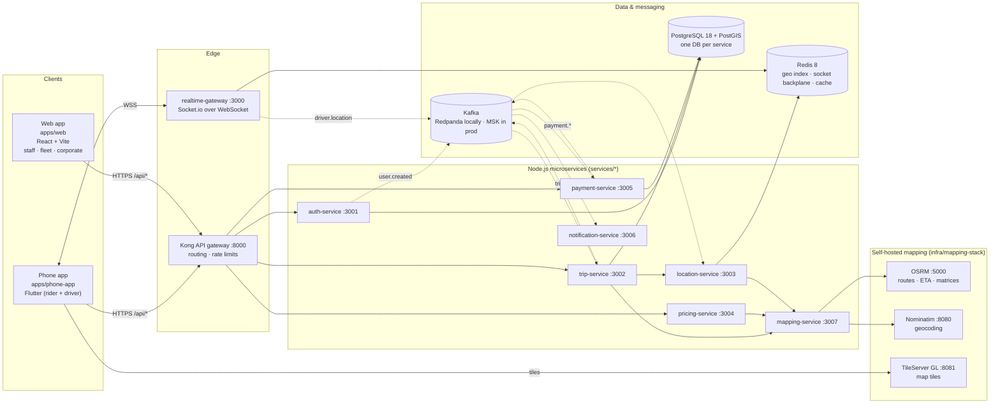

Solid arrows are synchronous calls (HTTP, WebSocket, DB). Dashed arrows are asynchronous events.

---

## 3. Services and ownership

Each service owns one business capability **and its data**. No service reads another service's database.

| Service | Port | Responsibility | Owns | Status |
|---|---|---|---|---|
| **auth-service** | 3001 | Identity on **Better Auth** ([Auth.md](../design/Auth.md)): phone OTP and staff password + TOTP, sessions, organisations, ES256 JWTs + JWKS, `/api/identity` (guests, maker–checker staff roles, suspension) | `auth_service` DB: users, sessions, organisations, members, signing keys, approvals, outbox | ✅ implemented, unit + integration tests |
| **trip-service** | 3002 | Trip lifecycle state machine, matching (one driver at a time, OSRM-ranked, 2→4→6 km; skips blocked balances, and cash-paused ones for cash trips), cancellations and fees, ratings, dispatcher board, trip parties (the driver's name and car for the rider, the rider's name for the driver, from auth- and fleet-service) | `trip_service` DB: trip, trip_event (monthly partitions), trip_offer, driver_active_trip, ratings, idempotency keys, outbox | ✅ implemented, integration tests + an end-to-end run with all services. Quotes come from pricing-service (`PRICING=builtin` keeps the old in-process stand-in for running alone) |
| **location-service** | 3003 | Driver state from `driver.online`/`offline` and `trip.*`, nearby-driver search for matching, ETA to pickup, staleness sweeper, ops map and the rider's trip view | Redis: driver state, geo sets per city and vehicle type (Database.md §10) | ✅ implemented, integration tests on Redis. A dev route still puts drivers online without fleet-service |
| **pricing-service** | 3004 | Quotes: route (mapping-service) × the city's live fare card (Settings → Fares), one per vehicle type; trip-service reads the quote when the trip is requested | Redis only (quotes expire after `quote.ttlSeconds`) | ✅ implemented, unit tests. Versioned fare rules, zones, promotions and surge (workflow 15) are next |
| **payment-service** | 3005 | Double-entry ledger, trip settlement per payment method, commission + VAT, driver/fleet balances with limits (cash pause, block), rider charges by mobile money and card with retries and receivables, top-ups (mobile money, office cash, bank transfer), weekly settlement and payouts, refunds, commission rules and balance policies (maker–checker), provider webhooks and reconciliation | `payment_service` DB: ledger_account, journal_entry, posting (balanced, append-only), beneficiary, payment, trip_settlement, top_up, payment_due, payout_batch/line, refund, commission_rule, balance_policy, rule_change, webhook_event, inbox, outbox | ✅ implemented, unit + integration tests, web Money pages. Providers (telebirr, CBE Birr, Chapa) are **simulated** until the real integrations are written; refused in production |
| **notification-service** | 3006 | Push (FCM) and SMS from events. **Login codes via the Telegram Gateway API, SMS fallback** (internal API from auth-service, never Kafka: [Auth.md §9.7](../design/Auth.md#97-otp-delivery-telegram-gateway-first-sms-fallback)) | `notification_service` DB: `otp_delivery`, `notification` (dedupe log), `device_token` | ✅ OTP delivery (Telegram + SMS fallback), invite SMS and driver-activated push from Kafka, device tokens. Trip/payment notifications wait for those events |
| **mapping-service** | 3007 | The only gateway to OSRM / Nominatim: route, table, snap, search, reverse, with timeouts, a circuit breaker and straight-line fallback | Route and geocoding cache (Redis) | ✅ implemented, tested against OSRM/Nominatim-shaped fakes. Needs `make map-data` for real routing |
| **fleet-service** | 3008 | Driver applications, vehicles and ownership (V1–V10), fleet authorisations, driving sessions (going online; a blocked balance can't), onboarding documents (pre-signed S3 uploads), review queue, document expiry | `fleet_service` DB: driver_profile (licence encrypted + blind index), vehicle, vehicle_authorization, driving_session, document, idempotency keys, outbox | ✅ implemented, unit + integration tests, web review queue and fleet portal |
| **platform-service** | 3011 | Live settings (matching, trip rules, fees, fares, OTP, documents, maintenance, app versions, feature flags) with maker–checker for sensitive ones; cities and vehicle types; announcements; public client configuration; the system page (health, outboxes, Kafka lag, integrations) | `platform_service` DB: setting values, history and change requests, cities, vehicle types, announcements, outbox | ✅ implemented, integration tests, admin dashboard |
| **support-service** | 3009 | Tickets with SLAs and threads (workflow 13), lost items between rider and driver without phone numbers, SOS alerts with a per-city staff queue, safety incidents with recorded decisions (workflow 14); links refunds requested in payment-service | `support_service` DB: ticket, ticket_message, ticket_refund, lost_item, lost_item_message, sos_alert, sos_note, incident, incident_note, incident_action (SOS and incidents never deleted), idempotency keys, outbox | ✅ implemented (phase 1), unit + integration tests, web pages for tickets, lost items, SOS queue and incidents |
| **audit-service** | 3010 | The write-once audit log: consumes `audit.recorded`, search and CSV export | `audit_service` DB: `audit_entry` (monthly partitions, UPDATE/DELETE refused) | ✅ implemented, integration tests, admin dashboard |
| **realtime-gateway** | 3000 | WebSocket connections, driver pings into Redis, live location fan-out to trip rooms | Socket rooms (in Redis) | ✅ pings from `DRIVER` tokens only, plausibility checks, fan-out to the assigned trip only, guarded Kafka publish |

### Internal structure (auth-service is the reference template)

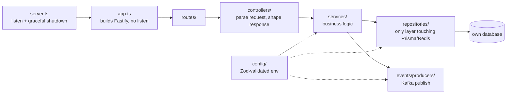

- `app.ts` builds the Fastify instance without calling `listen()`, so tests can drive it with `app.inject()`.
- `server.ts` handles `SIGTERM`/`SIGINT`, closing the server so in-flight requests finish.
- `config/` parses `process.env` with Zod at boot and fails fast. Key files are checked with `existingFile()` from `@ride-app/shared-config`.

### Shared libraries (`libs/*`)

| Library | Contents | Rule |
|---|---|---|
| `@ride-app/shared-types` | Domain types (`Trip`, `TripStatus`, `PublicUser`), **Kafka event contracts** | The contract boundary between services |
| `@ride-app/shared-utils` | `createLogger` (pino), `AppError`, `NotFoundError` | Generic utilities only |
| `@ride-app/shared-config` | `loadEnv`, `existingFile` | Env validation helpers |

> Libraries hold **contracts and generic utilities**, never business logic or database access. Sharing logic would couple service releases.

The Dart side mirrors the contracts in `packages/core` (e.g. `TripStatus`), synchronised by hand for now.

---

## 4. Communication

| Style | Technology | Used for | Examples |
|---|---|---|---|
| Synchronous request/response | HTTP/JSON through Kong | Client actions that need an immediate answer | login, fare estimate, request trip |
| Synchronous internal | HTTP between services | Queries across service boundaries | trip → location ("nearby drivers"), pricing → mapping |
| Real-time push | WebSocket (Socket.io) | Live updates both ways | driver GPS → rider map |
| Asynchronous events | Kafka topics | Side effects, replication, analytics | `user.created`, `driver.location`, `trip.completed` |
| Fan-out between gateway pods | Redis pub/sub (Socket.io adapter) | Delivering a room message to a socket on another pod | `trip:<id>` room broadcasts |
| Live configuration reloads | Redis pub/sub + a 30 s poll | Telling every service the permission matrix or the settings changed (they then fetch a snapshot over HTTP) | `authz:changed` (auth-service), `settings:changed` (platform-service) |

### When to use which

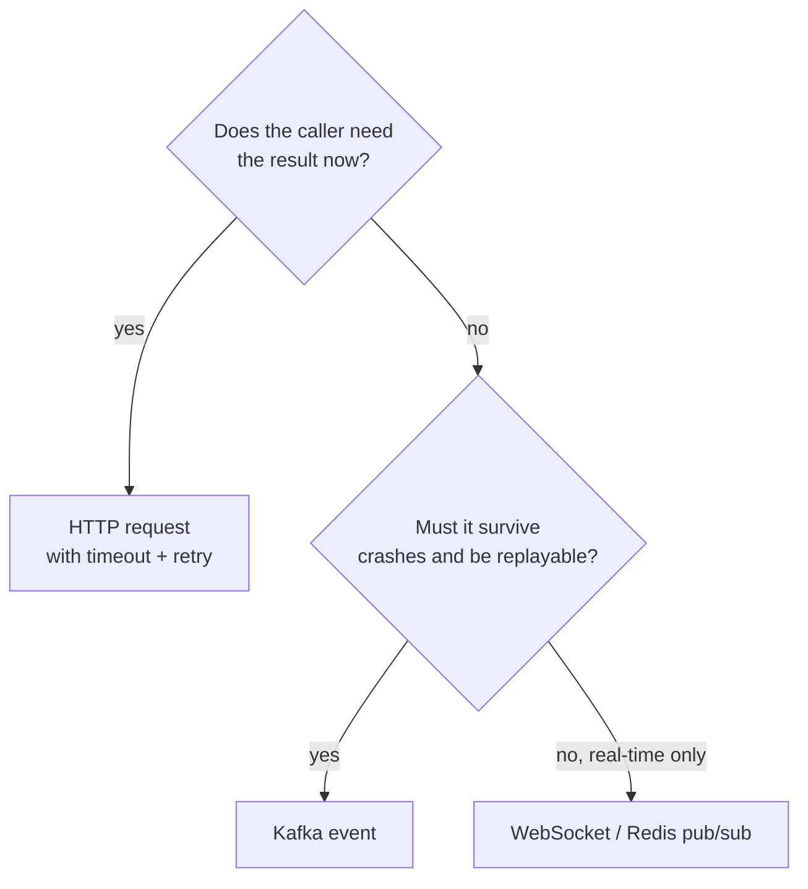

### Gateway routes (`infra/kong/kong.yml`)

| Path | Upstream | Plugins |
|---|---|---|
| `/api/auth` | auth-service:3001 | rate-limiting 30/min |
| `/api/trips` | trip-service:3002 | jwt, rate-limiting 60/min |
| `/api/pricing` | pricing-service:3004 | rate-limiting 120/min (each route checks its token; the fare card is public) |
| `/api/payments` | payment-service:3005 | rate-limiting 120/min, 64 KB bodies. `/api/payments/webhooks/{provider}` is public and verified by each provider's signature |

The realtime gateway is reached directly (through the load balancer), not through Kong.

---

## 5. Key flows

The flows below are summaries. Each business process is designed end to end, with steps, timeouts, failures and events, in **[docs/design/workflows](../design/workflows/README.md)**.

### 5.1 Login and session (target design: Better Auth)

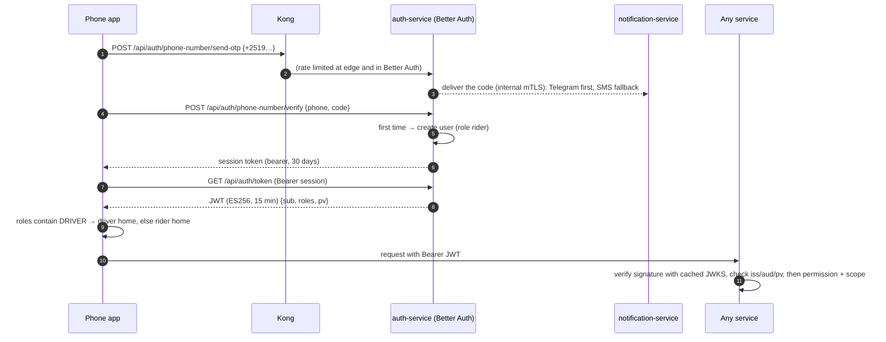

- Services verify JWTs **locally** against Better Auth's JWKS (`/api/auth/jwks`, keys rotated every 90 days). There's no call back to auth-service per request.
- Staff use the admin surface (`/api/admin-auth`, password + TOTP, `aud = ride-admin`). See [Auth.md §8–9](../design/Auth.md#8-sessions-and-tokens).
- **Today** the code still has hand-written email/password `register`/`login` that signs RS256 tokens with key files (and both endpoints currently fail, [§16](#16-known-gaps)).

### 5.2 Request a trip (target design)

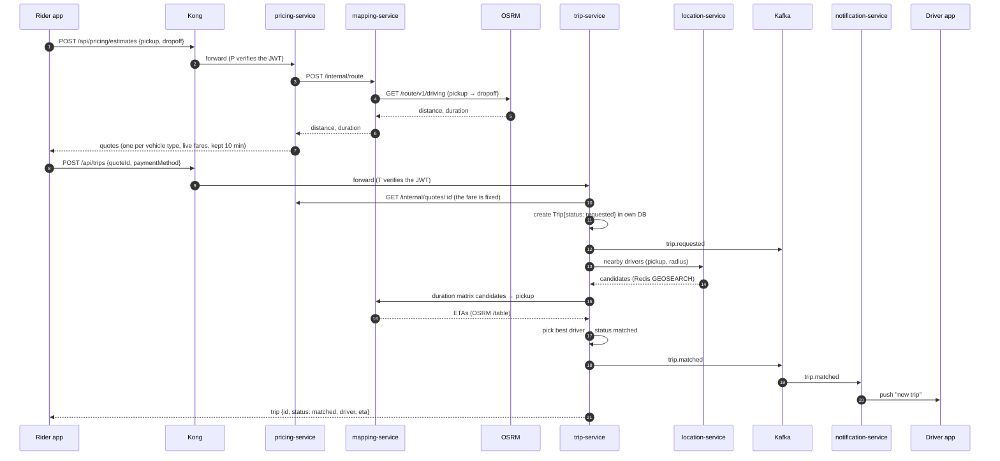

### 5.3 Live location tracking

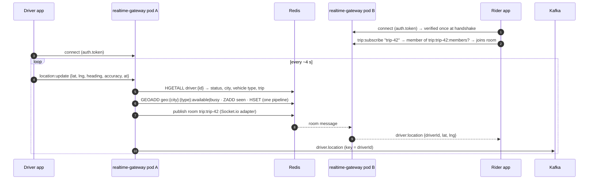

- `driverId` comes from the verified token's `sub`, never from the message body, and only `DRIVER` tokens may send pings.
- The trip comes from the driver's state in Redis (set by location-service on `trip.matched`), never from the client. Only the trip's rider and driver may join its room.
- Implausible pings (accuracy > 100 m, faster than 200 km/h, from the future, out of order) are dropped before they reach the geo index.
- Redis gives sub-millisecond nearby search. Kafka gives a durable stream for ETA recalculation, audit and analytics.

### 5.4 Trip completion and payment

Cash and company-account trips settle as soon as `trip.completed` arrives. Mobile money and card trips are charged first; the driver's balance moves when the provider confirms ([Payment.md](../design/Payment.md), workflow [08](../design/workflows/08-payment-receipt-rating.md)).

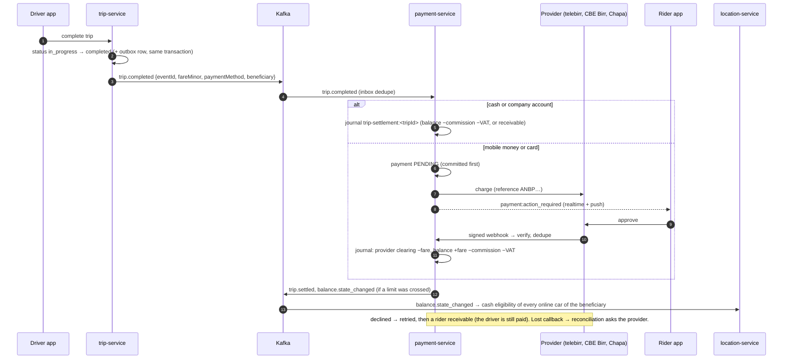

---

## 6. Trip lifecycle

The state machine owned by trip-service. The states come from `libs/shared-types/src/trip.ts` and are mirrored in `packages/core/lib/models/trip.dart`.

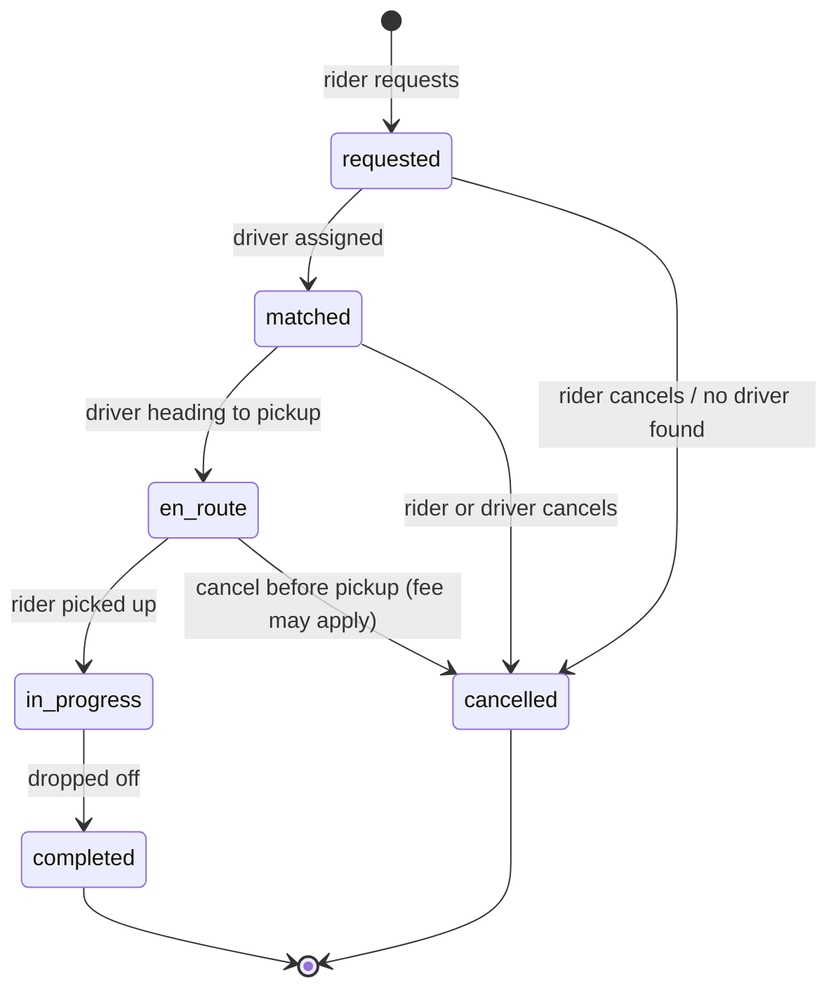

| Transition | Event published | Typical consumers |
|---|---|---|
| → requested | `trip.requested` | analytics |
| → matched | `trip.matched` | notification (driver push), realtime |
| → en_route | `trip.driver_en_route` | notification (rider) |
| → in_progress | `trip.started` | analytics |
| → completed | `trip.completed` | payment, notification |
| → cancelled | `trip.cancelled` | payment (cancellation fee), notification |

Rules: only trip-service changes a trip's status. Each transition is a single DB transaction that also writes an outbox row (see [§8](#8-event-catalog)). Illegal transitions (e.g. `completed → en_route`) are rejected.

---

## 7. Data architecture

### Ownership

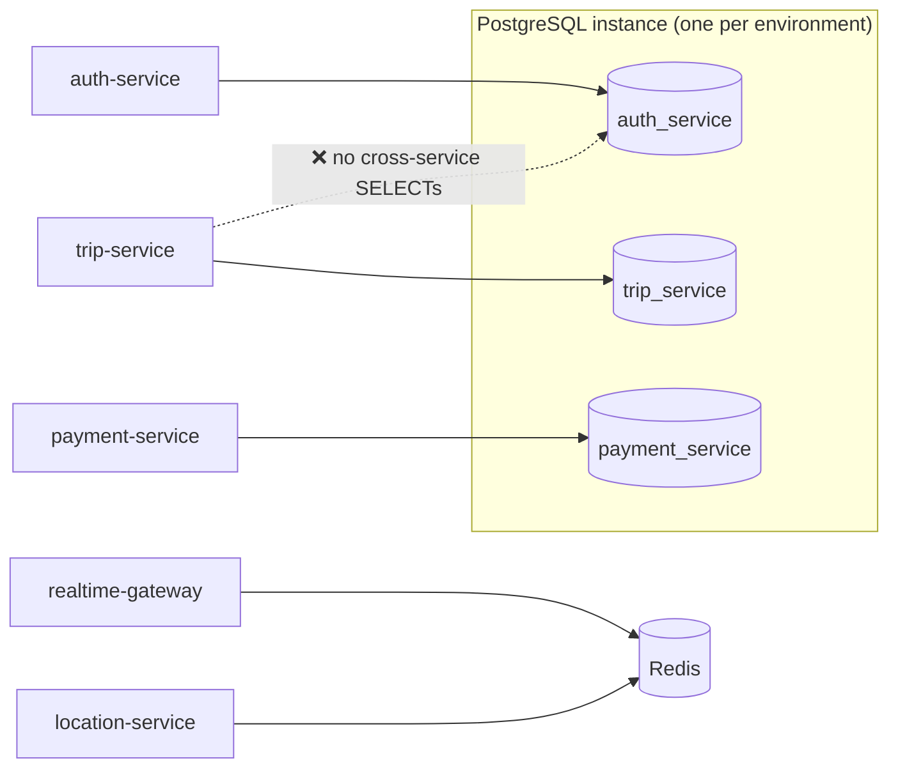

| Store | Data | Durability | Production |
|---|---|---|---|
| PostgreSQL 18 + PostGIS | Users, trips, payments; zones and pickups (geography) | Durable, the system of record | Amazon RDS |
| Redis 8 | Live driver positions (`geo:{city}:{type}:*`, `driver:{id}`), Socket.io room fan-out, caches | **Rebuildable**: lost data regenerates within seconds | Amazon ElastiCache |
| Kafka | Domain event streams | Durable, retained, replayable | Amazon MSK |

### Current schema (auth-service)

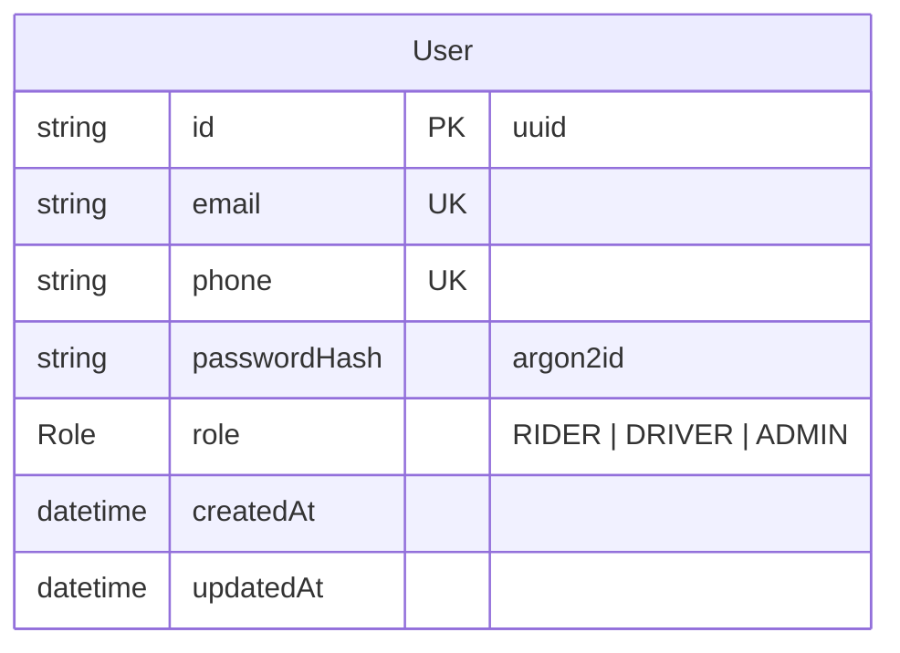

- Managed by Prisma 7 (`services/auth-service/prisma/schema.prisma`, `prisma.config.ts`, `@prisma/adapter-pg`).
- Migrations are committed under `prisma/migrations/` and applied with `prisma migrate deploy` in production.

### Rules

- **Database per service.** Separate databases and, in production, separate DB users.
- **Need another service's data?** Call its API, or keep a local read model updated from its events.
- **Hot vs durable geo data.** Live positions go in Redis GEO. Zones, pickups and history go in PostGIS.
- **Schema changes** follow expand → migrate → contract, so old and new pods can run during a rollout.

---

## 8. Event catalog

Contracts live in `libs/shared-types/src/events.ts`. Producer and consumer import the same type, and consumers validate the payload (zod) before acting on it.

| Topic | Key | Producer | Payload | Consumers | Status |
|---|---|---|---|---|---|
| `user.created` | `userId` | auth-service | `{ userId, guest }` | trip (rider cache) | 🟡 produced; no consumers yet |
| `org.member_invited` | `orgId` | auth-service | `{ invitationId, orgId, orgName, role, phoneNumber? }` | notification (invite SMS) | ✅ |
| `role.granted` / `role.revoked` | `userId` | auth-service | `{ userId, role, orgId?, cityId?, byUserId }` | notification (driver activated push), audit | ✅ produced, notification consumes `DRIVER` grants |
| `driver.location` | `driverId` | realtime-gateway | `{ driverId, cityId, tripId?, lat, lng, heading?, speed?, accuracy?, at }` | ETA, trip audit, analytics | ✅ produced (guarded, never blocks pings) |
| `driver.online` / `driver.offline` | `driverId` | fleet-service | `{ driverId, vehicleId, vehicleType, cityId, fleetOrgId?, beneficiaryId, cashAllowed, balanceState }` / `{ driverId, reason }` | location | ✅ (balance state asked from payment-service at session start) |
| `driver.connection_lost` | `driverId` | location-service | `{ driverId, cityId, lastSeenAt }` | fleet (ends the session) | ✅ produced |
| `trip.matched` | `tripId` | trip-service | `{ tripId, riderId, driverId, cityId, vehicleType }` | location (driver busy, trip members), notification | ✅ |
| `trip.requested` / `driver_en_route` / `driver_arrived` / `started` | `tripId` | trip-service | ids, city, payment method / fare estimate | notification, analytics | ✅ produced |
| `trip.completed` | `tripId` | trip-service | `{ fareMinor, waitingFeeMinor, paymentMethod, beneficiary {type, id}, billingType, billingOrgId?, distanceMeters, durationSeconds, … }` | payment (settles), location | ✅ |
| `trip.cancelled` | `tripId` | trip-service | `{ by, reason, feeMinor, driverCompensationMinor, beneficiary?, billingOrgId?, … }` | payment (fee), location | ✅ |
| `trip.settled` | `tripId` | payment-service | `{ tripId, riderId, driverId?, beneficiary?, purpose, paymentMethod, fareMinor, commissionMinor, vatMinor, earningsMinor }` | notification (receipt) | ✅ |
| `payment.action_required` | `riderId` | payment-service | `{ paymentId, tripId, purpose, provider, amountMinor, checkoutUrl }` | notification (approve push); riders also get it live through realtime-gateway | ✅ |
| `payment.captured` / `payment.failed` | `riderId` | payment-service | `{ paymentId, tripId, purpose, provider, method, amountMinor, final?, nextAttemptAt? }` | notification | ✅ |
| `balance.state_changed` | beneficiary id | payment-service | `{ accountId, beneficiary, cityId, state, previousState, cashAllowed, balanceMinor }` | location (matching eligibility of every online car of the beneficiary), notification | ✅ |
| `balance.topped_up` / `balance.payment_due` / `payout.sent` / `payout.failed` | beneficiary id | payment-service | `{ accountId, beneficiary, amountMinor, balanceMinor, channel?, provider?, minimumMinor?, dueAt?, failure? }` | notification | ✅ |
| `refund.succeeded` / `refund.failed` | `riderId` | payment-service | `{ refundId, paymentId, tripId, amountMinor }` | notification | ✅ |
| `trip.scheduled` / `trip.schedule_cancelled` / `trip.schedule_failed` | `scheduledTripId` | trip-service | `{ scheduledTripId, riderId, bookedById, cityId, scheduledFor, … }` (booked / edited with `updated`, cancelled `by`, failed `reason`) | notification (push to rider and booker) | ✅ (no reminder event: dispatch at `matchAt` is a plain `trip.requested`) |
| `trip.dispatch_escalated` | `tripId` | trip-service | `{ tripId, scheduledTripId, riderId, cityId, vehicleType, scheduledFor }` | notification (rider push); dispatch board flag | ✅ |
| `trip.reassigned` | `tripId` | trip-service | `{ tripId, riderId, cityId, fromDriverId, toDriverId?, byUserId, reason? }` (after `trip.matched` for the new driver, same key) | location (old driver freed, live trip → new driver), notification (rider and old driver) | ✅ |
| `sos.triggered` / `sos.acknowledged` / `sos.resolved` | `alertId` | support-service | `{ alertId, cityId, tripId, userId, … }` | notification (push to whoever pressed SOS only) | ✅ (emergency-contact SMS not built) |
| `pricing.rule_scheduled` / `pricing.rule_activated` / `pricing.zone_changed` | `cityId` | pricing-service | fare rule (maker–checker) / zone changes | none yet | 🟡 produced |
| `promo.activated` / `promo.redeemed` / `promo.exhausted` | `promoId` (`redeemed`: `tripId`) | pricing-service | promo lifecycle; `redeemed` from `trip.completed` | none yet (payment uses `trip.completed`'s `promoDiscountMinor`) | 🟡 produced |

Full per-topic detail (every field, every consumer): [libs/shared-types/docs/event-catalog.md](../../libs/shared-types/docs/event-catalog.md).

### Event conventions

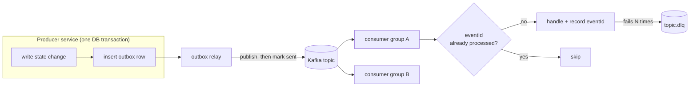

- **Names** are past-tense facts: `trip.completed`, not `completeTrip`.
- **Keys** are the entity whose ordering matters (Kafka orders within a partition).
- **Payloads** carry `eventId` (dedupe), `at` (event time) and a `version`.
- **Delivery** is at-least-once, so consumers must be idempotent.
- **Evolution:** add optional fields only. Breaking changes go in a new version or topic.
- **Outbox (target):** today auth-service publishes *after* committing, so an event can be lost if Kafka is down.

---

## 9. Security

### Authentication and trust boundaries

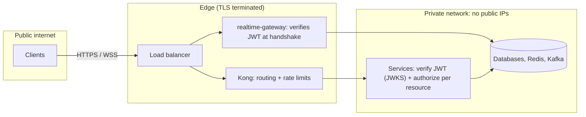

| Concern | Approach |
|---|---|
| Passwords | argon2id hashes. Plaintext is never stored or logged |
| Roles | Scoped roles with one permission matrix (`libs/shared-authz`) and maker–checker staff grants. See [docs/design/Role.md](../design/Role.md) |
| Authentication | Better Auth in auth-service: phone OTP for the app, password + TOTP for staff, organisations, JWT + JWKS (ES256, rotated), verified in each service. See [docs/design/Auth.md](../design/Auth.md) |
| Tokens | Better Auth sessions (app 30 days via bearer, admin 12 h cookie) + short-lived ES256 JWTs (app 15 min, admin 10 min) with `pv` and a Redis denylist for suspensions |
| Signing key | Generated, encrypted (with `BETTER_AUTH_SECRET`) and rotated by Better Auth in the `jwks` table, published at `/api/auth/jwks`. Only auth-service can sign. No key files |
| Edge auth | Kong does routing, rate limits and request-size limits only. realtime-gateway (and every service, as it gets routes) verifies JWTs with the JWKS through `libs/shared-authz` |
| Authorization | In the owning service (e.g. only the trip's rider or driver may read it). Never "the gateway checked" |
| Rate limiting | Kong per route (stricter on `/api/auth` and `/api/payments`) |
| Payments | A balanced, append-only ledger; idempotency keys per trip, top-up, payout and refund; provider callbacks verified by signature. Card data never touches our systems (Chapa's hosted checkout) |
| Network | Databases, Redis and Kafka in private subnets. TLS to RDS, ElastiCache and MSK in production |

### Secrets

| Environment | Source | Delivery |
|---|---|---|
| Local dev | `make secrets` (creates `.env` files, generates `BETTER_AUTH_SECRET` and `INTERNAL_SERVICE_TOKEN`, `umask 077`, never overwrites, gitignored) | Env vars |
| CI | GitHub environment secrets, OIDC to AWS (no static keys) | Masked env vars |
| Staging / production | AWS Secrets Manager → External Secrets → Kubernetes Secrets | `envFrom` + read-only key-file mounts |

Secrets are never committed (`.gitignore`), never baked into images (`.dockerignore`), and never logged.

---

## 10. Mapping stack

The self-hosted, free replacement for commercial map APIs. Only **mapping-service** talks to it, so the engines can be swapped without touching other services.

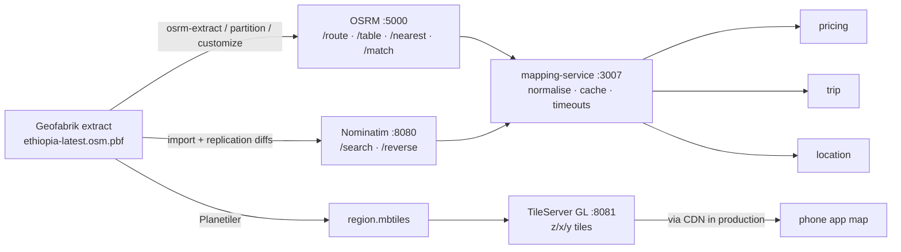

| Need | Engine | Notes |
|---|---|---|
| Road distance and ETA for fares | OSRM `/route` | Straight-line (PostGIS) distance is only a fallback |
| Rank nearby drivers by real arrival time | OSRM `/table` | After Redis `GEOSEARCH` finds candidates |
| Destination search, pickup labels | Nominatim | Bounded to the service area (`countrycodes`, `viewbox`) |
| Map display | TileServer GL | Raster/vector tiles, OSM attribution required |

---

## 11. Deployment topology

### Local development

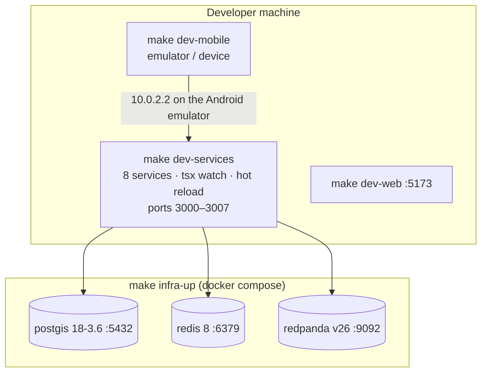

| Mode | Command | Use |
|---|---|---|
| Host dev | `make infra-up` + `make dev-services` | Daily coding, hot reload, libs loaded from source |
| Containerized stack | `make stack-up` | Prod-like images plus Kong on `:8000`. Don't run alongside host dev (ports clash) |
| One service | `services/<svc>/docker-compose.dev.yml` + `pnpm dev` | Isolated work |

### Production (AWS, target)

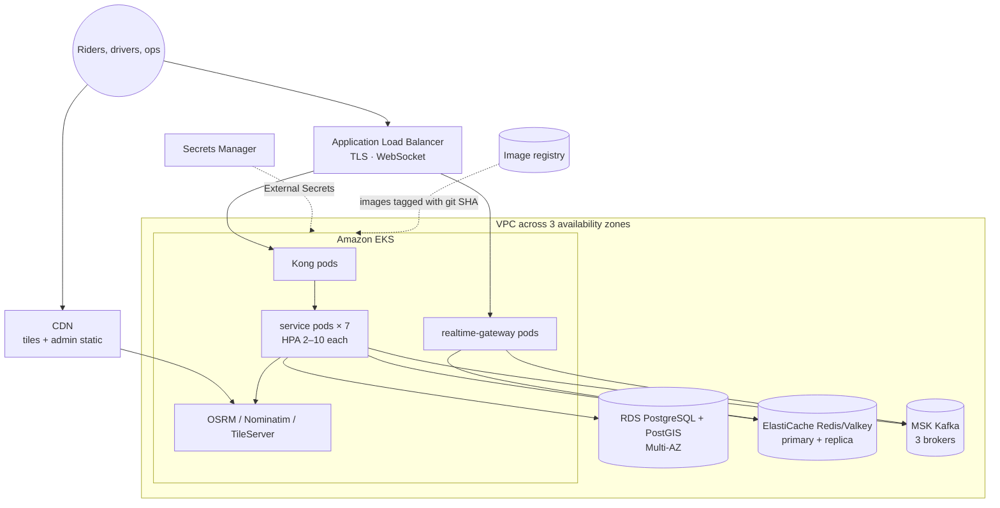

### Delivery pipeline

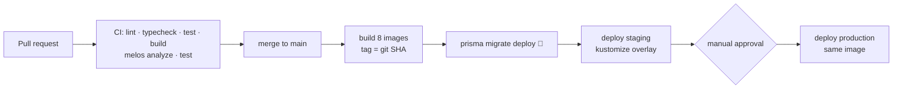

The infrastructure is defined in `infra/terraform` (EKS, RDS, ElastiCache, MSK) and `infra/k8s` (Kustomize base + staging/production overlays). See the [production guide](../production/README.md) for the readiness checklist.

---

## 12. Scalability and resilience

| Component | Scales by | Watch out for |
|---|---|---|
| Stateless services | HPA on CPU (2–10 replicas) | DB connections: replicas × pool size must stay under `max_connections` |
| realtime-gateway | More pods, with Redis adapter fan-out | LB idle timeouts, reconnect waves on deploy |
| Kafka consumers | Consumers per group, up to the partition count | Partition count caps parallelism. Plan it per topic |
| Redis | Vertical first, then cluster mode | Multi-key ops need hash tags in cluster mode |
| PostgreSQL | Vertical, read replicas, RDS Proxy | Long transactions, missing indexes |
| Mapping | More OSRM/Nominatim replicas, CDN for tiles | Memory per OSRM instance scales with region size |

### Failure handling

| Failure | Effect (target design) |
|---|---|
| notification-service down | Events wait in Kafka; notifications arrive late, nothing else breaks |
| payment-service down | Trips still complete; settlement and charges happen on recovery (events wait in Kafka, the inbox dedupes). Drivers go online with the last balance state location-service has |
| A payment provider is down or a callback is lost | Charges stay open; the provider is asked again (reconciliation) after `RECONCILE_AFTER_SECONDS`; declined charges are retried, then settled through a rider receivable |
| mapping/OSRM slow or down | Timeouts + cached routes. Fare falls back to a straight-line estimate |
| Redis down | No nearby search or live tracking; positions rebuild within seconds of recovery |
| A pod crashes | Kubernetes restarts it; readiness keeps traffic away until it's healthy |
| Bad deploy | Rolling update keeps old pods serving; `kubectl rollout undo` |

Every synchronous call needs a timeout, retries with backoff for idempotent operations, and a fallback where possible. Liveness probes never depend on databases (that would cause restart storms); readiness probes do.

---

## 13. Observability

| Signal | Today | Target |
|---|---|---|
| Logs | ✅ pino JSON to stdout (pretty in dev, `info` level in production) | Shipped by the cluster log agent; a correlation ID on every request and event |
| Health | ✅ `GET /health` on every service; Docker `HEALTHCHECK`; Kubernetes probes | Split `/health/live` and `/health/ready` (ready checks DB + Kafka) |
| Metrics | 📐 | Request rate, errors, latency per route; Kafka consumer lag; socket count |
| Tracing | 📐 | OpenTelemetry across Kong → services → Kafka |
| Alerts | 📐 | Error-rate SLOs, consumer lag, RDS/ElastiCache/MSK health |

---

## 14. Repository map

```
Anbessa/
├── apps/
│   ├── phone-app/          Flutter phone app, rider AND driver modes (role-based)
│   └── web/                React + Vite web app: staff dashboard, fleet and corporate portals (role-based)
├── packages/core/          Shared Dart models + widgets
├── services/               11 Node.js microservices (one image each), incl. fleet, platform (settings) and audit
├── libs/                   shared-types · shared-utils · shared-config · shared-authz (live permission matrix) · shared-settings (live settings)
├── infra/
│   ├── docker/             local compose stack
│   ├── kong/               declarative gateway config
│   ├── mapping-stack/      OSRM · Nominatim · TileServer GL
│   ├── k8s/                Kustomize base + overlays
│   └── terraform/          AWS: EKS · RDS · ElastiCache · MSK
├── docs/                   architecture · development · testing · production · api
├── learned/                Obsidian learning notes per technology
└── Makefile                team entry points (`make help`)
```

| Concern | Tooling |
|---|---|
| Node monorepo | pnpm 11 workspaces + Turborepo |
| Dart monorepo | Dart pub workspace + Melos 8 |
| Runtimes | Node 24 LTS, Flutter 3.44 / Dart 3.12, TypeScript 7 |

---

## 15. Key decisions

| # | Decision | Why | Trade-off |
|---|---|---|---|
| 1 | Microservices in a **monorepo** | Atomic changes to shared contracts; one toolchain | Needs task caching and affected-only CI to stay fast |
| 2 | **One phone app** with rider and driver modes | One codebase, release and set of shared widgets | The app bundle contains both experiences |
| 3 | **Kafka** for inter-service events, **Redis pub/sub** only for socket fan-out | Durable, replayable and ordered vs instant and ephemeral | Two messaging systems to operate |
| 4 | **Asymmetric JWTs verified by each service** (ES256 via Better Auth's JWKS, with rotation) | Stateless verification; only auth-service can sign; keys rotate without redeploys | Revocation needs short TTLs plus the suspension denylist |
| 5 | **Self-hosted OSM** mapping behind mapping-service | No per-request fees; engines are swappable | You operate OSRM, Nominatim and tile servers |
| 6 | **Database per service** on shared Postgres instances | Isolation without one server per service | No cross-service joins; eventual consistency |
| 7 | **Redis GEO** for live positions, **PostGIS** for durable geo | Write-heavy hot path vs queryable history | Two geo stores to keep consistent |
| 8 | **Managed** data services in production (RDS, ElastiCache, MSK) | Backups, failover and patching handled by AWS | Cost; some vendor coupling |
| 9 | **Kong DB-less** declarative config | Gateway config reviewed and versioned like code | No runtime admin changes |
| 10 | **Kubernetes + Kustomize** | Self-healing, rolling deploys, per-service autoscaling | Operational complexity |
| 11 | **Better Auth** for authentication (planned), our own permission matrix for authorization | Proven auth flows, sessions, organisations and key rotation without hand-written security code | Library upgrades need care. Two-surface setup needs a spike ([Auth.md §15](../design/Auth.md#15-risks-and-spikes)) |

---

## 16. Known gaps

Issues found while running the system, listed so nobody builds on false assumptions.

| Area | Gap | Impact |
|---|---|---|
| Events | Only auth-service has an outbox (and relay) so far | Other services can lose events if Kafka is down after a commit |
| Compose stack mode | Redpanda advertises `localhost:9092`; root `.env` points containers at `localhost` | Containerized services can't reach Kafka or Redis |
| Delivery | Kubernetes manifests use `:latest`; deploy jobs lack cluster credentials; only trip-service has manifests; `.github/` is gitignored | CD doesn't deploy new code yet |
| Infra | `infra/terraform/modules/` is empty; RDS pinned to Postgres 16 vs 18 locally | `terraform init` fails; dev/prod parity gap |
| Services | pricing, payment and fleet aren't built (pricing and payment expose `/health` only, fleet doesn't exist) | trip-service uses a quote stand-in, and no money moves yet | The flows in [§5.2](#52-request-a-trip-target-design) and [§5.4](#54-trip-completion-and-payment-target-design) are designs, not code |

When you close a gap, update this table and the status markers in [§3](#3-services-and-ownership) and [§8](#8-event-catalog).
