# Design: authentication with Better Auth

| | |
|---|---|
| **Status** | 👀 In review (proposal) |
| **Scope** | How Anbessa authenticates riders, drivers, partners and staff with **[Better Auth](https://better-auth.com)**: plugins, configuration, how the 18 roles and their scopes map onto Better Auth, sessions vs JWTs, verification in other services, data model, security, migration from the current auth-service |
| **Out of scope** | *What* each role may do. That stays in [Role.md](Role.md) and `libs/shared-authz` |
| **Related** | [← Design home](README.md) · [Role.md](Role.md) · [Database.md](Database.md) · [Payment.md](Payment.md) |

---

## Contents

1. [Summary](#1-summary)
2. [What Better Auth does, and what we keep](#2-what-better-auth-does-and-what-we-keep)
3. [Decisions](#3-decisions)
4. [Architecture](#4-architecture)
5. [Plugins](#5-plugins)
6. [Configuration sketch](#6-configuration-sketch)
7. [Mapping roles and scopes onto Better Auth](#7-mapping-roles-and-scopes-onto-better-auth)
8. [Sessions and tokens](#8-sessions-and-tokens)
9. [Key flows](#9-key-flows)
10. [Verifying tokens in other services](#10-verifying-tokens-in-other-services)
11. [Data model](#11-data-model)
12. [Security](#12-security)
13. [Events and audit](#13-events-and-audit)
14. [Migration from the current auth-service](#14-migration-from-the-current-auth-service)
15. [Risks and spikes](#15-risks-and-spikes)
16. [Open questions](#16-open-questions)

---

## 1. Summary

**Better Auth runs inside auth-service** (Fastify + Prisma 7 + PostgreSQL) and handles **authentication**:
- phone OTP sign-in,
- staff password + two-factor login,
- sessions,
- organisations, memberships and invitations,
- bans,
- issuing short-lived **JWTs** signed with keys it manages and publishes as a **JWKS**.

Every other service and the realtime gateway **verify those JWTs locally** against the JWKS, with no call to auth-service per request.

**Authorization stays ours.** Our permission matrix and scope checks (`libs/shared-authz`, [Role.md §8–9](Role.md#8-role--permission-matrix)) remain the single source of truth for what each role may do. The token's claims are built from Better Auth's data in the format Role.md defines.

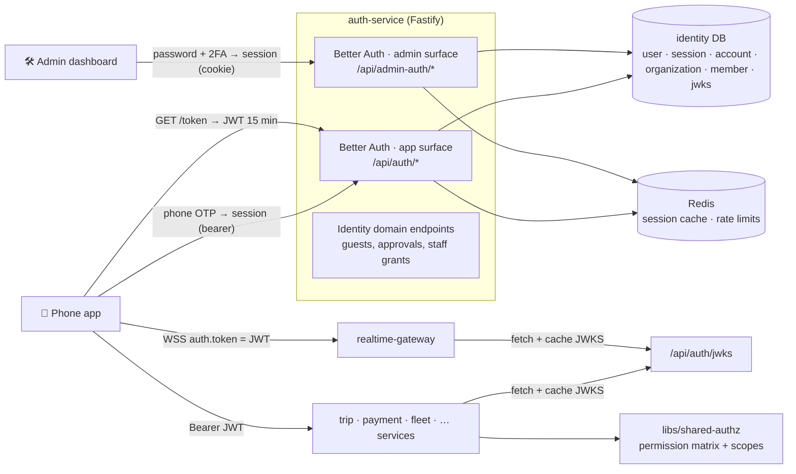

---

## 2. What Better Auth does, and what we keep

| Concern | Owner | Notes |
|---|---|---|
| Phone OTP sign-up and sign-in | **Better Auth** (`phoneNumber` plugin) | SMS sent through notification-service |
| Staff password login + two-factor | **Better Auth** (`emailAndPassword`, `twoFactor`) | Password hashing kept as **argon2id** through a custom hasher |
| Sessions, revocation, multi-device | **Better Auth** (DB sessions + Redis secondary storage) | |
| Mobile auth without cookies | **Better Auth** (`bearer` plugin) | |
| JWT issuing, key storage, rotation, JWKS | **Better Auth** (`jwt` plugin) | Replaces the RSA key files from `make secrets` |
| Organisations, members, invitations | **Better Auth** (`organization` plugin) | Fleet companies, corporate accounts **and** city staff groups |
| Global roles, ban/unban, session revoke | **Better Auth** (`admin` plugin) | Impersonation **disabled** |
| Rate limiting of auth endpoints | **Better Auth** (`rateLimit` in Redis) | Plus Kong's limits at the edge |
| **Permission matrix and scopes** | **Us** (`libs/shared-authz`) | Fed into Better Auth's access-control definitions so both agree |
| Maker–checker approvals for role grants | **Us** (approval tables + Better Auth hooks that refuse unapproved grants) | [Role.md §11](Role.md#11-approvals-makerchecker) |
| Guest riders, on-behalf bookings (`act`) | **Us** (identity domain endpoints) | Built on Better Auth's server API |
| Domain events (`user.created`, `user.suspended`, `role.granted`) | **Us** (database hooks → outbox) | [Database.md §8](Database.md#8-consistency-model) |
| Audit log | **Us** (`audit.recorded` events) | [Role.md §12](Role.md#12-audit-log) |

---

## 3. Decisions

| # | Decision | Why |
|---|---|---|
| AU1 | Use **Better Auth** for authentication, sessions, organisations and token issuing | TypeScript-native, framework-agnostic (Fastify works), Prisma adapter, plugin model covers phone OTP, organisations, 2FA, JWT/JWKS, bans. Saves building and maintaining security-critical code |
| AU2 | **Authorization stays in `libs/shared-authz`.** Better Auth's access-control definitions are **generated from** the same permission matrix | One source of truth. Better Auth's role checks can't express our CITY scopes on their own |
| AU3 | **Two surfaces**: an *app* instance (`/api/auth`, `aud = ride-app`) and an *admin* instance (`/api/admin-auth`, `aud = ride-admin`, 2FA required), over **one** identity database | Keeps [Role.md §10](Role.md#10-tokens)'s separation: staff tokens never work in the app, and app tokens never work on admin routes |
| AU4 | Signing algorithm **ES256** with automatic rotation (90 days) and the default 30-day grace period | Small, fast keys, supported by `jose` and by common gateways. The library default EdDSA is also fine for `jose`, but less widely supported by gateways |
| AU5 | Services verify JWTs **locally with the JWKS**. Kong does routing and rate limits, and **stops verifying JWTs** | Kong's open-source `jwt` plugin needs static per-consumer keys, which clashes with automatic key rotation. Verification in services is needed anyway for scopes |
| AU6 | **Minimal token payload** via `definePayload`: id, roles, scopes, versions. **Never** the whole user object (the plugin's default) | No PII in tokens, smaller headers |
| AU7 | IDs are **UUIDv7** via `advanced.database.generateId` | Matches [Database.md §6](Database.md#6-conventions-for-every-table) |
| AU8 | **Impersonation disabled.** Call-center work uses explicit on-behalf actions with an `act` claim | Impersonation hides who really acted. On-behalf keeps both identities in the audit log |
| AU9 | Pin the current **stable** Better Auth 1.x release and upgrade deliberately (a 1.8 beta exists at the time of writing) | Auth is security-critical. No beta in production |

---

## 4. Architecture

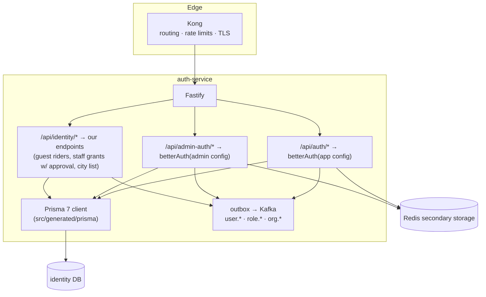

Fastify mounting (the documented pattern, one route per surface):

```ts
// services/auth-service/src/routes/better-auth.routes.ts (sketch)
import { fromNodeHeaders } from "better-auth/node";

export function mountBetterAuth(app: FastifyInstance, instance: Auth, prefix: string) {
  app.route({
    method: ["GET", "POST"],
    url: `${prefix}/*`,
    async handler(request, reply) {
      const url = new URL(request.url, `http://${request.headers.host}`);
      const req = new Request(url.toString(), {
        method: request.method,
        headers: fromNodeHeaders(request.headers),
        ...(request.body ? { body: JSON.stringify(request.body) } : {}),
      });
      const res = await instance.handler(req);
      reply.status(res.status);
      res.headers.forEach((value, key) => reply.header(key, value));
      return reply.send(res.body ? await res.text() : null);
    },
  });
}

mountBetterAuth(app, appAuth, "/api/auth");
mountBetterAuth(app, adminAuth, "/api/admin-auth");
```

Register `@fastify/cors` **before** these routes, and list allowed origins in each instance's `trustedOrigins`.

---

## 5. Plugins

| Plugin / feature | App surface | Admin surface | Purpose |
|---|---|---|---|
| `phoneNumber` | ✅ | — | OTP sign-up and sign-in for riders, drivers and partners. `signUpOnVerification` creates the account on first verify |
| `bearer` | ✅ | — | Mobile app sends `Authorization: Bearer <session token>` (no cookies) |
| `jwt` | ✅ `aud=ride-app`, 15 min | ✅ `aud=ride-admin`, 10 min | Short-lived JWTs for services, JWKS endpoint, key rotation |
| `organization` | ✅ | ✅ | Fleet companies, corporate accounts, staff city groups, invitations |
| `admin` | ✅ (role field, ban) | ✅ | Global roles on `user.role`, ban/unban, list and revoke sessions. **Impersonation disabled** |
| `emailAndPassword` | — | ✅ | Staff login (password hashed with argon2id) |
| `twoFactor` | optional | ✅ **required** | TOTP + backup codes for staff |
| `secondaryStorage` (Redis) | ✅ | ✅ | Session lookups and rate-limit counters without hitting Postgres |
| `rateLimit` | ✅ | ✅ | Stricter custom rules on OTP and sign-in endpoints |
| `databaseHooks` / `organizationHooks` | ✅ | ✅ | Outbox events, approval enforcement, validation |
| Not used | | | Anonymous sessions, magic links, social login (v1), impersonation |

---

## 6. Configuration sketch

> [!NOTE]
> A **sketch** to fix the design. Option names follow the Better Auth docs; exact signatures must be checked against the pinned version during the spike ([§15](#15-risks-and-spikes)).

```ts
// services/auth-service/src/auth/app-auth.ts (sketch)
import { betterAuth } from "better-auth";
import { prismaAdapter } from "@better-auth/prisma-adapter";   // or "better-auth/adapters/prisma", per pinned version
import { phoneNumber, bearer, jwt, organization, admin, twoFactor } from "better-auth/plugins";
import argon2 from "argon2";
import { v7 as uuidv7 } from "uuid";
import { prisma } from "../db.js";                                // Prisma 7 client from src/generated/prisma
import { redisStorage } from "./redis-storage.js";
import { orgAc, orgRoles, globalAc, globalRoles } from "@ride-app/shared-authz/better-auth";  // generated from the matrix
import { buildClaims } from "./claims.js";
import { enqueueOtpSms, outbox } from "./side-effects.js";
import { requireApprovedGrant } from "./approvals.js";

const ETHIOPIAN_MOBILE = /^\+251[79]\d{8}$/;                   // +2519… and +2517… (E.164)

export const appAuth = betterAuth({
  appName: "Anbessa",
  baseURL: process.env.AUTH_BASE_URL,                           // e.g. https://api.anbessa.et
  basePath: "/api/auth",
  secret: process.env.BETTER_AUTH_SECRET,                       // from Secrets Manager; also encrypts JWKS private keys
  database: prismaAdapter(prisma, { provider: "postgresql" }),
  secondaryStorage: redisStorage,
  trustedOrigins: [process.env.FLEET_PORTAL_ORIGIN!, process.env.CORPORATE_PORTAL_ORIGIN!],
  advanced: { database: { generateId: () => uuidv7() } },

  user: {
    modelName: "user",                                          // Prisma model User @@map("app_user")
    additionalFields: {
      accountStatus:     { type: "string", defaultValue: "ACTIVE", input: false },  // ACTIVE | GUEST | DELETED
      permissionVersion: { type: "number", defaultValue: 0,        input: false },  // the "pv" claim
    },
  },
  session: {
    expiresIn: 60 * 60 * 24 * 30,                               // 30 days (refreshes the app's ability to get JWTs)
    updateAge: 60 * 60 * 24,
    additionalFields: { surface: { type: "string", defaultValue: "app", input: false } },
  },
  rateLimit: {
    enabled: true,
    storage: "secondary-storage",
    customRules: {
      "/phone-number/send-otp": { window: 60, max: 3 },
      "/phone-number/verify":   { window: 60, max: 5 },
    },
  },

  plugins: [
    phoneNumber({
      phoneNumberValidator: (p) => ETHIOPIAN_MOBILE.test(p),
      sendOTP: ({ phoneNumber, code }) => { void enqueueOtpSms(phoneNumber, code); },   // don't await (docs advice)
      otpLength: 6,
      expiresIn: 300,
      allowedAttempts: 3,
      requireVerification: true,
      signUpOnVerification: {
        getTempEmail: (p) => `${p.slice(1)}@phone.anbessa.invalid`,  // email is required by the core schema
        getTempName:  (p) => p,
      },
    }),
    bearer(),
    jwt({
      jwks: { keyPairConfig: { alg: "ES256" }, rotationInterval: 60 * 60 * 24 * 90 },  // gracePeriod: default 30 days
      jwt: {
        issuer: "https://auth.anbessa.et",
        audience: "ride-app",
        expirationTime: "15m",
        definePayload: (ctx) => buildClaims(ctx, "app"),        // minimal claims, never the whole user (AU6)
      },
    }),
    organization({
      ac: orgAc,
      roles: orgRoles,
      allowUserToCreateOrganization: true,                      // fleet owners / corporate admins self-register (PENDING)
      schema: {
        organization: { additionalFields: {
          kind:      { type: "string", required: true },        // FLEET | CORPORATE | STAFF_CITY | STAFF_HQ
          cityId:    { type: "string", required: true },
          legalName: { type: "string" },
          tin:       { type: "string" },
          status:    { type: "string", defaultValue: "PENDING" },
        } },
        member: { additionalFields: { validUntil: { type: "date" } } },
      },
      organizationHooks: {
        beforeCreateOrganization: async ({ organization }) => {
          if (!["FLEET", "CORPORATE"].includes(organization.kind)) throw new Error("FORBIDDEN_ORG_KIND"); // staff orgs are seeded
        },
        beforeAddMember: async (data) => requireApprovedGrant(data),  // staff grants need an APPROVED approval_request
      },
    }),
    admin({ ac: globalAc, roles: globalRoles, defaultRole: "rider", adminRoles: ["super_admin"] }),
    twoFactor({ issuer: "Anbessa" }),
  ],

  emailAndPassword: { enabled: false },
  databaseHooks: {
    user: {
      create: { after: async (user) => outbox("user.created", { userId: user.id }) },
      update: { after: async (user) => { if (user.banned) await outbox("user.suspended", { userId: user.id }); } },
    },
  },
});
```

The **admin instance** reuses the same database, Prisma client, access control and hooks, with these differences:

| Setting | Admin surface |
|---|---|
| `basePath` | `/api/admin-auth` |
| `emailAndPassword` | `{ enabled: true, password: { hash: argon2.hash, verify: ({ hash, password }) => argon2.verify(hash, password) } }` |
| `twoFactor` | required for every staff account (sign-in refused until enrolled) |
| `session.expiresIn` | 12 h, and `session.additionalFields.surface.defaultValue = "admin"` |
| `jwt.audience` / `expirationTime` | `ride-admin` / `10m` |
| `phoneNumber`, `bearer` | not loaded |
| `trustedOrigins` | the admin dashboard origin only |
| Cookies | `__Host-` prefixed, `Secure`, `SameSite=Strict` |

---

## 7. Mapping roles and scopes onto Better Auth

[Role.md](Role.md) needs role assignments with a **scope** (`SELF`, `ORG`, `CITY`, `GLOBAL`). Better Auth has two role stores: **global roles** on `user.role` (admin plugin, comma-separated) and **per-organisation roles** on `member.role` (organization plugin, comma-separated). We use both, and model **cities as staff organisations**:

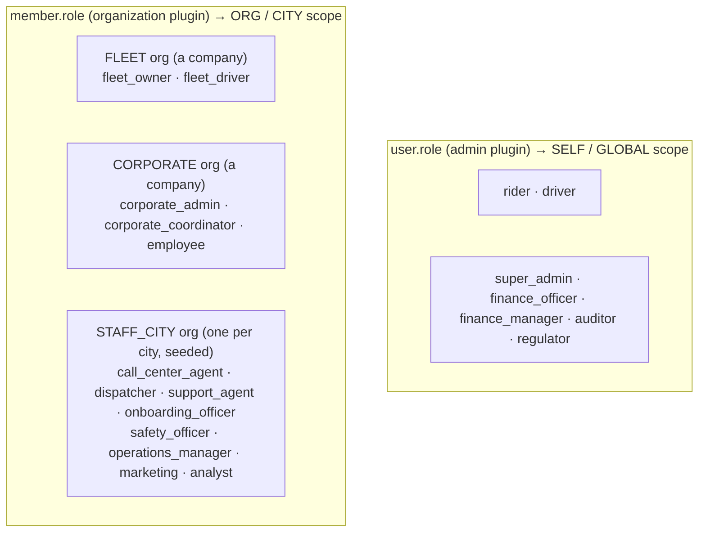

| Role ([Role.md §4](Role.md#4-role-catalog)) | Stored as | Scope it gives |
|---|---|---|
| `RIDER` | `user.role` contains `rider` (default on sign-up) | `SELF` |
| `DRIVER` | `user.role` contains `driver`, set by fleet-service on activation (server API) | `SELF` |
| `FLEET_OWNER` | `member.role = fleet_owner` in a `FLEET` org | `ORG:<id>` |
| Fleet driver (attribute) | `member.role = fleet_driver` in a `FLEET` org | membership for [V7](Role.md#ownership-rules) |
| `CORPORATE_ADMIN` / `CORPORATE_COORDINATOR` | `member.role` in a `CORPORATE` org | `ORG:<id>` |
| Corporate employee (attribute) | `member.role = employee` in a `CORPORATE` org | billing eligibility |
| `CALL_CENTER_AGENT`, `DISPATCHER`, `SUPPORT_AGENT`, `ONBOARDING_OFFICER`, `SAFETY_OFFICER`, `OPERATIONS_MANAGER`, `MARKETING`, `ANALYST` | `member.role` in the city's `STAFF_CITY` org (e.g. `staff-addis-ababa`) | `CITY:<org.cityId>` |
| `FINANCE_OFFICER`, `FINANCE_MANAGER`, `SUPER_ADMIN`, `AUDITOR` | `user.role` | `GLOBAL` |
| `ANALYST` (global) | `user.role` contains `analyst` | `GLOBAL` |
| `SERVICE` | Not a Better Auth user. Workload identity (Kubernetes service account / mTLS) or a separate client-credentials token | per client |

**Why cities as organisations?** Better Auth already gives organisations memberships, several roles per member, invitations, hooks and `validUntil` (as an additional field). A staff member who covers two cities simply has two memberships. Our `CITY` scope becomes "membership in a `STAFF_CITY` org whose `cityId` is X". No custom role-assignment table is needed.

### One permission matrix, two consumers

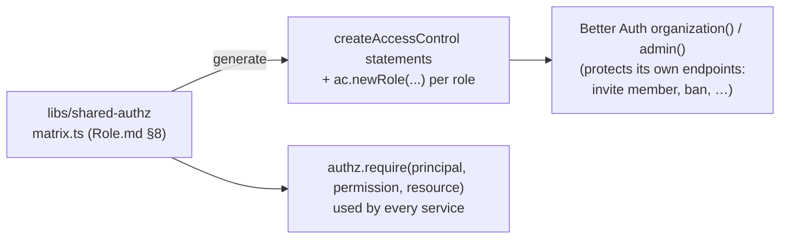

Better Auth's `hasPermission` protects **Better Auth's own** endpoints (inviting members, banning). Every **domain** action (`trip:assign`, `refund:approve`) is checked by `shared-authz` with scopes. Both read the same generated definitions, so they can't drift.

---

## 8. Sessions and tokens

Two kinds of credentials, with different jobs:

| | Session | Access JWT |
|---|---|---|
| Issued by | Better Auth on sign-in | Better Auth `jwt` plugin (`GET /token`) |
| Format | Opaque token. App: `Authorization: Bearer`. Admin: `__Host-` cookie | Signed JWT (ES256). The header carries the `kid` of the signing key |
| Lifetime | App 30 days, admin 12 h (sliding) | App 15 min, admin 10 min |
| Stored | `session` table + Redis secondary storage | Nowhere (stateless) |
| Used for | Getting new JWTs, Better Auth endpoints | Every call to every other service, and the WebSocket handshake |
| Revocation | Immediate (ban, sign-out, `revokeUserSessions`) | Expires within its TTL, plus the `user.suspended` denylist ([Role.md §10](Role.md#10-tokens)) |

### Claims (built by `definePayload`)

Same shape as [Role.md §10](Role.md#10-tokens):

```json
{
  "iss": "https://auth.anbessa.et",
  "aud": "ride-app",
  "sub": "0192f7a8-…",
  "exp": 1792900900,
  "pv": 7,
  "amr": ["otp"],
  "roles": [
    { "r": "RIDER" },
    { "r": "DRIVER" },
    { "r": "FLEET_OWNER", "org": "0192f7b1-…" }
  ]
}
```

`buildClaims(ctx, surface)`:
1. Refuses (returns no roles) if `session.surface ≠ surface`. A session belongs to exactly one surface.
2. Maps `user.role` → global/self roles.
3. Loads the user's active members (`validUntil` in the future) with their organisation `kind` and `cityId`. FLEET/CORPORATE become `{ r, org }`, and STAFF_CITY becomes `{ r, city }`.
4. On the **app** surface: includes only customer and partner roles. On the **admin** surface: includes only staff roles, and only if the user has two-factor enabled (`amr` includes `otp`/`totp`).
5. Adds `pv = user.permissionVersion`. Never adds name, phone, email or any other PII.

### Refreshing

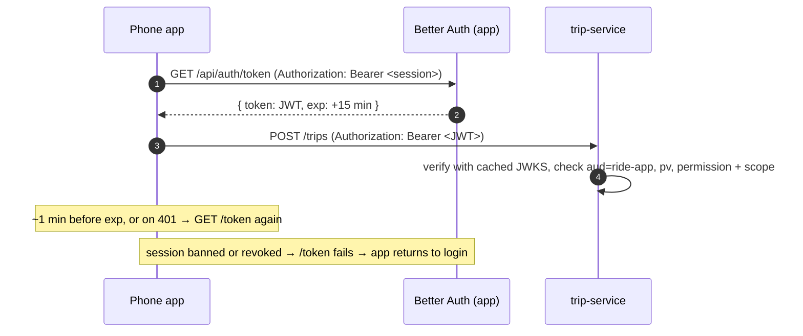

---

## 9. Key flows

### 9.1 Rider sign-up and sign-in with a phone OTP

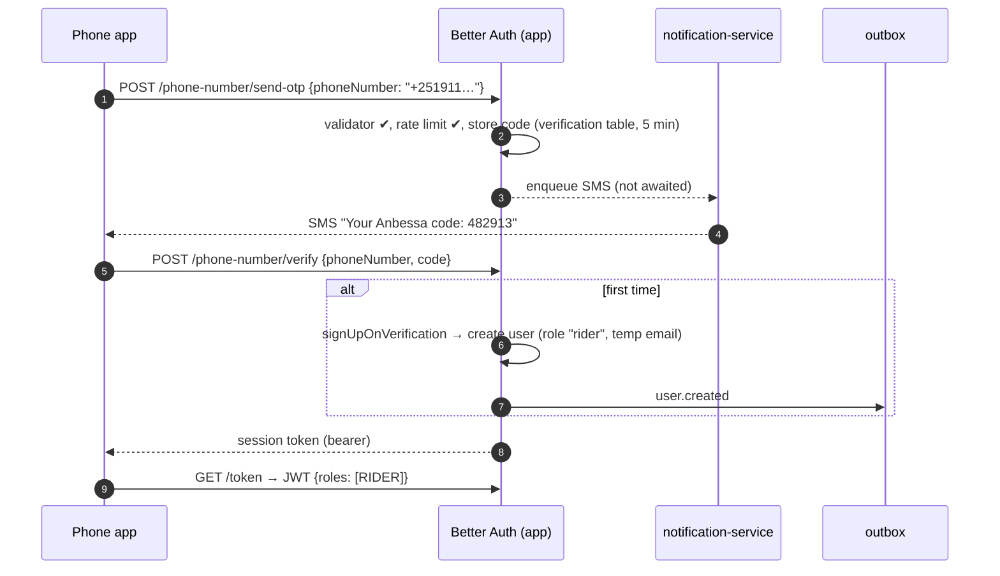

### 9.2 Staff sign-in with two-factor

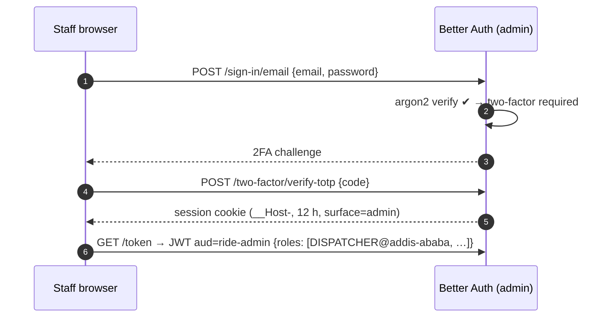

### 9.3 Granting a staff role (maker–checker)

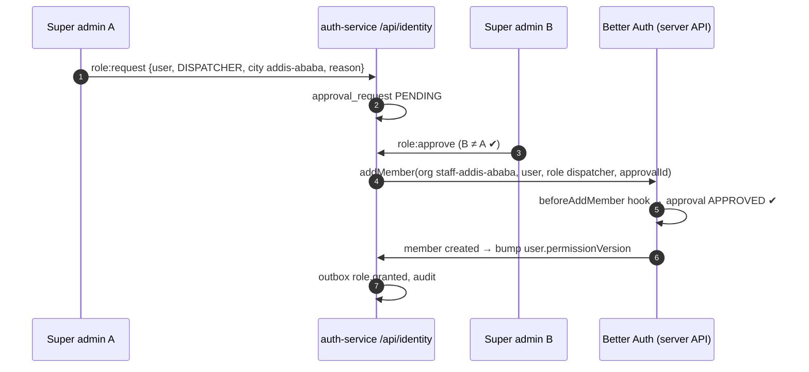

A direct `addMember` call (from a buggy script or a compromised super-admin session) **without** an approved request is refused by the hook.

### 9.4 Call center: guest rider, then claiming the account

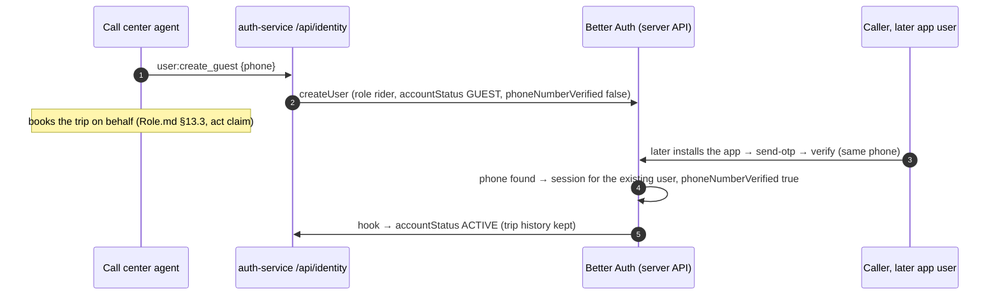

### 9.5 Suspension

`banUser` (safety officer through our endpoint, after the authz check):
1. Better Auth sets `banned`, `banReason` and `banExpires`, and **revokes all sessions**.
2. The database hook publishes `user.suspended` through the outbox.
3. Services add the `sub` to the Redis denylist, so even unexpired JWTs (≤ 15 min) are refused.
4. `/token` refuses new JWTs while banned.

### 9.6 Key rotation

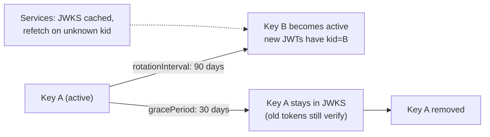

Tokens live 15 minutes, so the 30-day grace period is generous. Private keys are stored **AES-256-GCM encrypted** with `BETTER_AUTH_SECRET` (the default; don't disable it).

---

## 10. Verifying tokens in other services

In `libs/shared-authz` (used by every service and realtime-gateway):

```ts
import { createRemoteJWKSet, jwtVerify } from "jose";

const jwks = createRemoteJWKSet(new URL(`${process.env.AUTH_INTERNAL_URL}/api/auth/jwks`));
// cached in memory; jose refetches when a token carries an unknown kid

export async function verifyAccessToken(token: string, audience: "ride-app" | "ride-admin") {
  const { payload } = await jwtVerify(token, jwks, {
    issuer: "https://auth.anbessa.et",
    audience,
    algorithms: ["ES256"],            // pin the algorithm, never trust the header alone
    clockTolerance: 30,
  });
  await assertNotDenylisted(payload.sub!);   // Redis: user.suspended
  await assertPermissionVersion(payload);    // Redis: pv:{userId}
  return toPrincipal(payload);               // { userId, roles: [{ role, scopeType, orgId?, cityId? }] }
}
```

| Consumer | Change from today |
|---|---|
| realtime-gateway | Replace `importSPKI(readFileSync(JWT_PUBLIC_KEY_PATH))` with `verifyAccessToken(handshake.auth.token, "ride-app")`. `JWT_PUBLIC_KEY_PATH` goes away |
| All HTTP services | A Fastify `onRequest` hook calls `verifyAccessToken`, then routes call `authz.require(...)` |
| Admin-facing routes (`/api/admin/*`) | `audience: "ride-admin"` |
| Kong | Remove the `jwt` plugin (which today has no consumers and rejects everything). Keep routing, rate limiting and request-size limits |
| Local dev | Services point `AUTH_INTERNAL_URL` at `http://localhost:3001`. `make secrets` generates `BETTER_AUTH_SECRET` instead of RSA key files |

---

## 11. Data model

Better Auth owns its core tables, plus the plugin tables. We add fields through `additionalFields`. Its CLI generates the Prisma models, and our normal **Prisma migrations** apply them (the Better Auth CLI doesn't migrate Prisma schemas).

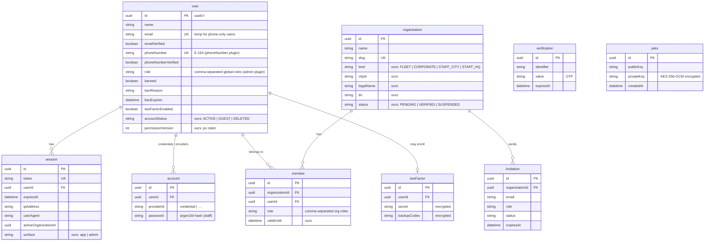

### What changes in the other designs

| Previous design element | Becomes |
|---|---|
| `app_user` ([Database.md §7.1](Database.md#71-identity-auth-service-better-auth)) | Better Auth `user` (Prisma `@@map("app_user")`) + additional fields |
| `role_assignment` with `scope_type` | `user.role` (SELF/GLOBAL) + `member.role` in FLEET / CORPORATE / STAFF_CITY organisations |
| `organization` (ours) | Better Auth `organization` + additional fields (`kind`, `cityId`, `legalName`, `tin`, `status`) |
| `membership` | Better Auth `member` (+ `validUntil`) and `invitation` |
| `token_version` | `user.permissionVersion` (the `pv` claim) |
| `status SUSPENDED` | Better Auth ban fields (`banned`, `banReason`, `banExpires`) |
| `city` | Stays ours (plain table). Each city also gets a seeded `STAFF_CITY` organisation |
| RSA key files from `make secrets` | `jwks` table (encrypted). `make secrets` generates `BETTER_AUTH_SECRET` |

### Constraints we add on top (raw SQL migrations)

| Constraint | Why |
|---|---|
| `UNIQUE (phoneNumber)` where not null | One account per phone (the plugin relies on it) |
| `CHECK (phoneNumber ~ '^\+251[79][0-9]{8}$')` | Same rule as the validator, enforced in the DB |
| `CHECK (kind IN ('FLEET','CORPORATE','STAFF_CITY','STAFF_HQ'))` on organization | Valid kinds only |
| `UNIQUE (kind, tin)` on organization where `tin` is not null | One verified legal entity per kind ([Role.md §5](Role.md#5-core-model-users-roles-scopes-organisations)) |
| `UNIQUE (organizationId, userId)` on member | One membership row per org (several roles are comma-separated in it) |

---

## 12. Security

| # | Measure |
|---|---|
| S1 | `BETTER_AUTH_SECRET`: 32+ random bytes, in Secrets Manager, **different per environment**. It encrypts JWKS private keys and signs cookies, so rotating it needs a planned key migration |
| S2 | **Minimal JWT payload** (AU6). The plugin's default puts the whole user object in the token, so it **must** be overridden |
| S3 | Pin `algorithms: ["ES256"]` on verification, and check `iss`, `aud` and `exp` everywhere |
| S4 | **OTP abuse ("SMS pumping")**: per-number and per-IP rate limits (Kong + Better Auth `customRules`), the Ethiopian-mobile validator, daily SMS budget alerts, a CAPTCHA challenge after repeated sends |
| S5 | `allowedAttempts: 3` and a 5-minute expiry on OTPs. After 3 failures the code is deleted and a new one must be requested |
| S6 | Staff: password + **TOTP required**, `__Host-` cookies, `SameSite=Strict`, 12-hour sessions, admin origin only in `trustedOrigins` |
| S7 | **Impersonation disabled** (no role gets `impersonate`). On-behalf actions carry an `act` claim instead |
| S8 | Passwords hashed with **argon2id** (custom hasher). Existing hashes migrate unchanged |
| S9 | Session cookies and bearer tokens never logged. Better Auth's error messages don't reveal whether a phone number exists |
| S10 | Pin a stable Better Auth version, watch its security advisories, and upgrade through a PR with the auth test suite |

---

## 13. Events and audit

| Better Auth event (hook) | Our event (outbox) | Consumers |
|---|---|---|
| `databaseHooks.user.create.after` | `user.created` | notification (welcome), trip (rider cache), audit |
| user updated with `banned = true` / `false` | `user.suspended` / `user.reinstated` | every service (denylist), audit |
| `organizationHooks` after add/remove member | `role.granted` / `role.revoked` (+ `permissionVersion` bump) | audit, admin dashboard |
| `organizationHooks` after organisation status changes | `org.verified` / `org.suspended` | fleet, payment, trip |
| sign-in success / failure | `audit.recorded` (staff surface: always. App: failures only, sampled) | audit-service |

Hooks only **write to the outbox in the same database**. They never call Kafka directly, so a Kafka outage can't break sign-in ([Database.md §8](Database.md#8-consistency-model)).

---

## 14. Migration from the current auth-service

Today, auth-service has hand-written `register`/`login` (both currently broken, see [architecture §16](../architecture/overview.md#16-known-gaps)), a single `User.role`, and RS256 key files.

| Phase | Work | Result |
|---|---|---|
| **1. Spike** | Better Auth + Prisma 7 adapter + Fastify in a branch. Prove: phone OTP, bearer, `/token`, JWKS verify in a test service, two surfaces on one DB ([§15](#15-risks-and-spikes)) | Risks closed or design adjusted |
| **2. Schema** | Generate the Better Auth Prisma models, add our `additionalFields` and constraints, `@@map` to snake_case tables, migrate with `prisma migrate` | Tables ready |
| **3. Data migration** | `User` → `user` (+ `phoneNumber`), `passwordHash` → `account` (`providerId = "credential"`, argon2 kept), `role` → `user.role` (`RIDER → rider`, `DRIVER → driver`, `ADMIN → super_admin`, flagged for review). Seed `STAFF_CITY` org `staff-addis-ababa` | Existing users keep working |
| **4. Switch auth-service** | Mount both Better Auth surfaces. Delete the hand-written routes, `jose` signing and `JWT_PRIVATE_KEY_PATH`. Add `/api/identity/*` for guests and staff grants | Login works (fixes today's bugs) |
| **5. Switch verifiers** | `libs/shared-authz` `verifyAccessToken` in realtime-gateway and services. Remove the `jwt` plugin from Kong | One verification path |
| **6. Clients** | Phone app: OTP screens + bearer + `/token` refresh (replaces the login placeholder and the rider/driver buttons). Admin dashboard: password + TOTP | End-to-end |
| **7. Hardening** | OTP abuse controls, key-rotation drill, ban → denylist test, audit events | Production-ready |

---

## 15. Risks and spikes

| # | Risk | Spike / mitigation |
|---|---|---|
| R1 | **Two Better Auth instances on one database** (app + admin surfaces) | Verify that sessions stamped with `surface` can't mint tokens on the other surface, and that shared tables and hooks behave. **Fallback:** one instance, with the surface decided by a session field set at sign-in and the audience chosen in a custom `jwt.sign` |
| R2 | `definePayload` arguments, and whether it can be `async` (needed to load memberships) | Check against the pinned version. **Fallback:** keep memberships in a Redis cache refreshed by `role.*` events, and read it synchronously |
| R3 | Prisma 7 client with the custom output path (`src/generated/prisma`) and the driver adapter | Import the client from the generated path (as the adapter docs require). Integration test in CI |
| R4 | Organisations as city staff groups could be confused with customer organisations in Better Auth's own UI/APIs | `kind` field + `beforeCreateOrganization` hook. Staff orgs are only created by seed migrations. List endpoints are filtered by kind |
| R5 | Better Auth's core schema requires an email for phone-only users | Temp email on a reserved domain (`@phone.anbessa.invalid`), never shown and never sent to |
| R6 | Library upgrades changing behaviour | Pin the version, run the auth test suite (sign-in, OTP limits, token claims, ban, rotation) on every upgrade |

---

## 16. Open questions

| # | Question | Current default |
|---|---|---|
| Q1 | Should riders and drivers have **passwords** as well as OTP? | OTP only for the app (passwords for staff) |
| Q2 | Social login (Google/Apple) for riders? | Not in v1 |
| Q3 | SMS provider for OTPs, and its cost per message | Through notification-service, provider TBD |
| Q4 | Optional 2FA for fleet owners and corporate admins (they handle money and staff)? | Optional at launch, required later for fleets above N vehicles |
| Q5 | Service-to-service identity: Kubernetes workload identity / mTLS, or OAuth client credentials? | Workload identity + mTLS (service mesh) in production, so no Better Auth users for services |
