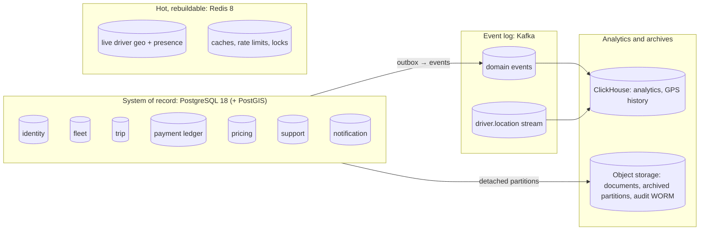
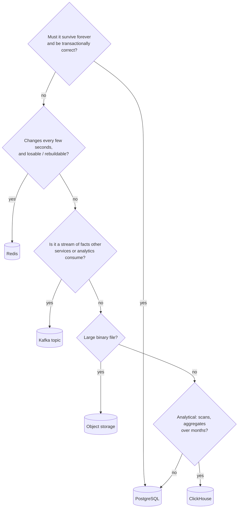
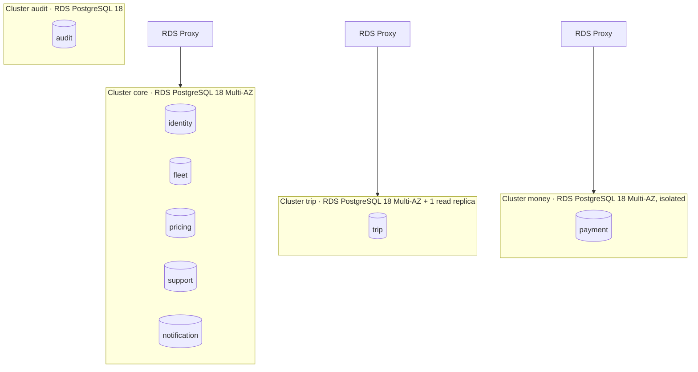
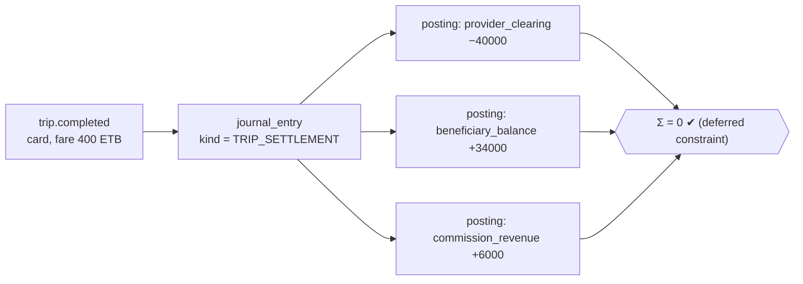
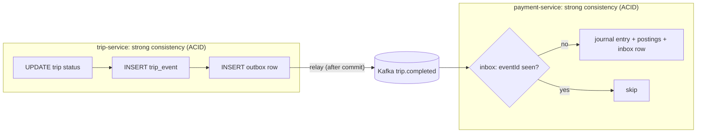
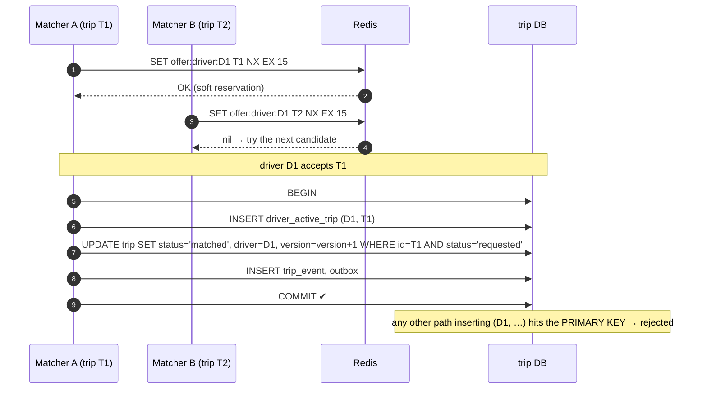
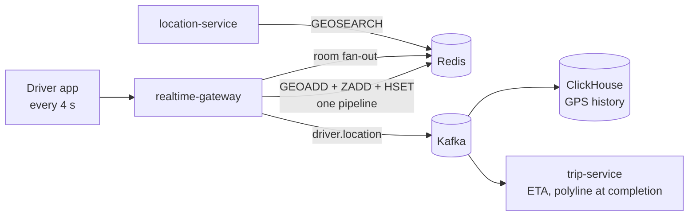
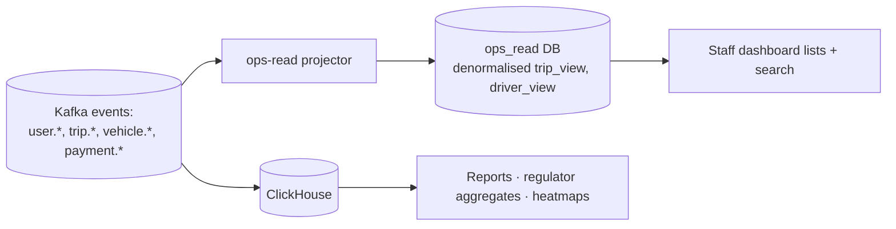
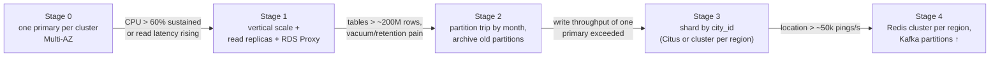
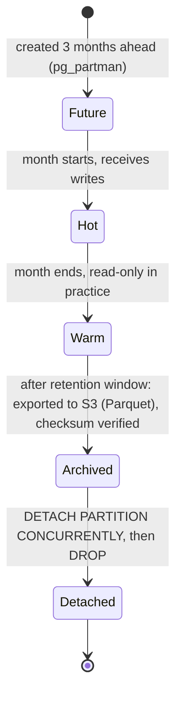

# Design: database architecture

| | |
|---|---|
| **Status** | 👀 In review (proposal) |
| **Scope** | Every persistent store in Anbessa: which data goes where, schemas, keys and indexes, consistency guarantees, concurrency control, scaling path, performance, data lifecycle, backup/DR, security and migrations |
| **Out of scope** | Business rules themselves (see [Role.md](Role.md) and the planned `Trip.md` / `Payment.md`) |
| **Related** | [← Design home](README.md) · [Role.md](Role.md) · [Auth.md](Auth.md) · [Architecture overview](../architecture/overview.md) · [Production guide](../production/README.md) |

---

## Contents

1. [Summary](#1-summary)
2. [Goals and principles](#2-goals-and-principles)
3. [Workload and capacity estimates](#3-workload-and-capacity-estimates)
4. [Which store for which data](#4-which-store-for-which-data)
5. [Topology: clusters, databases, connections](#5-topology-clusters-databases-connections)
6. [Conventions for every table](#6-conventions-for-every-table)
7. [Schemas per service](#7-schemas-per-service)
8. [Consistency model](#8-consistency-model)
9. [Concurrency control](#9-concurrency-control)
10. [Hot path: live location in Redis](#10-hot-path-live-location-in-redis)
11. [Kafka topics as data](#11-kafka-topics-as-data)
12. [Read models, search and analytics](#12-read-models-search-and-analytics)
13. [Performance](#13-performance)
14. [Scaling path](#14-scaling-path)
15. [Data lifecycle: partitions, retention, archiving, deletion](#15-data-lifecycle-partitions-retention-archiving-deletion)
16. [Backup and disaster recovery](#16-backup-and-disaster-recovery)
17. [Security](#17-security)
18. [Schema migrations](#18-schema-migrations)
19. [Observability](#19-observability)
20. [Decisions and alternatives considered](#20-decisions-and-alternatives-considered)
21. [Rollout plan](#21-rollout-plan)
22. [Open questions](#22-open-questions)

---

## 1. Summary



**In one paragraph:** each service owns a PostgreSQL database, the system of record, with strict constraints and ACID transactions *inside* the service. Data crosses services only through **events** published reliably with the **transactional outbox** and consumed **idempotently**, so the system is **eventually consistent between services and strongly consistent within each one**.

- **Redis:** the high-frequency live-location path, plus caches.
- **Kafka:** the durable event backbone, and the source for analytics.
- **ClickHouse:** analytics and GPS history, which never live in Postgres row-by-row.
- **Money:** a **double-entry ledger** with integer amounts in santim, immutable entries and idempotency keys.
- **Growth:** every operational row carries a `city_id`, so the system can grow from one primary per cluster → read replicas → partitioning → per-city sharding **without a redesign**.

---

## 2. Goals and principles

| # | Goal | What it means concretely |
|---|---|---|
| G1 | **Correctness first for money and assignments** | A driver can't be on two trips. A rider can't be charged twice. Ledger entries always balance. Enforced by the database, not just code |
| G2 | **Low latency on the rider/driver path** | p99 < 50 ms for nearby-driver search and trip reads. Location writes never touch Postgres |
| G3 | **Scale by adding, not rewriting** | Shard keys (`city_id`), time-ordered IDs and partitioning hooks exist from day one |
| G4 | **Services stay independent** | Database per service. No cross-service SQL. Contracts are events and APIs |
| G5 | **Survive failures** | Multi-AZ, point-in-time recovery, tested restores, documented RPO/RTO per store |
| G6 | **Privacy by design** | Minimal PII, encrypted sensitive columns, retention limits, deletable personal data |
| G7 | **Operable by a small team** | Managed services (RDS, ElastiCache, MSK), boring proven technology, few moving parts at first |

**Principles**

1. **Let the database enforce invariants** (unique, check, foreign key, exclusion, partial unique indexes). Code can have bugs; constraints don't forget.
2. **Append, don't overwrite, for anything historical** (trip events, ledger, audit). Current state is derived or kept beside it.
3. **Hot vs durable:** data that changes every few seconds and can be rebuilt (positions, presence) never goes in the system of record.
4. **One writer per table:** only the owning service writes it.
5. **Measure before optimising.** The scaling stages in [§14](#14-scaling-path) are triggered by metrics, not guesses.

---

## 3. Workload and capacity estimates

These are planning numbers to size the design, not forecasts. Revisit them with real metrics after launch.

| Metric | Year 1 (Addis) | Year 3 (multi-city, ~10×) |
|---|---|---|
| Registered riders | 500 k | 5 M |
| Active drivers | 15 k | 150 k |
| Drivers online at peak | 5 k | 50 k |
| Trips per day | 150 k | 1.5 M |
| Peak trip requests / s | ~5 | ~50 |
| Location pings / s at peak (1 every 4 s) | **~1,250** | **~12,500** |
| Nearby-driver searches / s at peak | ~50 | ~500 |

### What that means per store

| Data | Year-1 volume | Year-3 volume | Consequence |
|---|---|---|---|
| `trip` rows | ~55 M / year | ~550 M / year | Fine unpartitioned at first; partition by month around year 2 |
| `trip_event` rows (~6 per trip) | ~330 M / year | ~3.3 B / year | **Partition monthly from day one** |
| Ledger postings (~4 per trip) | ~220 M / year | ~2.2 B / year | **Partition monthly from day one** |
| GPS points (~375 per trip) | ~56 M / **day** | ~560 M / day | **Never in Postgres.** Kafka → ClickHouse, plus a compressed polyline per trip |
| Location writes | 1,250 / s | 12,500 / s | Redis handles 100k+ ops/s per node: one node, then a small cluster |
| Audit entries | ~50 M / year | ~500 M / year | Partitioned, append-only, archived to WORM storage |

**Storage, year 1:** trip ≈ 55 M × ~1.2 KB (row + indexes) ≈ **65 GB**, trip events ≈ **60 GB**, ledger ≈ **50 GB**. All comfortably on single RDS instances. The challenge is **write concurrency, lock contention and history growth**, not raw size.

---

## 4. Which store for which data



| Data | Store | Why |
|---|---|---|
| Users, sessions, roles, organisations, memberships | PostgreSQL `identity` (Better Auth tables, [Auth.md](Auth.md)) | Relational, strongly consistent, low volume |
| Drivers, vehicles, ownership, authorisations, sessions, document metadata | PostgreSQL `fleet` | Ownership invariants need constraints ([Role.md §6](Role.md#6-vehicle-ownership)) |
| Document **files** (licences, registrations) | Object storage (S3), encrypted | Large binaries. The DB stores only the key + hash + metadata |
| Trips, trip state history | PostgreSQL `trip` (+ PostGIS) | State machine with concurrency guarantees, geo columns for pickup/dropoff |
| Ledger, payments, refunds, payouts, invoices | PostgreSQL `payment` (isolated cluster) | Money: strongest guarantees, isolated from other load |
| Fares, zones, vehicle types | PostgreSQL `pricing` (+ PostGIS) | Polygons for zones, low write volume, heavily cached |
| Tickets, incidents, SOS, lost items | PostgreSQL `support` | Workflow data |
| Notification log, templates, device tokens | PostgreSQL `notification` | Deduplication, delivery tracking |
| Live driver positions, presence, driver state | Redis | ~1,250–12,500 writes/s, sub-ms geo search, rebuildable in seconds |
| Caches, rate limits, short locks, idempotency fast-path | Redis | TTL-based, losable |
| Domain events, location stream | Kafka | Durable, ordered per key, replayable |
| GPS history, trip analytics, dashboards | ClickHouse | Columnar: billions of rows, fast aggregates, cheap compression |
| Audit log | PostgreSQL `audit` (partitioned) → S3 with Object Lock (WORM) | Queryable recent window, tamper-proof long-term archive |
| Search (phone, plate, name) for staff | Postgres read model first, OpenSearch later if needed | See [§12](#12-read-models-search-and-analytics) |

---

## 5. Topology: clusters, databases, connections

Services don't each need their own *server*. They need their own *database and credentials*. Group logical databases onto a few clusters by **criticality and load profile**:



| Cluster | Why separate | Instance (start) |
|---|---|---|
| **core** | Low-to-medium load, shared to save cost | `db.r7g.large` |
| **trip** | Highest OLTP write rate. Must not be slowed by others | `db.r7g.xlarge` + 1 read replica |
| **money** | Strictest correctness, access and audit. Isolated blast radius and credentials | `db.r7g.large` |
| **audit** | Append-heavy, long retention, different backup policy | `db.r7g.large` |

**Locally** (`make infra-up`) all of these are databases on the single `postgis/postgis:18-3.6-alpine` container: same schemas, one server.

### Connections and pooling

Each pod opens a pool, and replicas multiply it. Budget it explicitly:

```
connections needed ≈ Σ over services ( max_replicas × pool_size )
trip cluster:  trip-service 10 pods × 10 = 100   (+ workers 20)  → 120  ≤ 70% of max_connections
```

| Rule | Value |
|---|---|
| Pool size per pod | 5–10 (start at 5). More connections ≠ more throughput |
| Proxy | **RDS Proxy** (or PgBouncer in transaction mode) in front of every cluster |
| Statement timeout | `statement_timeout = 5s` for API roles, longer for batch roles |
| Idle in transaction | `idle_in_transaction_session_timeout = 10s` (stops idle transactions holding locks) |
| Lock timeout for migrations | `lock_timeout = 3s` ([§18](#18-schema-migrations)) |

> [!NOTE]
> Prisma with a transaction-mode pooler: keep transactions short and avoid session-level features (prepared statements across transactions, `SET` without `LOCAL`). Use `SET LOCAL` inside transactions.

---

## 6. Conventions for every table

| Topic | Convention | Why |
|---|---|---|
| **Primary keys** | `uuid` **v7** via PostgreSQL 18's built-in `uuidv7()` | Globally unique (safe across shards and events), **time-ordered** so inserts append to the index instead of random page splits (unlike v4). The creation time is recoverable with `uuid_extract_timestamp()` |
| **External IDs** | Prefixed in APIs: `trp_…`, `usr_…`, `veh_…` (prefix + base32 of the UUID) | Readable in logs and support calls, type-safe |
| **Money** | `bigint` in **minor units (santim)** + `currency char(3)` (`'ETB'`) | Exact arithmetic. 1 ETB = 100 santim. Never `float`/`real` |
| **Time** | `timestamptz`, stored in **UTC** | Convert to the Ethiopian calendar or local clock **only in the presentation layer** |
| **Phone numbers** | E.164 text (`+2519…`), unique | One canonical form for lookups and dedupe |
| **Email** | `citext` | Case-insensitive uniqueness |
| **Status / enums** | `text` + `CHECK (status IN (…))`, or a lookup table | Changing a native enum needs a migration with a lock. A check constraint is easier to evolve |
| **Geo** | `geography(Point, 4326)` for points, `geography(Polygon, 4326)` for zones, GiST index | Distances in meters ([PostGIS note](../../learned/Data%20&%20Messaging/PostGIS.md)) |
| **Scope keys** | `city_id text NOT NULL` on every operational row (trips, vehicles, drivers, tickets, ledger accounts) | The future shard key, and the staff scope ([Role.md §9](Role.md#9-authorization-how-a-request-is-checked)) |
| **Optimistic locking** | `version int NOT NULL DEFAULT 0` on mutable aggregates | Safe concurrent updates ([§9](#9-concurrency-control)) |
| **Audit columns** | `created_at`, `updated_at` (trigger), `created_by` where actors matter | Debugging, support |
| **Deletion** | No hard deletes on business tables. Use `status` / `deleted_at`. PII is **anonymised**, not deleted, when the row must stay for accounting ([§15](#15-data-lifecycle-partitions-retention-archiving-deletion)) | History and ledgers must stay intact |
| **Naming** | `snake_case`, singular table names (`trip`, `vehicle`), FKs `<table>_id`, indexes `ix_<table>_<cols>`, unique `ux_…`, checks `ck_…` | Predictable. (Prisma maps model names with `@@map`) |
| **JSON** | `jsonb` only for genuinely schemaless payloads (event payloads, provider responses). Never for fields you filter on | Typed columns can be indexed and constrained |

---

## 7. Schemas per service

The DDL below is PostgreSQL 18 (the services may express it through Prisma migrations). Each block shows tables, keys and the indexes that serve the main queries.

> [!NOTE]
> **Verified on PostgreSQL 18.6** (the local `postgis/postgis:18-3.6-alpine` image): every `CREATE` block in this document applies cleanly (the identity constraints in §7.1 were applied to stand-in tables shaped like Better Auth's generated schema), and these invariants were tested and hold. A vehicle with two owners is rejected (`ck_vehicle_single_owner`). An unbalanced journal entry fails at `COMMIT`, and a balanced one commits. A duplicate settlement is rejected (`idempotency_key`). A second active trip for one driver is rejected (`driver_active_trip_pkey`). A stale conditional transition updates 0 rows. Overlapping fare validity is rejected (`ex_fare_rule_no_overlap`). Corporate billing without an org is rejected. The app role has no `UPDATE`/`DELETE` on ledger tables. Identity: non-Ethiopian-mobile phone numbers, duplicate phones, unknown organisation kinds, unknown cities, and a duplicate TIN within one organisation kind are all rejected. The outbox `SKIP LOCKED` query runs.

### 7.1 Identity (auth-service, Better Auth)

Identity tables are **owned by Better Auth** ([Auth.md §11](Auth.md#11-data-model)). Its CLI generates the Prisma models, and we add `additionalFields`, map them to snake_case tables (`@@map`, `@map`), use UUIDv7 IDs (`advanced.database.generateId`) and migrate with our normal Prisma migrations.

| Table (mapped name) | From | Holds |
|---|---|---|
| `app_user` | Better Auth core + `phoneNumber`, `admin`, `twoFactor` plugins | id, name, email (temp for phone-only users), `phone_number` (E.164), `phone_number_verified`, `role` (comma-separated **global** roles), `banned` / `ban_reason` / `ban_expires`, `two_factor_enabled`, **ours:** `account_status`, `permission_version` |
| `session` | core (+ `organization`, `admin`) | token, user, expiry, IP, user agent, `active_organization_id`, **ours:** `surface` (`app` / `admin`) |
| `account` | core | credentials per provider. Staff `password` = argon2id hash |
| `verification` | core | OTP codes and other one-time values (short TTL) |
| `organization` | `organization` plugin | name, slug, **ours:** `kind` (`FLEET` / `CORPORATE` / `STAFF_CITY` / `STAFF_HQ`), `city_id`, `legal_name`, `tin`, `status` |
| `member` | `organization` plugin | user ↔ organisation, `role` (comma-separated **org** roles), **ours:** `valid_until` |
| `invitation` | `organization` plugin | pending invitations (fleet drivers, corporate employees) |
| `jwks` | `jwt` plugin | signing keys. Private keys **AES-256-GCM encrypted** |
| `two_factor` | `twoFactor` plugin | TOTP secrets and backup codes (encrypted) |
| `city` | **ours** | the list of cities (scope key everywhere) |
| `approval_request`, `outbox`, `inbox` | **ours** | maker–checker grants, events ([§8](#8-consistency-model)) |

Constraints and the `city` table we add with raw-SQL migrations on top of the generated ones:

```sql
CREATE TABLE city (
  id        text PRIMARY KEY,                               -- 'addis-ababa'
  name      text NOT NULL,
  timezone  text NOT NULL DEFAULT 'Africa/Addis_Ababa'
);

ALTER TABLE app_user
  ADD CONSTRAINT ck_app_user_phone_e164_et
    CHECK (phone_number IS NULL OR phone_number ~ '^\+251[79][0-9]{8}$'),
  ADD CONSTRAINT ck_app_user_account_status
    CHECK (account_status IN ('ACTIVE','GUEST','DELETED'));
CREATE UNIQUE INDEX ux_app_user_phone ON app_user (phone_number) WHERE phone_number IS NOT NULL;

ALTER TABLE organization
  ADD CONSTRAINT ck_organization_kind   CHECK (kind IN ('FLEET','CORPORATE','STAFF_CITY','STAFF_HQ')),
  ADD CONSTRAINT ck_organization_status CHECK (status IN ('PENDING','VERIFIED','SUSPENDED')),
  ADD CONSTRAINT fk_organization_city   FOREIGN KEY (city_id) REFERENCES city(id);
CREATE UNIQUE INDEX ux_organization_kind_tin ON organization (kind, tin) WHERE tin IS NOT NULL;

CREATE UNIQUE INDEX ux_member_org_user ON member (organization_id, user_id);
CREATE INDEX ix_member_user ON member (user_id);             -- building token claims: all memberships of a user
```

Main queries:
- sign-in by phone (unique index),
- session lookup (Redis secondary storage first, then `session.token`),
- claims for a token (`app_user.role` + `member` by `user_id`, joined with `organization.kind/city_id`),
- the members of an organisation.

### 7.2 Fleet (fleet-service)

```sql
CREATE TABLE driver_profile (
  user_id         uuid PRIMARY KEY,                    -- same id as identity.app_user (no cross-DB FK)
  status          text NOT NULL CHECK (status IN ('APPLIED','PENDING_REVIEW','ACTIVE','SUSPENDED')),
  license_number  bytea NOT NULL,                      -- encrypted at the application layer (see §17)
  license_hash    bytea NOT NULL UNIQUE,               -- blind index for duplicate detection
  city_id         text  NOT NULL,
  rating_avg      numeric(3,2),
  created_at      timestamptz NOT NULL DEFAULT now()
);

CREATE TABLE vehicle (
  id             uuid PRIMARY KEY DEFAULT uuidv7(),
  plate_number   text NOT NULL UNIQUE,
  owner_type     text NOT NULL CHECK (owner_type IN ('INDIVIDUAL','ORGANIZATION')),
  owner_user_id  uuid,
  owner_org_id   uuid,
  vehicle_type   text NOT NULL,                        -- SEDAN, MINIVAN, MINIBUS…
  seats          smallint NOT NULL CHECK (seats BETWEEN 1 AND 20),
  status         text NOT NULL DEFAULT 'DRAFT'
                 CHECK (status IN ('DRAFT','PENDING_REVIEW','VERIFIED','SUSPENDED','RETIRED')),
  city_id        text NOT NULL,
  version        int  NOT NULL DEFAULT 0,
  CONSTRAINT ck_vehicle_single_owner CHECK (                  -- Role.md rule V1
       (owner_type = 'INDIVIDUAL'   AND owner_user_id IS NOT NULL AND owner_org_id IS NULL)
    OR (owner_type = 'ORGANIZATION' AND owner_org_id  IS NOT NULL AND owner_user_id IS NULL))
);
CREATE INDEX ix_vehicle_owner_user ON vehicle (owner_user_id) WHERE owner_user_id IS NOT NULL;
CREATE INDEX ix_vehicle_owner_org  ON vehicle (owner_org_id)  WHERE owner_org_id  IS NOT NULL;

CREATE TABLE vehicle_authorization (
  vehicle_id      uuid NOT NULL REFERENCES vehicle(id),
  driver_user_id  uuid NOT NULL,
  granted_by      uuid NOT NULL,
  status          text NOT NULL DEFAULT 'ACTIVE' CHECK (status IN ('ACTIVE','REVOKED')),
  valid_until     timestamptz,
  PRIMARY KEY (vehicle_id, driver_user_id)
);

CREATE TABLE driving_session (
  id              uuid PRIMARY KEY DEFAULT uuidv7(),
  driver_user_id  uuid NOT NULL,
  vehicle_id      uuid NOT NULL REFERENCES vehicle(id),
  started_at      timestamptz NOT NULL DEFAULT now(),
  ended_at        timestamptz
);
CREATE UNIQUE INDEX ux_session_vehicle_active ON driving_session (vehicle_id)     WHERE ended_at IS NULL; -- V4
CREATE UNIQUE INDEX ux_session_driver_active  ON driving_session (driver_user_id) WHERE ended_at IS NULL; -- V5

CREATE TABLE document (
  id            uuid PRIMARY KEY DEFAULT uuidv7(),
  subject_type  text NOT NULL CHECK (subject_type IN ('DRIVER','VEHICLE','ORGANIZATION')),
  subject_id    uuid NOT NULL,
  kind          text NOT NULL,
  object_key    text NOT NULL,          -- S3 key, never the file itself
  sha256        bytea NOT NULL,         -- integrity + duplicate upload detection
  expires_at    date,
  status        text NOT NULL DEFAULT 'PENDING' CHECK (status IN ('PENDING','APPROVED','REJECTED','EXPIRED')),
  reviewed_by   uuid,
  created_at    timestamptz NOT NULL DEFAULT now()
);
CREATE INDEX ix_document_subject  ON document (subject_type, subject_id);
CREATE INDEX ix_document_expiring ON document (expires_at) WHERE status = 'APPROVED';   -- nightly expiry job
CREATE INDEX ix_document_review   ON document (created_at) WHERE status = 'PENDING';     -- onboarding queue
```

### 7.3 Trip (trip-service)

```sql
CREATE TABLE trip (
  id                      uuid PRIMARY KEY DEFAULT uuidv7(),
  city_id                 text NOT NULL,
  rider_user_id           uuid NOT NULL,
  booked_by_user_id       uuid NOT NULL,
  channel                 text NOT NULL CHECK (channel IN ('APP','PHONE','CORPORATE_PORTAL')),
  billing_type            text NOT NULL CHECK (billing_type IN ('PERSONAL','CORPORATE')),
  billing_org_id          uuid,
  status                  text NOT NULL CHECK (status IN
                          ('requested','matched','en_route','in_progress','completed','cancelled')),
  pickup                  geography(Point,4326) NOT NULL,
  dropoff                 geography(Point,4326) NOT NULL,
  pickup_address          text,
  vehicle_type            text NOT NULL,
  -- snapshot at match time (Role.md §6: earnings follow the vehicle owner at that moment)
  driver_user_id          uuid,
  vehicle_id              uuid,
  vehicle_owner_type      text CHECK (vehicle_owner_type IN ('INDIVIDUAL','ORGANIZATION')),
  beneficiary_account_id  uuid,
  -- money in santim
  fare_estimate_minor     bigint NOT NULL,
  fare_final_minor        bigint,
  currency                char(3) NOT NULL DEFAULT 'ETB',
  route_polyline          text,              -- encoded polyline written at completion (not per-ping rows)
  distance_m              int,
  duration_s              int,
  version                 int NOT NULL DEFAULT 0,
  created_at              timestamptz NOT NULL DEFAULT now(),
  updated_at              timestamptz NOT NULL DEFAULT now(),
  CONSTRAINT ck_corporate_billing CHECK ((billing_type = 'CORPORATE') = (billing_org_id IS NOT NULL))
) WITH (fillfactor = 85);                     -- room for HOT updates on status changes

CREATE INDEX ix_trip_rider_recent   ON trip (rider_user_id, created_at DESC);           -- "my trips"
CREATE INDEX ix_trip_driver_recent  ON trip (driver_user_id, created_at DESC) WHERE driver_user_id IS NOT NULL;
CREATE INDEX ix_trip_city_active    ON trip (city_id, status, created_at)
  WHERE status IN ('requested','matched','en_route','in_progress');                     -- dispatcher live board
CREATE INDEX ix_trip_billing_org    ON trip (billing_org_id, created_at) WHERE billing_org_id IS NOT NULL;
CREATE INDEX ix_trip_pickup_gix     ON trip USING gist (pickup);                         -- heatmaps, zone queries

-- One active trip per driver, enforced by the database (see §9)
CREATE TABLE driver_active_trip (
  driver_user_id  uuid PRIMARY KEY,
  trip_id         uuid NOT NULL UNIQUE REFERENCES trip(id),
  since           timestamptz NOT NULL DEFAULT now()
);

-- Append-only state history, partitioned monthly from day one
CREATE TABLE trip_event (
  id          uuid NOT NULL DEFAULT uuidv7(),
  trip_id     uuid NOT NULL,
  at          timestamptz NOT NULL DEFAULT now(),
  from_status text,
  to_status   text NOT NULL,
  actor_id    uuid,
  data        jsonb,
  PRIMARY KEY (at, id)
) PARTITION BY RANGE (at);
CREATE INDEX ix_trip_event_trip ON trip_event (trip_id, at);
-- partitions created ahead by pg_partman (or a cron job): trip_event_2026_11, trip_event_2026_12, …
```

**Why `trip` isn't partitioned yet:** about 55 M rows a year is comfortable for one indexed table. Partitioning it would force `created_at` into every unique key, and break simple lookups by ID. Partition it when retention or vacuum time demands it (around year 2). Because the IDs are UUIDv7, `uuid_extract_timestamp(id)` lets a lookup by ID add a partition-pruning time bound without an extra index.

### 7.4 Payment ledger (payment-service)

A **double-entry ledger**: every money movement is a journal entry whose postings sum to zero. Balances are derived from postings and never edited by hand.



```sql
CREATE TABLE ledger_account (
  id           uuid PRIMARY KEY DEFAULT uuidv7(),
  owner_type   text NOT NULL CHECK (owner_type IN ('USER','ORGANIZATION','PLATFORM')),
  owner_id     uuid,
  kind         text NOT NULL,          -- BENEFICIARY_BALANCE, COMMISSION_REVENUE, PROVIDER_CLEARING, CORPORATE_RECEIVABLE, PROMO_EXPENSE, VAT_PAYABLE, CASH_RECEIPTS, BAD_DEBT_EXPENSE (Payment.md §5)
  currency     char(3) NOT NULL DEFAULT 'ETB',
  city_id      text NOT NULL,
  balance_minor bigint NOT NULL DEFAULT 0,     -- cached, updated in the same transaction as postings
  version      int NOT NULL DEFAULT 0,
  UNIQUE (owner_type, owner_id, kind, currency)
);

CREATE TABLE journal_entry (
  id               uuid PRIMARY KEY DEFAULT uuidv7(),
  kind             text NOT NULL,      -- TRIP_SETTLEMENT, REFUND, PAYOUT, COMMISSION_COLLECTION, ADJUSTMENT
  reference_type   text NOT NULL,      -- 'trip', 'refund', 'payout'
  reference_id     uuid NOT NULL,
  idempotency_key  text NOT NULL UNIQUE,   -- e.g. 'trip-settlement:<tripId>': a retry can't double-post
  created_at       timestamptz NOT NULL DEFAULT now(),
  created_by       uuid
);

CREATE TABLE posting (
  id               uuid NOT NULL DEFAULT uuidv7(),
  journal_entry_id uuid NOT NULL,
  account_id       uuid NOT NULL,
  amount_minor     bigint NOT NULL CHECK (amount_minor <> 0),   -- + credit, − debit
  created_at       timestamptz NOT NULL DEFAULT now(),
  PRIMARY KEY (created_at, id)
) PARTITION BY RANGE (created_at);
CREATE INDEX ix_posting_account ON posting (account_id, created_at);
CREATE INDEX ix_posting_entry   ON posting (journal_entry_id);

-- Every journal entry must balance. Checked at COMMIT, after all postings are inserted.
CREATE FUNCTION assert_entry_balanced() RETURNS trigger LANGUAGE plpgsql AS $$
BEGIN
  IF (SELECT coalesce(sum(amount_minor),0) FROM posting WHERE journal_entry_id = NEW.journal_entry_id) <> 0 THEN
    RAISE EXCEPTION 'journal entry % does not balance', NEW.journal_entry_id;
  END IF;
  RETURN NULL;
END $$;
CREATE CONSTRAINT TRIGGER trg_posting_balanced AFTER INSERT ON posting
  DEFERRABLE INITIALLY DEFERRED FOR EACH ROW EXECUTE FUNCTION assert_entry_balanced();

-- Immutability: the service's DB role may INSERT but never UPDATE/DELETE ledger rows
REVOKE UPDATE, DELETE ON journal_entry, posting FROM payment_app;
```

Cash trips, limits, top-ups, commission rules and fleet settlement are designed in [Payment.md](Payment.md). Supporting tables: `payment` (provider intents with `status`, `provider_ref`, `idempotency_key UNIQUE`), `refund` and `payout` (linked to `approval_request`, [Role.md §11](Role.md#11-approvals-makerchecker)), `invoice` / `invoice_line` (corporate monthly billing), and `provider_reconciliation` (daily statement matching).

| Rule | How |
|---|---|
| Ledger always balances | Deferred constraint trigger on `posting` |
| No double settlement | `journal_entry.idempotency_key UNIQUE` |
| History never changes | No `UPDATE`/`DELETE` grant. Corrections are new `ADJUSTMENT` entries |
| Balances are fast to read | `ledger_account.balance_minor` updated in the **same transaction** as its postings, guarded by `version` |
| Balances are provably right | Nightly job: `balance_minor = Σ postings` for every account, alerting on any mismatch |
| Cash-commission limits | The `BENEFICIARY_BALANCE` account's `balance_minor` drives the `balance_state` (OK / WARNING / CASH_BLOCKED / BLOCKED), cached in Redis for matching ([Payment.md §8](Payment.md#8-balance-limits-and-blocking)) |

### 7.5 Pricing, support, notification, audit (summary)

| Database | Key tables | Notes |
|---|---|---|
| **pricing** | `zone (id, city_id, area geography(Polygon), surge_cap)`, `fare_rule (city_id, vehicle_type, base_minor, per_km_minor, per_min_minor, min_fare_minor, valid_from, valid_to)`, `pricing_change_request` | Rules are **versioned by validity range**: a fare change is a new row with `valid_from` in the future, never an edit. An exclusion constraint prevents overlapping validity for the same city and vehicle type. Heavily cached in Redis |
| **support** | `ticket`, `ticket_message`, `incident`, `sos_alert`, `lost_item` | `city_id` + status partial indexes for the work queues. SOS rows are never deleted |
| **notification** | `device_token`, `notification (dedupe_key UNIQUE)`, `template`, `otp_delivery` | `dedupe_key = eventId + channel`, so a replayed event never re-sends an SMS. `otp_delivery` tracks Telegram Gateway / SMS delivery of login codes **without storing the code** ([Auth.md §9.7](Auth.md#97-otp-delivery-telegram-gateway-first-sms-fallback)). **Implemented** (database `notification_service`), except `template`: v1 templates are reviewed code (`src/notify/templates.ts`); the table comes with editable and translated templates |
| **audit** | `audit_entry` partitioned monthly by `at` | Insert-only role. Older partitions exported to S3 with Object Lock, then detached ([§15](#15-data-lifecycle-partitions-retention-archiving-deletion)) |

Versioned fare rules, with an exclusion constraint for non-overlapping validity (needs `btree_gist`):

```sql
CREATE TABLE fare_rule (
  id              uuid PRIMARY KEY DEFAULT uuidv7(),
  city_id         text NOT NULL,
  vehicle_type    text NOT NULL,
  base_minor      bigint NOT NULL CHECK (base_minor >= 0),
  per_km_minor    bigint NOT NULL CHECK (per_km_minor >= 0),
  per_min_minor   bigint NOT NULL CHECK (per_min_minor >= 0),
  min_fare_minor  bigint NOT NULL CHECK (min_fare_minor >= 0),
  currency        char(3) NOT NULL DEFAULT 'ETB',
  valid_from      timestamptz NOT NULL,
  valid_to        timestamptz,                      -- NULL = open-ended
  approved_by     uuid NOT NULL,                    -- Role.md §11: no rule without approval
  CHECK (valid_to IS NULL OR valid_to > valid_from)
);

CREATE EXTENSION IF NOT EXISTS btree_gist;
ALTER TABLE fare_rule ADD CONSTRAINT ex_fare_rule_no_overlap
  EXCLUDE USING gist (city_id WITH =, vehicle_type WITH =, tstzrange(valid_from, valid_to) WITH &&);
```

---

## 8. Consistency model



| Boundary | Guarantee | Mechanism |
|---|---|---|
| Inside one service | **Strong** (ACID, read-your-writes on the primary) | Single PostgreSQL transaction, constraints |
| Between services | **Eventual**, with **no lost and no double-applied** events | Transactional outbox + at-least-once delivery + idempotent inbox |
| Multi-step business processes | **Saga** with compensations | e.g. `trip.completed` → charge → on failure `payment.failed` → trip marked unpaid |
| Hot location data | **Best effort**, freshness ≤ a few seconds | Redis, rebuilt by the next pings |
| Analytics | **Eventual**, minutes behind | Kafka → ClickHouse |

### Transactional outbox

```sql
CREATE TABLE outbox (
  id            uuid PRIMARY KEY DEFAULT uuidv7(),
  topic         text NOT NULL,
  key           text NOT NULL,             -- Kafka message key (entity id)
  payload       jsonb NOT NULL,            -- includes eventId, version, at
  created_at    timestamptz NOT NULL DEFAULT now(),
  published_at  timestamptz
);
CREATE INDEX ix_outbox_unpublished ON outbox (created_at) WHERE published_at IS NULL;
```

The relay is a loop in each service. It's safe with several replicas because `SKIP LOCKED` makes them share the work instead of blocking each other:

```sql
WITH batch AS (
  SELECT id FROM outbox WHERE published_at IS NULL
  ORDER BY created_at LIMIT 100
  FOR UPDATE SKIP LOCKED
)
SELECT o.* FROM outbox o JOIN batch USING (id);
-- publish each to Kafka (acks=all), then:
UPDATE outbox SET published_at = now() WHERE id = ANY($1);
```

Published rows are deleted after 7 days by a cleanup job. **Later option:** replace polling with CDC (Debezium reading the WAL) when volume or latency demands it. The table and contract stay the same.

### Idempotent consumer (inbox)

```sql
CREATE TABLE inbox (
  event_id     uuid PRIMARY KEY,
  topic        text NOT NULL,
  processed_at timestamptz NOT NULL DEFAULT now()
);
```

The consumer, in **one** transaction: `INSERT INTO inbox … ON CONFLICT DO NOTHING`. Zero rows inserted means a duplicate, so it skips. Otherwise it applies the change. It commits the Kafka offset **after** the DB commit.

### Read-your-writes and replicas

- Writes and the immediate reads after them (the rider's "my current trip") go to the **primary**.
- Read replicas serve reports, history lists and the staff dashboard, which tolerate seconds of lag. Monitor `replica_lag` and fall back to the primary above a threshold.
- **Never** read from a replica to decide something you'll write (a balance check before a payout, for example).

### Isolation levels

| Operation | Isolation | Why |
|---|---|---|
| Default API writes | `READ COMMITTED` + explicit row locks or conditional updates | Fast, predictable, enough with the patterns in §9 |
| Ledger posting + balance update | `READ COMMITTED` + `SELECT … FOR UPDATE` on the affected accounts, **in a fixed order (by account id)** | Avoids lost updates and deadlocks |
| Payout batch creation, month-end invoice close | `SERIALIZABLE`, with retry on serialization failure | Complex reads → writes where anomalies would cost money |

---

## 9. Concurrency control

### Race 1: two dispatch workers assign the same driver



- **Redis `SET NX EX`** is a *soft* reservation, so we don't offer the same driver two trips at once. It can expire or be lost, so it's never relied on for correctness.
- **`driver_active_trip` primary key** is the *hard* guarantee: a driver has at most one active trip, enforced by the database. The row is deleted in the same transaction that completes or cancels the trip.

### Race 2: concurrent status changes on one trip (rider cancels while the driver accepts)

Optimistic, conditional update: the transition only succeeds from the expected state.

```sql
UPDATE trip
SET status = 'cancelled', version = version + 1, updated_at = now()
WHERE id = $1 AND status IN ('requested','matched') AND version = $2
RETURNING *;
-- 0 rows → someone else changed it first: re-read and answer 409 Conflict with the current state
```

Allowed transitions are defined once (the state machine in the [architecture overview §6](../architecture/overview.md#6-trip-lifecycle)) and checked by the `WHERE status IN (…)` clause, never by an earlier read.

### Race 3: double-tap "Request ride" or a retry after a timeout

HTTP **idempotency keys**, sent by the client as `Idempotency-Key: <uuid>` on POSTs that create things or move money:

```sql
CREATE TABLE idempotency_key (
  key           text NOT NULL,
  user_id       uuid NOT NULL,
  request_hash  bytea NOT NULL,          -- same key + different body → 422
  response      jsonb,
  status        text NOT NULL DEFAULT 'IN_PROGRESS',
  created_at    timestamptz NOT NULL DEFAULT now(),
  PRIMARY KEY (user_id, key)
);
```

The first request inserts the key and does the work. A concurrent duplicate hits the primary key and waits or returns `409`. A later retry returns the stored response. Keys are kept for 24 h.

### Race 4: the same vehicle or driver goes online twice

The partial unique indexes `ux_session_vehicle_active` and `ux_session_driver_active` ([§7.2](#72-fleet-fleet-service)) reject the second session at insert. No application lock is needed.

### Race 5: calls to an external payment provider

1. Insert `payment` with status `PENDING` and `idempotency_key = payment.id`, then **commit**.
2. Call the provider, passing that idempotency key.
3. Update the status from the response, or leave it `PENDING` on timeout.
4. A **reconciliation job** resolves `PENDING` payments older than N minutes by querying the provider.

We never hold a database transaction open while waiting for the network.

### Deadlock avoidance

- Lock rows in a **consistent order** (by primary key).
- Keep transactions short, with no network calls inside them.
- `lock_timeout` on API roles turns a wait into an error the caller can retry.

---

## 10. Hot path: live location in Redis



### Key design

| Key | Type | Content | Expiry / cleanup |
|---|---|---|---|
| `geo:{city}:{vehicleType}:available` | GEO (sorted set) | Online **and** free drivers | Member removed when busy, offline or stale |
| `geo:{city}:{vehicleType}:busy` | GEO | Drivers on a trip (for ETA, ops map) | Same |
| `seen:{city}` | Sorted set, score = last ping (unix s) | Last-seen per driver | Sweeper removes members older than 20 s from all geo sets |
| `driver:{id}` | Hash | `status`, `vehicleId`, `tripId`, `heading`, `lat`, `lng`, `at` | `EXPIRE 60` refreshed on every ping |
| `offer:driver:{id}` | String | Trip currently offered (soft lock) | `EX 15` |
| `trip:{id}:last` | Hash | Last known driver position for the rider screen | `EX 3600` |

- **Split by city and vehicle type.** A search touches only the relevant, smaller set, and in cluster mode each set lives on one shard.
- **Per-member freshness.** The `seen:{city}` sorted set plus a sweeper replaces today's single `EXPIRE drivers:geo`, which can't expire individual drivers ([Redis note](../../learned/Data%20&%20Messaging/Redis.md)).
- **Pipelining.** Each ping is one round trip: `GEOADD`, `ZADD seen`, `HSET driver`, `EXPIRE`.
- **Rebuild.** After a Redis failover, every online driver re-appears within one ping interval (4 s). No restore is needed.
- **Hash tags** (`{addis-ababa}`) keep a city's keys on the same cluster slot when multi-key operations are needed.

Capacity: 12,500 pings/s × 4 commands ≈ 50k ops/s, about half of one modern Redis node. Year 3 runs as a 3-shard cluster with replicas, split by city.

---

## 11. Kafka topics as data

| Topic | Key | Partitions (start) | Retention | Cleanup |
|---|---|---|---|---|
| `driver.location` | `driverId` | 24 | 24 h | delete |
| `trip.*` events | `tripId` | 12 | 14 days | delete |
| `payment.*` events | `tripId` / `payoutId` | 6 | 30 days | delete |
| `user.*`, `role.*`, `org.*` | entity id | 6 | 30 days | delete |
| `driver.state` (latest status per driver) | `driverId` | 12 | — | **compact** (keeps the last value per key) |
| `audit.recorded` | `actorId` | 6 | 7 days (archived by audit-service) | delete |
| `*.dlq` | original key | 3 | 30 days | delete |

Rules: replication factor 3, `min.insync.replicas=2`, producers `acks=all` with idempotence enabled, topics created as code. Retention covers **replay after a consumer outage**. Kafka is *not* the permanent record: Postgres and ClickHouse are.

---

## 12. Read models, search and analytics

Admin screens want joins across services ("trips with rider name, driver phone, vehicle plate, payment status"). **Don't** query four databases. Build **read models** from events instead.



| Need | Solution | Consistency |
|---|---|---|
| Staff lists, filters, "find by phone or plate" | `ops_read` Postgres read model (denormalised, PII masked by default) with `pg_trgm` indexes for fuzzy search | Seconds behind |
| Full-text and complex search at scale | Swap the projector target to OpenSearch, only when Postgres search is too slow | Seconds behind |
| Analytics, finance reports, regulator aggregates, GPS history | ClickHouse fed from Kafka (Kafka engine or a connector) | Minutes behind |
| Rider/driver "my trips" | The owning service's own DB (indexed by user) | Strong |

Read models are **disposable**: they can be rebuilt by replaying events from Kafka plus a snapshot export, so schema changes there are cheap.

---

## 13. Performance

### Index strategy

| Pattern | Index type | Example |
|---|---|---|
| Lookups by user, newest first | B-tree composite `(user_id, created_at DESC)` | `ix_trip_rider_recent` |
| Work queues (only a small fraction of rows matter) | **Partial** index on the queue predicate | `ix_trip_city_active`, `ix_document_review`, `ix_outbox_unpublished` |
| Geo containment and radius | GiST on `geography` | `ix_trip_pickup_gix`, zone areas |
| Fuzzy staff search | GIN `pg_trgm` | `ops_read.trip_view (rider_phone gin_trgm_ops)` |
| Index-only reads of hot lists | Covering `INCLUDE (…)` | `(rider_user_id, created_at DESC) INCLUDE (status, fare_final_minor)` |

Every new query in a PR comes with its `EXPLAIN (ANALYZE, BUFFERS)` on realistic data. **No sequential scans on tables over 100k rows** in request paths.

### Query and write budgets

| Path | Budget |
|---|---|
| Request a trip | ≤ 5 queries, ≤ 1 transaction, p99 < 100 ms (excluding OSRM) |
| Driver ping | **0** Postgres queries |
| Trip status change | 1 transaction: conditional `UPDATE` + `trip_event` + `outbox` |
| Admin list page | 1 read-model query, keyset pagination |

### Practices

- **Keyset pagination** (`WHERE (created_at, id) < ($1, $2) ORDER BY created_at DESC, id DESC LIMIT 50`), never `OFFSET` on big tables.
- **No N+1 queries.** Batch with `WHERE id = ANY($1)`.
- **HOT updates:** `fillfactor = 85` on frequently updated tables (`trip`, `ledger_account`), and don't index columns that change on every update (`updated_at`), so updates stay in the same page without index writes.
- **Autovacuum tuned per hot table** (`autovacuum_vacuum_scale_factor = 0.02` on `trip` and `outbox`), so dead rows from status updates don't bloat tables.
- **Batch writes** in workers (outbox publishing, analytics export).
- **Caching (cache-aside in Redis)** for read-mostly data: fare rules, zones, vehicle types, user profile for tokens. Invalidated by events (`pricing.changed`), with a short TTL as a safety net.
- **Prepared statement plans:** watch for generic-plan regressions on skewed columns (`city_id`). Use `plan_cache_mode` where needed.

---

## 14. Scaling path

Each stage is triggered by a **metric**, not a calendar.



| Stage | What changes | Why it's safe |
|---|---|---|
| 0 → 1 | Bigger instance, add replicas for read-only traffic | No schema change. The app routes reads by intent |
| 1 → 2 | `trip` becomes partitioned (expand/contract migration), older months detached to S3 | UUIDv7 time ordering + `created_at` already present |
| 2 → 3 | Shard operational tables by `city_id`: Citus distributed tables, or one cluster per region with routing by city | `city_id` is on every operational row and in staff scopes from day one, and no query joins across cities |
| Money | The **payment** cluster stays a single primary as long as possible (it's ~4 postings per trip, modest). If needed, shard by `city_id` as well, since accounts are city-scoped | Correctness beats horizontal scale for money |

What we deliberately **don't** do early: multi-master writes, cross-region active-active, or a NoSQL system of record. Each adds consistency problems that this workload doesn't need.

---

## 15. Data lifecycle: partitions, retention, archiving, deletion

### Partition lifecycle (trip_event, posting, audit_entry, and later trip)



### Retention (proposed, confirm with legal counsel)

| Data | Hot in Postgres | Archive | Then |
|---|---|---|---|
| Trips | 24 months | S3 Parquet, 7 years (tax/accounting) | Delete |
| Trip events | 12 months | S3, 7 years | Delete |
| Ledger postings, journal entries | **Kept** in Postgres (partitions stay attached) at least 7 years | S3 copy | Per accounting law |
| GPS history (ClickHouse) | 90 days full detail | Per-trip polyline stays on the trip | Delete raw points |
| Audit log | 13 months | S3 **Object Lock (WORM)**, 7 years | Delete when lock expires |
| Driver documents (S3) | While the driver is active + 2 years | — | Delete |
| Outbox / inbox / idempotency keys | 7 days / 30 days / 24 h | — | Delete |
| Kafka topics | Per [§11](#11-kafka-topics-as-data) | — | — |

### Personal data deletion

Under Ethiopia's Personal Data Protection Proclamation (2024), and as good practice:

1. **Identity:** `app_user` → status `DELETED`. Phone, email and name are replaced with irreversible tokens, and the password hash is removed.
2. **Other services** react to `user.deleted`: they anonymise rider fields on trips but **keep** the financial facts, because the ledger must still balance.
3. **Encrypted PII columns** use per-user data keys. Destroying the key ("crypto-shredding") makes any copies in backups and archives unreadable.
4. The request, and what was done, are recorded in the audit log.

---

## 16. Backup and disaster recovery

| Store | Backup | RPO (max data loss) | RTO (max downtime) |
|---|---|---|---|
| payment | RDS automated backups + PITR (35 days), daily snapshot copied to a second region | ≤ 5 min (PITR), 0 for AZ failure (Multi-AZ sync) | ≤ 1 h |
| trip, core | PITR 14 days, cross-region snapshot copy | ≤ 5 min | ≤ 1 h |
| audit | PITR + the S3 WORM archive | ≤ 5 min | ≤ 4 h |
| Redis | None needed (rebuildable). Replica for failover | Seconds (positions regenerate) | ≤ 1 min (automatic failover) |
| Kafka (MSK) | Replication factor 3 across AZs | 0 for broker/AZ loss | Minutes |
| ClickHouse | Daily backups to S3. Rebuildable from Kafka (recent) + S3 archives | ≤ 24 h | ≤ 4 h |
| S3 documents | Versioning + replication | 0 | — |

**Restore drills:** monthly, restore the payment DB to a point in time into a scratch instance, run the ledger balance check, and record the duration. A backup that hasn't been restored isn't a backup.

---

## 17. Security

| Area | Measure |
|---|---|
| Network | All databases in private subnets. Security groups allow only the owning service's pods (and the proxy) |
| Credentials | One DB user per service (`trip_app`, `payment_app`, …), plus a separate `*_migrator` user that owns the schema. Passwords in Secrets Manager, rotated automatically |
| Least privilege | App users get DML only on their own schema. Ledger and audit tables are **insert-only** for the app role |
| Encryption | At rest (KMS) on RDS, ElastiCache, MSK and S3. TLS required (`sslmode=verify-full`) |
| Sensitive columns | National ID, licence number and bank details are encrypted at the application layer (envelope encryption, KMS-managed keys, per-user data keys) |
| Searching encrypted data | **Blind index**: an HMAC of the normalised value in a separate column (`license_hash`), for exact-match lookups and duplicate detection without decrypting |
| Org isolation (defense in depth) | Optional PostgreSQL **Row-Level Security** on fleet/corporate tables (`USING (owner_org_id = current_setting('app.org_id')::uuid)`), set per transaction by the service, in addition to the app-level scope checks in [Role.md §9](Role.md#9-authorization-how-a-request-is-checked) |
| Staff data access | Staff never get direct DB credentials. They use the staff dashboard (permission-checked and audited). A break-glass read-only DB role has alerting on use |
| PII in logs | No raw SQL parameters in logs. Phone numbers masked in application logs |

---

## 18. Schema migrations

The existing practice ([Database Migrations note](../../learned/Concepts/Database%20Migrations.md)) applies, plus these production rules for large tables:

| Rule | Why |
|---|---|
| **Expand → migrate → contract**, never a breaking change in one release | Old and new pods run together during rolling deploys |
| `CREATE INDEX CONCURRENTLY` / `DROP INDEX CONCURRENTLY` | No write lock on big tables (Prisma: write these migrations as raw SQL) |
| Add constraints as `NOT VALID`, then `VALIDATE CONSTRAINT` separately | Validation doesn't block writes |
| `SET lock_timeout = '3s'` at the top of every migration | A blocked migration fails fast instead of queueing every query behind it |
| Backfills in **batches** (1–10k rows), throttled, idempotent | No long transactions or replication-lag spikes |
| Never rename a column in place. Add the new column, dual-write, backfill, switch reads, drop the old one later | Zero downtime |
| Migrations run **before** the rollout, from CI or a Job (`prisma migrate deploy`) | [Production guide](../production/README.md) |
| Migration linting in CI (e.g. `squawk`) | Catches locking operations before review |

---

## 19. Observability

| Signal | Tool | Alert when |
|---|---|---|
| Slow queries | `pg_stat_statements`, Performance Insights | A query's p95 regresses > 2× week-over-week |
| Connections | `pg_stat_activity`, proxy metrics | > 80% of `max_connections` |
| Locks | `pg_locks`, `log_lock_waits = on` | Waits > 1 s |
| Replication lag | RDS `ReplicaLag` | > 5 s (reads fall back to the primary) |
| Bloat / vacuum | `pg_stat_user_tables` (dead tuples, last autovacuum) | Dead tuples > 20% on hot tables |
| Storage growth | CloudWatch `FreeStorageSpace` | < 20% free |
| Outbox health | Count of unpublished rows, oldest age | Oldest > 60 s |
| Consumer lag | Kafka consumer-group lag | Growing for 5 min |
| Ledger integrity | Nightly balance check job | Any mismatch (page immediately) |
| Redis | Memory, evictions, latency | Evictions > 0 on location keys, p99 > 2 ms |

---

## 20. Decisions and alternatives considered

| # | Decision | Alternatives considered | Why this one |
|---|---|---|---|
| DB1 | **PostgreSQL 18** as the system of record (RDS). Align RDS with local 18 | MySQL, Aurora PostgreSQL | PostGIS, constraints, partitioning, `uuidv7()`, team familiarity. Aurora is a valid later upgrade for faster failover and storage scaling, with the same SQL |
| DB2 | **Database per service on shared clusters** | One shared DB; one server per service | Isolation without paying for 8 servers. Money isolated on its own cluster |
| DB3 | **UUIDv7 keys** | bigserial, UUIDv4, Snowflake IDs | Unique across shards and events, time-ordered (index-friendly), native in PG 18 |
| DB4 | **Double-entry ledger, integer santim** | Balance columns only; decimals | Auditable, self-checking, no rounding errors |
| DB5 | **Outbox + idempotent inbox** | Dual writes (DB then Kafka); CDC from day one | Correct without extra infrastructure. Upgradable to Debezium CDC later with the same table |
| DB6 | **Redis for live location**, split by city/vehicle type | PostGIS for live positions; Tile38; DynamoDB | Sub-ms GEO at the required write rate, already in the stack, rebuildable |
| DB7 | **ClickHouse for analytics and GPS history** | Postgres + TimescaleDB; BigQuery/Redshift; Cassandra | Columnar compression and speed for billions of rows, self-hostable or managed, Kafka ingestion built in |
| DB8 | **Read models for admin**, Postgres first | Cross-service queries; OpenSearch from day one | Keeps services decoupled. Postgres + `pg_trgm` is enough until proven otherwise |
| DB9 | **Partition append-only tables from day one, `trip` later** | Partition everything now; nothing | Partitioning costs complexity. Apply it where growth is certain |
| DB10 | **Shard by `city_id` when needed** (Citus or per-region clusters) | Hash sharding by user; NoSQL | Rides are local, so cities are natural, low-cross-traffic shards that match staff scopes |
| DB11 | **No NoSQL system of record** (MongoDB, DynamoDB) | — | Money and assignment invariants need transactions and constraints |

---

## 21. Rollout plan

| Phase | Work | Depends on |
|---|---|---|
| **1** | Conventions ([§6](#6-conventions-for-every-table)) in all new migrations: UUIDv7, santim, `city_id`, `version`. Align RDS to Postgres 18. One DB user per service. RDS Proxy | — |
| **2** | `outbox` + relay and `inbox` in auth-service and trip-service. Fix realtime-gateway's Kafka producer | Kafka topics as code |
| **3** | Identity on Better Auth ([Auth.md §14](Auth.md#14-migration-from-the-current-auth-service)) and fleet schemas from [Role.md](Role.md) | Phase 1 |
| **4** | Trip schema: `driver_active_trip`, conditional transitions, `trip_event` partitioned, idempotency keys | Phases 1–2 |
| **5** | Redis key design ([§10](#10-hot-path-live-location-in-redis)) with per-member freshness. `driver.location` → ClickHouse | ClickHouse provisioned |
| **6** | Payment ledger with the balance trigger, reconciliation and nightly integrity checks | Phases 2, 4 |
| **7** | `ops_read` read model for the staff dashboard. Partition maintenance with pg_partman. Archiving to S3 | Phases 4, 6 |
| **8** | Backup/restore drills, alerts from [§19](#19-observability), retention jobs | All |

---

## 22. Open questions

| # | Question | Current default |
|---|---|---|
| Q1 | Legal retention periods for trips, ledger, GPS and audit in Ethiopia? | 7 years for financial data, 90 days of raw GPS (confirm with counsel) |
| Q2 | Managed ClickHouse (ClickHouse Cloud) or self-hosted on EKS? | Managed, to keep the ops load small |
| Q3 | RDS PostgreSQL or Aurora PostgreSQL? | RDS first. Aurora if failover time or storage scaling becomes a problem |
| Q4 | Which mobile-money provider (and its idempotency/webhook semantics)? | Abstracted behind `payment` + reconciliation, so any provider fits |
| Q5 | Do the ops staff need cross-city search in v1? | No: `ops_read` is scoped by city like the staff roles |
| Q6 | Is Row-Level Security worth the operational cost in v1? | Optional, enable on fleet/corporate tables once the portals launch |
