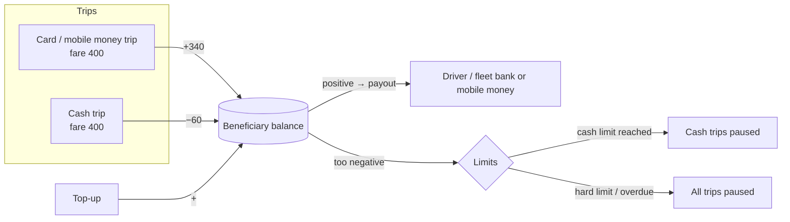
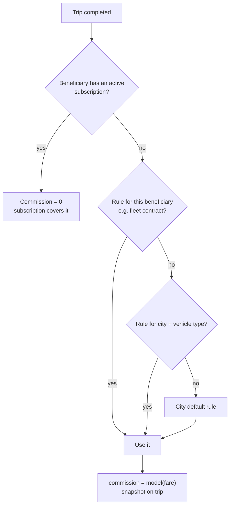
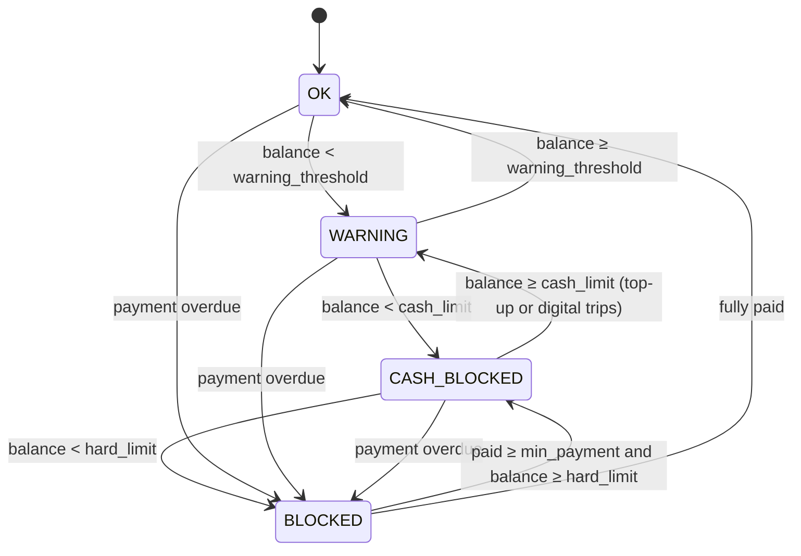
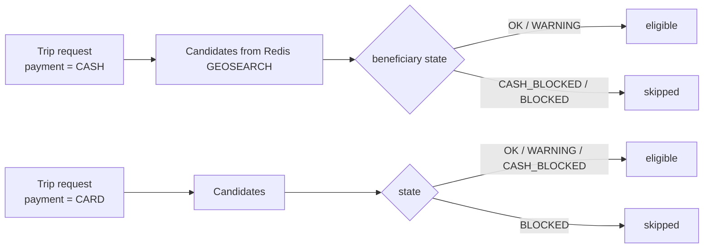
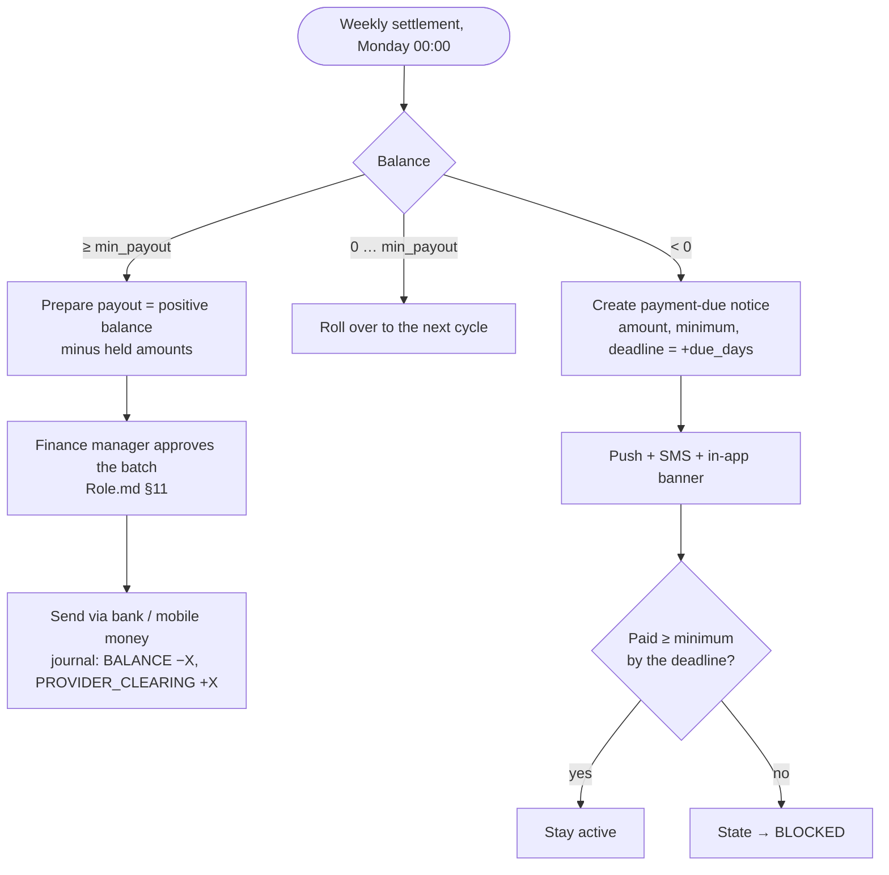
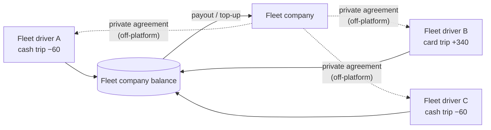
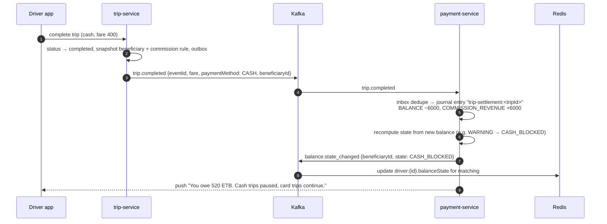
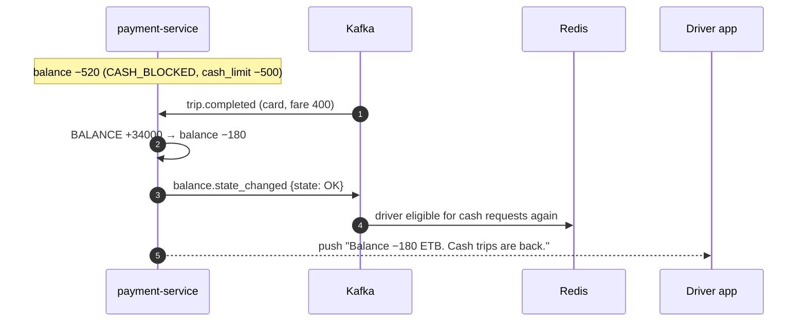
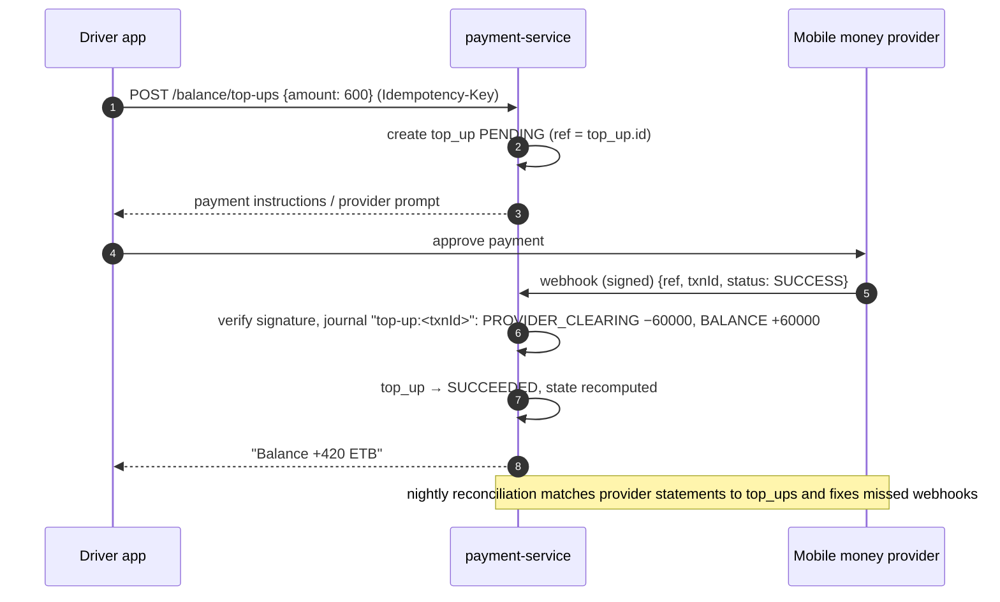
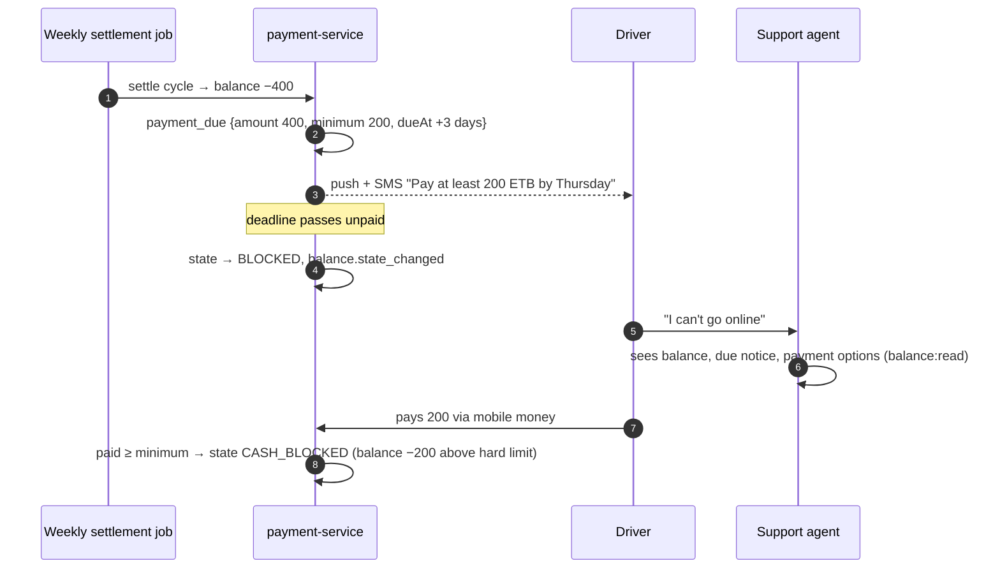

# Design: earnings, commission and the driver balance

| | |
|---|---|
| **Status** | ✅ Implemented in payment-service ([§20](#20-implementation)), with **simulated** providers until the real telebirr, CBE Birr and Chapa integrations exist |
| **Scope** | How the platform earns its commission on **every** trip, including when the rider pays the driver directly in cash: the beneficiary balance, settlement per payment method, limits and blocking, top-ups, payouts, fleet-company settlement, commission models, taxes |
| **Out of scope** | Payment-provider integration details (card/mobile-money APIs), corporate invoicing layout |
| **Related** | [← Design home](README.md) · [Role.md §6 (vehicle ownership)](Role.md#6-vehicle-ownership) · [Database.md §7.4 (ledger)](Database.md#74-payment-ledger-payment-service) |

---

## Contents

1. [Summary](#1-summary)
2. [The problem](#2-the-problem)
3. [How the industry solves it](#3-how-the-industry-solves-it)
4. [Decisions and assumptions](#4-decisions-and-assumptions)
5. [The beneficiary balance](#5-the-beneficiary-balance)
6. [Settlement per payment method](#6-settlement-per-payment-method)
7. [Commission models](#7-commission-models)
8. [Balance limits and blocking](#8-balance-limits-and-blocking)
9. [Top-ups and repayments](#9-top-ups-and-repayments)
10. [Payouts and netting](#10-payouts-and-netting)
11. [Fleet companies](#11-fleet-companies)
12. [Key flows](#12-key-flows)
13. [Data model](#13-data-model)
14. [Consistency and concurrency](#14-consistency-and-concurrency)
15. [Roles and permissions](#15-roles-and-permissions)
16. [Edge cases](#16-edge-cases)
17. [Reporting and controls](#17-reporting-and-controls)
18. [Rollout plan](#18-rollout-plan)
19. [Open questions](#19-open-questions)
20. [Implementation](#20-implementation)

---

## 1. Summary

Every driver, or fleet company, has **one balance** with the platform. Every trip changes it, whatever the payment method:

| Payment method | Who holds the money after the trip | Balance change |
|---|---|---|
| Card / mobile money / corporate invoice | The platform | **+ fare − commission** (we owe the driver their share) |
| Cash | The driver | **− commission** (the driver owes us our share) |

Card earnings and cash commission **net against each other automatically**. A driver who takes both kinds of trip often owes nothing at the end of the week. When a balance goes too far negative:
1. **cash trips are paused** first (card trips continue, and they repay the debt automatically),
2. then **all trips** are paused if the debt reaches a hard limit or a payment is overdue.

Drivers **top up** by mobile money, bank transfer or at an office, or their **fleet company** settles for them. The commission formula (percentage, fixed per trip, or subscription), the limits and the prepaid/postpaid mode are **configuration per city**, not code.



---

## 2. The problem

On a cash trip the rider hands the full fare to the driver, so the platform never touches the money. Its commission becomes a **receivable**: money the driver owes. Without a design for this:

- commission on cash trips is never collected (lost revenue),
- debt grows without limit, and drivers who leave the platform take it with them,
- the platform can't tell how much it is owed, by whom, or how old the debt is,
- in Ethiopia, where much of the market still pays in cash, this is most of the revenue.

---

## 3. How the industry solves it

Research into how ride-hailing platforms in Africa, the Middle East and Asia handle cash commission found five recurring patterns. Anbessa supports all five as configuration.

| # | Pattern | How it works | Strength | Weakness |
|---|---|---|---|---|
| P1 | **Running balance with netting** (postpaid) | Card earnings credit the balance, cash commission debits it. Settled weekly: positive → payout, negative → payment due | Fair, low friction, card trips repay cash debt | Debt can build up before collection |
| P2 | **Negative limit pauses cash trips only** | Below a limit, the driver stops receiving *cash* requests but still gets card/mobile-money trips | Self-healing: digital trips repay the debt | Needs enough digital demand to work |
| P3 | **Prepaid balance (top-up first)** | The driver must top up before receiving requests. Commission is deducted per trip | No credit risk for the platform | Friction for new drivers, liquidity burden |
| P4 | **Subscription instead of commission** | A flat daily, weekly or monthly fee lets the driver take unlimited trips with no per-trip commission. Seen in the Ethiopian market | Predictable for drivers, simple | Revenue not tied to volume |
| P5 | **Fleet partner settles for its drivers** | A fleet company holds the balance for all its vehicles and settles with the platform. Its drivers settle with the fleet privately | Fewer, larger, more reliable counterparties | The fleet's internal arrangements are opaque to the platform |

Common controls across platforms:
- the balance is visible in the driver app at all times,
- a payment-due notice gives a short deadline (2–3 days),
- partial payment above a minimum restores access,
- accounts are deactivated for unpaid debt,
- top-up goes through mobile money, bank transfer or physical payment points.

Commission levels vary widely by market: from 0–1% promotional rates to around 20%, sometimes capped by regulators. In Ethiopia, some platforms charge a **fixed amount per trip** rather than a percentage.

---

## 4. Decisions and assumptions

| # | Decision |
|---|---|
| D1 | **One balance per beneficiary.** The beneficiary is the vehicle owner from [Role.md §6](Role.md#6-vehicle-ownership): the **driver** for `INDIVIDUAL` vehicles, the **fleet company** for `ORGANIZATION` vehicles. This replaces the separate "earnings" and "commission debt" accounts of earlier drafts |
| D2 | **Postpaid with netting (P1 + P2) is the default.** Prepaid (P3) is a per-city or per-beneficiary option for new or high-risk drivers |
| D3 | **Commission is computed at trip completion** from a versioned commission rule, and **snapshotted on the trip**, so later rule changes never alter past trips |
| D4 | **Commission models are configuration:** `PERCENT` (with min and max), `FIXED_PER_TRIP`, `SUBSCRIPTION`, and `ZERO` (promotions) |
| D5 | **Two limits:** a *cash limit* pauses cash requests, and a *hard limit* (or an overdue payment) pauses all requests |
| D6 | **Digital trips always repay debt first.** Payouts only pay out the positive part of the balance above a minimum |
| D7 | **Every money movement is a balanced ledger entry** with an idempotency key ([Database.md §7.4](Database.md#74-payment-ledger-payment-service)). The balance is never edited directly |
| D8 | **Platform-funded discounts never reduce driver pay.** If a promo reduces what the rider pays in cash, the platform credits the difference to the beneficiary |
| D9 | **Tips go 100% to the driver**, with no commission |

| # | Assumption |
|---|---|
| A1 | Currency ETB, amounts in santim (`bigint`) |
| A2 | Top-up and payout channels: mobile money (e.g. telebirr), bank transfer, cash at an office or agent |
| A3 | VAT applies to the platform's commission. The design also supports VAT on the full fare, because that's under discussion in Ethiopia (see [§6.6](#66-taxes)) |
| A4 | Weekly settlement cycle (Monday 00:00 local time), configurable |

---

## 5. The beneficiary balance

**Sign convention** (same as [Database.md](Database.md#74-payment-ledger-payment-service)): postings are `+` credit / `−` debit. A beneficiary balance's value is **what the platform owes the beneficiary**:

| Balance | Meaning | Driver app shows |
|---|---|---|
| `> 0` | We owe them (digital earnings not yet paid out) | "Balance: 1,240 ETB · next payout Monday" |
| `= 0` | Settled | "Balance: 0 ETB" |
| `< 0` | They owe us (commission on cash trips) | "You owe 180 ETB · pay by Thursday to keep receiving cash trips" |

### Accounts involved

| Account | Owner | Type | Purpose |
|---|---|---|---|
| `BENEFICIARY_BALANCE` | Driver (`INDIVIDUAL` vehicles) or fleet company | Liability (+) / receivable (−) | **The** balance described here |
| `COMMISSION_REVENUE` | Platform, per city | Revenue | Commission earned |
| `PROVIDER_CLEARING` | Platform, per payment provider | Asset | Money held at or in transit through the card/mobile-money provider |
| `CORPORATE_RECEIVABLE` | Corporate organisation | Asset | Fares invoiced to companies |
| `PROMO_EXPENSE` | Platform, per city | Expense | Platform-funded discounts |
| `TIPS_PAYABLE` | — | Pass-through | Tips go straight to the beneficiary balance |
| `VAT_PAYABLE` | Platform | Liability | Tax collected, owed to the tax authority |
| `CASH_RECEIPTS` | Platform, per office | Asset | Cash physically collected from drivers at offices |
| `BAD_DEBT_EXPENSE` | Platform | Expense | Approved write-offs of uncollectable debt |

---

## 6. Settlement per payment method

Worked example for all cases: **fare 400.00 ETB**, commission **15% = 60.00 ETB** (amounts in santim in the ledger). Each block is **one journal entry** whose postings sum to zero. VAT is shown separately in [§6.6](#66-taxes).

### 6.1 Card or mobile money (platform collects)

| Account | Posting | |
|---|---|---|
| `PROVIDER_CLEARING` | −40000 | the provider holds the rider's 400 |
| `BENEFICIARY_BALANCE` | +34000 | we owe the driver 340 |
| `COMMISSION_REVENUE` | +6000 | our 60 |

### 6.2 Cash (driver collects)

| Account | Posting | |
|---|---|---|
| `BENEFICIARY_BALANCE` | −6000 | the driver owes us 60 |
| `COMMISSION_REVENUE` | +6000 | our 60 |

The driver physically keeps the 400. Nothing else moves.

### 6.3 Corporate invoice

| Account | Posting | |
|---|---|---|
| `CORPORATE_RECEIVABLE` | −40000 | the company owes us 400, invoiced monthly |
| `BENEFICIARY_BALANCE` | +34000 | |
| `COMMISSION_REVENUE` | +6000 | |

### 6.4 Cash trip with a platform-funded promo (rider pays only 350)

The driver earns as if the fare were 400 (decision D8). The platform pays for the 50 discount.

| Account | Posting | |
|---|---|---|
| `BENEFICIARY_BALANCE` | −6000 | commission on the full 400 |
| `BENEFICIARY_BALANCE` | +5000 | the platform compensates the 50 the driver didn't receive in cash |
| `COMMISSION_REVENUE` | +6000 | |
| `PROMO_EXPENSE` | −5000 | the discount is our cost |

Net effect on the driver: −10 ETB (they hold 350 cash and are owed −10, i.e. they effectively keep 340).

### 6.5 Tip (digital) and cancellation fee

| Case | Postings |
|---|---|
| Tip of 20 by card | `PROVIDER_CLEARING −2000`, `BENEFICIARY_BALANCE +2000` (no commission) |
| Rider cancellation fee of 30, charged digitally, driver compensated 25 | `PROVIDER_CLEARING −3000`, `BENEFICIARY_BALANCE +2500`, `COMMISSION_REVENUE +500` |
| Rider cancellation fee on a cash rider | Can't be collected now. Recorded as a rider receivable added to the rider's next trip. The driver is compensated when it's collected (or immediately, as a platform cost, by city policy) |

### 6.6 Taxes

VAT is configured per city as a **tax basis** and rate:

| Basis | Meaning | Extra postings on a cash trip |
|---|---|---|
| `COMMISSION` (default) | VAT on the platform's commission only | `BENEFICIARY_BALANCE −900` (15% of 60), `VAT_PAYABLE +900` |
| `FULL_FARE` | VAT on the whole fare (under discussion in Ethiopia) | The VAT on 400 is owed. On cash trips the driver collected it, so it's debited from the balance like commission |

Whether VAT is added *on top* of the commission or included in it is a per-city configuration that must be confirmed with tax counsel ([§19](#19-open-questions)). The ledger design is the same either way.

---

## 7. Commission models

A **commission rule** is versioned by validity period (like fare rules in [Database.md §7.5](Database.md#75-pricing-support-notification-audit-summary)) and resolved at trip completion, most specific first:



| Model | Formula | Example |
|---|---|---|
| `PERCENT` | `clamp(fare × rate, min, max)` | 15%, min 10 ETB, max 150 ETB |
| `FIXED_PER_TRIP` | constant | 10 ETB per trip |
| `SUBSCRIPTION` | 0 per trip while a plan is active. The plan fee debits the balance on purchase | 50 ETB/day, 300 ETB/week, 1,000 ETB/month |
| `ZERO` | 0 | launch promotion, first-week drivers |

**Subscription purchase** is a journal entry: `BENEFICIARY_BALANCE −30000`, `COMMISSION_REVENUE +30000` (for a 300 ETB weekly plan). If the balance doesn't cover it, the driver must top up first. Subscriptions are never bought on credit.

---

## 8. Balance limits and blocking

Configured per city in a **balance policy** (values are examples):

| Setting | Example | Meaning |
|---|---|---|
| `mode` | `POSTPAID` | `POSTPAID` (may go negative) or `PREPAID` (must stay ≥ `prepaid_minimum`) |
| `warning_threshold` | −300 ETB | Show a warning and send a reminder |
| `cash_limit` | −500 ETB | **Pause cash requests.** Card and mobile-money requests continue |
| `hard_limit` | −1,000 ETB | **Pause all requests** |
| `prepaid_minimum` | +100 ETB | `PREPAID` only: below this, no requests |
| `due_days` | 3 | Days to pay after a weekly settlement leaves the balance negative |
| `min_payment` | 50% of the amount due | Paying at least this restores access when overdue |
| `min_payout` | 100 ETB | Positive balances below this roll over to the next cycle |

### Balance states



| State | Cash requests | Digital requests | Can go online |
|---|---|---|---|
| `OK` | ✅ | ✅ | ✅ |
| `WARNING` | ✅ | ✅ | ✅ (banner in the app) |
| `CASH_BLOCKED` | ❌ | ✅ (these repay the debt) | ✅ |
| `BLOCKED` | ❌ | ❌ | ❌ ("pay to continue") |

`PREPAID` mode uses the same states, with `prepaid_minimum` taking the role of the limits.

### How matching uses the state



- The state is cached in Redis (`driver:{id}` hash field `balanceState`, refreshed from `balance.state_changed` events), so matching never queries the ledger.
- **Projected overshoot guard:** a cash request is only offered if `balance − expected_commission ≥ hard_limit`. One trip can't push a driver far past the limit.
- Riders choosing cash may see longer ETAs when many nearby drivers are cash-blocked. That's an intended incentive for drivers to settle.

---

## 9. Top-ups and repayments

| Channel | How it's matched to the beneficiary | Confirmation | Notes |
|---|---|---|---|
| **Mobile money** (e.g. telebirr) | A payment request created in the app carries a unique reference | Provider webhook (signed), plus reconciliation | Instant. Preferred |
| **Bank transfer** | A personal reference code shown in the app (`ANB-7K2Q9X`) | Bank statement import, matched by reference | Unmatched transfers go to a finance queue |
| **Cash at an office or agent** | The finance officer records it against the beneficiary | **Maker–checker:** recorded by a finance officer, approved by a finance manager ([Role.md §11](Role.md#11-approvals-makerchecker)) | Printed or SMS receipt with the ledger entry ID |
| **Automatic netting** | Digital trip earnings credit the balance | Immediate | No action needed |
| **Fleet company** | The fleet tops up its single organisation balance | Same channels | See [§11](#11-fleet-companies) |

Each top-up is a journal entry (`PROVIDER_CLEARING −X`, `BENEFICIARY_BALANCE +X`, or `CASH_RECEIPTS −X` for office cash). Its idempotency key is the provider's transaction ID, so a duplicated webhook can't double-credit.

---

## 10. Payouts and netting



- **Netting first:** cash commission and digital earnings within the cycle cancel out automatically, so only the net result is paid out or collected.
- **Holds:** amounts under dispute, or digital payments not yet confirmed by the provider, are excluded from the payout until resolved.
- **Instant payout (optional, later):** a driver may cash out a positive balance before the weekly cycle, for a small fee.

---

## 11. Fleet companies

For `ORGANIZATION` vehicles, **the fleet company is the beneficiary** ([Role.md §6](Role.md#6-vehicle-ownership)). All trips by all its drivers in its vehicles go to **one fleet balance**.



| Rule | |
|---|---|
| Limits apply to the **fleet balance** | When the fleet is `CASH_BLOCKED`, **all** its vehicles stop receiving cash requests |
| The fleet settles with the platform | Top-ups and payouts go to and from the fleet's account, never an individual fleet driver's |
| The platform isn't party to the fleet–driver agreement | The fleet may collect cash commission from its drivers however it likes |
| **Per-driver statements for the fleet** | The fleet portal shows each driver's trips, cash collected and commission generated (from the trip snapshots), so the fleet can settle with its drivers. This is **informational**, not a separate balance |
| Optional fleet sub-limits (later) | A fleet may set its own per-driver cash cap, which pauses only that driver's cash requests. Enforced in matching, not in the ledger |
| Contract commission | A fleet can have a negotiated commission rule (most-specific rule in [§7](#7-commission-models)) |

A driver who owns a car **and** drives for a fleet has two separate beneficiaries: their own balance for trips in their own car, and the fleet's balance for trips in fleet cars. The vehicle used in each session decides which one applies.

---

## 12. Key flows

### 12.1 Cash trip settlement



### 12.2 Card trips repay the debt automatically



### 12.3 Top-up by mobile money



### 12.4 Overdue debt



---

## 13. Data model

Extends the ledger in [Database.md §7.4](Database.md#74-payment-ledger-payment-service) (`ledger_account`, `journal_entry`, `posting`). The account kinds are now those in [§5](#accounts-involved).

```sql
-- Per-city commission rules, versioned like fare rules (needs btree_gist)
CREATE TABLE commission_rule (
  id               uuid PRIMARY KEY DEFAULT uuidv7(),
  city_id          text NOT NULL,
  vehicle_type     text,                       -- NULL = any vehicle type
  beneficiary_id   uuid,                       -- NULL = everyone; set for fleet contracts
  model            text NOT NULL CHECK (model IN ('PERCENT','FIXED_PER_TRIP','SUBSCRIPTION','ZERO')),
  rate_bp          int  CHECK (rate_bp BETWEEN 0 AND 10000),      -- basis points, PERCENT only (1500 = 15%)
  fixed_minor      bigint CHECK (fixed_minor >= 0),               -- FIXED_PER_TRIP only
  min_minor        bigint CHECK (min_minor >= 0),
  max_minor        bigint CHECK (max_minor >= 0),
  valid_from       timestamptz NOT NULL,
  valid_to         timestamptz,
  approved_by      uuid NOT NULL,
  CHECK ((model = 'PERCENT')        = (rate_bp IS NOT NULL)),
  CHECK ((model = 'FIXED_PER_TRIP') = (fixed_minor IS NOT NULL)),
  CHECK (valid_to IS NULL OR valid_to > valid_from),
  CONSTRAINT ex_commission_rule_no_overlap EXCLUDE USING gist (
    city_id WITH =,
    coalesce(vehicle_type, '*') WITH =,
    coalesce(beneficiary_id::text, '*') WITH =,
    tstzrange(valid_from, valid_to) WITH &&)
);

-- Limits and settlement settings per city (one active row per city)
CREATE TABLE balance_policy (
  city_id               text NOT NULL,
  mode                  text NOT NULL DEFAULT 'POSTPAID' CHECK (mode IN ('POSTPAID','PREPAID')),
  warning_minor         bigint NOT NULL,          -- e.g. -30000
  cash_limit_minor      bigint NOT NULL,          -- e.g. -50000
  hard_limit_minor      bigint NOT NULL,          -- e.g. -100000
  prepaid_minimum_minor bigint NOT NULL DEFAULT 0,
  due_days              int    NOT NULL DEFAULT 3 CHECK (due_days BETWEEN 1 AND 30),
  min_payment_bp        int    NOT NULL DEFAULT 5000 CHECK (min_payment_bp BETWEEN 0 AND 10000),
  min_payout_minor      bigint NOT NULL DEFAULT 10000,
  tax_basis             text   NOT NULL DEFAULT 'COMMISSION' CHECK (tax_basis IN ('COMMISSION','FULL_FARE')),
  vat_rate_bp           int    NOT NULL DEFAULT 1500,
  valid_from            timestamptz NOT NULL,
  approved_by           uuid NOT NULL,
  PRIMARY KEY (city_id, valid_from),
  CHECK (hard_limit_minor <= cash_limit_minor AND cash_limit_minor <= warning_minor AND warning_minor <= 0)
);

-- Per-beneficiary overrides (e.g. a new driver forced to PREPAID, a trusted fleet with a larger limit)
CREATE TABLE beneficiary_policy_override (
  beneficiary_account_id uuid PRIMARY KEY,
  mode                   text CHECK (mode IN ('POSTPAID','PREPAID')),
  cash_limit_minor       bigint,
  hard_limit_minor       bigint,
  reason                 text NOT NULL,
  approved_by            uuid NOT NULL,
  valid_until            timestamptz
);

-- Cached state, written in the same transaction as every posting on the balance
CREATE TABLE balance_state (
  beneficiary_account_id uuid PRIMARY KEY,
  state                  text NOT NULL CHECK (state IN ('OK','WARNING','CASH_BLOCKED','BLOCKED')),
  overdue_since          timestamptz,
  changed_at             timestamptz NOT NULL DEFAULT now()
);

CREATE TABLE top_up (
  id                     uuid PRIMARY KEY DEFAULT uuidv7(),
  beneficiary_account_id uuid NOT NULL,
  channel                text NOT NULL CHECK (channel IN ('MOBILE_MONEY','BANK_TRANSFER','OFFICE_CASH')),
  amount_minor           bigint NOT NULL CHECK (amount_minor > 0),
  status                 text NOT NULL DEFAULT 'PENDING' CHECK (status IN ('PENDING','SUCCEEDED','FAILED','PENDING_APPROVAL')),
  provider_txn_id        text UNIQUE,              -- idempotency for webhooks
  reference_code         text UNIQUE,              -- bank transfer matching
  recorded_by            uuid,                     -- office cash: the finance officer (maker)
  journal_entry_id       uuid,
  created_at             timestamptz NOT NULL DEFAULT now()
);

CREATE TABLE payment_due (
  id                     uuid PRIMARY KEY DEFAULT uuidv7(),
  beneficiary_account_id uuid NOT NULL,
  cycle_end              date NOT NULL,
  amount_minor           bigint NOT NULL CHECK (amount_minor > 0),
  minimum_minor          bigint NOT NULL CHECK (minimum_minor > 0),
  due_at                 timestamptz NOT NULL,
  status                 text NOT NULL DEFAULT 'OPEN' CHECK (status IN ('OPEN','MIN_PAID','PAID','OVERDUE','WRITTEN_OFF')),
  UNIQUE (beneficiary_account_id, cycle_end)        -- one notice per cycle, even if the job reruns
);

CREATE TABLE subscription (
  id                     uuid PRIMARY KEY DEFAULT uuidv7(),
  beneficiary_account_id uuid NOT NULL,
  plan                   text NOT NULL CHECK (plan IN ('DAILY','WEEKLY','MONTHLY')),
  price_minor            bigint NOT NULL CHECK (price_minor > 0),
  starts_at              timestamptz NOT NULL,
  ends_at                timestamptz NOT NULL,
  journal_entry_id       uuid NOT NULL,
  CHECK (ends_at > starts_at),
  CONSTRAINT ex_subscription_no_overlap
    EXCLUDE USING gist (beneficiary_account_id WITH =, tstzrange(starts_at, ends_at) WITH &&)   -- no overlapping plans
);
```

### Trip snapshot fields (trip-service)

| Field | Purpose |
|---|---|
| `payment_method` (`CASH` / `CARD` / `MOBILE_MONEY` / `CORPORATE`) | Picks the settlement in [§6](#6-settlement-per-payment-method) |
| `beneficiary_account_id` | From [Role.md §6](Role.md#6-vehicle-ownership), snapshotted at match |
| `commission_rule_id`, `commission_minor` | Rule and amount, fixed at completion |
| `promo_funded_minor`, `tip_minor`, `vat_minor` | Inputs to the journal entry |

> [!NOTE]
> **Verified on PostgreSQL 18.6:** these tables apply cleanly on the local image. The constraints were tested: overlapping commission rules are rejected, a `PERCENT` rule without a rate is rejected, a balance policy with limits in the wrong order is rejected, duplicate webhooks (`provider_txn_id`) and duplicate due notices are rejected, and overlapping subscriptions are rejected.

---

## 14. Consistency and concurrency

| Concern | Mechanism |
|---|---|
| A trip settled twice (replayed event) | Inbox dedupe + `journal_entry.idempotency_key = 'trip-settlement:<tripId>'` |
| Webhook delivered twice | `top_up.provider_txn_id UNIQUE` + journal idempotency key `top-up:<txnId>` |
| Concurrent postings on one balance (two trips completing at once) | `SELECT … FOR UPDATE` on the `ledger_account` row, then postings + `balance_minor` + `balance_state` in one transaction |
| State seen by matching | `balance.state_changed` published through the **outbox** in that same transaction, so Redis converges within seconds |
| Stale state in Redis (e.g. a lost event) | At **session start** and on each **cash offer**, trip-service asks payment-service for the authoritative state if the cached value is older than 60 s |
| Weekly job rerun | `payment_due UNIQUE (beneficiary_account_id, cycle_end)` and payout batch idempotency keys |
| Balance drift | Nightly check: `balance_minor = Σ postings` for every account, plus `balance_state` recomputed and compared |

---

## 15. Roles and permissions

New permissions, added to the catalog in [Role.md §7](Role.md#7-permission-catalog):

| Permission | Who | Scope |
|---|---|---|
| `balance:read` | Driver, Fleet owner, Support agent, Finance officer/manager | S / O / C / G |
| `topup:create` | Driver, Fleet owner | S / O |
| `topup:record_cash` | Finance officer (maker) | G |
| `topup:approve_cash` | Finance manager (checker) ↻ | G |
| `adjustment:request` | Finance officer, Support agent (e.g. goodwill credit) | G / C |
| `adjustment:approve` | Finance manager ↻ | G |
| `writeoff:request` / `writeoff:approve` | Finance officer / Finance manager ↻ | G |
| `commission_rule:propose` / `commission_rule:approve` | Operations manager / Finance manager ↻ | C / G |
| `balance_policy:propose` / `balance_policy:approve` | Operations manager / Finance manager ↻ | C / G |
| `policy_override:request` / `policy_override:approve` | Onboarding officer / Finance manager ↻ | C / G |

↻ = maker–checker approval, as in [Role.md §11](Role.md#11-approvals-makerchecker).

---

## 16. Edge cases

| Case | Handling |
|---|---|
| **Driver leaves the platform with a negative balance** | The account stays `BLOCKED`. Due notices continue for a set period, then the debt goes to write-off (`writeoff:request` → approve), posted as `BAD_DEBT_EXPENSE −X`, `BENEFICIARY_BALANCE +X`. Re-registration with the same phone, licence or plate is matched to the old balance |
| **Vehicle ownership transfer** ([Role.md V9](Role.md#ownership-rules)) | Balances stay with each beneficiary. Past trips keep their snapshotted beneficiary. Transferring to a new owner requires the old owner's balance to be ≥ 0 or a recorded settlement plan |
| **Rider claims they paid cash, driver says they didn't** | Support ticket. If upheld for the driver, a rider receivable is created. If upheld for the rider, nothing changes: the driver keeps the cash |
| **Driver collected more cash than the fare** | Rider complaint → refund to the rider from the platform (`PROVIDER_CLEARING +X` paid out to the rider) and the same amount debited to the beneficiary balance, plus a safety/integrity flag |
| **Refund on a cash trip** (e.g. wrong route) | The rider is refunded digitally by the platform. The beneficiary balance is debited by the driver's share of the refund (policy: driver at fault vs platform goodwill) |
| **Card payment fails after the trip** | The trip stays unpaid. The beneficiary is still credited (the platform carries the risk), and the rider gets a receivable added to the next trip |
| **Fleet company becomes insolvent** | Org suspended. Its drivers' sessions in its vehicles end. The fleet balance follows the write-off flow |
| **Commission rule changes mid-trip** | No effect: the rule is resolved and snapshotted at completion, using the rule valid at the **trip start** time |
| **Clock / cycle boundaries** | Cycles use the city's timezone (`Africa/Addis_Ababa`). All stored timestamps are UTC |

---

## 17. Reporting and controls

| Report | Purpose | Audience |
|---|---|---|
| **Receivables aging** (0–7, 8–30, 31–90, 90+ days negative) | Collection risk | Finance |
| **Collection rate** (commission collected ÷ commission accrued, per city and week) | Health of the cash model | Finance, ops |
| **Cash-blocked share** (% of online drivers cash-blocked at peak) | Too high means riders paying cash wait longer: tune the limits | Ops |
| **Top-up channel mix and failure rate** | Provider reliability | Finance, engineering |
| **Fleet statements** | Per-fleet trips, cash collected and commission per driver | Fleet owners |
| **Ledger integrity** | Nightly `balance = Σ postings`, and Σ of all accounts = 0 | Engineering (alerts) |

---

## 18. Rollout plan

| Phase | Work |
|---|---|
| 1 | Ledger accounts from [§5](#accounts-involved), cash and card settlement ([§6.1–6.3](#6-settlement-per-payment-method)), `PERCENT` and `FIXED_PER_TRIP` rules, the balance shown in the driver app |
| 2 | Balance policy, states, `balance.state_changed` → Redis, cash filtering in matching ([§8](#8-balance-limits-and-blocking)) |
| 3 | Mobile-money top-ups with webhooks and reconciliation. Weekly settlement, due notices, payouts with approval |
| 4 | Fleet balances and fleet-portal statements ([§11](#11-fleet-companies)) |
| 5 | Office cash receipts (maker–checker), bank-transfer matching, write-offs, the aging report |
| 6 | Subscriptions, per-beneficiary overrides, VAT on full fare if required, instant payouts |

---

## 19. Open questions

| # | Question | Current default |
|---|---|---|
| Q1 | Commission model at launch: percentage or fixed per trip? | `PERCENT` 15% with a 10 ETB minimum |
| Q2 | Limit values (`warning`, `cash_limit`, `hard_limit`) for Addis | −300 / −500 / −1,000 ETB |
| Q3 | Postpaid for everyone, or prepaid for drivers' first N weeks? | Postpaid. Prepaid only via override |
| Q4 | VAT basis and whether VAT is included in or added to the commission | VAT on commission, added on top (confirm with tax counsel) |
| Q5 | Offer subscriptions at launch? | No, phase 6 |
| Q6 | Who carries the loss when a post-trip card charge fails: platform or driver? | Platform |
| Q7 | Which mobile-money and bank providers for top-ups and payouts? | Mobile money first |
| Q8 | How long before unpaid debt is written off? | 90 days after the account is blocked |

---

## 20. Implementation

`services/payment-service` (port 3005, database `payment_service`). The defaults of [§19](#19-open-questions) are what runs until finance approves something else.

| Design | Where | Notes |
|---|---|---|
| Ledger, balanced and append-only ([§5](#5-the-beneficiary-balance), Database.md §7.4) | `src/ledger/ledger.ts`, migration | A deferred trigger checks every entry balances; triggers refuse `UPDATE`/`DELETE` on `journal_entry` and `posting`. Account rows are locked in id order. `posting` isn't partitioned yet |
| Settlement per payment method ([§6](#6-settlement-per-payment-method)) | `src/money/settlement.ts` | Cash, card / mobile money (on capture), corporate, failed charge → rider receivable, cancellation fees. VAT is charged to the beneficiary on top of the commission (Q4). Promo funding (§6.4) and tips wait for pricing promotions |
| Commission rules ([§7](#7-commission-models)) | `src/money/rules.ts`, `rule-changes.ts` | `PERCENT`, `FIXED_PER_TRIP`, `ZERO`; most specific first (beneficiary contract → vehicle type → city → default 15%, min 10 ETB). Resolved at the trip's completion time (the trip event has no start time yet). Proposed with `commission_rule:propose`, approved by someone else with `commission_rule:approve`. Subscriptions (phase 6) aren't built |
| Balance limits and states ([§8](#8-balance-limits-and-blocking)) | `src/money/balances.ts` | Recomputed in the transaction of every posting; `balance.state_changed` → location-service updates every online car of the beneficiary (`applyBalanceState`), matching skips `BLOCKED` drivers and, for cash trips, `CASH_BLOCKED` ones. fleet-service asks the authoritative state at session start and refuses `BLOCKED`. The projected-overshoot guard isn't built |
| Top-ups ([§9](#9-top-ups-and-repayments)) | `src/money/topups.ts` | Mobile money through the provider (webhook credits it); office cash and bank transfers (by reference code) recorded by a finance officer, credited when a finance manager approves. Bank statement import isn't built |
| Payouts and dues ([§10](#10-payouts-and-netting)) | `src/money/payouts.ts`, `src/jobs.ts` | Weekly run (Monday 00:00 Addis) or "run now"; one batch per day; payout lines need `payout:approve` by someone other than the preparer; a failed payout is reversed. Dues: minimum 50% within 3 days; overdue blocks; paying the minimum lifts it. Holds: refunds waiting to be charged to the balance |
| Fleet companies ([§11](#11-fleet-companies)) | beneficiary `ORGANIZATION` | One balance per fleet; the fleet owner sees it, tops up and sets the payout method on the company page. Per-driver fleet statements aren't built |
| Refunds ([§16](#16-edge-cases)) | `src/money/payments.ts` | `refund:request` → `refund:approve` (different people); the provider refunds; driver at fault → their balance, else platform goodwill (`GOODWILL_EXPENSE`) |
| Consistency ([§14](#14-consistency-and-concurrency)) | inbox, idempotency keys, outbox | Kafka inbox dedupe; journal idempotency keys (`trip-settlement:`, `top-up:`, `payout:`, `refund:`); webhooks deduped per provider notification; HTTP `Idempotency-Key` on top-ups and refunds |
| Reporting ([§17](#17-reporting-and-controls)) | `GET /api/payments/overview`, `/ledger/integrity` | Hourly integrity check logs loudly on any mismatch. Aging and collection-rate reports aren't built |
| Write-offs, adjustments, overrides | — | Not built (permissions exist in the catalog) |

**Providers** (`src/gateways/`): each adapter (`telebirr.ts`, `cbebirr.ts`, `chapa.ts`) parses that provider's callback format and checks its signature; requests go to `simulator.ts`, which answers like the provider and posts the signed callback to the webhook. Going live replaces the four request methods in an adapter with the provider's HTTP API (the file header lists the endpoints) and keeps the parser; config refuses `GATEWAY_MODE=simulated` in production.

**Web**: staff Money section (overview, balances, rider payments, money approvals, payouts, commission and limits, payment providers), the payment panel on a trip, and the Balance tab on a fleet's company page. **Phone app**: the API is there (`/api/payments/balances/me`, top-ups, `/api/payments/trips/:id`, `payment:action_required` over the socket); the Flutter screens aren't built yet.
