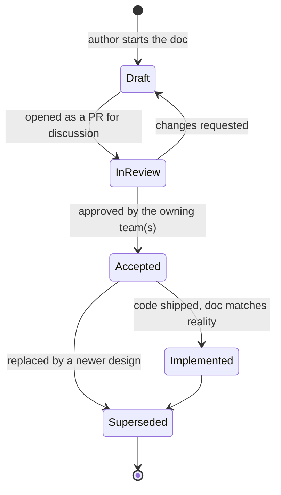
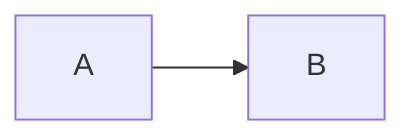

# Design documents

This folder holds Anbessa's **design documents**: one file per design topic, each describing a decision before (or while) it's built.

| Doc type | Answers | Lives in |
|---|---|---|
| **Architecture** | How the system is put together *today* | [`docs/architecture/`](../architecture/overview.md) |
| **Design** (this folder) | How a specific capability *should* work, and why | `docs/design/<Topic>.md` |
| **Guides** | How to develop, test and ship | [`docs/development/`](../development/README.md) · [`docs/testing/`](../testing/README.md) · [`docs/production/`](../production/README.md) |

---

## Contents

| Design | Status | Summary |
|---|---|---|
| [Roles, permissions and vehicle ownership](Role.md) | ✅ Accepted · not implemented | 18 scoped roles, permission matrix, owner-driver vs company-owned vehicles, tokens, maker–checker approvals, audit log, migration plan |
| [Earnings, commission and the driver balance](Payment.md) | 👀 In review | How commission is collected on cash trips: one balance per driver or fleet, netting, cash-first blocking, top-ups, payouts, commission models (percent / fixed / subscription), taxes |
| [Database architecture](Database.md) | 👀 In review | Store per data type, clusters, schemas (verified on PG 18), consistency (outbox/inbox, sagas), concurrency control, Redis hot path, ledger, scaling stages, lifecycle, DR, security |

### Roles, permissions and vehicle ownership — [`Role.md`](Role.md)

1. [Summary](Role.md#1-summary)
2. [Decisions and assumptions](Role.md#2-decisions-and-assumptions)
3. [Glossary](Role.md#3-glossary)
4. [Role catalog](Role.md#4-role-catalog)
5. [Core model: users, roles, scopes, organisations](Role.md#5-core-model-users-roles-scopes-organisations)
6. [Vehicle ownership](Role.md#6-vehicle-ownership)
7. [Permission catalog](Role.md#7-permission-catalog)
8. [Role → permission matrix](Role.md#8-role--permission-matrix)
9. [Authorization: how a request is checked](Role.md#9-authorization-how-a-request-is-checked)
10. [Tokens](Role.md#10-tokens)
11. [Approvals (maker–checker)](Role.md#11-approvals-makerchecker)
12. [Audit log](Role.md#12-audit-log)
13. [Key flows](Role.md#13-key-flows)
14. [Data model](Role.md#14-data-model)
15. [Service ownership](Role.md#15-service-ownership)
16. [Security requirements](Role.md#16-security-requirements)
17. [Migration plan](Role.md#17-migration-plan)
18. [Open questions](Role.md#18-open-questions)

### Database architecture — [`Database.md`](Database.md)

1. [Summary](Database.md#1-summary) · 2. [Goals and principles](Database.md#2-goals-and-principles) · 3. [Workload and capacity](Database.md#3-workload-and-capacity-estimates) · 4. [Which store for which data](Database.md#4-which-store-for-which-data)
5. [Topology](Database.md#5-topology-clusters-databases-connections) · 6. [Table conventions](Database.md#6-conventions-for-every-table) · 7. [Schemas per service](Database.md#7-schemas-per-service) · 8. [Consistency model](Database.md#8-consistency-model)
9. [Concurrency control](Database.md#9-concurrency-control) · 10. [Live location in Redis](Database.md#10-hot-path-live-location-in-redis) · 11. [Kafka topics](Database.md#11-kafka-topics-as-data) · 12. [Read models and analytics](Database.md#12-read-models-search-and-analytics)
13. [Performance](Database.md#13-performance) · 14. [Scaling path](Database.md#14-scaling-path) · 15. [Data lifecycle](Database.md#15-data-lifecycle-partitions-retention-archiving-deletion) · 16. [Backup and DR](Database.md#16-backup-and-disaster-recovery)
17. [Security](Database.md#17-security) · 18. [Migrations](Database.md#18-schema-migrations) · 19. [Observability](Database.md#19-observability) · 20. [Decisions](Database.md#20-decisions-and-alternatives-considered) · 21. [Rollout](Database.md#21-rollout-plan) · 22. [Open questions](Database.md#22-open-questions)

### Planned design topics

The role design defers these. Each should get its own file here:

| Topic | Suggested file | Why it needs its own design |
|---|---|---|
| Trip lifecycle and matching | `Trip.md` | State machine, matching algorithm, cancellation rules, the on-behalf booking channels from [Role.md §13](Role.md#13-key-flows) |
| Corporate billing | `Corporate.md` | Monthly invoicing, ride policies and budgets, receivables (the ledger side is in [Payment.md](Payment.md)) |
| Pricing and zones | `Pricing.md` | Fare formula per city and vehicle type, zones, incentive budgets, approval timing |
| Fleet and driver onboarding | `Fleet.md` | Document types, verification checklist, re-verification schedule, fleet-service API |
| Support, safety and SOS | `Safety.md` | SOS escalation, incident workflow, suspensions, police data requests |
| Notifications | `Notification.md` | Events → push/SMS templates, languages, opt-outs |
| Audit and compliance | `Audit.md` | Audit-service storage, retention, regulator reports ([Role.md §12](Role.md#12-audit-log)) |

---

## Status lifecycle



| Status | Meaning |
|---|---|
| 📝 Draft | Being written. Not a commitment |
| 👀 In review | Open PR. Comment there |
| ✅ Accepted | Agreed. Build to this design |
| 🚀 Implemented | Shipped. Keep the doc in sync with the code |
| 🗄️ Superseded | Replaced. Link to the replacement at the top |

---

## How to add a design

1. **Create** `docs/design/<Topic>.md` (PascalCase, singular: `Payment.md`, `Trip.md`).
2. **Start from the template** below. Keep the header table and the numbered sections, so every design reads the same way.
3. **Add a row** to [Contents](#contents) and, once it's stable, a section list like the one for `Role.md`.
4. **Open a PR** with status `In review`. Tag the teams whose services the design touches.
5. **On merge**, set the status to `Accepted`. When the code ships, set it to `Implemented`, and update the [architecture overview](../architecture/overview.md) and its known-gaps table.
6. **Diagrams:** use Mermaid (it renders on GitHub, and in VS Code with the `bierner.markdown-mermaid` extension the repo recommends). Avoid `;` inside sequence-diagram messages and notes, because Mermaid treats it as a line break.

### Template

````markdown
# Design: <topic>

| | |
|---|---|
| **Status** | Draft |
| **Owner** | <team or person> |
| **Scope** | <what this design covers, and what it doesn't> |
| **Related** | [← Design home](README.md) · <other designs / docs> |

## 1. Summary
<One paragraph: the problem and the proposed solution.>

## 2. Decisions and assumptions
| # | Decision / assumption | Why |
|---|---|---|

## 3. Glossary

## 4. Design
<Model, rules, diagrams.>



## 5. Key flows
<Sequence diagrams for the important scenarios.>

## 6. Data model and service ownership

## 7. Security and failure handling

## 8. Migration / rollout plan

## 9. Open questions
| # | Question | Current default |
|---|---|---|
````

---

## Conventions shared by all designs

| Convention | Rule |
|---|---|
| Permissions | `resource:action`, checked in the owning service with `libs/shared-authz` ([Role.md §9](Role.md#9-authorization-how-a-request-is-checked)) |
| Data ownership | One owning service per table. No cross-service queries ([architecture §7](../architecture/overview.md#7-data-architecture)) |
| Events | Past-tense names, keyed by entity, `eventId` + `version` in the payload ([architecture §8](../architecture/overview.md#8-event-catalog)) |
| Sensitive actions | Maker ≠ checker, and always audited ([Role.md §11–12](Role.md#11-approvals-makerchecker)) |
| Status markers | ✅ implemented · 🟡 partial · 📐 designed only (same as the architecture doc) |
