# Design: roles, permissions and vehicle ownership

| | |
|---|---|
| **Status** | Accepted design, not implemented yet |
| **Scope** | Who can do what in Anbessa: identity, roles, permissions, scopes, organisations (fleet companies and corporate accounts), vehicle ownership, approvals and audit |
| **Replaces** | The single `role` column (`RIDER` / `DRIVER` / `ADMIN`) in `services/auth-service/prisma/schema.prisma` |
| **Related** | [← Design home](README.md) · [Architecture overview](../architecture/overview.md) · [Production guide](../production/README.md) |

---

## Contents

1. [Summary](#1-summary)
2. [Decisions and assumptions](#2-decisions-and-assumptions)
3. [Glossary](#3-glossary)
4. [Role catalog](#4-role-catalog)
5. [Core model: users, roles, scopes, organisations](#5-core-model-users-roles-scopes-organisations)
6. [Vehicle ownership](#6-vehicle-ownership)
7. [Permission catalog](#7-permission-catalog)
8. [Role → permission matrix](#8-role--permission-matrix)
9. [Authorization: how a request is checked](#9-authorization-how-a-request-is-checked)
10. [Tokens](#10-tokens)
11. [Approvals (maker–checker)](#11-approvals-makerchecker)
12. [Audit log](#12-audit-log)
13. [Key flows](#13-key-flows)
14. [Data model](#14-data-model)
15. [Service ownership](#15-service-ownership)
16. [Security requirements](#16-security-requirements)
17. [Migration plan](#17-migration-plan)
18. [Open questions](#18-open-questions)

---

## 1. Summary

Anbessa needs **18 roles** across three groups:

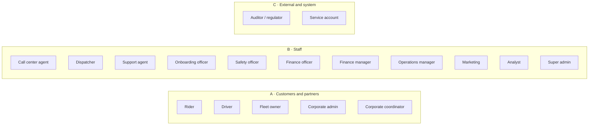

The model in one paragraph: a **user** can hold **many role assignments**. Each assignment is **scoped**: to the user's own data, to an **organisation** (a fleet company or a corporate account), to a **city**, or globally. Roles are bundles of **permissions** (`trip:assign`, `refund:approve`, …). Services check permissions **plus scope plus resource ownership**, never role names. Money, pricing and role changes need **a second person's approval**, and every sensitive action is written to an **append-only audit log**.

A **vehicle is owned either by its driver or by a company, never both.** Ownership decides who may drive it and who receives the trip earnings.

---

## 2. Decisions and assumptions

### Confirmed decisions

| # | Decision |
|---|---|
| D1 | All five customer/partner roles are in scope: rider, driver, fleet owner, corporate admin, corporate coordinator |
| D2 | All eleven staff roles and both external/system roles are in scope |
| D3 | A vehicle is owned by **exactly one** owner: an **individual driver** or a **company** (fleet organisation) |
| D4 | One user may hold several roles at once (e.g. a driver who also rides, or a fleet owner who also drives) |
| D5 | Some things are **attributes, not roles**: corporate employee, fleet driver, phone-booked guest |
| D6 | Staff roles are **scoped** (by city or organisation), so the same role can be limited to one area |
| D7 | Refunds, payouts, fare changes and role grants use **request → approve by a different person** |
| D8 | Code checks **permissions**, not role names. Roles are configurable bundles |

### Assumptions (change these if they're wrong)

| # | Assumption | Why it matters |
|---|---|---|
| A1 | A **phone booking center** operates from day one | Needs guest riders and "booked on behalf of" trips |
| A2 | Payment methods: **cash, mobile money, card** and **corporate monthly invoice** | Cash means drivers or fleet companies **owe commission** to the platform. Handled by the beneficiary balance in [Payment.md](Payment.md) |
| A3 | Launch in **one city (Addis Ababa)**, but city scoping exists from the start | Adding a city later needs data, not code |
| A4 | The fleet company and its drivers agree on pay **outside the platform**. The platform settles with the vehicle owner (a common industry pattern for fleet partners) | Payouts go to the vehicle owner's account |
| A5 | The regulator role gets **aggregated reports only**, never raw personal data | Privacy by default |
| A6 | In v1, an **individually owned** vehicle may be driven **only by its owner** | Keeps insurance and earnings simple. See [§18](#18-open-questions) |

---

## 3. Glossary

| Term | Meaning |
|---|---|
| **User** | One person's account (phone number + optional email). Drivers, riders and staff are all users |
| **Role** | A named bundle of permissions, e.g. `DISPATCHER` |
| **Role assignment** | "User X has role Y **within scope Z**" |
| **Scope** | Where a role applies: `SELF`, `ORG:<id>`, `CITY:<id>`, `GLOBAL` |
| **Permission** | One allowed action on one resource type: `resource:action` (e.g. `trip:assign`) |
| **Organisation** | A company on the platform. Type `FLEET` (owns vehicles) or `CORPORATE` (buys rides) |
| **Membership** | A user belonging to an organisation (fleet driver, corporate employee) |
| **Owner-driver** | A driver who owns the car they drive |
| **Fleet driver** | A driver authorised to drive cars owned by a fleet company |
| **Guest rider** | A rider known only by phone number, created when a call center agent or coordinator books for them |
| **Beneficiary** | The account that receives a trip's earnings: the vehicle owner |
| **Maker / checker** | The person who requests a sensitive action / the different person who approves it |

---

## 4. Role catalog

### A. Customers and partners

| Role code | Who | What they do | App / surface | Scope |
|---|---|---|---|---|
| `RIDER` | Anyone booking a ride | Book, track, pay, rate, report problems, SOS | Phone app, rider mode | `SELF` |
| `DRIVER` | Verified driver | Go online with a vehicle, accept trips, stream GPS, see earnings, SOS | Phone app, driver mode | `SELF` |
| `FLEET_OWNER` | Admin of a fleet company | Register company vehicles, invite and authorise drivers, view trips, earnings and payouts | Fleet portal (web) | `ORG:<fleet>` |
| `CORPORATE_ADMIN` | Admin of a corporate account | Invite employees, set ride policies and budgets, view trips and invoices | Corporate portal (web) | `ORG:<corporate>` |
| `CORPORATE_COORDINATOR` | Assistant or travel desk | Book rides for guests or employees, billed to the company | Corporate portal (web) | `ORG:<corporate>` |

### B. Staff (admin dashboard)

| Role code | What they do | Typical scope |
|---|---|---|
| `CALL_CENTER_AGENT` | Book rides by phone for callers (creating guest riders), cancel or modify bookings, log lost items, open tickets | `CITY` |
| `DISPATCHER` | Watch the live map, manually assign or reassign trips, handle unassigned and stuck trips | `CITY` |
| `SUPPORT_AGENT` | Work tickets from riders, drivers and companies; **request** refunds; view trip details | `CITY` |
| `ONBOARDING_OFFICER` | Review driver, vehicle and company documents; verify, activate or reject; schedule re-checks | `CITY` |
| `SAFETY_OFFICER` | Respond to SOS, investigate incidents, suspend and reinstate accounts, export trip GPS traces for police | `CITY` |
| `FINANCE_OFFICER` | Reconcile payments, **prepare** refunds and payouts, track and collect commission owed (cash trips), issue corporate invoices | `GLOBAL` |
| `FINANCE_MANAGER` | **Approve** refunds and payouts prepared by others; finance reports | `GLOBAL` |
| `OPERATIONS_MANAGER` | Service zones, vehicle types, **propose** and **approve** fare changes and incentives | `CITY` |
| `MARKETING` | Promo codes, referral programs, push and SMS campaigns | `CITY` |
| `ANALYST` | Read-only reports and dashboards, personal data **masked** | `CITY` / `GLOBAL` |
| `SUPER_ADMIN` | Manage staff accounts, **request** role grants (another super admin approves), read the audit log | `GLOBAL` |

> [!IMPORTANT]
> `SUPER_ADMIN` is **not** "can do everything". It manages *who has which role*. It doesn't automatically get finance, safety or dispatch powers. A super admin who needs those gets the role assigned and approved like anyone else.

### C. External and system

| Role code | What they do | Scope |
|---|---|---|
| `AUDITOR` | Read-only: audit log, aggregated reports. Internal audit or the regulator (Transport Bureau) | `GLOBAL` (aggregates only for the regulator) |
| `SERVICE` | Non-human: a microservice or partner integration with fixed, minimal API scopes | Per client |

### Attributes, not roles

| Looks like a role | Actually modelled as | Why |
|---|---|---|
| Corporate employee | `RIDER` + an active `Membership` in a `CORPORATE` org + a business profile on bookings | Same app, same permissions. Only billing differs |
| Fleet driver | `DRIVER` + a `Membership` in a `FLEET` org + `VehicleAuthorization`s | Same driver app. Only vehicle access and earnings routing differ |
| Owner-driver | `DRIVER` + a vehicle with `ownerType = INDIVIDUAL` owned by them | Ownership is a property of the vehicle |
| Guest rider | `User` with `status = GUEST` (phone number only) + `RIDER` | Can later "claim" the account by verifying the phone |

### Which surface each role uses

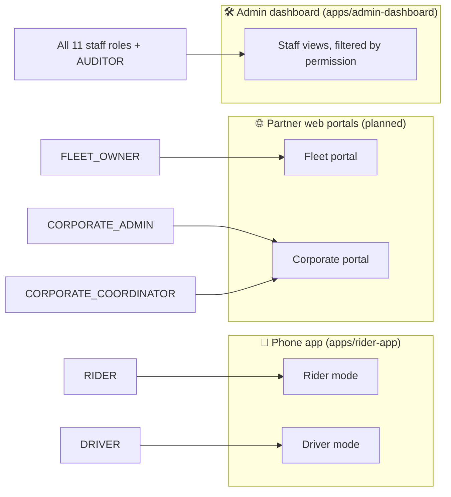

The admin dashboard is **one app**. Navigation and buttons are shown according to the permissions in the token, while the APIs enforce them.

---

## 5. Core model: users, roles, scopes, organisations

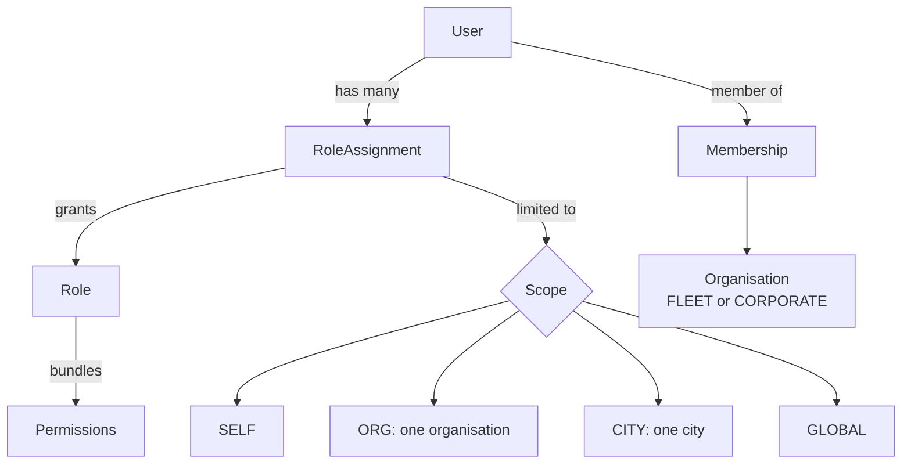

### Rules

1. **Many roles per user.** Example: Abebe is a `DRIVER` (`SELF`), a `RIDER` (`SELF`) and the `FLEET_OWNER` of *Abebe Transport PLC* (`ORG:org_42`).
2. **Customer roles are self-service.** `RIDER` is granted on sign-up. `DRIVER` is granted only after the onboarding officer activates the driver.
3. **Organisation roles come from membership.** Making someone a fleet owner or corporate admin creates a membership **and** a scoped role assignment. Removing the membership revokes the role.
4. **Staff roles are always granted through an approval** ([§11](#11-approvals-makerchecker)) and carry a scope.
5. **Assignments can expire** (`validUntil`), for temporary cover or contractors.
6. **Suspension beats roles.** A suspended user is denied everything except reading their own data and contacting support.

### Organisation types

| Type | Owns vehicles | Has drivers | Buys rides | Admin role | Second role |
|---|---|---|---|---|---|
| `FLEET` | ✅ | ✅ members with `DRIVER` | — | `FLEET_OWNER` | — |
| `CORPORATE` | — | — | ✅ members ride on the company account | `CORPORATE_ADMIN` | `CORPORATE_COORDINATOR` |

A real company can be both (a logistics firm that owns cars *and* books rides for staff). Model that as **two organisations** linked by the same legal entity (TIN), so fleet earnings and corporate billing never mix.

---

## 6. Vehicle ownership

**Rule D3:** every vehicle has exactly one owner, either an individual driver **or** a fleet company.

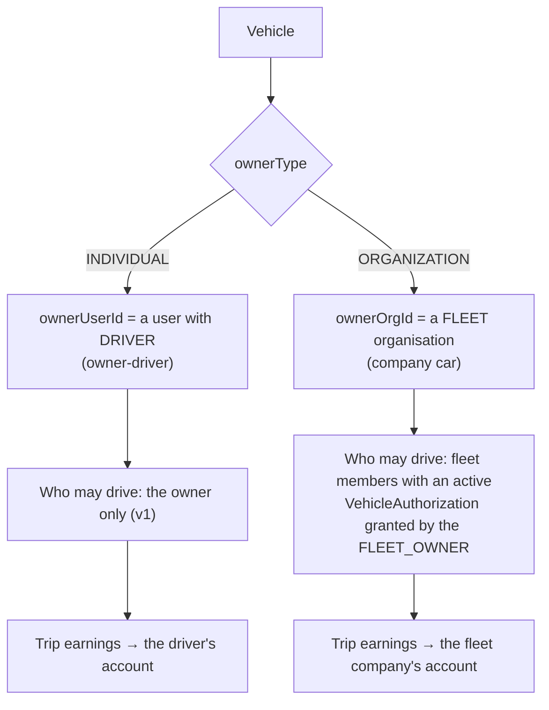

### Ownership rules

| # | Rule |
|---|---|
| V1 | Exactly one of `ownerUserId` / `ownerOrgId` is set (enforced by a database `CHECK` constraint) |
| V2 | The ownership document (e.g. the vehicle registration / "libre") must name the owner: the driver's name for `INDIVIDUAL`, the company's legal name for `ORGANIZATION`. The onboarding officer verifies the match |
| V3 | A vehicle can't take trips until it's `VERIFIED` (registration, insurance and inspection documents valid) |
| V4 | A vehicle has **at most one active driving session** at a time |
| V5 | A driver drives **one vehicle per session**, chosen when going online |
| V6 | `INDIVIDUAL` vehicle: only the owner may start a session (v1) |
| V7 | `ORGANIZATION` vehicle: the driver must be an **active member** of that fleet **and** hold an active `VehicleAuthorization` for that vehicle |
| V8 | A driver may own a car **and** be a fleet member. Each session's vehicle decides which rules apply |
| V9 | Transferring ownership (driver sells to a company, or the reverse) closes all sessions and authorisations, and requires re-verification of the documents under the new owner |
| V10 | Expired documents (insurance, inspection) automatically set the vehicle to `SUSPENDED` until renewed and re-verified |

### Vehicle lifecycle

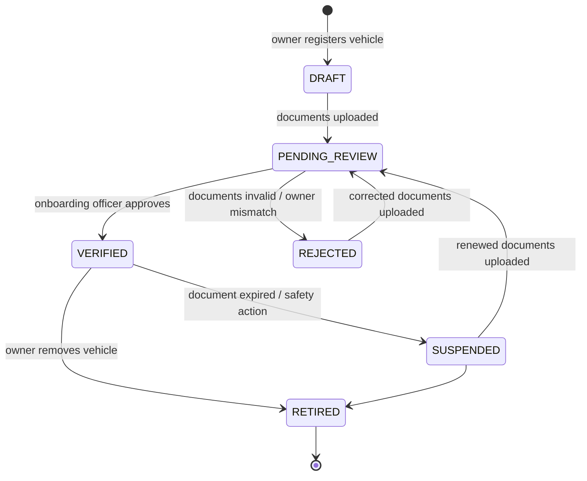

### Going online: which vehicle is allowed?

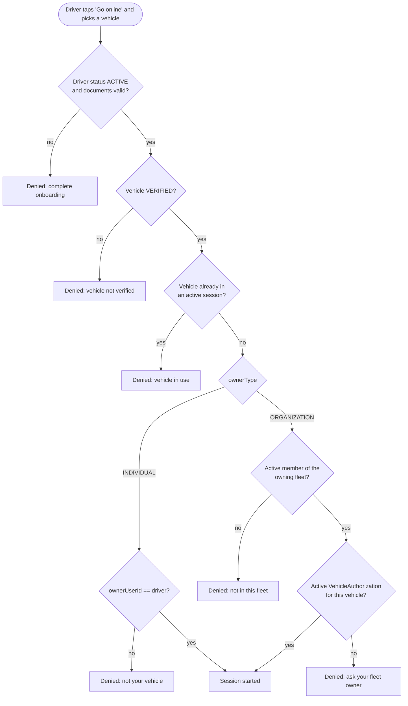

### Earnings and commission

The trip records a **snapshot** at match time: `driverUserId`, `vehicleId`, `vehicleOwnerType` and `beneficiaryAccountId`. Later ownership changes never rewrite past trips.

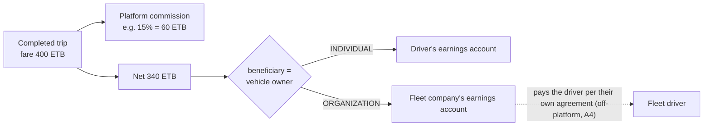

Every beneficiary has **one balance** with the platform. Digital trips credit it with the fare minus commission. **Cash trips debit it by the commission**, because the driver kept the whole fare. The two net out automatically:

| Payment method | Who holds the money after the trip | Beneficiary balance |
|---|---|---|
| Card / mobile money / corporate invoice | Platform | **+ fare − commission** (paid out weekly when positive) |
| Cash | Driver (handed over by the rider) | **− commission** (owed to the platform) |

When the balance goes too far negative, **cash requests pause first** (digital trips continue and repay the debt), then **all requests** pause at a hard limit or when a payment is overdue. For a fleet company, the limit applies to the **whole fleet's** balance.

➡️ Full design, covering settlement per payment method, commission models, limits, top-ups, payouts, fleet settlement and taxes: **[Payment.md](Payment.md)**.

---

## 7. Permission catalog

Format: `resource:action`. A permission alone isn't enough: it's always combined with a **scope** ([§9](#9-authorization-how-a-request-is-checked)).

| Area | Permissions |
|---|---|
| **Trips** | `trip:create` · `trip:create_on_behalf` · `trip:read` · `trip:cancel` · `trip:accept` · `trip:update_status` · `trip:assign` · `trip:reassign` · `trip:read_gps_trace` |
| **Live location** | `location:stream` · `location:read_live` |
| **Users** | `user:read_masked` · `user:read_pii` · `user:create_guest` · `user:suspend` · `user:reinstate` |
| **Drivers** | `driver:apply` · `driver:read` · `driver:verify` · `driver:activate` · `driver:suspend` · `driver:reinstate` |
| **Vehicles** | `vehicle:register` · `vehicle:read` · `vehicle:verify` · `vehicle:authorize_driver` · `vehicle:retire` · `vehicle:transfer` |
| **Documents** | `document:upload` · `document:read` · `document:review` |
| **Organisations** | `org:create` · `org:read` · `org:update` · `org:verify` · `org:manage_members` · `org:suspend` |
| **Corporate** | `corporate:manage_policies` · `corporate:read_invoices` |
| **Earnings & payments** | `earnings:read` · `payment:read` · `refund:request` · `refund:approve` · `payout:prepare` · `payout:approve` · `commission:read` · `commission:collect` · `invoice:issue` |
| **Pricing & ops** | `zone:manage` · `vehicle_type:manage` · `pricing:propose` · `pricing:approve` · `incentive:propose` · `incentive:approve` |
| **Marketing** | `promo:manage` · `campaign:send` |
| **Support & safety** | `ticket:create` · `ticket:read` · `ticket:update` · `lost_item:manage` · `sos:trigger` · `sos:respond` · `incident:manage` |
| **Administration** | `staff:manage` · `role:request` · `role:approve` · `audit_log:read` · `report:read` · `report:read_finance` · `report:read_regulatory` |

---

## 8. Role → permission matrix

Scope legend: **S** = own data (`SELF`) · **O** = own organisation (`ORG`) · **C** = assigned city (`CITY`) · **G** = everywhere (`GLOBAL`) · **↻** = needs approval by another person ([§11](#11-approvals-makerchecker)).

### Customers and partners

| Permission | Rider | Driver | Fleet owner | Corporate admin | Corporate coordinator |
|---|---|---|---|---|---|
| `trip:create` | S | — | — | O | O |
| `trip:create_on_behalf` | — | — | — | O | O |
| `trip:read` | S | S (assigned) | O (fleet vehicles) | O | O (booked by self) |
| `trip:cancel` | S | S (assigned) | — | O | O (booked by self) |
| `trip:accept` / `trip:update_status` | — | S (assigned) | — | — | — |
| `location:stream` | — | S | — | — | — |
| `location:read_live` | S (own trip's driver) | — | O (own vehicles, on trip) | — | — |
| `driver:apply` | S | — | — | — | — |
| `vehicle:register` | — | S (becomes owner-driver) | O | — | — |
| `vehicle:authorize_driver` | — | — | O | — | — |
| `vehicle:retire` | — | S (own vehicle) | O | — | — |
| `document:upload` | — | S | O | O (company docs) | — |
| `org:update` / `org:manage_members` | — | — | O | O | — |
| `corporate:manage_policies` | — | — | — | O | — |
| `corporate:read_invoices` | — | — | — | O | — |
| `earnings:read` | — | S | O | — | — |
| `payment:read` | S | — | O (payouts) | O | — |
| `ticket:create` / `sos:trigger` | S | S | O | O | O |

### Staff

| Permission | Call center | Dispatcher | Support | Onboarding | Safety | Finance officer | Finance manager | Ops manager | Marketing | Analyst | Super admin |
|---|---|---|---|---|---|---|---|---|---|---|---|
| `trip:read` | C | C | C | — | C | G | G | C | — | C (masked) | — |
| `trip:create_on_behalf` | C | — | — | — | — | — | — | — | — | — | — |
| `trip:cancel` | C | C | C | — | C | — | — | — | — | — | — |
| `trip:assign` / `trip:reassign` | — | C | — | — | — | — | — | — | — | — | — |
| `trip:read_gps_trace` | — | C | — | — | C | — | — | — | — | — | — |
| `location:read_live` | — | C | — | — | C | — | — | — | — | — | — |
| `user:create_guest` | C | — | — | — | — | — | — | — | — | — | — |
| `user:read_masked` | C | C | C | C | C | G | G | C | C | C | G |
| `user:read_pii` | — | — | C (logged) | C | C | G | G | — | — | — | — |
| `user:suspend` / `user:reinstate` | — | — | — | — | C | — | — | — | — | — | — |
| `driver:verify` / `driver:activate` | — | — | — | C | — | — | — | — | — | — | — |
| `driver:suspend` / `driver:reinstate` | — | — | — | C (documents) | C | — | — | — | — | — | — |
| `vehicle:verify` / `document:review` | — | — | — | C | — | — | — | — | — | — | — |
| `vehicle:transfer` | — | — | — | C ↻ | — | — | — | — | — | — | — |
| `org:verify` | — | — | — | C | — | — | — | — | — | — | — |
| `org:suspend` | — | — | — | — | C | G | — | — | — | — | — |
| `refund:request` | C | — | C | — | C | G | — | — | — | — | — |
| `refund:approve` | — | — | — | — | — | — | G ↻ | — | — | — | — |
| `payout:prepare` | — | — | — | — | — | G | — | — | — | — | — |
| `payout:approve` | — | — | — | — | — | — | G ↻ | — | — | — | — |
| `commission:read` / `commission:collect` | — | — | — | — | — | G | G | — | — | — | — |
| `invoice:issue` | — | — | — | — | — | G | — | — | — | — | — |
| `zone:manage` / `vehicle_type:manage` | — | — | — | — | — | — | — | C | — | — | — |
| `pricing:propose` / `incentive:propose` | — | — | — | — | — | — | — | C | — | — | — |
| `pricing:approve` / `incentive:approve` | — | — | — | — | — | — | G (cost review) | C ↻ | — | — | — |
| `promo:manage` / `campaign:send` | — | — | — | — | — | — | — | — | C | — | — |
| `ticket:read` / `ticket:update` | C | C | C | C | C | G | — | — | — | — | — |
| `lost_item:manage` | C | — | C | — | — | — | — | — | — | — | — |
| `sos:respond` / `incident:manage` | — | C (alert only) | — | — | C | — | — | — | — | — | — |
| `report:read` | — | C | C | C | C | G | G | C | C | C | — |
| `report:read_finance` | — | — | — | — | — | G | G | — | — | — | — |
| `staff:manage` | — | — | — | — | — | — | — | — | — | — | G |
| `role:request` | — | — | — | — | — | — | — | — | — | — | G |
| `role:approve` | — | — | — | — | — | — | — | — | — | — | G ↻ |
| `audit_log:read` | — | — | — | — | — | — | — | — | — | — | G |

### External and system

| Permission | Auditor (internal) | Auditor (regulator) | Service account |
|---|---|---|---|
| `audit_log:read` | G | — | — |
| `report:read` / `report:read_finance` | G | — | — |
| `report:read_regulatory` | G | G (aggregates) | — |
| Service-specific scopes | — | — | Per client, e.g. trip-service: `location:read_live`, `driver:read` |

> [!NOTE]
> The matrix lives in code as **one shared definition** (proposed `libs/shared-authz`), so services, the admin dashboard and tests use the same source of truth. Changing a role's bundle is a reviewed code change plus a permission-version bump ([§10](#10-tokens)).

---

## 9. Authorization: how a request is checked

Every protected action asks one question: **can *this user* do *this action* on *this resource*?**

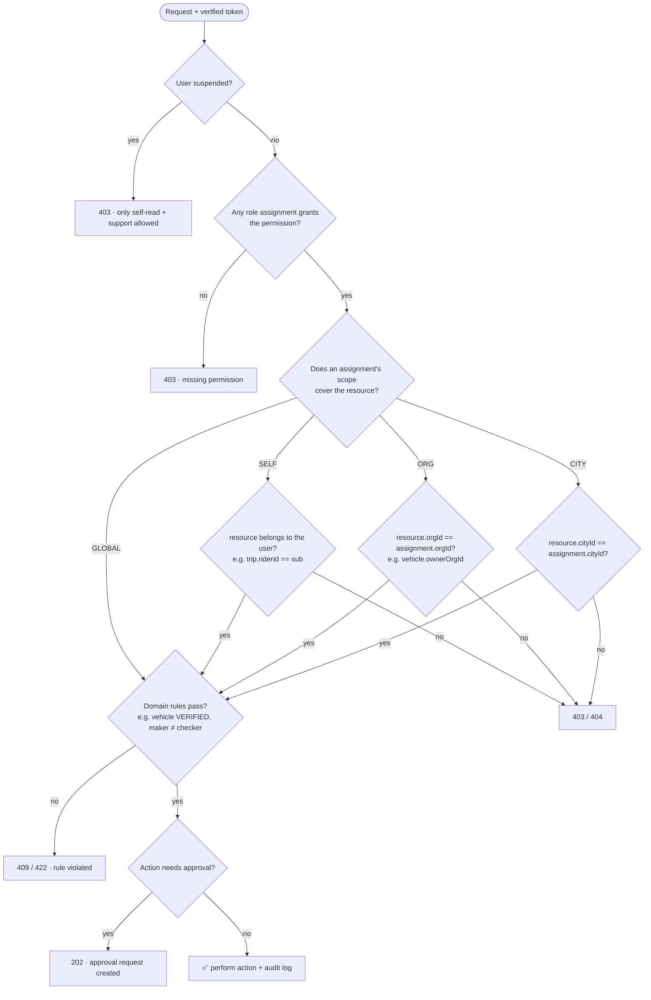

### Where each check happens

| Layer | Checks | Why there |
|---|---|---|
| **Kong** (edge) | Token signature and expiry; **audience** (`ride-app` vs `ride-admin`); route group (`/api/admin/*` requires `ride-admin`); rate limits | Cheap rejection before traffic reaches services |
| **Each service** | Permission + scope + ownership + domain rules + approval | Only the owning service knows the resource (which org owns this vehicle, which city this trip is in) |
| **Clients** | Hide what the user can't do | UX only, **never** a security boundary |

### The service-side helper (proposed `libs/shared-authz`)

```ts
// One call per protected action. Throws ForbiddenError (403) or NotFoundError (404).
await authz.require(principal, "vehicle:authorize_driver", {
  type: "vehicle",
  orgId: vehicle.ownerOrgId,   // scope attributes of the resource
  cityId: vehicle.cityId,
});
```

- **404 instead of 403** when revealing that the resource exists would leak information (e.g. another rider's trip).
- Every *deny* on a staff route and every *allow* on a sensitive permission (`user:read_pii`, `trip:read_gps_trace`, all money actions) is written to the audit log.

---

## 10. Tokens

Extends the current RS256 design (auth-service signs with the private key; everyone else verifies with the public key).

### Two audiences

| Audience | Issued to | Access-token TTL | Login requirements |
|---|---|---|---|
| `ride-app` | Riders, drivers, fleet owners, corporate admins and coordinators | 15 min (refresh 30 days) | Phone OTP or password |
| `ride-admin` | Staff, auditors | **10 min** (refresh 12 h, re-login daily) | Password **+ MFA**. Optional IP allow-list |

A user with both customer and staff roles gets **separate sessions** per audience. A staff token never works in the phone app, and a phone-app token never works on `/api/admin/*`.

### Claims

```json
{
  "iss": "ride-auth",
  "aud": "ride-admin",
  "sub": "usr_8f3c",
  "iat": 1792900000,
  "exp": 1792900600,
  "amr": ["pwd", "otp"],
  "pv": 7,
  "roles": [
    { "r": "DISPATCHER", "city": "addis-ababa" },
    { "r": "SUPPORT_AGENT", "city": "addis-ababa" }
  ]
}
```

```json
{
  "iss": "ride-auth",
  "aud": "ride-app",
  "sub": "usr_12ab",
  "exp": 1792900900,
  "pv": 7,
  "roles": [
    { "r": "RIDER" },
    { "r": "DRIVER" },
    { "r": "FLEET_OWNER", "org": "org_42" }
  ]
}
```

| Claim | Purpose |
|---|---|
| `iss`, `aud` | Kong's `jwt` plugin and services verify both (fixes the current gap where tokens have neither) |
| `roles` | Role **codes with scopes**, not expanded permissions. Services expand them from the shared matrix, which keeps tokens small |
| `pv` | Permission-matrix version. A token with an old `pv` is refused, so the client refreshes and gets the current roles |
| `amr` | Authentication methods. Staff routes require `otp` (MFA) |
| `act` | Only on "on behalf" actions (see the phone booking flow). Records the agent acting for a rider |

### Role changes take effect fast

- A role grant or revocation bumps the user's **token version**, and the refresh is refused until they re-authenticate.
- The worst case is the access-token TTL (10 minutes for staff, 15 for apps).
- **Suspension** goes further: auth-service publishes `user.suspended`, and services deny that `sub` immediately, from a short-lived denylist in Redis.

---

## 11. Approvals (maker–checker)

Sensitive actions are **requested** by one person and **approved** by another.

### Which actions need approval

| Action | Requested by (permission) | Approved by (permission) | Extra rule |
|---|---|---|---|
| Refund | `refund:request` (support, call center, safety, finance officer) | `refund:approve` (finance manager) | Refunds below a small threshold may auto-approve (configurable) |
| Driver/fleet payout batch | `payout:prepare` (finance officer) | `payout:approve` (finance manager) | — |
| Fare or zone pricing change | `pricing:propose` (ops manager) | `pricing:approve` (another ops manager or finance manager) | Takes effect at a scheduled time, never instantly |
| Driver incentive | `incentive:propose` | `incentive:approve` | Budget cap |
| Staff role grant | `role:request` (super admin) | `role:approve` (**another** super admin) | Grants of `SUPER_ADMIN`, `FINANCE_MANAGER` and `SAFETY_OFFICER` need a written reason |
| Vehicle ownership transfer | `vehicle:transfer` (onboarding officer) | A second onboarding officer | New owner's documents re-verified |

**Universal rules:** the requester can never approve their own request (checked by user ID, not role). Approvals expire after 7 days. Every state change is audited.

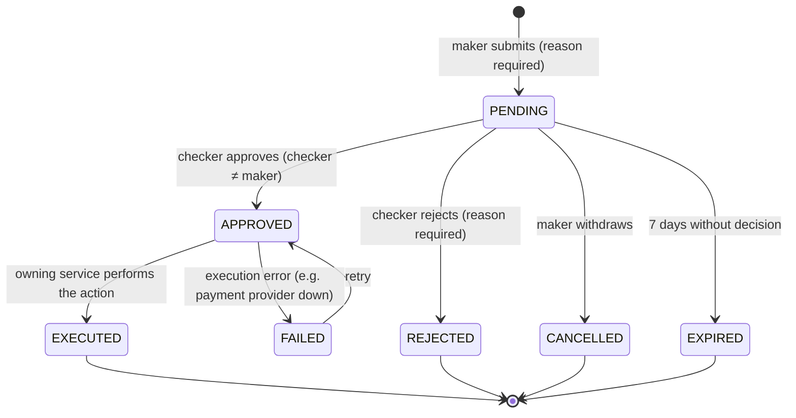

---

## 12. Audit log

An **append-only** record of who did what. It's for security investigations, disputes and the regulator.

| Field | Example |
|---|---|
| `id`, `at` | `aud_91c…`, `2026-10-25T09:14:03Z` |
| `actorId`, `actorRoles` | `usr_8f3c`, `["SUPPORT_AGENT@addis-ababa"]` |
| `onBehalfOf` | `usr_12ab` (when an agent acts for a rider) |
| `action` | `refund:request` |
| `resource` | `{ "type": "trip", "id": "trp_77" }` |
| `outcome` | `ALLOWED` / `DENIED` / `PENDING_APPROVAL` |
| `reason` | Free text, required for suspensions, PII views, approvals |
| `requestId`, `ip`, `userAgent` | For correlation |

**What is always logged:** every staff write; every view of PII or GPS traces; every money action; every role, suspension and approval change; every denied staff request.

**How:** each service publishes `audit.recorded` events to Kafka. The proposed audit-service consumes them into a write-once store. No API can update or delete entries, and retention is set per legal requirements.

---

## 13. Key flows

### 13.1 Owner-driver onboarding (vehicle owned by the driver)

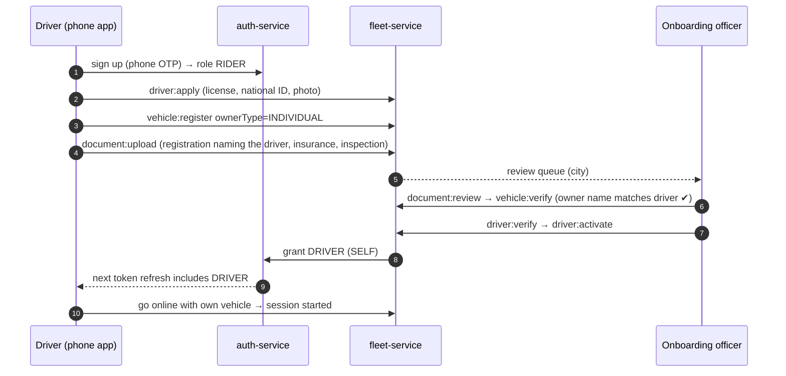

### 13.2 Company car (vehicle owned by a fleet company)

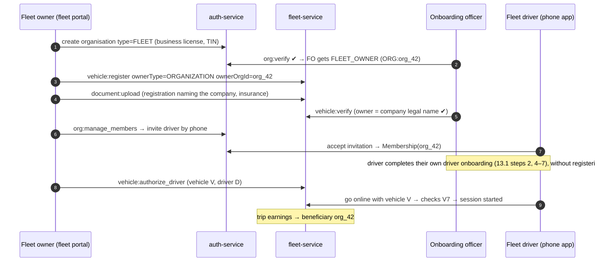

### 13.3 Phone booking by the call center (guest rider)

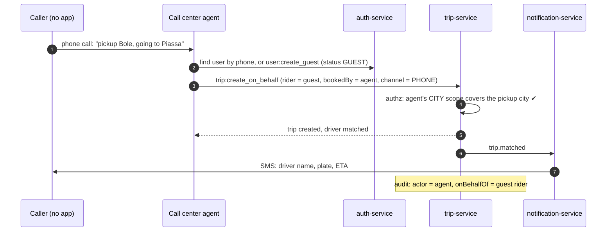

The guest can later install the app, verify the same phone number and **claim** the account, keeping their trip history.

### 13.4 Corporate coordinator books for a guest

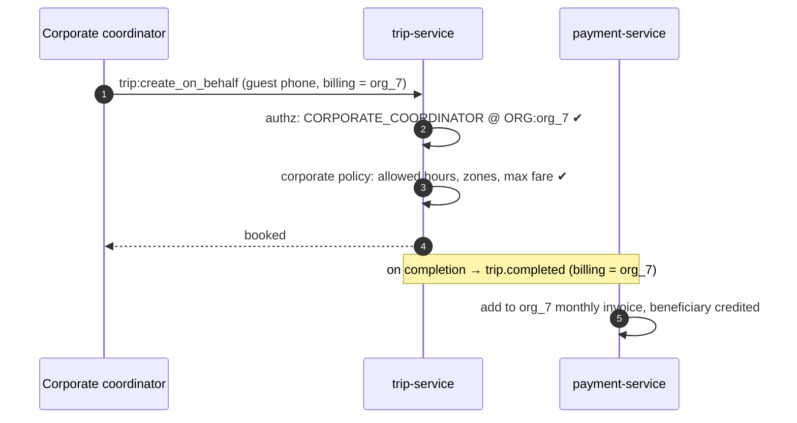

### 13.5 Refund with approval

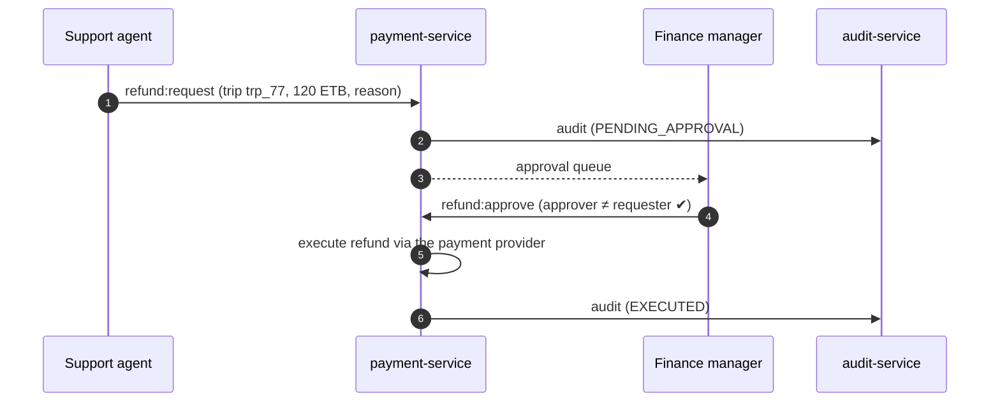

### 13.6 SOS

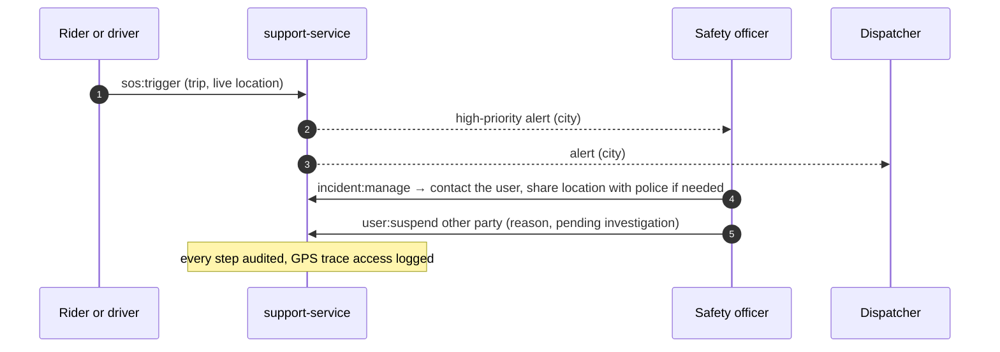

---

## 14. Data model

```mermaid
erDiagram
  User ||--o{ RoleAssignment : has
  Role ||--o{ RoleAssignment : "granted as"
  City ||--o{ RoleAssignment : "scopes (CITY)"
  Organization ||--o{ RoleAssignment : "scopes (ORG)"
  User ||--o{ Membership : "belongs via"
  Organization ||--o{ Membership : has
  User ||--o| DriverProfile : "may have"
  User ||--o{ Vehicle : "owns (INDIVIDUAL)"
  Organization ||--o{ Vehicle : "owns (ORGANIZATION)"
  Vehicle ||--o{ VehicleAuthorization : "drivable by"
  DriverProfile ||--o{ VehicleAuthorization : holds
  DriverProfile ||--o{ DrivingSession : starts
  Vehicle ||--o{ DrivingSession : "used in"
  Vehicle ||--o{ Document : has
  DriverProfile ||--o{ Document : has
  Organization ||--o{ Document : has
  User ||--o{ ApprovalRequest : "makes / checks"
  User ||--o{ AuditEntry : "acts in"

  User {
    string id PK
    string phone UK
    string email UK "optional"
    string passwordHash "optional"
    string status "ACTIVE | GUEST | SUSPENDED | DELETED"
    int tokenVersion
  }
  Role {
    string code PK "RIDER, DRIVER, FLEET_OWNER, ..."
    string audience "ride-app | ride-admin"
  }
  RoleAssignment {
    string id PK
    string userId FK
    string roleCode FK
    string scopeType "SELF | ORG | CITY | GLOBAL"
    string orgId FK "when ORG"
    string cityId FK "when CITY"
    datetime validUntil "optional"
    string grantedBy FK
  }
  City {
    string id PK "addis-ababa"
    string name
  }
  Organization {
    string id PK
    string type "FLEET | CORPORATE"
    string legalName
    string tin UK
    string status "PENDING | VERIFIED | SUSPENDED"
    string cityId FK
  }
  Membership {
    string userId FK
    string orgId FK
    string kind "FLEET_DRIVER | EMPLOYEE | ADMIN | COORDINATOR"
    string status "INVITED | ACTIVE | REMOVED"
  }
  DriverProfile {
    string userId PK
    string status "APPLIED | PENDING_REVIEW | ACTIVE | SUSPENDED"
    string licenseNumber
    string cityId FK
  }
  Vehicle {
    string id PK
    string plateNumber UK
    string ownerType "INDIVIDUAL | ORGANIZATION"
    string ownerUserId FK "set iff INDIVIDUAL"
    string ownerOrgId FK "set iff ORGANIZATION"
    string vehicleType "SEDAN | MINIVAN | ..."
    string status "DRAFT | PENDING_REVIEW | VERIFIED | SUSPENDED | RETIRED"
    string cityId FK
  }
  VehicleAuthorization {
    string vehicleId FK
    string driverUserId FK
    string grantedBy FK "fleet owner"
    datetime validUntil "optional"
    string status "ACTIVE | REVOKED"
  }
  DrivingSession {
    string id PK
    string driverUserId FK
    string vehicleId FK
    datetime startedAt
    datetime endedAt "null while online"
  }
  Document {
    string id PK
    string subjectType "DRIVER | VEHICLE | ORGANIZATION"
    string subjectId
    string kind "LICENSE | NATIONAL_ID | REGISTRATION | INSURANCE | INSPECTION | BUSINESS_LICENSE | TIN"
    date expiresAt
    string status "PENDING | APPROVED | REJECTED | EXPIRED"
    string reviewedBy FK
  }
  ApprovalRequest {
    string id PK
    string action "refund:approve, payout:approve, ..."
    json payload
    string makerId FK
    string checkerId FK
    string status "PENDING | APPROVED | REJECTED | CANCELLED | EXPIRED | EXECUTED | FAILED"
  }
  AuditEntry {
    string id PK
    datetime at
    string actorId FK
    string onBehalfOf "optional"
    string action
    json resource
    string outcome
    string reason
  }
```

### Key database constraints

| Constraint | Enforces |
|---|---|
| `CHECK ((ownerType = 'INDIVIDUAL' AND ownerUserId IS NOT NULL AND ownerOrgId IS NULL) OR (ownerType = 'ORGANIZATION' AND ownerOrgId IS NOT NULL AND ownerUserId IS NULL))` | V1: exactly one owner |
| Partial unique index on `DrivingSession(vehicleId) WHERE endedAt IS NULL` | V4: one active session per vehicle |
| Partial unique index on `DrivingSession(driverUserId) WHERE endedAt IS NULL` | V5: one vehicle per driver session |
| `CHECK (makerId <> checkerId)` on `ApprovalRequest` | Maker ≠ checker |
| Unique `(userId, roleCode, scopeType, orgId, cityId)` on `RoleAssignment` | No duplicate assignments |

### Trip fields added for this design (trip-service)

| Field | Purpose |
|---|---|
| `riderUserId` | The rider (may be a guest) |
| `bookedByUserId`, `channel` (`APP` / `PHONE` / `CORPORATE_PORTAL`) | Who booked it, and how |
| `billingType` (`PERSONAL` / `CORPORATE`), `billingOrgId` | Who pays |
| `driverUserId`, `vehicleId`, `vehicleOwnerType`, `beneficiaryAccountId` | Snapshot at match time, for earnings |
| `cityId` | Scope checks for staff |

---

## 15. Service ownership

Each table belongs to exactly one service ([database per service](../architecture/overview.md#7-data-architecture)).

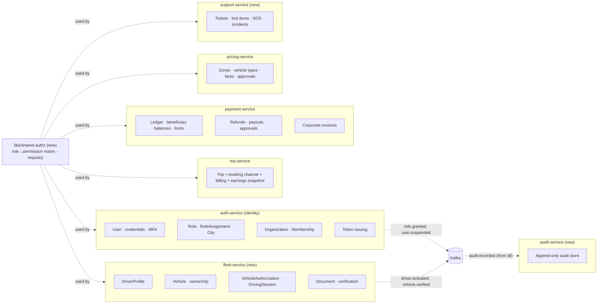

| Change | Service |
|---|---|
| Extend | **auth-service**: multi-role assignments, scopes, organisations, memberships, staff MFA, two audiences, `iss`/`aud`/`roles`/`pv` claims |
| New | **fleet-service** (port 3008): drivers, vehicles, ownership, authorisations, sessions, documents |
| New | **support-service** (port 3009): tickets, lost items, SOS, incidents |
| New | **audit-service** (port 3010): consumes `audit.recorded` and stores it write-once |
| Extend | **trip-service**: booking channel, on-behalf bookings, billing, earnings snapshot, city scope |
| Extend | **payment-service**: ledger with one balance per beneficiary, cash-commission limits, top-ups, approvals, corporate invoicing ([Payment.md](Payment.md)) |
| Extend | **pricing-service**: city zones, vehicle types, fare proposals with approval |
| New lib | **`libs/shared-authz`**: the permission matrix and the `require()` helper |
| New apps | **Fleet portal** and **corporate portal** (web). The **admin dashboard** gains permission-driven views |

### New events

| Topic | Producer | Consumers |
|---|---|---|
| `role.granted` / `role.revoked` | auth-service | audit, admin dashboard |
| `user.suspended` / `user.reinstated` | auth-service | every service (immediate deny), audit |
| `org.verified` / `org.suspended` | auth-service | fleet, payment, trip |
| `driver.activated` / `driver.suspended` | fleet-service | auth (grant/revoke DRIVER), trip, audit |
| `vehicle.verified` / `vehicle.suspended` / `vehicle.transferred` | fleet-service | trip, payment, audit |
| `approval.requested` / `approval.decided` | owning service | admin dashboard (queues), audit |
| `audit.recorded` | every service | audit-service |

---

## 16. Security requirements

| # | Requirement |
|---|---|
| SR1 | **Least privilege:** every role gets only the permissions in [§8](#8-role--permission-matrix). No wildcard permissions, even for super admin |
| SR2 | **MFA** required for all `ride-admin` logins. Staff sessions expire daily |
| SR3 | **Separate audiences:** customer tokens are rejected on admin routes, and vice versa |
| SR4 | **Maker ≠ checker** on money, pricing, role and ownership changes |
| SR5 | **PII masking by default:** names shortened and phones masked (`+251 9•• ••• 456`). Full PII needs `user:read_pii`, a reason, and is audited |
| SR6 | **Scope isolation:** fleet owners and corporate admins never see other organisations' data. Covered by automated tests for every list and read endpoint |
| SR7 | **Break-glass account:** one emergency super admin, credentials split and sealed. Any use triggers an alert and a review |
| SR8 | **Offboarding:** removing a staff member revokes all assignments and active sessions within the token TTL |
| SR9 | **Quarterly access review:** each staff role assignment is re-confirmed or removed |
| SR10 | **Documents are sensitive:** stored encrypted in object storage, served by short-lived signed URLs, every access audited |

---

## 17. Migration plan

| Phase | Work | Result |
|---|---|---|
| **0. Fix the basics** | Fix the auth-service register/login bugs; add `iss`/`aud`; configure Kong's JWT consumer | Today's flows work |
| **1. Multi-role identity** | Add `Role`, `RoleAssignment`, `City`. Migrate `User.role` → one `RoleAssignment` per user (`RIDER` / `DRIVER` @ `SELF`; `ADMIN` → `SUPER_ADMIN` @ `GLOBAL`, flagged for review). Tokens carry `roles` + `pv`. Keep `User.role` read-only for one release, then drop it (expand → contract) | Users can hold several roles |
| **2. Shared authz** | `libs/shared-authz` with the matrix + `require()`. Use it in auth-service and realtime-gateway | One enforcement pattern |
| **3. Organisations + fleet-service** | `Organization`, `Membership`; fleet-service with drivers, vehicles, ownership rules V1–V10, documents, onboarding queue | Owner-drivers and company cars |
| **4. Staff roles in admin dashboard** | MFA, `ride-admin` audience, permission-driven UI; call center, dispatcher, onboarding and support views | Staff can operate |
| **5. Money** | Beneficiary balances and limits, top-ups, approvals, payouts, refunds, corporate invoices ([Payment.md §18](Payment.md#18-rollout-plan)) | Finance roles live |
| **6. Safety + audit** | support-service (SOS, incidents), audit-service, PII masking, access reviews | Compliance-ready |
| **7. Partner portals** | Fleet portal, corporate portal | Partners self-serve |

Each phase ships behind the previous one and keeps every existing flow working.

---

## 18. Open questions

| # | Question | Current default |
|---|---|---|
| Q1 | May an owner-driver let **another driver** use their car (e.g. a night-shift driver)? | No in v1 (A6). The model already supports it: allow `VehicleAuthorization` on `INDIVIDUAL` vehicles, granted by the owner |
| Q2 | Should the platform split earnings between a fleet company and its driver automatically? | No: paid to the company, which pays the driver off-platform (A4) |
| Q3 | Commission rate per city, vehicle type, or fleet contract? | Per city + vehicle type |
| Q4 | Balance limits before blocking? | Configurable per city. See [Payment.md §8](Payment.md#8-balance-limits-and-blocking) |
| Q5 | Retention period for audit entries and GPS traces? | Set with legal counsel |
| Q6 | Which reports and format does the Transport Bureau require? | Aggregated trips and drivers per period, no personal data (A5) |
| Q7 | Should corporate employees be invited only, or also join by verified email domain? | Invite only |
