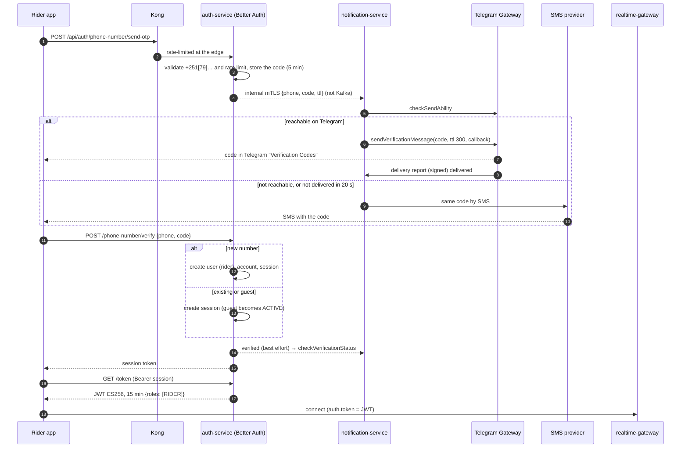
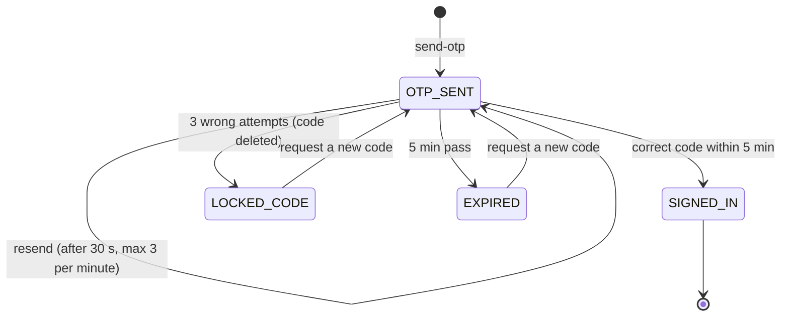
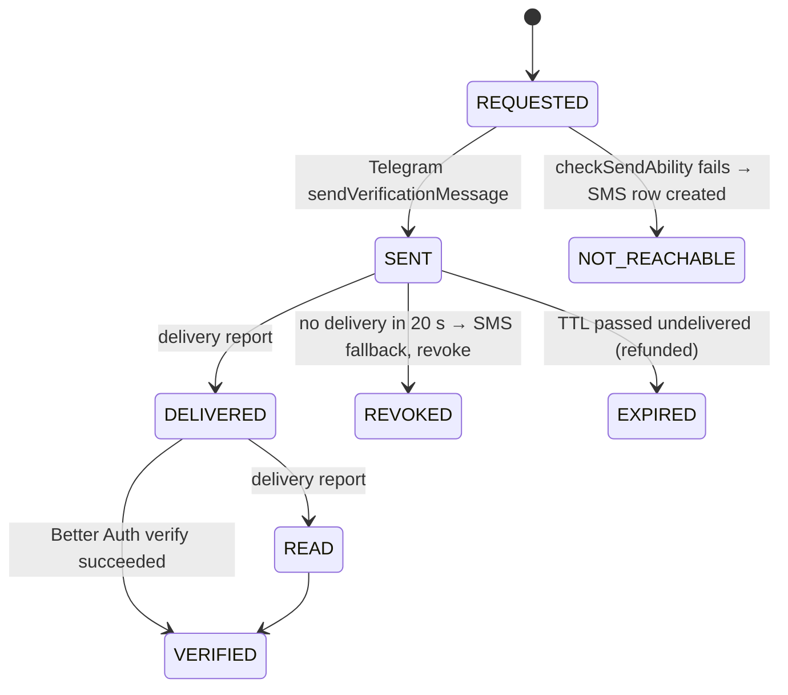

# Workflow 01: Rider sign-up and sign-in

| | |
|---|---|
| **Actors** | Rider (phone app) |
| **Services** | auth-service (Better Auth app surface), notification-service (**Telegram Gateway** first, SMS fallback) |
| **Trigger** | A new or returning user opens the app |
| **Outcome** | The user has a session (bearer token) and a short-lived JWT with role `RIDER` |
| **Related** | [← Workflows](README.md) · [Auth.md §9.1](../Auth.md#91-rider-sign-up-and-sign-in-with-a-phone-otp) · **[Auth.md §9.7 (Telegram delivery)](../Auth.md#97-otp-delivery-telegram-gateway-first-sms-fallback)** · [10 Phone booking (claiming a guest account)](10-phone-booking.md) |

## 1. Summary

Riders identify with their **phone number**:
1. The user enters it.
2. **Telegram sends the 6-digit code to that number's Telegram account** (Telegram Gateway API). If the number can't receive Telegram codes, or the code isn't delivered within 20 s, the **same code goes by SMS**.
3. The user types the code, and **our backend (Better Auth) checks it**. On first verification Better Auth creates the account (`signUpOnVerification`) with role `rider`.
4. The app exchanges its session for a 15-minute JWT and refreshes it silently.

There's no password for riders.

## 2. Preconditions

- The app is installed and can reach `https://api.anbessa.et`.
- The phone number is an Ethiopian mobile number (`+2519…` or `+2517…`).
- The number isn't banned ([16](16-account-lifecycle.md)).
- Telegram is **not** required: users without it get the code by SMS automatically.

## 3. Steps

| # | Who | Action | Data written | Event |
|---|---|---|---|---|
| 1 | Rider | Enters a phone number. The app normalises it to E.164 (`0911…` → `+251911…`). The screen notes: "We'll send your code via Telegram, or SMS if Telegram isn't available" | — | — |
| 2 | App → auth | `POST /api/auth/phone-number/send-otp` | Better Auth `verification` row: the code, expiring in 5 min | — |
| 3 | auth | Validates the format and rate limits (3 per minute per number, plus a per-IP limit). Calls notification-service **over internal mTLS HTTP** with `{phone, code, ttl: 300}`, not awaited. **The code never goes through Kafka** ([Auth.md AU11](../Auth.md#3-decisions)) | — | — |
| 4 | notification | `checkSendAbility(phone)` on the Telegram Gateway | `otp_delivery` (`REQUESTED`) + the code encrypted in Redis for 5 min | — |
| 5a | notification | **Can receive:** `sendVerificationMessage(phone, request_id, code, ttl=300, callback_url, payload=deliveryId)` → the code appears in the user's Telegram "Verification Codes" chat | `otp_delivery` (`TELEGRAM`, `SENT`, `request_id`, cost) | — |
| 5b | notification | **Can't receive** (no Telegram, or restricted): free check → sends the **same code by SMS** | `otp_delivery` (`SMS`) | — |
| 6 | Telegram → notification | Signed delivery reports (`delivered`, `read`) at `POST /api/webhooks/telegram-gateway` | `otp_delivery.status` | — |
| 7 | notification | **No `delivered` report within 20 s** → SMS fallback with the same code, and best-effort `revokeVerificationMessage` | `otp_delivery` (`SMS`, `fallback_of`) | — |
| 8 | Rider | Types the code from Telegram or SMS (it's the same code). The app offers "Open Telegram" and, after 20 s, "Didn't get it? We've sent it by SMS too" | — | — |
| 9 | App → auth | `POST /api/auth/phone-number/verify {phoneNumber, code}` | — | — |
| 10 | auth | **Better Auth checks** the code, its expiry and the 3-attempt limit | — | — |
| 11a | auth | **New number:** creates `user` (role `rider`, temp email, `phoneNumberVerified = true`), `account`, `session` | user, account, session | `user.created` |
| 11b | auth | **Known number:** creates a `session`. If the account was a call-center **guest**, sets `accountStatus = ACTIVE` (claimed, and its trips stay) | session | `user.claimed` (guest only) |
| 12 | auth → notification | Best effort: "verified" → notification calls `checkVerificationStatus(request_id, code)` (Telegram records `code_valid`) and deletes the Redis copy of the code | `otp_delivery` `VERIFIED` | — |
| 13 | auth → App | Returns the session token. The app stores it in secure storage (`flutter_secure_storage`) | — | — |
| 14 | App → auth | `GET /api/auth/token` with `Authorization: Bearer <session>` | — | — |
| 15 | auth | Builds the claims (`definePayload`: `sub`, `roles`, `pv`) and signs an ES256 JWT (15 min) | — | — |
| 16 | App | Opens the WebSocket to realtime-gateway with `auth.token = JWT`, and shows the rider home (or the driver home if the roles include `DRIVER`) | — | — |
| 17 | App | Refreshes the JWT about a minute before `exp`, or on any 401, by repeating step 14 | — | — |
| 18 | Rider (optional) | Sets a display name and an emergency contact in the profile | user fields | `user.updated` |

## 4. Sequence diagram

## 5. States

Verification (Better Auth):

Delivery (notification-service `otp_delivery`):

## 6. Timeouts and limits

| Item | Value |
|---|---|
| OTP length / lifetime / attempts | 6 digits / 5 min (= the Telegram `ttl`) / 3 |
| SMS auto-fallback | 20 s without a Telegram `delivered` report |
| Resend cooldown | 30 s (client), 3 per minute per number (server). A resend after an unread Telegram attempt goes **by SMS** |
| Per-IP send limit | 20 per hour (Kong + Better Auth) |
| Session lifetime | 30 days, sliding (refreshed daily while used) |
| JWT lifetime | 15 min |

## 7. Failures and edge cases

| Case | Handling |
|---|---|
| User has no Telegram | `checkSendAbility` fails (free) → SMS immediately. No delay for the user |
| Telegram installed but the code isn't delivered (offline phone, Telegram down) | SMS fallback after 20 s with the same code. The Telegram attempt is refunded if undelivered within the TTL |
| Code arrives on both Telegram and SMS | Harmless: it's the same code, and it works once |
| Telegram Gateway API errors or times out | Treated like "can't receive" → SMS. Circuit breaker: after repeated errors, skip Telegram for 5 min |
| Gateway prepaid balance runs out | Requests fail → SMS fallback keeps sign-in working. **Alert** before it happens (balance metric) |
| Forged delivery report | Rejected: bad `X-Request-Signature` or a stale `X-Request-Timestamp` |
| SMS provider outage | Telegram still works for most users. notification-service fails over to a second SMS provider if configured |
| Paid-message pumping (fraud generating cost) | Per-number and per-IP limits, Ethiopian-mobile validation, daily spend alerts (Telegram + SMS), a CAPTCHA after repeated sends |
| User changes phone number | Settings → new number → OTP (Telegram or SMS) on the new number (`updatePhoneNumber: true`) |
| Banned user | `verify` succeeds but no session is issued: "Your account is suspended, contact support" |
| Lost phone | Support can revoke sessions ("sign out everywhere"). A new device needs a new OTP |

## 8. Permissions

Self-service sign-up needs no permission. Every subsequent call uses `RIDER @ SELF` ([Role.md §8](../Role.md#8-role--permission-matrix)). The internal OTP-delivery endpoint accepts calls **only from auth-service** (mTLS workload identity).

## 9. Events

| Event | Producer | Consumers |
|---|---|---|
| `user.created` | auth | notification (welcome), trip (rider cache), audit |
| `user.claimed` | auth | trip (link the guest's trips to the active account), audit |
| `user.updated` | auth | trip / notification read copies |

OTP delivery is deliberately **not** an event (codes stay out of Kafka). `otp_delivery` statuses are exported as metrics.

## 10. Metrics and alerts

- **Telegram reach:** share of numbers that pass `checkSendAbility`.
- Delivery rate and time to delivery per channel. **SMS fallback rate** (alert if it jumps: Telegram problems).
- OTP **conversion** (verified ÷ requested). Alert below 70%.
- Cost per verified sign-in, Telegram vs SMS. Gateway **remaining balance** (alert below 7 days of spend).
- Rate-limit hits per IP (abuse signal).

## 11. Open questions

- Should "Send by SMS" be offered **before** the 20-s fallback, for users who don't open Telegram?
- Use Telegram codes for **staff** 2FA too, or keep TOTP only (current design)?
