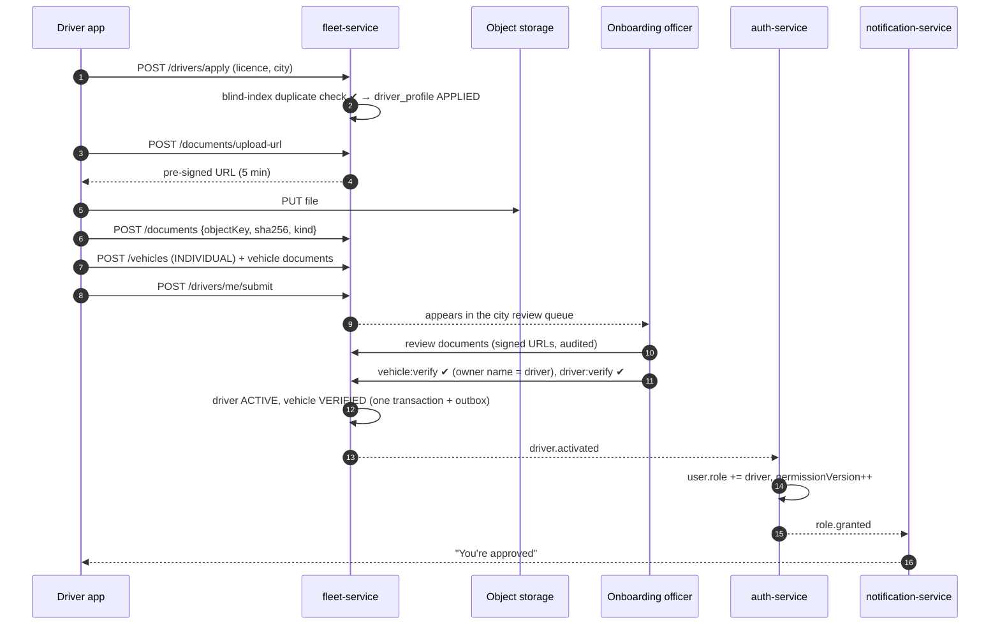
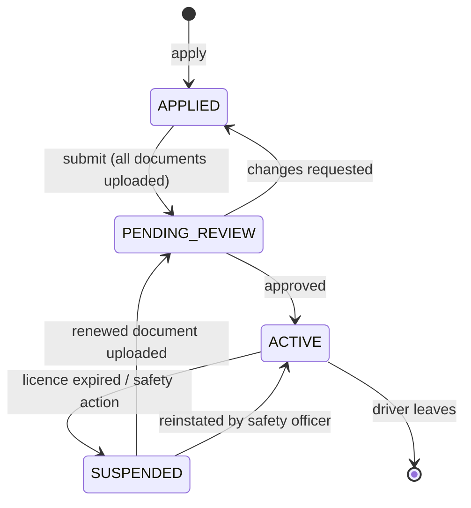

# Workflow 02: Driver onboarding and vehicle verification

| | |
|---|---|
| **Actors** | Driver (phone app, driver mode), onboarding officer (admin dashboard) |
| **Services** | auth-service, fleet-service, notification-service, object storage (S3) |
| **Trigger** | A signed-in user taps "Drive with Anbessa" |
| **Outcome** | An **owner-driver** with role `DRIVER` and a `VERIFIED` vehicle they own, ready to go online ([04](04-driver-shift.md)). Fleet drivers skip the vehicle part ([03](03-fleet-onboarding.md)) |
| **Related** | [← Workflows](README.md) · [Role.md §6 (vehicle ownership)](../Role.md#6-vehicle-ownership) · [Role.md §13.1](../Role.md#131-owner-driver-onboarding-vehicle-owned-by-the-driver) · [Database.md §7.2](../Database.md#72-fleet-fleet-service) |

## 1. Summary

The driver applies in the app, uploads their own documents (licence, national ID, photo) and, if they own their car, registers it with its documents (registration showing their name, insurance, inspection). An onboarding officer in the same city reviews everything in a queue. When both the driver and their vehicle are approved, fleet-service activates the driver and asks auth-service to add the `driver` role. Documents are re-checked automatically when they expire.

## 2. Preconditions

- The user is signed in ([01](01-rider-signup-signin.md)) and isn't banned.
- The user has no existing active `driver_profile` (one per user).
- The pickup city is one where Anbessa operates.

## 3. Steps

### A. Application (driver)

| # | Action | Data written | Event |
|---|---|---|---|
| 1 | Driver mode → "Apply": city, licence number, full name as on the licence | `driver_profile` (status `APPLIED`, licence encrypted + blind-index hash) | `driver.applied` |
| 2 | Duplicate check: the licence `license_hash` must be unique. A match means a duplicate application or a banned driver | — (rejected with "already registered") | — |
| 3 | Upload documents: `LICENSE` (front/back), `NATIONAL_ID`, `PHOTO` (live selfie). The app requests a **pre-signed S3 upload URL** per file, uploads directly, then confirms | `document` rows (`PENDING`, `object_key`, `sha256`, `expires_at` from the licence) | — |
| 4 | **Owner-driver only:** "Add my vehicle": plate, make/model, year, colour, seats, vehicle type | `vehicle` (`owner_type = INDIVIDUAL`, `owner_user_id = driver`, `DRAFT`) | — |
| 5 | Vehicle documents: `REGISTRATION` (ownership booklet), `INSURANCE`, `INSPECTION` (annual) | `document` rows (`PENDING`) | — |
| 6 | Submit → statuses move to `PENDING_REVIEW` | driver_profile, vehicle | `driver.submitted`, `vehicle.submitted` |

### B. Review (onboarding officer)

| # | Action | Data written | Event |
|---|---|---|---|
| 7 | The officer opens the city queue (`ix_document_review`, oldest first). Viewing documents uses short-lived signed URLs, and every view is audited | `audit_entry` | `audit.recorded` |
| 8 | Check the driver: the licence is valid for the category and not expired, the ID matches the name, the selfie matches the ID photo | `document.status` per file | — |
| 9 | Check the vehicle: the plate matches the registration, **the registration owner's name matches the driver** (rule V2), insurance and inspection are valid | `document.status` | — |
| 10a | All approved → `vehicle:verify`, `driver:verify` | vehicle `VERIFIED`, driver_profile `ACTIVE` | `vehicle.verified`, `driver.activated` |
| 10b | Any rejected → reason per document (e.g. "photo blurry", "registration owner differs") | document `REJECTED`, profile back to `APPLIED` | `driver.changes_requested` |
| 11 | On `driver.activated`, auth-service adds `driver` to `user.role` and bumps `permissionVersion` | `user.role`, `permissionVersion` | `role.granted` |
| 12 | notification → push + SMS: "You're approved. Go online anytime." | notification | — |

### C. Ongoing: document expiry

| # | Action | Data written | Event |
|---|---|---|---|
| 13 | Nightly job: documents expiring within 30 days → reminder (push + SMS) at 30, 7 and 1 days | notification | — |
| 14 | On expiry: document `EXPIRED` → vehicle `SUSPENDED` (V10), or the driver profile is suspended for the licence | statuses | `vehicle.suspended` / `driver.suspended` |
| 15 | Driver uploads the renewed document → `PENDING_REVIEW` → step 7 again | | |

## 4. Sequence diagram

## 5. States

The vehicle lifecycle is in [Role.md §6](../Role.md#vehicle-lifecycle).

## 6. Timeouts and limits

| Item | Value |
|---|---|
| Upload URL validity | 5 min |
| Max file size / types | 10 MB · JPEG, PNG, PDF |
| Review SLA | 90% within 24 h (alert when the queue's oldest item is > 24 h) |
| Draft applications | Deleted after 60 days of inactivity (documents purged) |

## 7. Failures and edge cases

| Case | Handling |
|---|---|
| Registration names someone else (family car) | Rejected under V2 in v1. The owner must register as a fleet ([03](03-fleet-onboarding.md)), or the open question Q1 in [Role.md §18](../Role.md#18-open-questions) is decided |
| Same plate registered twice | `vehicle.plate_number UNIQUE` → "plate already registered, contact support" (possible fraud, flagged) |
| Licence already used by a banned driver | Blind-index match → application blocked, safety team notified |
| Upload interrupted | The upload URL can be requested again. The `sha256` dedupes repeated uploads |
| Officer approves a document then notices fraud | `driver:suspend` with a reason (audited), and back to review |
| Driver also wants to drive fleet cars | Possible: they join a fleet ([03](03-fleet-onboarding.md)). Both rule sets apply per session (V8) |

## 8. Permissions

| Step | Permission | Scope |
|---|---|---|
| Apply, upload, register own vehicle | `driver:apply`, `document:upload`, `vehicle:register` | `SELF` |
| Review, verify, activate | `document:review`, `vehicle:verify`, `driver:verify`, `driver:activate` | `CITY` |
| Viewing PII in documents | `user:read_pii` (audited) | `CITY` |

## 9. Events

`driver.applied`, `driver.submitted`, `vehicle.submitted`, `driver.changes_requested`, `driver.activated`, `vehicle.verified`, `vehicle.suspended`, `driver.suspended`, `role.granted`.

## 10. Metrics and alerts

- Funnel: applied → submitted → approved (by city, per week).
- Review queue size and oldest item age (SLA alert).
- Rejection reasons distribution (improves the in-app guidance).
- Documents expiring in the next 7 days.

## 11. Open questions

- In-person verification day (photo, vehicle inspection) in addition to the remote review?
- Automated ID/selfie matching (a KYC provider) or manual only at launch?
