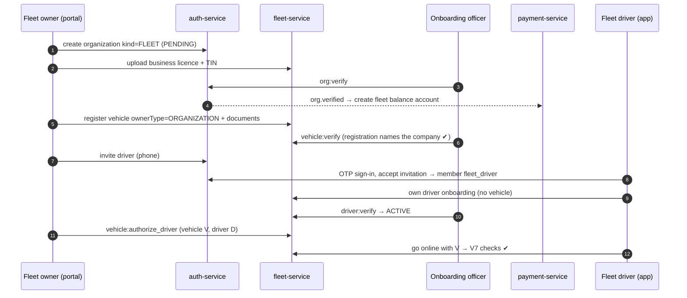

# Workflow 03: Fleet company onboarding and fleet drivers

| | |
|---|---|
| **Actors** | Fleet owner (fleet portal), fleet driver (phone app), onboarding officer |
| **Services** | auth-service (Better Auth organizations), fleet-service, payment-service, notification-service |
| **Trigger** | A company that owns cars registers on the fleet portal |
| **Outcome** | A `VERIFIED` fleet organisation with company-owned `VERIFIED` vehicles, invited drivers authorised to drive specific cars, and a fleet balance in payment-service |
| **Related** | [← Workflows](README.md) · [Role.md §6](../Role.md#6-vehicle-ownership) · [Role.md §13.2](../Role.md#132-company-car-vehicle-owned-by-a-fleet-company) · [Payment.md §11](../Payment.md#11-fleet-companies) · [Auth.md §7](../Auth.md#7-mapping-roles-and-scopes-onto-better-auth) |

## 1. Summary

The fleet owner signs in, creates a `FLEET` organisation and uploads company documents. After verification they register **company-owned** vehicles (the registration names the company), invite drivers by phone number, and authorise each driver for specific vehicles. Every trip in a company car credits or debits the **fleet's** balance, not the driver's.

## 2. Preconditions

- The fleet owner has an Anbessa account ([01](01-rider-signup-signin.md)).
- The company has a business licence and a TIN.

## 3. Steps

### A. Register the company

| # | Who | Action | Data written | Event |
|---|---|---|---|---|
| 1 | Fleet owner | Fleet portal → "Register company": legal name, TIN, city, contact | Better Auth `organization` (`kind = FLEET`, `status = PENDING`). The creator becomes member `fleet_owner` | `org.created` |
| 2 | auth | Hook: one organisation per (`kind`, `tin`). A duplicate TIN is refused | — | — |
| 3 | Fleet owner | Uploads `BUSINESS_LICENSE` and `TIN` certificate | fleet-service `document` (`subject_type = ORGANIZATION`) | — |
| 4 | Onboarding officer | Reviews (city queue), then `org:verify` | organization `VERIFIED` | `org.verified` |
| 5 | payment | On `org.verified`, creates the fleet's `BENEFICIARY_BALANCE` ledger account and applies the city's balance policy | `ledger_account` | — |

### B. Register company vehicles

| # | Who | Action | Data written | Event |
|---|---|---|---|---|
| 6 | Fleet owner | "Add vehicle": plate, type, seats, plus documents (registration **naming the company**, insurance, inspection) | `vehicle` (`owner_type = ORGANIZATION`, `owner_org_id`), documents | `vehicle.submitted` |
| 7 | Onboarding officer | Verifies, with the owner on the registration = the company's legal name (V2) | vehicle `VERIFIED` | `vehicle.verified` |
| 8 | Fleet owner | Bulk upload (CSV of plates + document files) for large fleets | many vehicles | — |

### C. Invite and authorise drivers

| # | Who | Action | Data written | Event |
|---|---|---|---|---|
| 9 | Fleet owner | "Invite driver": phone number | Better Auth `invitation` (role `fleet_driver`, expires in 7 days) | `org.member_invited` |
| 10 | notification | SMS: "Abebe Transport PLC invites you to drive with Anbessa. Open the app to accept." | — | — |
| 11 | Driver | Signs in by OTP ([01](01-rider-signup-signin.md)) and accepts the invitation | `member` (`role = fleet_driver`) | `role.granted` |
| 12 | Driver | Completes their **own** driver onboarding: licence, ID, photo ([02](02-driver-onboarding.md) steps 1–3, 6–12), but **without** registering a vehicle | driver_profile → `ACTIVE` | `driver.activated` |
| 13 | Fleet owner | "Assign vehicle": authorises the driver for one or more fleet vehicles (optional `validUntil`) | `vehicle_authorization` (`ACTIVE`) | `vehicle.driver_authorized` |
| 14 | Driver | Goes online choosing an authorised vehicle ([04](04-driver-shift.md)). Checks V7: active member + active authorisation | `driving_session` | — |

### D. Day-to-day management

| # | Who | Action | Effect |
|---|---|---|---|
| 15 | Fleet owner | Revokes an authorisation or removes a member | Active sessions in those vehicles end at the next trip boundary ([04](04-driver-shift.md)) |
| 16 | Fleet owner | Views trips, cash collected and commission per driver (statements) | Read from trip snapshots, informational ([Payment.md §11](../Payment.md#11-fleet-companies)) |
| 17 | Fleet owner | Tops up or receives payouts for the **fleet balance** | [09](09-driver-balance.md) |

## 4. Sequence diagram

## 5. States

Organisation: `PENDING → VERIFIED → SUSPENDED` (and back by reinstatement). Invitation: `pending → accepted | rejected | canceled | expired`. Vehicle authorisation: `ACTIVE → REVOKED` (or expired via `validUntil`).

## 6. Timeouts and limits

| Item | Value |
|---|---|
| Invitation expiry | 7 days |
| Organisation review SLA | 48 h |
| Fleet size | No hard limit. The bulk upload handles up to 500 vehicles per file |

## 7. Failures and edge cases

| Case | Handling |
|---|---|
| Driver leaves the fleet mid-shift | Membership removed → the session ends after the current trip (no stranded rider). Authorisations are revoked |
| Fleet suspended (e.g. unpaid balance at the hard limit, fraud) | All its vehicles stop receiving requests. Drivers see "your fleet is paused, contact your fleet owner" |
| A driver is authorised for a car another driver is using | The session start is refused (`ux_session_vehicle_active`): "vehicle in use by another driver" |
| A car is sold from the fleet to a driver (or the reverse) | Ownership transfer with maker–checker (`vehicle:transfer`). Sessions and authorisations close. Re-verification under the new owner (V9) |
| Same TIN tries to register a second fleet | Refused by `UNIQUE (kind, tin)` |

## 8. Permissions

| Step | Permission | Scope |
|---|---|---|
| Create organisation | self-service (`allowUserToCreateOrganization`, kind restricted by hook) | — |
| Vehicles, invites, authorisations, statements | `vehicle:register`, `org:manage_members`, `vehicle:authorize_driver`, `earnings:read` | `ORG` |
| Verify organisation and vehicles | `org:verify`, `vehicle:verify` | `CITY` |

## 9. Events

`org.created`, `org.verified`, `org.member_invited`, `role.granted` / `role.revoked`, `vehicle.verified`, `vehicle.driver_authorized` / `vehicle.driver_revoked`, `driver.activated`.

## 10. Metrics and alerts

- Fleets by size. Utilisation per fleet (online hours ÷ vehicles).
- Invitation acceptance rate.
- Fleets in `CASH_BLOCKED` / `BLOCKED` (collection health).

## 11. Open questions

- Should fleet owners be required to use two-factor login ([Auth.md Q4](../Auth.md#16-open-questions))?
- Per-driver cash caps inside a fleet (Payment.md, phase 6)?
