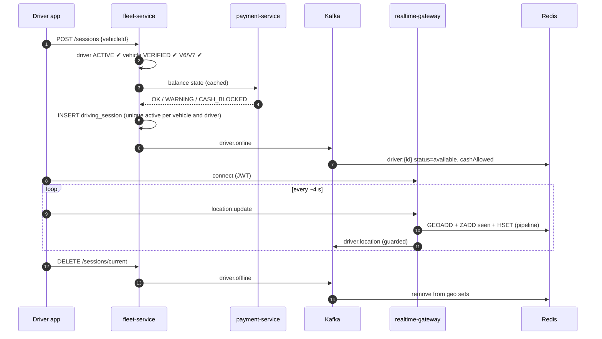
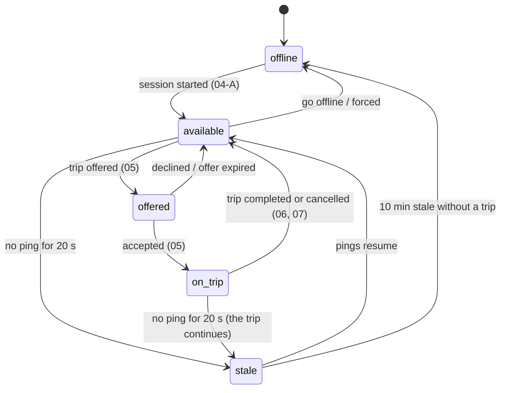

# Workflow 04: Driver shift — online, location, offline

| | |
|---|---|
| **Actors** | Driver (phone app, driver mode) |
| **Services** | fleet-service (sessions), payment-service (balance state), realtime-gateway (WebSocket, location), location-service, Redis, Kafka |
| **Trigger** | The driver taps "Go online" |
| **Outcome** | The driver is visible to matching in their city and vehicle type, streams GPS every ~4 s, and can go offline cleanly |
| **Related** | [← Workflows](README.md) · [Role.md §6 (going online)](../Role.md#going-online-which-vehicle-is-allowed) · [Database.md §10](../Database.md#10-hot-path-live-location-in-redis) · [Payment.md §8](../Payment.md#8-balance-limits-and-blocking) |

> **Implemented:** parts B and C (pings, plausibility checks, Redis pipeline, guarded `driver.location`, the sweeper) and the Redis side of A and D (`driver.online` / `driver.offline` handled by location-service). Not yet: fleet-service (sessions, step 2–5, 14–17), so in development drivers go online through location-service's dev route. Details: [Database.md §10, implementation](../Database.md#implementation-v1).

## 1. Summary

Going online opens a **driving session** for exactly one vehicle (database-enforced). It checks the driver, the vehicle, ownership or fleet authorisation and the balance state. From then on the app sends a GPS ping about every 4 seconds over the WebSocket. Each ping updates Redis (geo index, last-seen, driver state) and is published to Kafka for history. A sweeper removes drivers whose pings stop. Going offline, or being forced offline, ends the session.

## 2. Preconditions

- `DRIVER` role, driver profile `ACTIVE` ([02](02-driver-onboarding.md)), not banned.
- At least one vehicle the driver may drive: an owned `INDIVIDUAL` vehicle, or a fleet vehicle with an active authorisation ([03](03-fleet-onboarding.md)).
- Location permission granted on the phone.

## 3. Steps

### A. Go online

| # | Who | Action | Data written | Event |
|---|---|---|---|---|
| 1 | Driver | Taps "Go online" and picks a vehicle (preselected: the last one used) | — | — |
| 2 | App → fleet | `POST /api/sessions {vehicleId}` (`Idempotency-Key`) | — | — |
| 3 | fleet | Checks: driver `ACTIVE` and documents valid · vehicle `VERIFIED` · ownership (V6) **or** fleet membership + authorisation (V7) | — | — |
| 4 | fleet → payment | Gets the **beneficiary balance state** (cached ≤ 60 s): `BLOCKED` → refused ("pay to continue"), `CASH_BLOCKED` → allowed, flagged as digital-only | — | — |
| 5 | fleet | Inserts `driving_session`. The partial unique indexes reject a second active session for the vehicle or the driver | `driving_session` | `driver.online {driverId, vehicleId, vehicleType, beneficiaryId, cityId}` |
| 6 | Kafka → realtime / location | `driver.online` populates `driver:{id}` in Redis: `status = available`, `vehicleId`, `vehicleType`, `beneficiaryId`, `balanceState`, `cashAllowed` | Redis hash | — |
| 7 | App | Opens the WebSocket (JWT) if it isn't already connected, and starts the foreground location service ("Anbessa is using your location") | — | — |

### B. Location streaming (every ~4 s while online)

| # | Who | Action | Data written |
|---|---|---|---|
| 8 | App → gateway | `location:update {lat, lng, heading, speed, accuracy, at}` | — |
| 9 | gateway | Drops implausible pings (accuracy > 100 m, a jump faster than 200 km/h, a timestamp in the future) | — |
| 10 | gateway → Redis | **One pipeline:** `GEOADD geo:{city}:{type}:available` (or `:busy` while on a trip), `ZADD seen:{city} <now> <driverId>`, `HSET driver:{id} lat lng heading at`, `EXPIRE driver:{id} 60` | Redis |
| 11 | gateway → Kafka | `driver.location` (key `driverId`). Guarded: a Kafka error is logged and metered, and **never** crashes the socket server (fixes the bug in [architecture §16](../../architecture/overview.md#16-known-gaps)) | Kafka |
| 12 | gateway | If the driver is on a trip, it also emits `driver:location` to room `trip:{tripId}` ([06](06-trip-execution.md)) | — |

### C. Staleness sweeper (every 5 s, one instance per city via a Redis lock)

| # | Action |
|---|---|
| 13 | `ZRANGEBYSCORE seen:{city} -inf <now-20s>` → for each stale driver: remove them from the `available` and `busy` geo sets, set `status = stale` |
| 14 | Stale for more than 10 min without an active trip → fleet ends the session (`reason = CONNECTION_LOST`). The app shows "You went offline" when it reconnects |

### D. Go offline

| # | Who | Action | Data written | Event |
|---|---|---|---|---|
| 15 | Driver | Taps "Go offline". If a trip is active, the app asks the driver to finish it first | — | — |
| 16 | App → fleet | `DELETE /api/sessions/current` | `driving_session.ended_at` | `driver.offline {reason: DRIVER}` |
| 17 | Kafka → Redis | Removed from the geo sets. `driver:{id}.status = offline` | Redis | — |

### E. Forced offline

| Trigger | Reason | Effect |
|---|---|---|
| Balance becomes `BLOCKED` | `BALANCE_BLOCKED` | No new offers. The session ends after the current trip |
| Ban / suspension ([16](16-account-lifecycle.md)) | `SUSPENDED` | The session ends **immediately** (if on a trip, safety decides first) |
| Vehicle authorisation revoked / document expired | `VEHICLE_UNAVAILABLE` | The session ends after the current trip |
| Fleet suspended | `FLEET_SUSPENDED` | Same |

## 4. Sequence diagram

## 5. States (driver availability, in Redis)

## 6. Timeouts and limits

| Item | Value |
|---|---|
| Ping interval | 4 s while moving. 10 s when stationary for more than 2 min (battery) |
| Stale after | 20 s without a ping |
| Session auto-end | 10 min stale without an active trip |
| Max shift length | 12 h online → forced 30-min break (safety, configurable per city) |
| Balance state cache | ≤ 60 s, refreshed on `balance.state_changed` |

## 7. Failures and edge cases

| Case | Handling |
|---|---|
| Gateway pod restarts | The app reconnects with backoff (1, 2, 4… s). The next ping restores the driver in Redis. Matching skips stale drivers meanwhile |
| Redis failover | Positions repopulate within one ping interval. No data loss that matters |
| Kafka unavailable | Pings still update Redis (the hot path is unaffected). History has a gap, and an alert fires |
| Phone kills the app in the background | An Android foreground service keeps location alive. If killed anyway: stale, then auto-offline |
| GPS spoofing (fake location apps) | Implausible-jump filter, mock-location flag from the OS, server-side speed checks. Repeat offenders are flagged to safety |
| Two phones, same driver | The second `POST /sessions` is refused by the unique index |

## 8. Permissions

`location:stream` (`SELF`) and session start (`DRIVER @ SELF` + the V6/V7 rules). Dispatchers read live positions with `location:read_live` (`CITY`).

## 9. Events

`driver.online`, `driver.offline {reason}`, `driver.location` (high volume, 24 h retention), `balance.state_changed` (consumed).

## 10. Metrics and alerts

- Drivers online per city and vehicle type (supply), and the share that is stale.
- Ping rate and gateway processing latency (p99 < 20 ms).
- Kafka publish failures from the gateway (alert on any sustained rate).
- Forced offline counts by reason.

## 11. Open questions

- A heat map in the driver app showing high demand, to steer supply (uses ClickHouse aggregates)?
- Max online hours per day: a regulation or a company policy?
