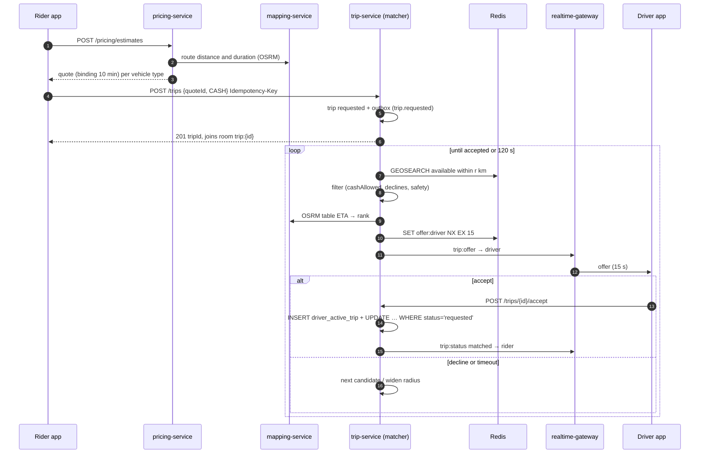

# Workflow 05: Ride booking — estimate, request, matching

| | |
|---|---|
| **Actors** | Rider (phone app), drivers (phone app) |
| **Services** | pricing-service, mapping-service (OSRM, Nominatim), trip-service (matching), location-service, payment-service (balance state via Redis), realtime-gateway, notification-service |
| **Trigger** | The rider chooses a destination and taps "Request" |
| **Outcome** | The trip is `matched` with one driver who accepted, or `cancelled` with reason `NO_DRIVER_FOUND` |
| **Related** | [← Workflows](README.md) · [Architecture §5.2](../../architecture/overview.md#52-request-a-trip-target-design) · [Database.md §9 (races)](../Database.md#9-concurrency-control) · [Payment.md §8 (cash filtering)](../Payment.md#how-matching-uses-the-state) |

## 1. Summary

1. The rider gets a **binding fare estimate** (a quote) from pricing, which uses OSRM road distance and duration.
2. The rider confirms vehicle type and payment method, and trip-service creates the trip as `requested`.
3. The **matcher** finds candidates near the pickup in Redis, filters them (vehicle type, cash eligibility, declines), ranks them by **real driving ETA** (OSRM table), and offers the trip to **one driver at a time** for 15 seconds, widening the search radius until a driver accepts or 2 minutes pass.
4. Acceptance is a conditional database transaction that also guarantees the driver has no other active trip.

## 2. Preconditions

- The rider is signed in ([01](01-rider-signup-signin.md)) and not banned.
- The pickup is inside a served zone ([15](15-pricing-promotions.md)).
- The rider has no other active trip (one active trip per rider).

## 3. Steps

### A. Choose pickup and destination

| # | Who | Action | Service |
|---|---|---|---|
| 1 | Rider | The pickup defaults to the GPS position, snapped to the nearest road (OSRM `/nearest`) and labelled (Nominatim `/reverse`) | mapping |
| 2 | Rider | Searches for a destination (debounced 300 ms, bounded to the city's `viewbox`) | mapping → Nominatim (cached in Redis) |

### B. Estimate (quote)

| # | Who | Action | Data written | Event |
|---|---|---|---|---|
| 3 | App → pricing | `POST /api/pricing/estimates {pickup, dropoff, vehicleTypes: [SEDAN, MINIVAN]}` | — | — |
| 4 | pricing → mapping | Route distance and duration (OSRM `/route`) | — | — |
| 5 | pricing | Point-in-zone (PostGIS), the active `fare_rule` per vehicle type, surge (if enabled), promo eligibility | `fare_quote` (id, inputs, amounts, rule ids, `expires_at = now + 10 min`) | — |
| 6 | pricing → App | Quote per vehicle type, with an ETA to pickup from the nearest available drivers (location-service, Redis) | — | — |

The quote is **binding**: the rider pays the quoted fare unless the route changes materially ([06](06-trip-execution.md) §7).

### C. Request

| # | Who | Action | Data written | Event |
|---|---|---|---|---|
| 7 | Rider | Picks vehicle type and payment method (`CASH`, `MOBILE_MONEY`, `CARD`, `CORPORATE` if eligible) and taps "Request" | — | — |
| 8 | App → trip | `POST /api/trips {quoteId, vehicleType, paymentMethod}` with `Idempotency-Key` | `idempotency_key` | — |
| 9 | trip | Validates: quote not expired · rider has no active trip · payment method allowed (mobile money/card: a pre-authorisation or wallet check where the provider supports it) | — | — |
| 10 | trip | Creates the trip: `requested`, quote snapshot, `city_id`, `payment_method`, `channel = APP` | `trip`, `trip_event`, outbox | `trip.requested` |
| 11 | trip → App | `201 {tripId, status: requested}`. The app joins room `trip:{id}` on the WebSocket | — | — |

### D. Matching loop (trip-service matcher)

| # | Action |
|---|---|
| 12 | **Candidates:** `GEOSEARCH geo:{city}:{vehicleType}:available FROMLONLAT <pickup> BYRADIUS r km ASC COUNT 20`, with `r` starting at 2 km |
| 13 | **Filters**, in Redis (`driver:{id}` hash): `status = available` · not stale · `cashAllowed` if the payment is `CASH` · has not declined this trip · not the rider themself · not blocked by a safety rule (rider ↔ driver pair blocked after an incident) |
| 14 | **Rank** by real ETA: OSRM `/table` from the top 10 candidates to the pickup. Tie-break on driver acceptance rate |
| 15 | **Reserve** the best: `SET offer:driver:{id} {tripId} NX EX 15`. If it fails, the driver is being offered another trip, so try the next one |
| 16 | **Offer:** WebSocket `trip:offer {tripId, offerId, pickup, dropoffArea, fare, paymentMethod, etaToPickup, expiresAt}` + high-priority push if the app is backgrounded |
| 17 | **Wait** up to 15 s for `accept` / `decline` |
| 18 | Declined or expired → record it in `trip_offer` (for acceptance-rate stats), and continue with the next candidate |
| 19 | Candidates exhausted → widen the radius: **2 → 4 → 6 km** (per-city config) |
| 20 | **Overall timeout 120 s** with no acceptance → trip `cancelled`, `reason = NO_DRIVER_FOUND` → the rider is told "No drivers available, try again" and any payment hold is released ([07](07-cancellations.md)) |

### E. Accept

| # | Who | Action | Data written | Event |
|---|---|---|---|---|
| 21 | Driver | Taps "Accept" → `POST /api/trips/{id}/accept {offerId}` (`Idempotency-Key`) | — | — |
| 22 | trip | **One transaction:** `INSERT driver_active_trip (driver, trip)` (hard guarantee: one active trip per driver) · `UPDATE trip SET status = matched, driver…, vehicle…, beneficiary…, version + 1 WHERE id = $1 AND status = 'requested'` · `trip_event` · outbox | trip, driver_active_trip, trip_event | `trip.matched` |
| 23 | trip | 0 rows updated (the trip was cancelled, or matched by another path) → `409`, and the driver sees "This trip is no longer available" | — | — |
| 24 | Kafka → Redis | Driver: `status = on_trip`, moved from `available` to the `busy` geo set. `offer:driver:{id}` deleted | Redis | — |
| 25 | gateway → rider | `trip:status {matched, driver: {name, photo, rating}, vehicle: {plate, make, colour}, etaToPickup}` | — | — |
| 26 | notification | Push to the rider if the app is backgrounded: "Abebe is on the way in a white Toyota Vitz AA-3-B12345" | — | — |

## 4. Sequence diagram

## 5. States

Trip: `requested → matched` (or `→ cancelled` with `NO_DRIVER_FOUND`). Offers: each attempt is a row in `trip_offer` (`OFFERED → ACCEPTED | DECLINED | EXPIRED`).

## 6. Timeouts and limits

| Item | Value |
|---|---|
| Quote validity | 10 min |
| Offer window | 15 s (= the Redis reservation TTL) |
| Radius steps | 2 km → 4 km → 6 km (per city and vehicle type) |
| Matching timeout | 120 s |
| Candidates per round | top 20 by distance, then top 10 by OSRM ETA |
| Max concurrent active trips per rider | 1 (corporate coordinators and call center agents book *for* other riders: see [10](10-phone-booking.md), [11](11-corporate-rides.md)) |

## 7. Failures and edge cases

| Case | Handling |
|---|---|
| Double tap on "Request" / retry after a timeout | Same `Idempotency-Key` → the same trip is returned, never a second trip |
| Two matchers offer the same driver | The Redis `NX` reservation prevents it. If it's lost, `driver_active_trip` rejects the second acceptance |
| Rider cancels while a driver taps accept | The conditional update succeeds for one of them only ([Database.md §9](../Database.md#9-concurrency-control)) |
| Driver's accept arrives after the offer expired | Allowed only if the trip is still `requested` and no other offer is outstanding. Otherwise `409` |
| OSRM down | Rank by straight-line distance (PostGIS/Redis distance), and flag the estimates as approximate |
| Matcher instance crashes mid-loop | The loop state (`trip_id`, round, declined set) is kept in Redis with a lease. Another instance picks up expired leases within 5 s |
| Cash rider, all nearby drivers `CASH_BLOCKED` | Not offered to them. The rider sees "Fewer drivers accept cash right now. Pay by mobile money to get a faster pickup?" |
| Surge or price change between quote and request | The rider keeps the **quoted** price while the quote is valid |

## 8. Permissions

| Step | Permission | Scope |
|---|---|---|
| Estimate, request, cancel own | `trip:create`, `trip:cancel` | `SELF` |
| Accept offer | `trip:accept` | `SELF` (offered to this driver) |
| Manual assignment (dispatcher fallback) | `trip:assign` | `CITY` |

## 9. Events

`trip.requested`, `trip.matched`, `trip.cancelled {reason: NO_DRIVER_FOUND}`. Internal (not Kafka): offers, kept in `trip_offer` + Redis.

## 10. Metrics and alerts

- **Match rate** (matched ÷ requested) per city, hour and payment method. Alert below 85%.
- Time to match (p50/p95). Offers per trip. Acceptance rate per driver.
- `NO_DRIVER_FOUND` by zone and hour → supply heat map for ops.
- Quote → request conversion (price sensitivity).

## 11. Open questions

- Sequential offers (one driver at a time) vs a small broadcast (e.g. 3 drivers, first wins) in low-supply areas?
- Show the destination to the driver before acceptance, or only the area?
- Surge pricing at launch? (Some local competitors advertise "no surge".)
