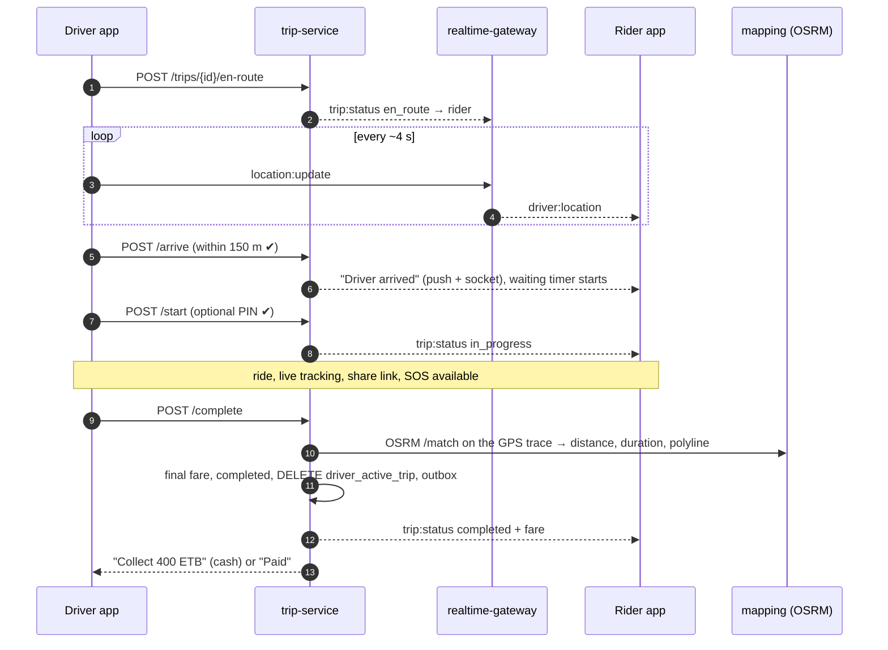

# Workflow 06: Trip execution — pickup to drop-off

| | |
|---|---|
| **Actors** | Driver, rider |
| **Services** | trip-service, realtime-gateway, mapping-service (OSRM), Redis, Kafka |
| **Trigger** | The trip is `matched` ([05](05-ride-booking-matching.md)) |
| **Outcome** | The trip is `completed` with the final fare, distance, duration and route polyline, ready for payment ([08](08-payment-receipt-rating.md)) |
| **Related** | [← Workflows](README.md) · [Architecture §5.3 (live tracking)](../../architecture/overview.md#53-live-location-tracking) · [WebSocket learning note](../../../learned/Edge%20&%20Networking/WebSocket.md) |

> **Implemented** in trip-service: en route, arrive (150 m geofence on the last ping), start (optional PIN), complete (quote + paid waiting, a far-from-drop-off flag), ratings. Not yet: GPS-trace distance (OSRM `/match`), ETA refresh, route-deviation alerts, destination change, share links, masked calls.

## 1. Summary

The driver drives to the pickup while the rider watches the car move live. On arrival the driver taps "Arrived" (the rider is notified and a free waiting period starts). The driver may call the rider through a masked number to find them. When the rider is in the car, the driver taps "Start". During the ride both sides see the route and the live position. At the destination the driver taps "Complete". trip-service computes the final fare, writes the route summary, frees the driver and publishes `trip.completed`.

## 2. Preconditions

- Trip `matched`, with a `driver_active_trip` row for the driver.
- The driver has an active session and is pinging ([04](04-driver-shift.md)).

## 3. Steps

### A. Driving to the pickup

| # | Who | Action | Data written | Event |
|---|---|---|---|---|
| 1 | Driver | The app opens navigation to the pickup (OSRM route + in-app map, or hands off to an external navigation app). The first movement, or tapping "On my way", → `POST /trips/{id}/en-route` | trip `en_route`, `trip_event` | `trip.driver_en_route` |
| 2 | gateway | Each driver ping → `driver:location` to room `trip:{id}`. The rider's map animates the car | Redis `trip:{id}:last` | — |
| 3 | trip | ETA to pickup recalculated every 30 s, or when the driver deviates (OSRM), and pushed as `trip:eta` | — | — |
| 4 | Driver / rider | Contact if needed: a call through a **masked number** (telephony provider) or in-app chat. Real phone numbers are never shown | `contact_session` (for audit) | — |

### B. Arrival and waiting

| # | Who | Action | Data written | Event |
|---|---|---|---|---|
| 5 | Driver | Taps "Arrived". Accepted only if within **150 m** of the pickup (server checks the last ping) | `trip.arrived_at` | `trip.driver_arrived` |
| 6 | Rider | Push + in-app: "Your driver has arrived. White Toyota AA-3-B12345" | — | — |
| 7 | trip | **Free waiting: 3 min.** After that, paid waiting per minute (per city fare rule). After **5 min** without the rider, the driver may mark a no-show ([07](07-cancellations.md)) | — | — |

### C. Ride

| # | Who | Action | Data written | Event |
|---|---|---|---|---|
| 8 | Driver | The rider is in the car → taps "Start" (`POST /trips/{id}/start`). Optional: the rider confirms a 4-digit trip PIN, as an anti-fraud measure | trip `in_progress`, `started_at` | `trip.started` |
| 9 | Driver app | Navigation to the drop-off. Pings continue every ~4 s, in the `busy` geo set | Redis, Kafka | `driver.location` |
| 10 | Rider | Sees the route, ETA and live position. Can **share the trip** (a read-only link with a token, valid until 30 min after drop-off) and has the **SOS** button ([14](14-safety-sos.md)) | `trip_share` | — |
| 11 | trip | Route deviation detection: off the expected route by more than 500 m for more than 2 min → silent check to the safety queue, and an "Is everything OK?" prompt to the rider | — | `trip.route_deviation` |
| 12 | Rider (optional) | Changes the destination in the app → re-quote (pricing) → the driver accepts the new destination | new quote snapshot | `trip.destination_changed` |

### D. Completion

| # | Who | Action | Data written | Event |
|---|---|---|---|---|
| 13 | Driver | At the destination → "Complete" (`POST /trips/{id}/complete`, `Idempotency-Key`) | — | — |
| 14 | trip | Gets the actual GPS trace from Kafka (or the in-memory buffer), snaps it to roads (OSRM `/match`), computes distance and duration, and encodes the **polyline** | — | — |
| 15 | trip | **Final fare** = the quote, unless (a) the destination changed (new quote), (b) paid waiting time applies, or (c) the actual route is more than 20% longer for a reason accepted by policy (e.g. a closed road). Otherwise the rider is protected by the quote | — | — |
| 16 | trip | **One transaction:** status `completed`, `fare_final_minor`, distance, duration, polyline, `completed_at` · `DELETE driver_active_trip` · `trip_event` · outbox | trip, driver_active_trip | `trip.completed {fare, paymentMethod, beneficiaryId, commission inputs}` |
| 17 | Kafka → Redis | Driver `status = available`, back in the `available` geo set (they can get the next offer immediately) | Redis | — |
| 18 | Apps | Rider: payment screen ([08](08-payment-receipt-rating.md)). Driver: "Collect 400 ETB cash" if the trip is cash, else "Paid by card" | — | — |

## 4. Sequence diagram

## 5. States

`matched → en_route → in_progress → completed`. `arrived_at` is a timestamp inside `en_route`, not a status ([workflow conventions](README.md#trip-status-contract)).

## 6. Timeouts and limits

| Item | Value |
|---|---|
| Arrival geofence | 150 m from the pickup |
| Free waiting | 3 min, then paid per minute |
| No-show allowed after | 5 min of waiting ([07](07-cancellations.md)) |
| ETA refresh | every 30 s or on deviation |
| Route deviation alert | > 500 m off the route for > 2 min |
| Share link validity | until 30 min after drop-off |
| Fare tolerance | final = quote unless the destination changed, waiting time applies, or the route is +20% for an accepted reason |

## 7. Failures and edge cases

| Case | Handling |
|---|---|
| Driver's app loses connectivity during the trip | Pings are buffered on the phone and sent on reconnect (with original timestamps). "Complete" queues offline and is sent with its `Idempotency-Key` when back online |
| Driver forgets to tap "Start" | The server detects movement away from the pickup with the rider's phone moving alongside (optional) → prompts "Did the ride start?" Ops can correct it later |
| Driver forgets to tap "Complete" | If the drop-off is reached and the driver is stationary for 5 min, or starts moving away fast, the app prompts. After 30 min, auto-complete with the estimated values and flag for review |
| Rider disputes the fare | Support ticket ([13](13-support-refunds.md)). The stored GPS polyline and trip events are the evidence |
| Driver ends the trip early (fraud) | Completion more than 300 m from the drop-off without a destination change → flagged. The fare is recalculated on the actual route. Repeat offenders go to safety |
| Phone dies mid-trip | The trip continues on the server. The rider still sees the last position. Ops can complete it on the driver's behalf (`trip:update_status`, audited) |

## 8. Permissions

| Step | Permission | Scope |
|---|---|---|
| en-route / arrive / start / complete | `trip:update_status` | `SELF` (the assigned driver only) |
| Live position for the rider | `location:read_live` | `SELF` (their own trip's driver) |
| Ops corrections | `trip:update_status`, `trip:read_gps_trace` | `CITY` (audited) |

## 9. Events

`trip.driver_en_route`, `trip.driver_arrived`, `trip.started`, `trip.route_deviation`, `trip.destination_changed`, `trip.completed`, plus `driver.location` (stream).

## 10. Metrics and alerts

- ETA accuracy: predicted vs actual pickup time (p50 error).
- Waiting time distribution and the no-show rate.
- Completed-far-from-dropoff rate (fraud signal).
- Share-link usage, route-deviation alerts per 1,000 trips.

## 11. Open questions

- Masked calling provider in Ethiopia, and its cost per call?
- Is the trip PIN mandatory for all trips, or only at night or for flagged riders?
