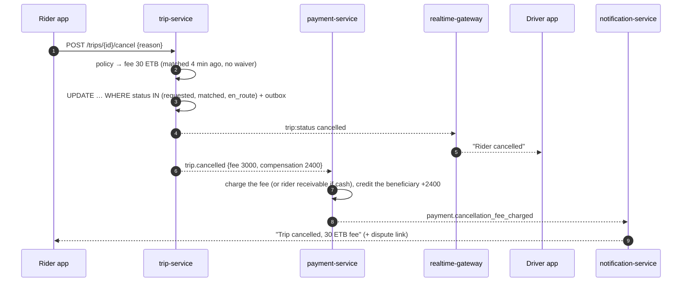

# Workflow 07: Cancellations and no-shows

| | |
|---|---|
| **Actors** | Rider, driver, dispatcher / support (staff) |
| **Services** | trip-service, payment-service, notification-service, realtime-gateway |
| **Trigger** | Anyone cancels a trip before completion, the driver reports a no-show, or matching times out |
| **Outcome** | Trip `cancelled` with a **reason** and **who** cancelled. Fees are applied fairly, the driver is freed, and payment holds are released |
| **Related** | [← Workflows](README.md) · [Payment.md §6.5 (cancellation fee)](../Payment.md#65-tip-digital-and-cancellation-fee) · [Database.md §9 race 2](../Database.md#race-2-concurrent-status-changes-on-one-trip-rider-cancels-while-the-driver-accepts) |

## 1. Summary

Cancelling is always allowed until the trip starts. Whether a **fee** applies depends on who cancels, when, and whether the other side was already inconvenienced. Each cancellation is one conditional transaction (it only succeeds from a cancellable state), followed by events that release the driver, release any payment hold, apply fees and update reliability statistics.

## 2. Preconditions

The trip is in `requested`, `matched` or `en_route` (not `in_progress` or `completed`). Cancelling during `in_progress` is an **early end** (completion with the actual route, see [06](06-trip-execution.md)), or a safety incident ([14](14-safety-sos.md)).

## 3. Cancellation policy

| Who cancels | When | Fee to rider | Driver compensation | Counts against |
|---|---|---|---|---|
| Rider | `requested` (no driver yet) | none | — | — |
| Rider | `matched` / `en_route`, within **2 min** of matching | none | — | — |
| Rider | `matched` / `en_route`, after 2 min | **cancellation fee** (e.g. 30 ETB, per city) | ~80% of the fee | rider cancellation rate |
| Rider | after the driver **arrived** | cancellation fee + waiting time | ~80% | rider |
| Driver | any time before the start | none | none | **driver** cancellation rate (affects offers, and a temporary pause if excessive) |
| Driver | no-show: arrived + waited **5 min**, rider unreachable | **no-show fee** (= cancellation fee) | ~80% | rider |
| System | `NO_DRIVER_FOUND` (120 s) | none | — | — |
| System | payment pre-check failed / rider banned | none | — | — |
| Staff (dispatcher / support / safety) | any time | per staff decision (default none) | per decision | — (reason logged) |

Exceptions where the fee is waived automatically:
- the driver's ETA grew by more than 5 min after matching,
- the driver was moving away from the pickup,
- the driver asked the rider to cancel (reported).

## 4. Steps

| # | Who | Action | Data written | Event |
|---|---|---|---|---|
| 1 | Canceller | `POST /api/trips/{id}/cancel {reason}` (`Idempotency-Key`). Rider reasons: "Driver too far", "Changed plans", "Driver asked me to cancel", … | — | — |
| 2 | trip | Authorizes by role: rider own trip, assigned driver, or staff `trip:cancel @ CITY` | — | — |
| 3 | trip | Computes the fee from the policy table, with the waiver rules | — | — |
| 4 | trip | **One transaction:** `UPDATE trip SET status = cancelled, cancelled_by, cancel_reason, fee… WHERE id = $1 AND status IN ('requested','matched','en_route')` · `DELETE driver_active_trip` (if any) · `trip_event` · outbox | trip, driver_active_trip | `trip.cancelled {by, reason, feeMinor, driverCompensationMinor}` |
| 5 | trip | 0 rows (already started, completed or cancelled) → `409` with the current status | — | — |
| 6 | Kafka → Redis / matcher | Driver back to `available`. A matching loop for this trip stops | Redis | — |
| 7 | gateway | `trip:status cancelled` to the room. Both apps return to home | — | — |
| 8 | payment | Releases any card/mobile-money hold. If a fee applies: charges it digitally, or records a **rider receivable** for cash riders (added to their next trip). Credits the driver's compensation to the beneficiary balance | journal entries | `payment.cancellation_fee_charged` |
| 9 | notification | Rider: "Trip cancelled" (+ "a 30 ETB fee applies" with the reason and a "dispute" link). Driver: "Rider cancelled, you received 24 ETB" | — | — |
| 10 | trip | Updates the reliability counters (`rider_stats`, `driver_stats`). Excessive driver cancellations → temporary pause ([04](04-driver-shift.md) forced offline) | stats | `driver.reliability_flagged` |

### No-show specifics

| # | Action |
|---|---|
| a | The "No-show" button becomes active only **5 min after `arrived_at`** **and** the driver is still within 150 m of the pickup |
| b | The driver must have tried to contact the rider (at least one masked call or chat, recorded in `contact_session`) |
| c | Then step 1 with `reason = NO_SHOW`, by the driver. The fee goes to the rider, and compensation to the beneficiary |

## 5. Sequence diagram

## 6. Timeouts and limits

| Item | Value (per city) |
|---|---|
| Free cancellation window after matching | 2 min |
| No-show threshold | 5 min after arrival, within 150 m, a contact attempt made |
| Cancellation / no-show fee | e.g. 30 ETB |
| Driver compensation share | ~80% of the fee |
| Driver cancellation threshold | > 20% of accepted trips in 7 days → warning, > 30% → 24 h pause |

## 7. Failures and edge cases

| Case | Handling |
|---|---|
| Rider cancels while the driver taps "Start" | The conditional update lets exactly one win. If the start won, the cancel gets `409 in_progress` |
| Both cancel at the same time | The first commit wins. The second gets `409 cancelled` (same final state) |
| Cash rider with an unpaid fee | Rider receivable. Shown at the next booking ("includes 30 ETB from a previous cancellation") |
| Rider disputes a no-show | Support compares the GPS (was the driver really within 150 m?), the arrival time and the contact attempts, then refunds through [13](13-support-refunds.md) if unjustified |
| Repeated rider no-shows | Cash bookings require prepayment after 3 no-shows in 30 days (policy) |

## 8. Permissions

`trip:cancel` with scope `SELF` (rider, assigned driver) or `CITY` (dispatcher, support, safety, call center for trips they booked).

## 9. Events

`trip.cancelled {by: RIDER | DRIVER | SYSTEM | STAFF, reason, feeMinor, driverCompensationMinor}`, `payment.cancellation_fee_charged`, `driver.reliability_flagged`.

## 10. Metrics and alerts

- Cancellation rate by who, reason and minute-after-match (calibrates the free window).
- No-show rate, and no-show disputes upheld (detects abuse by drivers).
- Driver cancellation outliers.

## 11. Open questions

- Fee and compensation values for Addis Ababa.
- Should driver cancellations ever compensate the rider (e.g. a promo credit)?
