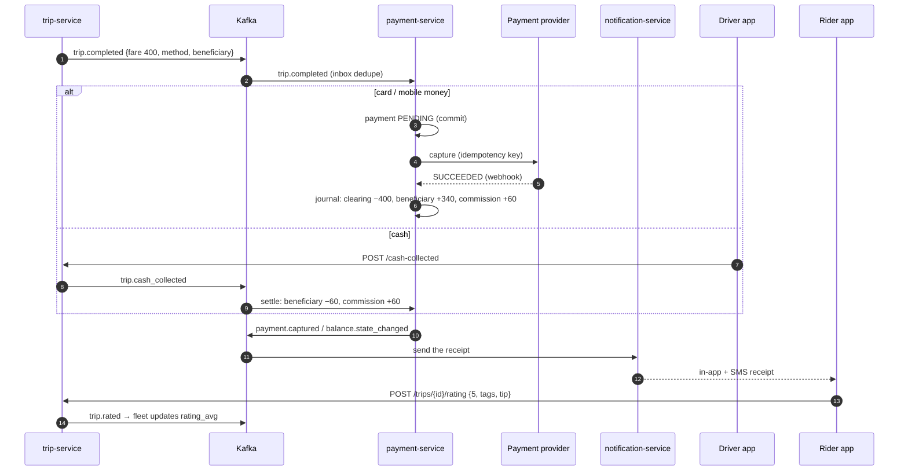

# Workflow 08: Payment, receipt and rating

| | |
|---|---|
| **Actors** | Rider, driver |
| **Services** | trip-service, payment-service, notification-service, fleet-service (ratings), Kafka |
| **Trigger** | `trip.completed` ([06](06-trip-execution.md)) or `trip.cancelled` with a fee ([07](07-cancellations.md)) |
| **Outcome** | The rider has paid (digitally, or cash to the driver), the ledger is settled, a receipt is sent, and both sides have rated each other |
| **Related** | [← Workflows](README.md) · [Payment.md §6 (settlement per method)](../Payment.md#6-settlement-per-payment-method) · [Database.md §7.4 (ledger)](../Database.md#74-payment-ledger-payment-service) |

## 1. Summary

On completion, payment-service settles the trip **once** (idempotency key `trip-settlement:<tripId>`), according to the payment method:
- **digital** (card / mobile money): the platform charges the rider, then credits the beneficiary with the fare minus commission,
- **cash**: the driver confirms collection, and the beneficiary is debited the commission,
- **corporate**: added to the company's invoice.

The rider gets a receipt (in-app + SMS, and email for corporate). Both parties rate each other, and ratings feed the driver profile and matching.

## 2. Preconditions

- The trip is `completed`, with `fare_final_minor`, `payment_method`, `beneficiary_account_id` and the commission rule snapshot.
- For digital payment: the rider has a payment method on file, or an approved mobile-money authorisation from the request step ([05](05-ride-booking-matching.md) step 9).

## 3. Steps

### A. Charge (digital)

| # | Who | Action | Data written | Event |
|---|---|---|---|---|
| 1 | payment | Consumes `trip.completed` (inbox dedupe) | `inbox` | — |
| 2 | payment | Creates `payment` `PENDING` (`idempotency_key = payment.id`) and **commits** before calling the provider | `payment` | — |
| 3 | payment → provider | Captures the pre-authorisation, or requests the mobile-money payment (the rider approves on their phone) | — | — |
| 4 | provider → payment | Webhook (signed) or API response: `SUCCEEDED` / `FAILED` | `payment.status` | — |
| 5 | payment | `SUCCEEDED` → **settlement journal** (fare 400, commission 60): `PROVIDER_CLEARING −40000`, `BENEFICIARY_BALANCE +34000`, `COMMISSION_REVENUE +6000` (+ VAT if configured) | `journal_entry`, `posting`, balance, `balance_state` | `payment.captured`, `balance.state_changed` (if the state changed) |
| 6 | payment | `FAILED` → retry the provider (max 3, with backoff). Still failing → **rider receivable** (charged at the next trip or settled in-app), and the beneficiary is **still credited** (the platform carries the risk, [Payment.md Q6](../Payment.md#19-open-questions)) | journal, receivable | `payment.failed` |

### B. Cash

| # | Who | Action | Data written | Event |
|---|---|---|---|---|
| 7 | Driver | The app shows "Collect 400 ETB". The driver taps "Cash received" (`POST /trips/{id}/cash-collected {amountMinor}`) | trip `cash_collected_minor` | `trip.cash_collected` |
| 8 | payment | **Settlement journal:** `BENEFICIARY_BALANCE −6000`, `COMMISSION_REVENUE +6000` (+ the promo compensation and VAT lines if they apply) | journal, balance, `balance_state` | `balance.state_changed` (if crossing a limit) |
| 9 | payment | If the state changed (e.g. `WARNING → CASH_BLOCKED`) → push to the driver ([09](09-driver-balance.md)) | — | — |
| 10 | trip | If the driver reports a different amount than the fare → `cash_mismatch` flag for support. The ledger still uses the **fare**, not the reported amount | trip flag | `trip.cash_mismatch` |

### C. Corporate

| # | Who | Action | Data written |
|---|---|---|---|
| 11 | payment | Journal: `CORPORATE_RECEIVABLE −40000`, `BENEFICIARY_BALANCE +34000`, `COMMISSION_REVENUE +6000`. Adds an invoice line to the company's open monthly invoice ([11](11-corporate-rides.md)) | journal, `invoice_line` |

### D. Receipt

| # | Who | Action |
|---|---|---|
| 12 | notification | On `payment.captured`, `trip.cash_collected` or the corporate settlement: an **in-app receipt** (route map, fare breakdown, driver, vehicle, time) + SMS summary ("Trip AA→Bole, 400 ETB, cash. Receipt: anb.et/r/…") + email for corporate riders |
| 13 | Rider | Can download a PDF receipt (with a VAT breakdown where applicable) from trip history |

### E. Rating

| # | Who | Action | Data written | Event |
|---|---|---|---|---|
| 14 | Rider | Rates the driver 1–5 with optional tags ("Clean car", "Unsafe driving", …) and a comment, plus an optional **tip** (digital only) | `trip_rating` (`UNIQUE (trip_id, rater_role)`) | `trip.rated` |
| 15 | Driver | Rates the rider 1–5 | `trip_rating` | `trip.rated` |
| 16 | fleet | Consumes `trip.rated` → updates the driver's rolling average (the last 500 rated trips) | `driver_profile.rating_avg` | — |
| 17 | trip / support | A rating ≤ 2, or a safety tag, automatically opens a review ticket ([13](13-support-refunds.md), [14](14-safety-sos.md)) | ticket | `ticket.created` |
| 18 | payment | Tip → `PROVIDER_CLEARING −2000`, `BENEFICIARY_BALANCE +2000` (no commission) | journal | `payment.tip_captured` |

## 4. Sequence diagram

## 5. States

Payment: `PENDING → SUCCEEDED | FAILED`. A failed payment becomes a rider receivable (`OPEN → PAID | WRITTEN_OFF`). Rating window: open for 72 h after completion.

## 6. Timeouts and limits

| Item | Value |
|---|---|
| Provider capture timeout | 30 s, then leave `PENDING` for reconciliation |
| Retries for a failed charge | 3 (1 min, 10 min, 1 h) |
| Reconciliation of `PENDING` payments | every 10 min for payments older than 5 min |
| Cash confirmation | the driver must confirm within 10 min. Otherwise it's auto-confirmed at the fare amount (and flagged) |
| Rating window | 72 h |
| Tip limit | up to 50% of the fare |

## 7. Failures and edge cases

| Case | Handling |
|---|---|
| `trip.completed` delivered twice | Inbox dedupe + `trip-settlement:<tripId>` idempotency key → settled once |
| Webhook lost | Reconciliation asks the provider and completes the payment. Settlement is still idempotent |
| Rider pays cash on a trip booked as card | The driver selects "Rider paid cash" → `payment_method` changes to `CASH` (audited), and settles as cash. The card hold is released |
| Rider says they paid cash, driver didn't confirm | Support ticket. The evidence is the trip events and the driver's confirmation history ([Payment.md §16](../Payment.md#16-edge-cases)) |
| Settlement fails (bug, DB down) | The consumer doesn't commit its Kafka offset, so it retries. After N failures → DLQ + page. Never a partial settlement (one transaction) |
| Low rating retaliation (driver rates the rider 1 after a dispute) | Ratings tied to an open dispute are hidden from averages until it's resolved |

## 8. Permissions

| Step | Permission | Scope |
|---|---|---|
| Confirm cash | `trip:update_status` | `SELF` (assigned driver) |
| Rate, tip | `trip:read` (own trip) + rating endpoint | `SELF` |
| Read receipts, payments | `payment:read` | `SELF` / `ORG` (corporate) |

## 9. Events

`payment.captured`, `payment.failed`, `trip.cash_collected`, `trip.cash_mismatch`, `balance.state_changed`, `payment.tip_captured`, `trip.rated`.

## 10. Metrics and alerts

- Payment success rate per provider and method (alert below 95%).
- `PENDING` payments older than 15 min (alert).
- Settlement lag (`trip.completed` → journal entry) p95 < 10 s.
- Cash confirmations auto-confirmed (should be rare).
- Rating participation and average by city.

## 11. Open questions

- Card payments at launch, or mobile money + cash only?
- Tips at launch?
