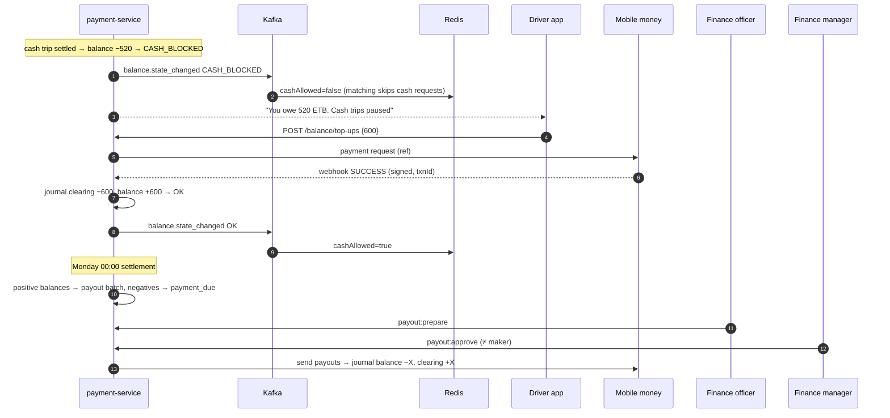

# Workflow 09: Driver balance — limits, top-ups, settlement and payouts

| | |
|---|---|
| **Actors** | Driver (owner-driver), fleet owner, finance officer, finance manager |
| **Services** | payment-service, notification-service, Redis (balance state for matching), payment providers (mobile money, bank) |
| **Trigger** | Every settled trip changes a balance. A weekly job settles the cycle. Drivers and fleets top up at any time |
| **Outcome** | Commission is collected on cash trips, earnings are paid out on digital trips, and drivers who owe too much stop receiving cash requests (then all requests) until they pay |
| **Related** | [← Workflows](README.md) · **[Payment.md](../Payment.md)** (full design: accounts, postings, policies, data model) |

## 1. Summary

Every beneficiary (an owner-driver, or a fleet company for company cars) has **one balance**:
- digital trips **credit** it with the fare minus commission,
- cash trips **debit** it by the commission.

The two net out continuously. The balance's **state** (`OK`, `WARNING`, `CASH_BLOCKED`, `BLOCKED`) is recomputed in the same transaction as every posting and pushed to Redis, so matching reacts within seconds. Drivers top up by mobile money, bank transfer or office cash. Once a week: positive balances are paid out (after approval), and negative ones get a due notice with a deadline.

## 2. Preconditions

- The beneficiary's ledger account exists: created on `driver.activated` (owner-driver) or `org.verified` (fleet).
- A balance policy is active for the city ([Payment.md §8](../Payment.md#8-balance-limits-and-blocking)).

## 3. Steps

### A. Continuous: balance and state

| # | Action | Data written | Event |
|---|---|---|---|
| 1 | Each settlement journal ([08](08-payment-receipt-rating.md)) locks the account row (`FOR UPDATE`), inserts postings, updates `balance_minor`, recomputes the state | posting, ledger_account, balance_state | — |
| 2 | State changed → outbox event | outbox | `balance.state_changed {beneficiaryId, state, balanceMinor}` |
| 3 | Kafka → Redis: every online driver of that beneficiary gets `cashAllowed` / `balanceState` updated ([05](05-ride-booking-matching.md) filters on it) | Redis | — |
| 4 | Driver app: a balance banner ("You owe 520 ETB. Cash trips are paused, card trips continue") + push on each state change | — | — |

### B. Top-up by mobile money

| # | Who | Action | Data written | Event |
|---|---|---|---|---|
| 5 | Driver / fleet owner | "Pay now" → amount (suggested: what's needed to reach `OK`) → `POST /api/balance/top-ups` (`Idempotency-Key`) | `top_up` `PENDING` | — |
| 6 | payment → provider | Payment request (reference = `top_up.id`). The driver approves on their phone | — | — |
| 7 | provider → payment | Signed webhook `{ref, txnId, SUCCESS}`. The signature is verified and `provider_txn_id UNIQUE` | — | — |
| 8 | payment | Journal `top-up:<txnId>`: `PROVIDER_CLEARING −X`, `BENEFICIARY_BALANCE +X` → state recomputed | journal, top_up `SUCCEEDED` | `balance.topped_up`, `balance.state_changed` |
| 9 | notification | "Payment received. Balance −100 ETB, cash trips are back" | — | — |

### C. Top-up by bank transfer or office cash

| # | Channel | Flow |
|---|---|---|
| 10 | Bank transfer | The driver transfers with their **reference code** (`ANB-7K2Q9X`). A daily statement import matches by reference → the same journal as step 8. Unmatched → finance queue |
| 11 | Office cash | A finance officer records the cash (`topup:record_cash`, maker) → `PENDING_APPROVAL` → a finance manager approves (`topup:approve_cash`, checker) → journal `CASH_RECEIPTS −X`, `BENEFICIARY_BALANCE +X` → a receipt SMS with the journal ID |

### D. Weekly settlement (Monday 00:00 city time)

| # | Action | Data written | Event |
|---|---|---|---|
| 12 | The job runs per city and per beneficiary, under a lock and idempotent per `(beneficiary, cycle_end)` | — | — |
| 13 | Balance **≥ `min_payout`** → payout line (minus holds: disputed amounts, provider-unconfirmed payments) | `payout_line` | — |
| 14 | Balance **between 0 and `min_payout`** → rolls over | — | — |
| 15 | Balance **< 0** → `payment_due {amount, minimum = 50%, due_at = +3 days}` → push + SMS | `payment_due` | `balance.payment_due` |
| 16 | A finance officer reviews the **payout batch** (`payout:prepare`) → a finance manager approves (`payout:approve`, maker ≠ checker) | approval_request | `approval.decided` |
| 17 | payment sends the payouts (mobile money / bank). Each line: journal `BENEFICIARY_BALANCE −X`, `PROVIDER_CLEARING +X`. A provider failure → retry, then a finance queue | journal, payout_line | `payout.sent` / `payout.failed` |

### E. Overdue

| # | Action | Event |
|---|---|---|
| 18 | `due_at` passes without at least the minimum paid → state `BLOCKED` (no requests at all), and the session ends after the current trip ([04](04-driver-shift.md)) | `balance.state_changed` |
| 19 | Paying ≥ the minimum → `CASH_BLOCKED` (if still below the cash limit) or `WARNING` / `OK` | `balance.state_changed` |
| 20 | Still unpaid after 90 days blocked → `writeoff:request` (finance officer) → `writeoff:approve` (finance manager) → `BAD_DEBT_EXPENSE −X`, `BENEFICIARY_BALANCE +X`. Re-registration with the same licence, phone or plate is matched to the debt | `balance.written_off` |

## 4. Sequence diagram

## 5. States

Balance states and the transitions between them are in [Payment.md §8](../Payment.md#balance-states). Top-up: `PENDING → SUCCEEDED | FAILED`, office cash `PENDING_APPROVAL → SUCCEEDED`. Payment due: `OPEN → MIN_PAID | PAID | OVERDUE | WRITTEN_OFF`.

## 6. Timeouts and limits

All per city ([Payment.md §8](../Payment.md#8-balance-limits-and-blocking)): warning −300 · cash limit −500 · hard limit −1,000 ETB · `due_days` 3 · minimum payment 50% · `min_payout` 100 ETB · write-off after 90 days blocked.

## 7. Failures and edge cases

| Case | Handling |
|---|---|
| Duplicate webhook | `provider_txn_id UNIQUE` + the journal idempotency key → credited once |
| Webhook never arrives | Nightly reconciliation against the provider statement credits missing top-ups |
| Stale Redis state offers a cash trip to a blocked driver | The authoritative check happens on the cash **offer** if the cache is older than 60 s ([Payment.md §14](../Payment.md#14-consistency-and-concurrency)). The overshoot guard caps the risk |
| Driver leaves with debt | Stays `BLOCKED`, then the write-off flow. The debt is matched on re-registration |
| A fleet's balance is blocked | All its vehicles stop receiving requests. The fleet owner pays, not the individual drivers ([03](03-fleet-onboarding.md)) |
| Payout to a wrong or closed account | `payout.failed` → the line is re-credited to the balance (journal reversal) and the beneficiary is asked to update their payout details |

## 8. Permissions

`balance:read`, `topup:create` (`SELF` / `ORG`) · `topup:record_cash` / `topup:approve_cash`, `payout:prepare` / `payout:approve`, `writeoff:request` / `writeoff:approve` (`GLOBAL`, maker–checker) ([Payment.md §15](../Payment.md#15-roles-and-permissions)).

## 9. Events

`balance.state_changed`, `balance.topped_up`, `balance.payment_due`, `payout.sent`, `payout.failed`, `balance.written_off`, `approval.requested` / `approval.decided`.

## 10. Metrics and alerts

Receivables aging · collection rate · share of online drivers cash-blocked at peak · top-up success rate per channel · payout failure rate · ledger integrity (nightly, page on any mismatch) ([Payment.md §17](../Payment.md#17-reporting-and-controls)).

## 11. Open questions

See [Payment.md §19](../Payment.md#19-open-questions) (limit values, commission model, VAT basis, subscriptions).
