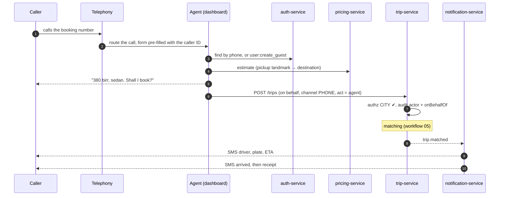

# Workflow 10: Phone booking (call center)

| | |
|---|---|
| **Actors** | Caller (no app, or prefers to call), call center agent (admin dashboard) |
| **Services** | telephony (call queue), auth-service (guest users), pricing-service, trip-service, notification-service (SMS) |
| **Trigger** | Someone calls the booking number |
| **Outcome** | A trip booked **on behalf of** the caller, with SMS updates to their phone. Both the agent and the rider are recorded in the audit trail |
| **Related** | [← Workflows](README.md) · [Role.md §13.3](../Role.md#133-phone-booking-by-the-call-center-guest-rider) · [Auth.md §9.4](../Auth.md#94-call-center-guest-rider-then-claiming-the-account) |

## 1. Summary

The agent identifies the caller by phone number (the caller ID is pre-filled), creating a **guest rider** if the number is new. They capture the pickup and destination, read back the fare, and book a trip with `channel = PHONE` and `bookedBy = agent`. From there it's the normal matching and trip flow ([05](05-ride-booking-matching.md)–[08](08-payment-receipt-rating.md)). The caller gets SMS updates instead of app pushes. A guest can later install the app and **claim** the account with the same phone number.

## 2. Preconditions

- The agent is signed in to the admin dashboard with 2FA, role `CALL_CENTER_AGENT @ CITY` ([Auth.md §9.2](../Auth.md#92-staff-sign-in-with-two-factor)).
- The pickup is in the agent's city.

## 3. Steps

| # | Who | Action | Data written | Event |
|---|---|---|---|---|
| 1 | Telephony | The call is routed to a free agent. The dashboard opens a **booking form** pre-filled with the caller ID (if not withheld) | `call` (`call_id`, from, agent, started) | — |
| 2 | Agent | Lookup by phone (`user:read_masked`): shows the last 5 trips and saved places, masked | — | — |
| 3 | Agent | New number → `user:create_guest` (auth creates a `user` with `accountStatus = GUEST`, role `rider`, phone **unverified**) | user | `user.created {guest: true}` |
| 4 | Agent | Pickup: a landmark search ("Edna Mall", "Bole Medhanialem") or a map pin. Destination the same way. The caller confirms | — | — |
| 5 | Agent → pricing | `POST /api/pricing/estimates` → reads the fare back: "From Edna Mall to Piassa it's 380 birr, sedan" | `fare_quote` | — |
| 6 | Agent → trip | `POST /api/trips` with `{quoteId, riderUserId: guest, channel: PHONE, paymentMethod: CASH}` and the **`act` context** (agent acting for the rider) | trip (`booked_by_user_id = agent`, `rider_user_id = guest`) | `trip.requested` |
| 7 | trip | Authz: `trip:create_on_behalf @ CITY`, the pickup city = the agent's city. Audit: actor = agent, onBehalfOf = rider | audit | `audit.recorded` |
| 8 | — | Matching ([05](05-ride-booking-matching.md)). The agent sees live status in the dashboard and can stay on the line until matched | — | — |
| 9 | notification | SMS to the caller on `trip.matched`: "Driver Abebe, white Toyota AA-3-B12345, arriving in 6 min. Call 8XXX for help" | — | — |
| 10 | Driver | Often calls the rider to confirm the exact spot (masked call, [06](06-trip-execution.md) step 4) | — | — |
| 11 | notification | SMS on `trip.driver_arrived` and on completion (a receipt summary with the fare) | — | — |
| 12 | Agent | Call ends → wrap-up: outcome code (booked / no drivers / price objection / info only) | `call` updated | — |
| 13 | Caller (later) | Installs the app → OTP with the same phone → the guest account is **claimed**, keeping its history ([01](01-rider-signup-signin.md) step 7b) | user `ACTIVE` | `user.claimed` |

### Agents can also

- **Modify or cancel** a phone-booked trip (`trip:cancel @ CITY`), for example when the caller calls back.
- **Log a lost item** or open a ticket ([13](13-support-refunds.md)).
- **Book for a later time** ([12](12-scheduled-rides.md)).

## 4. Sequence diagram

## 5. States

The trip follows the normal states. Call record: `ringing → in_progress → wrapped_up` (with an outcome code).

## 6. Timeouts and limits

| Item | Value |
|---|---|
| Target answer time | 80% of calls within 20 s |
| Guest accounts | Unverified phone. **Cash only**. Max 2 active phone bookings per number |
| Agent booking without a caller ID | Allowed, but the agent must read back and confirm the callback number |

## 7. Failures and edge cases

| Case | Handling |
|---|---|
| Caller ID withheld | The agent asks for the number and sends a 4-digit SMS code to read back (optional anti-abuse) |
| Prank or abusive bookings | Per-number limits, no-show tracking ([07](07-cancellations.md)) → numbers with repeated no-shows need a callback confirmation |
| Caller cannot describe the pickup | A landmark search + "driver will call you" flag. The driver calls the guest through a masked number |
| No drivers available | The agent offers a scheduled booking ([12](12-scheduled-rides.md)) or a different vehicle type. Wrap-up code `NO_DRIVER` |
| Guest's number belongs to an existing full account | Not a guest: the booking links to the existing account (the agent sees it masked) |

## 8. Permissions

`user:read_masked`, `user:create_guest`, `trip:create_on_behalf`, `trip:cancel`, `lost_item:manage`, `ticket:create`, all `@ CITY` ([Role.md §8](../Role.md#staff)).

## 9. Events

`user.created {guest}`, `trip.requested {channel: PHONE, bookedBy}`, `audit.recorded {actor, onBehalfOf}`, `user.claimed`.

## 10. Metrics and alerts

Calls per hour · answer time · booking conversion per call · phone-booking share of trips · guest → claimed conversion · no-show rate for phone bookings.

## 11. Open questions

- Telephony platform (cloud contact center vs on-premise)?
- Record calls for quality and disputes (consent and retention)?
