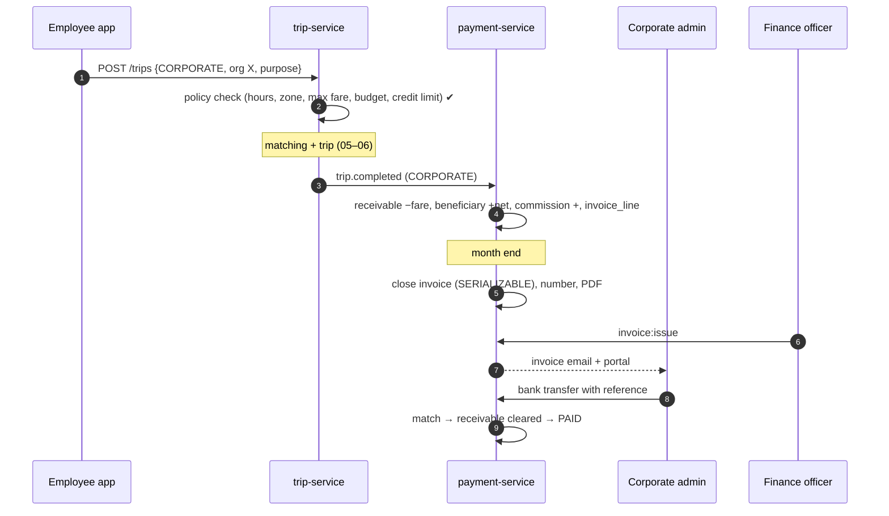

# Workflow 11: Corporate rides and invoicing

| | |
|---|---|
| **Actors** | Corporate admin, corporate coordinator (corporate portal), employee (phone app), finance officer |
| **Services** | auth-service (organization), trip-service (policies at booking), payment-service (receivable, invoices), notification-service |
| **Trigger** | A company signs up for a corporate account |
| **Outcome** | Employees and guests ride on the company account within its policies, and the company receives one monthly invoice |
| **Related** | [← Workflows](README.md) · [Role.md §13.4](../Role.md#134-corporate-coordinator-books-for-a-guest) · [Payment.md §6.3](../Payment.md#63-corporate-invoice) |

## 1. Summary

The company is a `CORPORATE` organisation:
- **admins** set ride policies and invite employees,
- **employees** ride from the phone app with a business profile,
- **coordinators** book for guests from the portal.

Trips are billed with `billing_type = CORPORATE`, which posts a **receivable** for the company and credits the driver as usual. At month end, finance issues an invoice and tracks payment.

## 2. Preconditions

The company has a business licence and TIN. The corporate admin has an Anbessa account.

## 3. Steps

### A. Set up the account

| # | Who | Action | Data written | Event |
|---|---|---|---|---|
| 1 | Corporate admin | Portal → "Register company" → `organization kind = CORPORATE` (`PENDING`) + documents | organization, documents | `org.created` |
| 2 | Onboarding / finance | Verifies the organisation, agrees on a **credit limit** and payment terms (e.g. net 30) | org `VERIFIED`, `corporate_account {credit_limit, terms}` | `org.verified` |
| 3 | payment | Creates `CORPORATE_RECEIVABLE` for the org | ledger_account | — |
| 4 | Corporate admin | **Policies:** allowed vehicle types, allowed hours (e.g. 06:00–22:00), zones, max fare per trip, a monthly budget per employee or group, a required **trip purpose** / cost centre | `corporate_policy` | `corporate.policy_updated` |
| 5 | Corporate admin | Invites employees by phone (or bulk CSV) → `member role = employee` | invitation → member | `role.granted` |

### B. Employee books a ride

| # | Who | Action | Data written | Event |
|---|---|---|---|---|
| 6 | Employee | Phone app → profile switch **"Business: Company X"** | — | — |
| 7 | App → pricing | Estimate (normal) | quote | — |
| 8 | App → trip | `POST /trips {billingType: CORPORATE, billingOrgId, purpose, costCentre}` | — | — |
| 9 | trip | **Policy check** (the latest policy, cached): vehicle type ✔, time window ✔, zone ✔, fare ≤ max ✔, the employee's monthly budget remaining ✔, the company is under its credit limit ✔ | trip (`billing_type = CORPORATE`) | `trip.requested` |
| 10 | trip | Policy violated → `422` with the rule: "Company X allows rides 06:00–22:00 only". The employee can switch to personal payment | — | — |
| 11 | — | Matching, trip, completion as normal ([05](05-ride-booking-matching.md)–[06](06-trip-execution.md)). The driver sees "Business ride, no payment to collect" | — | — |

### C. Coordinator books for a guest

| # | Who | Action |
|---|---|---|
| 12 | Coordinator | Portal → "Book a ride": guest name + phone, pickup, destination, time (now or [scheduled](12-scheduled-rides.md)) → `trip:create_on_behalf @ ORG` |
| 13 | trip | Same policy checks. The guest gets SMS updates (like [10](10-phone-booking.md) step 9) |

### D. Settlement and invoicing

| # | Who | Action | Data written | Event |
|---|---|---|---|---|
| 14 | payment | On `trip.completed` with `CORPORATE`: `CORPORATE_RECEIVABLE −fare`, `BENEFICIARY_BALANCE +net`, `COMMISSION_REVENUE +commission` (+ VAT). An `invoice_line` is added to the org's open invoice | journal, invoice_line | `payment.corporate_billed` |
| 15 | payment | Credit limit check after each trip: ≥ 90% → warn the admin, 100% → new corporate bookings are refused until paid | — | `corporate.credit_limit_reached` |
| 16 | Monthly job (1st, 00:00) | Closes the open invoice (`SERIALIZABLE`), numbers it sequentially, generates the PDF (VAT details, per-employee and cost-centre breakdown), opens a new one | invoice `ISSUED` | `invoice.issued` |
| 17 | Finance officer | Reviews and sends (`invoice:issue`). Email to the company's billing contact + portal download | — | — |
| 18 | Company | Pays by bank transfer with the invoice reference → statement matching → `PROVIDER_CLEARING −X`, `CORPORATE_RECEIVABLE +X` → invoice `PAID` | journal | `invoice.paid` |
| 19 | Overdue | Due date + 7 days unpaid → reminders. + 30 days → corporate bookings suspended (`org:suspend`, finance) | org status | `org.suspended` |

## 4. Sequence diagram

## 5. States

Invoice: `OPEN → ISSUED → PAID | OVERDUE → PAID | WRITTEN_OFF`. Organisation: `VERIFIED ↔ SUSPENDED` (for non-payment).

## 6. Timeouts and limits

| Item | Value |
|---|---|
| Invoice period | calendar month |
| Payment terms | net 30 (per contract) |
| Credit limit | per contract. Warn at 90%, block at 100% |
| Policy cache | 60 s (changes apply within a minute) |

## 7. Failures and edge cases

| Case | Handling |
|---|---|
| Employee leaves the company | The admin removes the member → the business profile disappears. Trips already in progress still bill the company |
| Trip disputed by the company | An invoice line credit note (maker–checker refund, [13](13-support-refunds.md)). The driver's earning is unchanged unless the driver was at fault |
| Policy changed during a trip | Policies apply at **request** time. The trip in progress is unaffected |
| Same legal entity is both FLEET and CORPORATE | Two separate organisations, linked by TIN ([Role.md §5](../Role.md#organisation-types)). Never netted against each other |

## 8. Permissions

`org:update`, `org:manage_members`, `corporate:manage_policies`, `corporate:read_invoices` (`ORG`, corporate admin) · `trip:create_on_behalf` (`ORG`, coordinator) · `invoice:issue`, `org:suspend` (`GLOBAL`, finance).

## 9. Events

`org.verified`, `corporate.policy_updated`, `trip.requested {billingType: CORPORATE}`, `payment.corporate_billed`, `corporate.credit_limit_reached`, `invoice.issued`, `invoice.paid`, `org.suspended`.

## 10. Metrics and alerts

Corporate share of trips and revenue · days sales outstanding · overdue receivables by company · policy rejections by rule (refine the defaults).

## 11. Open questions

- Should corporate employees be able to join by verified email domain ([Role.md Q7](../Role.md#18-open-questions))?
- e-Invoicing requirements with the tax authority?
