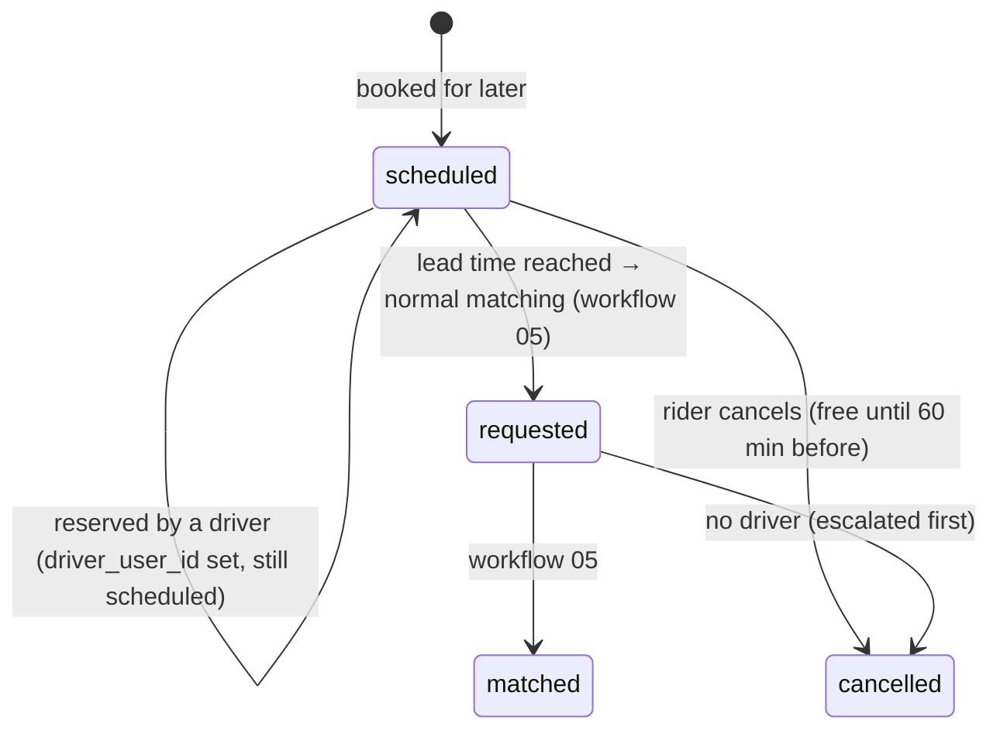
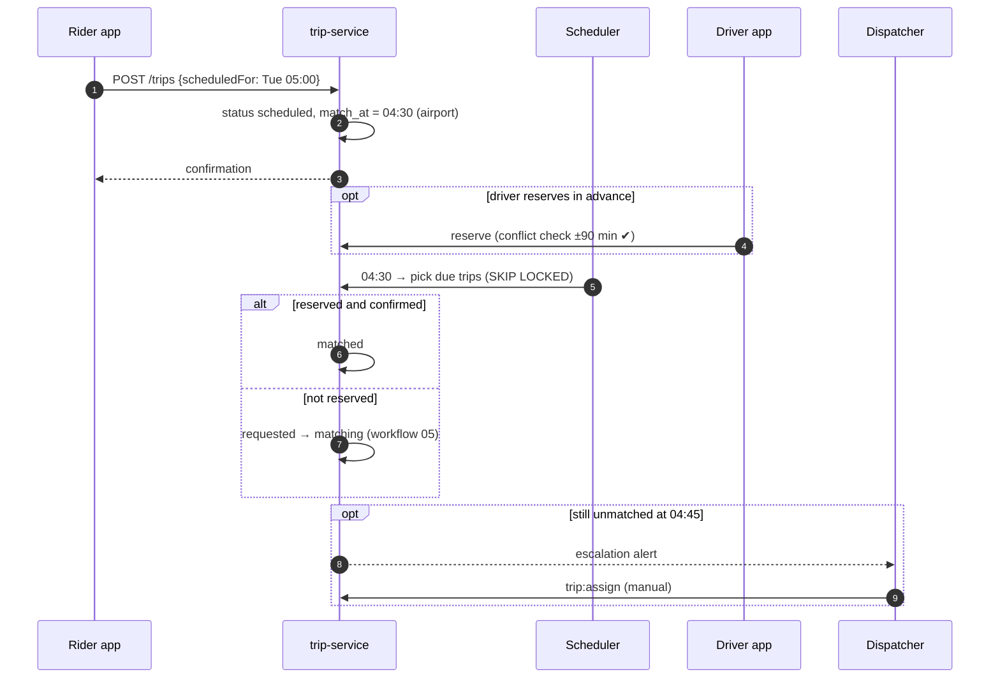

# Workflow 12: Scheduled rides (booking ahead)

| | |
|---|---|
| **Actors** | Rider (or coordinator / call center agent), driver, dispatcher |
| **Services** | trip-service (scheduler), pricing-service, notification-service, location-service |
| **Trigger** | A rider books a ride for a later time (e.g. an airport trip tomorrow at 05:00) |
| **Outcome** | At the right time, the trip enters normal matching early enough for an on-time pickup. If nobody accepts in time, a dispatcher steps in |
| **Related** | [← Workflows](README.md) · [05 Matching](05-ride-booking-matching.md) |

## 1. Summary

A scheduled ride is created with a **new status `scheduled`** and a pickup time. A scheduler starts matching **lead time** minutes before the pickup (longer for airports and low-supply hours). Optionally, the trip is offered **in advance** to drivers who want to reserve it. If it's still unassigned shortly before pickup, it escalates to dispatch.

> [!IMPORTANT]
> **Contract change.** This workflow adds `scheduled` to `TripStatus` in `libs/shared-types/src/trip.ts` **and** to the Dart mirror in `packages/core/lib/models/trip.dart`, in the same PR, plus the state machine in the [architecture overview §6](../../architecture/overview.md#6-trip-lifecycle).

## 2. Preconditions

- The pickup time is between **30 min and 7 days** ahead.
- The pickup is in a served zone. The rider is in good standing (no more than 2 no-shows in 30 days for cash).

## 3. Steps

| # | Who | Action | Data written | Event |
|---|---|---|---|---|
| 1 | Rider | "Schedule": pickup, destination, date and time, vehicle type, payment | — | — |
| 2 | pricing | Estimate using the fare rule valid **at the pickup time** (rules are versioned by validity, [Database.md §7.5](../Database.md#75-pricing-support-notification-audit-summary)). The quote is valid until the pickup | `fare_quote` (long-lived) | — |
| 3 | trip | Creates the trip `scheduled`, `scheduled_for`, `match_at = scheduled_for − lead_time` | trip, trip_event | `trip.scheduled` |
| 4 | notification | Confirmation: "Ride booked for Tue 05:00 from Bole to the airport, about 250 ETB" | — | — |
| 5 | Drivers (optional) | Nearby drivers who opted in see **upcoming reservable rides** and can reserve one (`trip:accept` on a scheduled trip): the driver is stored, the status stays `scheduled`, and a conflict check confirms no other reservation within ±90 min | trip.driver_user_id | `trip.reserved` |
| 6 | Scheduler (every minute) | Picks trips with `match_at ≤ now` (`FOR UPDATE SKIP LOCKED`, so several instances can run safely) | — | — |
| 7a | Scheduler | **Reserved:** asks the reserved driver to confirm 30 min before ("Your 05:00 pickup is coming up") → confirmed → `matched` (driver_active_trip inserted) | trip | `trip.matched` |
| 7b | Scheduler | **Not reserved**, or the driver didn't confirm within 10 min → status `requested` → **normal matching** ([05](05-ride-booking-matching.md)) | trip | `trip.requested` |
| 8 | Dispatcher | Unmatched **15 min before pickup** → escalation alert on the dispatch board → manual assignment (`trip:assign`) or calling nearby drivers | — | `trip.dispatch_escalated` |
| 9 | Rider | Reminders: 60 min before (with a "cancel for free" option) and when matched | — | — |
| 10 | — | From `matched` on, it's identical to an on-demand trip ([06](06-trip-execution.md)–[08](08-payment-receipt-rating.md)) | — | — |

### Lead time

| Situation | Lead time (default) |
|---|---|
| Normal city ride | 15 min before pickup |
| Airport pickup or drop-off | 30 min |
| Night (22:00–06:00) or low-supply zone | 30 min |

## 4. Sequence diagram

## 5. Timeouts and limits

| Item | Value |
|---|---|
| Booking window | 30 min to 7 days ahead |
| Free cancellation | until 60 min before pickup, then the normal fee policy ([07](07-cancellations.md)) |
| Driver confirmation before pickup | requested at T−30 min, auto-released if not confirmed within 10 min |
| Escalation to dispatch | T−15 min unmatched |
| Max reservations per driver | 3 per day, non-overlapping (±90 min) |

## 6. Failures and edge cases

| Case | Handling |
|---|---|
| Reserved driver goes offline or cancels | The reservation is released → normal matching at the lead time. The driver's reliability counter is updated |
| Fare rules change between booking and pickup | The rider keeps the quote (it was based on the rule valid at the pickup time) |
| Scheduler instance down | Another instance picks the due trips (`SKIP LOCKED`). Trips past `match_at` are processed immediately on recovery |
| The time-zone question | Stored in UTC, shown in local time ([Database.md §6](../Database.md#6-conventions-for-every-table)) |

## 7. Permissions

`trip:create` (`SELF`), `trip:create_on_behalf` (coordinator `ORG`, call center `CITY`), `trip:accept` for reservations (`SELF`), `trip:assign` (dispatcher `CITY`).

## 8. Events

`trip.scheduled`, `trip.reserved`, `trip.requested`, `trip.matched`, `trip.dispatch_escalated`.

## 9. Metrics and alerts

Scheduled-ride on-time pickup rate (target ≥ 95%) · escalations per day · reservation fill rate · cancellations of scheduled rides.

## 10. Open questions

- Let drivers reserve rides in advance at launch, or only automatic matching at the lead time?
- A guaranteed price for scheduled rides, or the actual fare at pickup?
