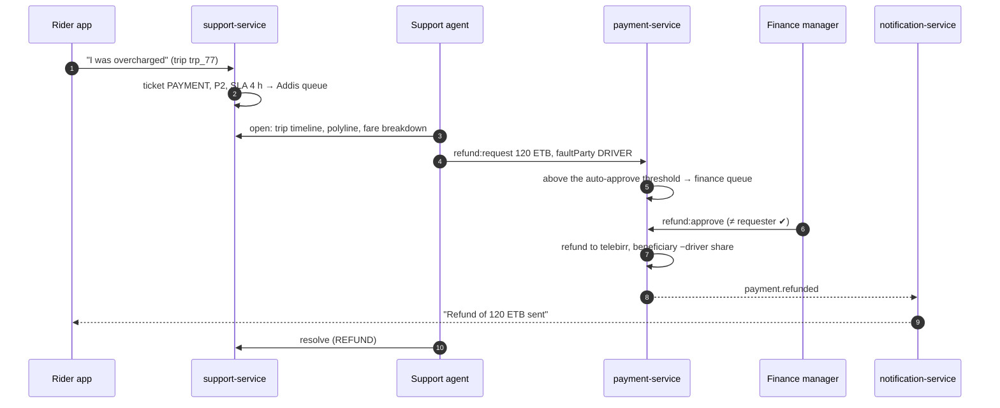
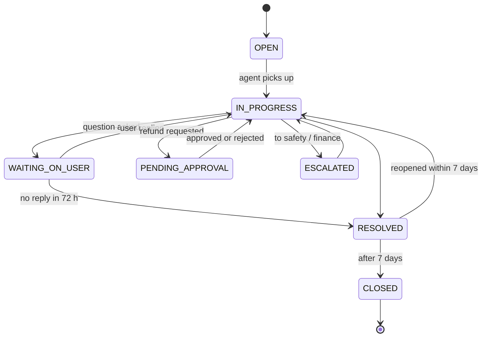

# Workflow 13: Support, lost items and refunds

| | |
|---|---|
| **Actors** | Rider, driver, fleet / corporate admins, support agent, call center agent, finance officer, finance manager |
| **Services** | support-service (tickets, lost items), payment-service (refunds, adjustments), trip-service (evidence), notification-service |
| **Trigger** | A user reports a problem (in-app help, a phone call, a low rating), or the system flags one (cash mismatch, route deviation, auto-flags) |
| **Outcome** | The ticket is resolved with a recorded decision. Money moves only through approved refunds or adjustments |
| **Related** | [← Workflows](README.md) · [Role.md §13.5 (refund approval)](../Role.md#135-refund-with-approval) · [Payment.md §16 (edge cases)](../Payment.md#16-edge-cases) |

## 1. Summary

Every problem becomes a **ticket** linked to its trip (when there is one), with a category, a priority and an SLA. A support agent investigates using the trip evidence: events, the GPS polyline, payment records, contact attempts. Money decisions are **requested** by the agent and **approved** by finance (maker–checker), and executed by payment-service as ledger entries. Lost items get their own flow connecting the rider and the driver without revealing phone numbers.

## 2. Ticket categories

| Category | Typical cases | Default priority | First-response SLA |
|---|---|---|---|
| `SAFETY` | Unsafe driving, harassment, accident | **P1** → routed to safety ([14](14-safety-sos.md)) | 5 min |
| `PAYMENT` | Overcharge, double charge, cash dispute, failed payout | P2 | 4 h |
| `TRIP` | Wrong route, driver didn't come, no-show dispute, cancellation fee dispute | P3 | 8 h |
| `LOST_ITEM` | Left a phone or bag in the car | P2 | 2 h |
| `ACCOUNT` | Can't sign in, change phone, balance question, document rejection | P3 | 24 h |
| `FEEDBACK` | Suggestions, compliments | P4 | 72 h |

## 3. Steps

### A. Open

| # | Who | Action | Data written | Event |
|---|---|---|---|---|
| 1 | User | App → trip → "Get help" → picks an issue → describes it (+ optional photos) | `ticket` (category, trip_id, city_id, priority, SLA due), `ticket_message` | `ticket.created` |
| 2 | System | Auto-tickets: rating ≤ 2 with a safety tag, `trip.cash_mismatch`, `trip.route_deviation` unanswered, a disputed fee | ticket (`source = SYSTEM`) | `ticket.created` |
| 3 | Call center | Phone reports become tickets on behalf of the caller ([10](10-phone-booking.md)) | ticket (`source = PHONE`) | — |
| 4 | support | Routing: a city queue by category and priority. P1 `SAFETY` goes straight to the safety officers | — | — |

### B. Investigate and resolve

| # | Who | Action | Data written | Event |
|---|---|---|---|---|
| 5 | Support agent | Opens the ticket. Evidence panel: trip timeline (`trip_event`), map with the GPS polyline, fare breakdown, payment records, ratings, contact attempts, both parties' history (masked) | audit entries for PII and GPS views | `audit.recorded` |
| 6 | Support agent | Messages the user (in-app, plus SMS for phone users) and/or the other party | ticket_message | `ticket.updated` |
| 7 | Support agent | Decides. Outcomes: `NO_ACTION`, `EXPLAINED`, `REFUND`, `ADJUSTMENT` (e.g. reverse a cancellation fee, goodwill credit), `DRIVER_WARNING`, `ESCALATE_SAFETY` | ticket.resolution | — |

### C. Refund (maker–checker)

| # | Who | Action | Data written | Event |
|---|---|---|---|---|
| 8 | Support agent | `refund:request {tripId, amount, reason, faultParty: DRIVER | PLATFORM | NONE}` | `approval_request` `PENDING` | `approval.requested` |
| 9 | payment | Auto-approves below a small threshold (e.g. ≤ 50 ETB, at most 2 per rider per month). Otherwise it goes to the finance queue | — | — |
| 10 | Finance manager | `refund:approve` (≠ requester) or reject with a reason | approval `APPROVED` | `approval.decided` |
| 11 | payment | Executes. **Digital trip:** refund to the original method (`PROVIDER_CLEARING +X` paid back). **Cash trip:** refund to mobile money, or a ride credit. If `faultParty = DRIVER`: the beneficiary is debited by the driver's share. If `PLATFORM`: `PROMO_EXPENSE` / goodwill | journal, `refund` `EXECUTED` | `payment.refunded` |
| 12 | notification | "We refunded 120 ETB to your telebirr" (or "as ride credit") | — | — |

### D. Lost items

| # | Who | Action | Event |
|---|---|---|---|
| 13 | Rider | "I lost an item" on the trip (within 7 days) → description | `ticket.created {LOST_ITEM}` |
| 14 | support | Notifies the driver in-app: "A rider left an item in your car on Tue 18:20". The driver answers *found* / *not found* | — |
| 15 | Found | A masked call is connected between the rider and the driver to arrange the return. A **return trip fee** (paid by the rider, paid out to the driver) is created as a special trip or adjustment. If they can't arrange it, the item goes to an office drop-off point | `lost_item.returned` |
| 16 | Not found after 48 h | Closed with an explanation. Repeat "not found" reports against the same driver are flagged | — |

### E. Close

| # | Action | Event |
|---|---|---|
| 17 | The resolution is sent to the user, with a 1-tap satisfaction survey | `ticket.resolved` |
| 18 | Reopen within 7 days if unsatisfied. Then it's closed automatically | `ticket.closed` |

## 4. Sequence diagram

## 5. States

## 6. Timeouts and limits

SLAs per category (above) · auto-approve refunds ≤ 50 ETB, at most 2 per rider per month · lost-item reports within 7 days of the trip · reopen within 7 days.

## 7. Failures and edge cases

| Case | Handling |
|---|---|
| Fraudulent refund requests (a serial complainer) | Per-rider refund rate and amount tracked. Above the thresholds, refunds always need finance approval and the account is flagged |
| Agent tries to approve their own refund | Rejected by `CHECK (maker_id <> checker_id)` ([Database.md §9](../Database.md#9-concurrency-control)) |
| Refund to a mobile-money account that is closed | `payment.refund_failed` → ride credit offered instead |
| Ticket about a driver from another city | Routed to the trip's `city_id` queue, not the reporter's |

## 8. Permissions

`ticket:create` (everyone, own) · `ticket:read` / `ticket:update`, `lost_item:manage`, `refund:request` (support and call center `CITY`) · `refund:approve`, `adjustment:approve` (finance manager `GLOBAL`) · evidence: `trip:read_gps_trace`, `user:read_pii` (audited).

## 9. Events

`ticket.created`, `ticket.updated`, `ticket.resolved`, `ticket.closed`, `approval.requested` / `approval.decided`, `payment.refunded`, `payment.refund_failed`, `lost_item.returned`.

## 10. Metrics and alerts

SLA breach rate per category · tickets per 1,000 trips · refund amount ÷ revenue · first-contact resolution · satisfaction score · lost-item return rate.

## 11. Open questions

- Refund to the original method only, or allow ride credit as the default (cheaper)?
- Physical lost-and-found office locations?
