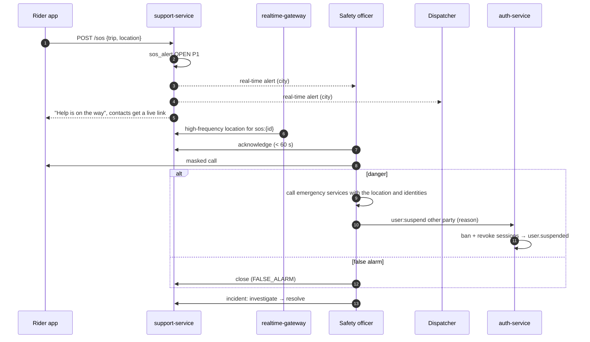
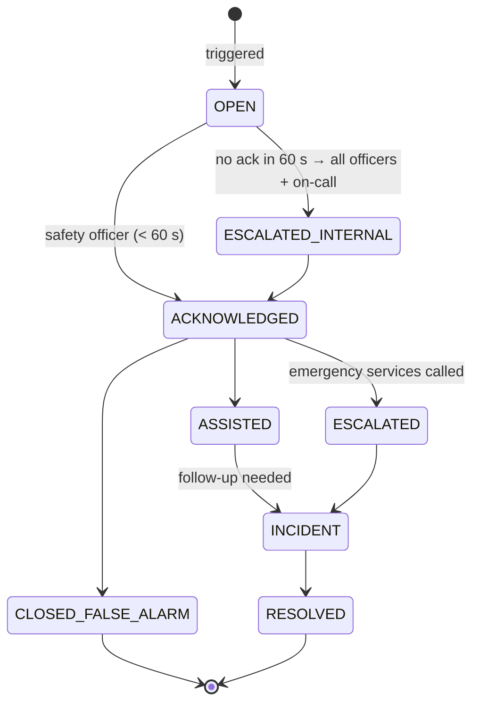

# Workflow 14: Safety — SOS and incidents

| | |
|---|---|
| **Actors** | Rider, driver, safety officer, dispatcher, (police / emergency services) |
| **Services** | support-service (SOS, incidents), realtime-gateway (live location), trip-service (GPS trace), auth-service (suspension), notification-service |
| **Trigger** | SOS pressed in the app, an automatic signal (route deviation, a long unexpected stop, crash detection), or a safety ticket |
| **Outcome** | The person is contacted within minutes, the location is shared with responders when needed, the incident is investigated, and accounts are suspended or cleared, all audited |
| **Related** | [← Workflows](README.md) · [Role.md §13.6](../Role.md#136-sos) · [16 Account lifecycle](16-account-lifecycle.md) |

## 1. Summary

SOS is the **highest-priority path** in the system. Pressing it creates an alert that reaches the city's **safety officers and dispatchers in real time**. It starts sharing the user's live location with the safety team and, if the user chose them, with their **emergency contacts**, and it gives one-tap access to the police number. A safety officer acknowledges, calls the user, and decides: false alarm, assist, or **escalate** to emergency services with the live location and trip details. Suspensions during an investigation use the ban mechanism ([16](16-account-lifecycle.md)). Everything is audited.

## 2. Preconditions

- An active trip or a recent trip (SOS stays available for 30 min after drop-off).
- An emergency contact is configured (optional but encouraged at sign-up).

## 3. Steps

### A. Trigger

| # | Who | Action | Data written | Event |
|---|---|---|---|---|
| 1 | Rider or driver | Long-presses **SOS** (2 s, to avoid pocket presses). Options: "Call police" (dials the emergency number directly) and "Alert Anbessa safety" | — | — |
| 2 | App → support | `POST /api/sos {tripId, location, at}`. **Fallback:** if the network fails, an SMS with the trip code and location goes to the safety short number | `sos_alert` (`OPEN`, P1) | `sos.triggered` |
| 3 | System triggers | Route deviation unanswered for 2 min · stationary > 10 min mid-trip outside traffic · (later) crash detection from the phone sensors | `sos_alert` (`source = SYSTEM`) | `sos.triggered` |
| 4 | gateway | Location pings from that phone go to every 2 s (higher precision) and also to room `sos:{alertId}` | Redis | — |
| 5 | notification | Emergency contacts get an SMS with a **live tracking link** (the trip share token) | — | — |

### B. Respond

| # | Who | Action | Data written | Event |
|---|---|---|---|---|
| 6 | Dashboard | A loud alert for **every safety officer and dispatcher online in the city**: map, trip, both parties (unmasked for safety officers), vehicle, live position | — | — |
| 7 | Safety officer | **Acknowledges within 60 s** (otherwise it escalates to all safety officers globally and pages the on-call lead) | sos_alert `ACKNOWLEDGED` (by, at) | `sos.acknowledged` |
| 8 | Safety officer | Calls the user (masked number). Outcomes: **false alarm** → close · **needs help** → assist (call the driver, redirect to a safe place, send another car) · **danger** → escalate | sos_alert notes | — |
| 9 | Safety officer | **Escalate:** calls emergency services, giving the live location, plate, vehicle, driver and rider identities. Logs the reference number | sos_alert `ESCALATED` | `sos.escalated` |
| 10 | Safety officer | If needed: **suspends** the other party immediately (`user:suspend`, reason required) → ban + session revoke ([16](16-account-lifecycle.md)). The current trip is ended safely by ops | auth ban fields | `user.suspended` |

### C. Investigate (incident)

| # | Who | Action | Data written | Event |
|---|---|---|---|---|
| 11 | Safety officer | Converts the alert or a safety ticket into an **incident**: category (harassment, assault, accident, dangerous driving, theft), severity | `incident` | `incident.opened` |
| 12 | Safety officer | Evidence: GPS trace (`trip:read_gps_trace`), trip events, ratings and comments, past reports on both parties, statements | audit entries | `audit.recorded` |
| 13 | Safety officer | Outcome: `CLEARED` (reinstate) · `WARNING` · `SUSPENDED_TEMPORARY` (`banExpires`) · `REMOVED_PERMANENTLY` (ban, plus a licence/plate/phone blocklist) | incident resolution | `incident.resolved` |
| 14 | System | A **pair block**: that rider and driver are never matched again ([05](05-ride-booking-matching.md) filter) | `match_block` | — |
| 15 | Police request for data | A formal request is logged. A data export of the specific trip (GPS, identities) is prepared by a safety officer and approved by a second officer (maker–checker), then delivered securely | `data_disclosure` | `audit.recorded` |

## 4. Sequence diagram

## 5. States

## 6. Timeouts and limits

| Item | Value |
|---|---|
| Acknowledge | ≤ 60 s, or it escalates and pages |
| First call to the user | ≤ 2 min |
| SOS available | during the trip + 30 min after drop-off |
| High-frequency location | every 2 s while the alert is open |
| Retention | SOS and incident records are never deleted (legal hold). GPS traces of incidents are kept beyond the normal 90 days |

## 7. Failures and edge cases

| Case | Handling |
|---|---|
| No data connection | SMS fallback to the safety short number with the trip code and the last GPS fix |
| No safety officer online (night) | Dispatchers receive the alert too. The 24/7 on-call rota is paged after 60 s |
| Repeated false alarms | Counted. Not penalised by default (safety first). Patterns are reviewed |
| Driver pressed SOS against a rider | The same flow. The rider can be suspended. A pair block is added |
| Rider's phone taken | The location stream stops → the officer uses the driver's phone location (same trip) and the vehicle details |

## 8. Permissions

`sos:trigger` (everyone, own trips) · `sos:respond`, `incident:manage`, `user:suspend` / `user:reinstate`, `trip:read_gps_trace`, `user:read_pii` (safety officer `CITY`, audited) · alerts also go to dispatchers (`sos:respond` alert-only) ([Role.md §8](../Role.md#staff)).

## 9. Events

`sos.triggered`, `sos.acknowledged`, `sos.escalated`, `incident.opened`, `incident.resolved`, `user.suspended` / `user.reinstated`, `audit.recorded`.

## 10. Metrics and alerts

Time to acknowledge (p95 < 60 s, **page** on breach) · time to first call · incidents per 100k trips by category · false-alarm rate · suspensions by outcome.

## 11. Open questions

- The official emergency numbers and any direct integration with police or emergency services in each city.
- Crash detection (phone sensors) at launch or later?
- Audio recording during trips (opt-in) for safety evidence: legal review needed.
