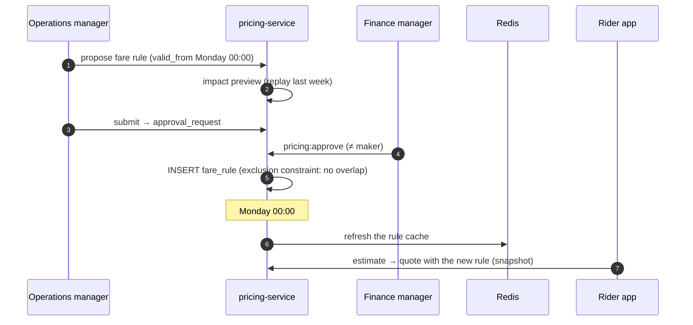

# Workflow 15: Pricing, zones and promotions

| | |
|---|---|
| **Actors** | Operations manager, finance manager, marketing, rider (redeems promos) |
| **Services** | pricing-service (zones, fare rules, promo validation), payment-service (commission rules, promo funding), notification-service (campaigns), Redis (rule cache) |
| **Trigger** | Ops changes fares or zones, finance changes commission, marketing launches a promotion |
| **Outcome** | New rules take effect **at a scheduled time**, after a second person approves them. Past trips are never repriced, and promotions are funded and tracked |
| **Related** | [← Workflows](README.md) · [Database.md §7.5 (versioned rules)](../Database.md#75-pricing-support-notification-audit-summary) · [Payment.md §6.4 (promo funding)](../Payment.md#64-cash-trip-with-a-platform-funded-promo-rider-pays-only-350) · [Role.md §11](../Role.md#11-approvals-makerchecker) |

## 1. Summary

All pricing configuration is **versioned by validity period**:
- **zones:** service areas, airport zones, surge caps,
- **fare rules:** base, per km, per minute, minimum, waiting, cancellation fee, per city and vehicle type,
- **commission rules** ([Payment.md §7](../Payment.md#7-commission-models)).

A change is a **proposal** of a new version with a future `valid_from`. A second person approves it, and pricing-service starts using it automatically at that time. Quotes and trips snapshot the rule they used. Promotions are codes or automatic offers with a budget, eligibility rules and a funding source.

## 2. Steps

### A. Change a fare rule

| # | Who | Action | Data written | Event |
|---|---|---|---|---|
| 1 | Operations manager | Dashboard → city → vehicle type → "Propose new fares": per-km 15 → 16 ETB, `valid_from` next Monday 00:00 | `pricing_change_request` (draft rule, reason) | — |
| 2 | pricing | **Impact preview:** replays last week's trips with the new rule → average fare change, distribution, estimated revenue and driver-earnings impact | stored with the request | — |
| 3 | Operations manager | Submits | `approval_request` `PENDING` | `approval.requested` |
| 4 | Another ops manager or the finance manager | Reviews the preview → `pricing:approve` (maker ≠ checker) | `fare_rule` row inserted with `valid_from` (the exclusion constraint blocks overlaps) | `pricing.rule_scheduled` |
| 5 | pricing | At `valid_from`: the rule cache in Redis is refreshed (and an event-driven invalidation happens). New **quotes** use it. Quotes issued earlier keep their snapshot until they expire | Redis | `pricing.rule_activated` |
| 6 | notification | Drivers in the city get an in-app notice before the change ("New fares from Monday") | — | — |

### B. Change zones

| # | Who | Action |
|---|---|---|
| 7 | Operations manager | Draws or edits a polygon on the map (service area, airport zone with a fixed fee, a no-pickup zone, e.g. where city rules forbid stopping) |
| 8 | pricing | Validates the geometry (valid, non-self-intersecting, inside the city boundary). Shows trips that would have been affected last week |
| 9 | Approval | Same maker–checker as step 4. The new zone version gets a `valid_from` |
| 10 | Effect | Matching rejects pickups outside the service area. No-pickup zones make the app snap the pickup to the nearest allowed point |

### C. Commission change

The same flow, by finance (`commission_rule:propose` → `commission_rule:approve`). The rule applies to trips **completed** after `valid_from`, using the rule valid at **trip start** ([Payment.md §16](../Payment.md#16-edge-cases)).

### D. Promotions

| # | Who | Action | Data written | Event |
|---|---|---|---|---|
| 11 | Marketing | Creates a promo: type (`PERCENT_OFF`, `AMOUNT_OFF`, `FIRST_RIDE`, `REFERRAL`), value, cap per trip, eligibility (new riders, a zone, vehicle type, payment method, time window), limits (per rider, total redemptions), **budget**, funding = `PLATFORM` (or a partner) | `promo` (`DRAFT`) | — |
| 12 | Finance manager | Approves the budget (`promo` above a threshold needs `incentive:approve`) | promo `ACTIVE` with dates | `promo.activated` |
| 13 | Marketing | Optional campaign: push + SMS to the eligible segment (`campaign:send`, quiet hours respected, opt-outs honoured) | notification batch | — |
| 14 | Rider | Enters the code (or it's auto-applied) at **estimate** time → pricing validates eligibility and limits → the quote shows the discount | `promo_reservation` (tied to the quote) | — |
| 15 | trip / payment | At completion: the redemption is recorded. Ledger: the rider pays less, the driver's earning is **unchanged**, and the difference goes to `PROMO_EXPENSE` ([Payment.md §6.4](../Payment.md#64-cash-trip-with-a-platform-funded-promo-rider-pays-only-350)) | `promo_redemption`, journal | `promo.redeemed` |
| 16 | pricing | Budget reached → the promo moves to `EXHAUSTED` automatically. New quotes stop offering it | promo status | `promo.exhausted` |

### E. Driver incentives

Quests ("complete 20 trips this weekend, get 300 ETB") follow the same propose → approve flow (`incentive:propose` / `incentive:approve`). Progress is computed from `trip.completed` events, and payout is a journal entry to the beneficiary balance (`PROMO_EXPENSE −X`, `BENEFICIARY_BALANCE +X`).

## 3. Sequence diagram

## 4. States

Pricing change request: `DRAFT → PENDING_APPROVAL → APPROVED (scheduled) → ACTIVE → SUPERSEDED`, or `REJECTED`. Promo: `DRAFT → ACTIVE → PAUSED | EXHAUSTED | EXPIRED`.

## 5. Timeouts and limits

| Item | Value |
|---|---|
| Earliest `valid_from` | 24 h after approval for fares (drivers get notice). Immediate only for emergency rollbacks (still maker–checker) |
| Approval expiry | 7 days ([Role.md §11](../Role.md#11-approvals-makerchecker)) |
| Promo stacking | one promo per trip |
| Campaign quiet hours | 21:00–08:00 local time |

## 6. Failures and edge cases

| Case | Handling |
|---|---|
| Wrong fare goes live | Emergency rollback: a new rule version with the old values and `valid_from = now`, still maker–checker (fast-track). Affected trips get refunds via [13](13-support-refunds.md) |
| Overlapping rules | Impossible: the database exclusion constraint rejects them |
| A promo is abused (multiple accounts) | Device and phone fingerprint limits. Redemptions are checked per payment method. Suspicious patterns are paused automatically |
| Cache stale after activation | Event-driven invalidation + a 60 s TTL. Quotes also record the rule id used, so audits are exact |

## 7. Permissions

`zone:manage`, `vehicle_type:manage`, `pricing:propose` / `pricing:approve` (`CITY`), `commission_rule:*` (finance), `promo:manage`, `campaign:send` (marketing `CITY`), `incentive:approve` (finance manager) ([Role.md §8](../Role.md#staff), [Payment.md §15](../Payment.md#15-roles-and-permissions)).

## 8. Events

`approval.requested` / `approval.decided`, `pricing.rule_scheduled`, `pricing.rule_activated`, `promo.activated`, `promo.redeemed`, `promo.exhausted`.

## 9. Metrics and alerts

Average fare per km by city and vehicle type · quote → request conversion before and after a change · promo cost per incremental trip · budget burn rate (alert at 80%) · surge frequency (if enabled).

## 10. Open questions

- Surge pricing at all? If yes, a cap per city (e.g. 1.5×) and rider-facing transparency.
- Fixed airport fares?
