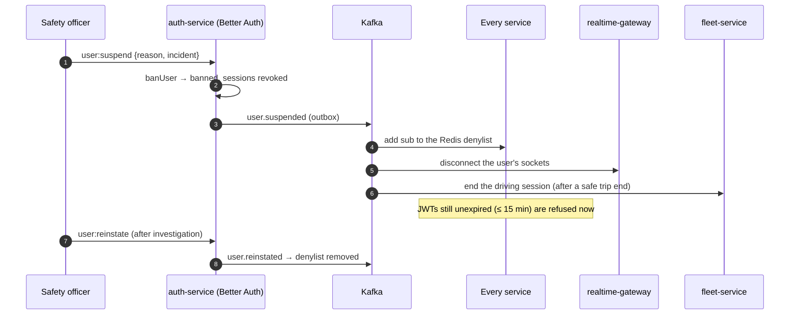
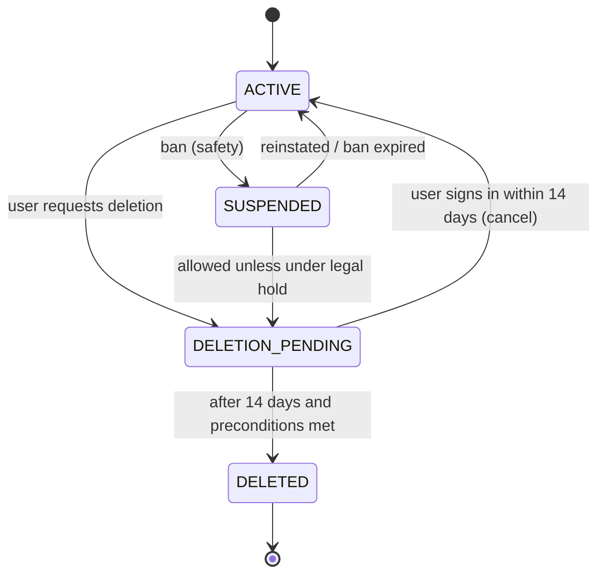

# Workflow 16: Account lifecycle — suspension, reinstatement and deletion

| | |
|---|---|
| **Actors** | Safety officer, onboarding officer, finance, the user (deletion request), every service |
| **Services** | auth-service (Better Auth ban, sessions), every service (denylist, anonymisation), payment-service (balances), audit-service |
| **Trigger** | A safety or compliance decision (suspend), an expired document (driver suspension), unpaid debt (balance block), or the user asks to delete their account |
| **Outcome** | Access is removed **within seconds** everywhere. Reinstatement restores it cleanly. Deletion removes personal data while keeping the financial and legal records the law requires |
| **Related** | [← Workflows](README.md) · [Auth.md §9.5](../Auth.md#95-suspension) · [Database.md §15 (personal data deletion)](../Database.md#personal-data-deletion) · [14 Safety](14-safety-sos.md) |

## 1. Summary

There are four kinds of "blocked", and they must not be confused:

| Kind | Cause | Effect | Owner |
|---|---|---|---|
| **Account suspension (ban)** | Safety or fraud decision | Can't sign in, all sessions revoked, all tokens denied | Safety officer → auth-service |
| **Driver suspension** | Expired or invalid documents, quality | Can still ride as a rider. Can't go online as a driver | fleet-service |
| **Balance block** | Commission debt or overdue payment | Can't receive cash (or any) requests until paid | payment-service ([09](09-driver-balance.md)) |
| **Organisation suspension** | Fleet or corporate non-payment or fraud | All its vehicles / corporate bookings stop | auth + payment |

Deletion is separate: the user leaves, and their **personal data** is removed or anonymised.

## 2. Steps

### A. Suspend an account (ban)

| # | Who | Action | Data written | Event |
|---|---|---|---|---|
| 1 | Safety officer | `user:suspend {userId, reason, until?}` (reason required, linked to an incident) | — | — |
| 2 | auth (Better Auth admin) | `banUser`: sets `banned`, `banReason`, `banExpires` and **revokes all sessions** | user ban fields, sessions deleted | outbox `user.suspended {userId, until}` |
| 3 | Every service | Consumes `user.suspended` → adds `sub` to the Redis **denylist** (TTL = the max JWT lifetime + margin, or until reinstated) → any JWT still valid is refused | Redis `deny:{userId}` | — |
| 4 | realtime-gateway | Disconnects the user's sockets immediately | — | — |
| 5 | fleet | If the user is a driver online: the session ends. If on a trip: safety decides first, and ops completes or cancels the trip safely | session ended | `driver.offline {SUSPENDED}` |
| 6 | trip | Future scheduled trips by the user are cancelled (with notifications to the other parties) | trips | `trip.cancelled {by: SYSTEM, reason: ACCOUNT_SUSPENDED}` |
| 7 | notification | SMS: "Your account is suspended. Contact support: …" (no details of the investigation) | — | — |
| 8 | audit | Who, why, when, the incident link | audit_entry | `audit.recorded` |

### B. Reinstate

| # | Who | Action | Event |
|---|---|---|---|
| 9 | Safety officer | `user:reinstate {userId, reason}` (after the investigation → `CLEARED`) | — |
| 10 | auth | `unbanUser` → the user can sign in again (a new OTP) | `user.reinstated` |
| 11 | Every service | Removes the denylist entry | — |
| 12 | Temporary bans | Expire automatically at `banExpires`. auth emits `user.reinstated` from a scheduled check | `user.reinstated` |

### C. Delete an account (user request)

| # | Who | Action | Data written | Event |
|---|---|---|---|---|
| 13 | User | Settings → "Delete my account" → OTP confirmation → a 14-day **grace period** (they can cancel by signing in) | `deletion_request` (`PENDING`, due date) | `user.deletion_requested` |
| 14 | auth | Preconditions: no active or scheduled trip · **balance ≥ 0** (otherwise: "settle 180 ETB first") · no open dispute or legal hold (safety incidents) | — | — |
| 15 | auth (after 14 days) | Sessions revoked. `user`: phone, email and name replaced with irreversible tokens, `accountStatus = DELETED`, credentials (`account`) and 2FA removed. The **per-user data key is destroyed** (crypto-shredding of encrypted PII in all services, backups and archives) | user anonymised, keys destroyed | `user.deleted {userId}` |
| 16 | trip | Anonymises rider and driver fields on trips (names, phone references, saved places). **Keeps** the trip facts (fare, times, zone-level locations) for accounting and the regulator | trips | — |
| 17 | fleet | Driver documents deleted from object storage (unless under legal hold). The driver profile is anonymised | documents | — |
| 18 | payment | **Keeps** the ledger (legal obligation), linked to the anonymised id. Payout details deleted | — | — |
| 19 | support / notification | Messages anonymised, device tokens deleted, marketing opt-in removed | — | — |
| 20 | audit | Records that the deletion was performed (not the deleted data) | audit_entry | `audit.recorded` |
| 21 | Each service | Confirms completion. auth marks `deletion_request` `COMPLETED` when every service has confirmed (tracked per service) | deletion_request | `user.deletion_completed` |

## 3. Sequence diagram

## 4. States

## 5. Timeouts and limits

| Item | Value |
|---|---|
| Suspension effective everywhere | ≤ 5 s (event + denylist). Worst case: the JWT TTL if Kafka is down (15 min app, 10 min admin) |
| Denylist TTL | max JWT TTL + 5 min, refreshed while banned |
| Deletion grace period | 14 days |
| Deletion completion | all services within 30 days (alert if a service hasn't confirmed in 7 days) |

## 6. Failures and edge cases

| Case | Handling |
|---|---|
| Kafka down when suspending | Sessions are already revoked (no new JWTs). Existing JWTs expire within 15 min. The outbox delivers the event when Kafka recovers |
| Suspended driver mid-trip with a rider in the car | Safety decides: let the trip finish (most cases), or redirect and assist ([14](14-safety-sos.md)). Never strand the rider silently |
| Deletion with a negative balance | Blocked until settled. Or, after the write-off flow ([09](09-driver-balance.md)), deletion proceeds and the debt record stays, linked to the anonymised id |
| Deleted user signs up again with the same phone | A new account (the phone was tokenised, not kept). Banned drivers are still caught by the licence and plate blind-index blocklist (stored separately under a legal-hold justification) |
| Fleet owner deletes their account | Ownership of the organisation must be transferred first (another `fleet_owner` member), or the organisation is closed |

## 7. Permissions

`user:suspend` / `user:reinstate` (safety officer `CITY`) · `driver:suspend` (onboarding for documents, safety) · `org:suspend` (safety, finance) · deletion: self-service (`SELF`) with the preconditions.

## 8. Events

`user.suspended`, `user.reinstated`, `user.deletion_requested`, `user.deleted`, `user.deletion_completed`, `driver.offline {SUSPENDED}`, `trip.cancelled {ACCOUNT_SUSPENDED}`, `audit.recorded`.

## 9. Metrics and alerts

Time from suspension to denylist active everywhere (p99) · suspensions by reason · reinstatement rate · deletion requests and completion time per service (alert on stragglers).

## 10. Open questions

- Retention periods that override deletion (accounting, tax, safety incidents): confirm with legal counsel ([Database.md Q1](../Database.md#22-open-questions)).
- Do we offer data export (download my data) before deletion?
