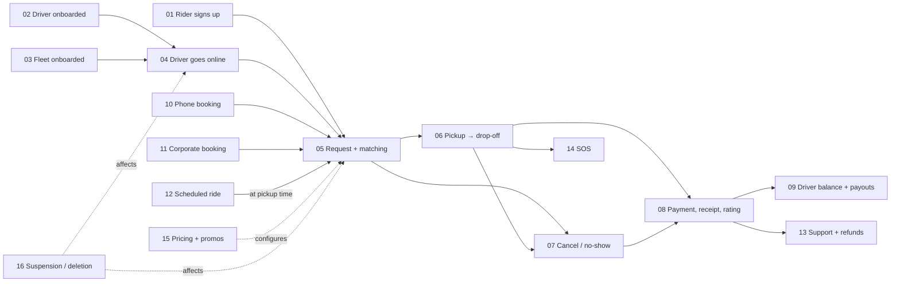
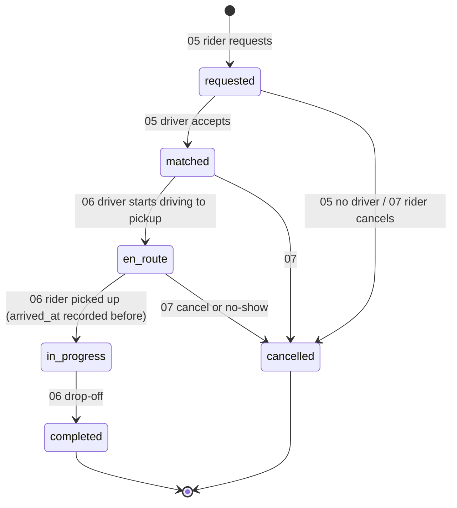

# Workflow designs

How Anbessa works **from start to finish**, one workflow per file. Each one traces a business process across apps, services, data stores and events, including what happens when things go wrong.

| | |
|---|---|
| **Status** | 👀 In review (proposal) |
| **Builds on** | [Role.md](../Role.md) (who may do what) · [Auth.md](../Auth.md) (identity, tokens) · [Database.md](../Database.md) (stores, consistency) · [Payment.md](../Payment.md) (money) · [Architecture overview](../../architecture/overview.md) |
| **Related** | [← Design home](../README.md) |

---

## Contents

| # | Workflow | Main actors | Main services |
|---|---|---|---|
| 01 | [Rider sign-up and sign-in](01-rider-signup-signin.md) | Rider | auth (Better Auth), notification (Telegram Gateway, SMS fallback) |
| 02 | [Driver onboarding and vehicle verification](02-driver-onboarding.md) | Driver, onboarding officer | auth, fleet, notification |
| 03 | [Fleet company onboarding and fleet drivers](03-fleet-onboarding.md) | Fleet owner, fleet driver, onboarding officer | auth, fleet, payment |
| 04 | [Driver shift: online, location, offline](04-driver-shift.md) | Driver | fleet, realtime-gateway, location, payment |
| 05 | [Ride booking: estimate, request, matching](05-ride-booking-matching.md) | Rider, driver | pricing, mapping, trip, location, realtime-gateway |
| 06 | [Trip execution: pickup to drop-off](06-trip-execution.md) | Rider, driver | trip, realtime-gateway, mapping |
| 07 | [Cancellations and no-shows](07-cancellations.md) | Rider, driver, dispatcher | trip, payment, notification |
| 08 | [Payment, receipt and rating](08-payment-receipt-rating.md) | Rider, driver | trip, payment, notification, fleet |
| 09 | [Driver balance: limits, top-ups, payouts](09-driver-balance.md) | Driver, fleet owner, finance | payment, notification |
| 10 | [Phone booking (call center)](10-phone-booking.md) | Caller, call center agent | auth, trip, notification |
| 11 | [Corporate rides and invoicing](11-corporate-rides.md) | Corporate admin, coordinator, employee, finance | auth, trip, payment |
| 12 | [Scheduled rides](12-scheduled-rides.md) | Rider, driver, dispatcher | trip, pricing, notification |
| 13 | [Support, lost items and refunds](13-support-refunds.md) | Rider, driver, support agent, finance | support, payment, trip |
| 14 | [Safety: SOS and incidents](14-safety-sos.md) | Rider, driver, safety officer, dispatcher | support, realtime-gateway, auth, trip |
| 15 | [Pricing, zones and promotions](15-pricing-promotions.md) | Operations manager, finance manager, marketing | pricing, payment, notification |
| 16 | [Account lifecycle: suspension and deletion](16-account-lifecycle.md) | Safety officer, user, all services | auth, every service |

---

## The life of a ride at a glance



---

## Conventions used in every workflow

### Interaction rules

| Rule | Why |
|---|---|
| **State changes go over HTTP, through Kong, with an `Idempotency-Key`** (accept, arrive, start, complete, cancel) | Reliable, retryable, auditable. A double tap or a retry can't apply twice |
| **Pushes to apps go over the WebSocket** (offers, status, live location) and **push notifications** when the app is in the background | Instant delivery. The WebSocket is never the only path for something critical |
| **Every state change is one transaction in the owning service** + an outbox event | [Database.md §8](../Database.md#8-consistency-model) |
| **Cross-service effects happen by events**, consumed idempotently | No service waits on another to finish its own step |
| **Timeouts are explicit** and listed per workflow | Mobile networks drop. Nothing waits forever |
| **Every step is permission-checked** with `libs/shared-authz` | [Role.md §9](../Role.md#9-authorization-how-a-request-is-checked) |

### Trip status contract

The statuses in `libs/shared-types/src/trip.ts` stay the contract: `requested → matched → en_route → in_progress → completed`, plus `cancelled`. Sub-steps such as "driver arrived" are **timestamps and events**, not new statuses. The one exception is workflow 12, which proposes a `scheduled` status that must be added to the shared type and the Dart mirror in the same PR.



### API surface used across workflows

| Endpoint / event | Purpose | Workflow |
|---|---|---|
| `POST /api/pricing/estimates` | Fare estimate for pickup → dropoff + vehicle type | 05, 10, 11, 12 |
| `POST /api/trips` | Request a ride (`Idempotency-Key`) | 05, 10, 11 |
| `POST /api/trips/{id}/accept` · `/decline` | Driver answers an offer | 05 |
| `POST /api/trips/{id}/arrive` · `/start` · `/complete` | Trip progress | 06 |
| `POST /api/trips/{id}/cancel` | Cancel (rider, driver, staff) | 07 |
| `POST /api/trips/{id}/rating` | Rate after the trip | 08 |
| WebSocket `trip:offer` (server → driver) | Offer with `expiresAt` | 05 |
| WebSocket `trip:status`, `driver:location` (server → rider) | Live updates in room `trip:{id}` | 05, 06 |
| WebSocket `location:update` (driver → server) | GPS ping every ~4 s | 04, 06 |
| Kafka `trip.*`, `payment.*`, `balance.*`, `user.*`, `driver.*`, `vehicle.*` | Domain events | all |

### Template for a new workflow

```markdown
# Workflow NN: <name>
| Status | Actors | Services | Trigger | Outcome |

## 1. Summary
## 2. Preconditions
## 3. Steps            (numbered: who → what → data written → event)
## 4. Sequence diagram
## 5. States           (if the workflow has a lifecycle)
## 6. Timeouts and limits
## 7. Failures and edge cases
## 8. Permissions
## 9. Events
## 10. Metrics and alerts
## 11. Open questions
```
