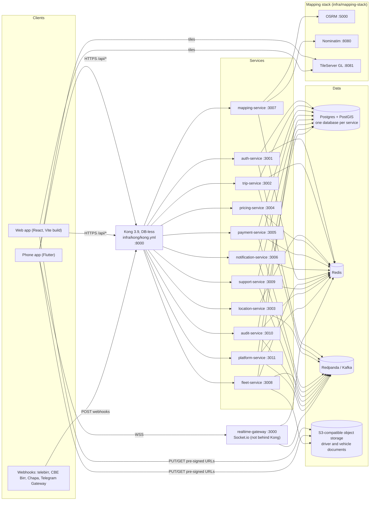

# Infrastructure documentation

Reference for the files under `infra/` and the build, CI and dev tooling that drives them
(`Makefile`, `scripts/`, `.github/workflows/`, root `package.json` / `turbo.json` /
`pnpm-workspace.yaml`, `services/*/Dockerfile`). Everything here is taken from those files. Where
something isn't in the repo, the page says "not found in repo".

Related guides that already cover parts of this, and are linked rather than repeated:

- [docs/development/README.md](../../docs/development/README.md): day-to-day developer workflow.
- [docs/production/README.md](../../docs/production/README.md): release process, configuration reference, readiness checklist.
- [docs/architecture/overview.md](../../docs/architecture/overview.md): services, events and request flows.

## Environments

| Environment | How it starts | What runs where | Source files |
|-------------|---------------|-----------------|--------------|
| Local dev | `make infra-up` then `make dev-services` (optionally `make dev-gateway`, `make dev-infra`) | Postgres, Redis, Redpanda in Docker. All 11 services and the web app on the host in watch mode (`tsx watch`, Vite). Kong optional, in Docker, pointed at the host | `infra/docker/docker-compose.yml`, `infra/kong/docker-compose.dev.yml`, `scripts/kong-dev-config.sh` |
| Local per-service | `docker compose -f services/<svc>/docker-compose.dev.yml up -d`, then `pnpm dev` in that service | Only the infra that one service needs | `services/*/docker-compose.dev.yml` |
| Local stack | `make stack-up` | Every service built from its `Dockerfile` and run in a container, plus Kong on `:8000` | `infra/docker/docker-compose.yml`, `infra/kong/kong.yml` |
| Staging | `.github/workflows/deploy.yml`, job `deploy-staging`, on every push to `main` | Kubernetes, `kubectl apply -k infra/k8s/overlays/staging` | `infra/k8s/` |
| Production | Same workflow, job `deploy-production`, after a manual approval on the `production` GitHub environment | Kubernetes, `kubectl apply -k infra/k8s/overlays/production`; cloud resources from Terraform (AWS) | `infra/k8s/`, `infra/terraform/` |

Staging and production are scaffolds today: only trip-service has Kubernetes manifests, the
Terraform modules directory is empty, and `.github/` is gitignored. See
[ci-cd.md](ci-cd.md), [kubernetes.md](kubernetes.md) and [terraform.md](terraform.md).

The staging hostnames the phone app expects are in `apps/phone-app/env/staging.json`:
`https://api.staging.anbessa.et` (API through Kong), `wss://ws.staging.anbessa.et`
(realtime-gateway) and `https://tiles.staging.anbessa.et` (tiles). No DNS, ingress or load
balancer config for them was found in repo.

## Deployment diagram

Notes on the diagram:

- Kong routes are in [kong.md](kong.md). realtime-gateway has no Kong route; clients connect to it
  directly (`WS_URL` in `apps/phone-app/env/*.json`).
- Service-to-service calls (`/internal/*`, guarded by `INTERNAL_SERVICE_TOKEN`) go directly between
  services and are left out of the diagram. See [docs/architecture/overview.md](../../docs/architecture/overview.md).
- Only mapping-service calls OSRM and Nominatim (`infra/mapping-stack/README.md`). The web app's
  default map style is OpenFreeMap (`apps/web/.env.example`, `VITE_MAP_STYLE_URL`), not the
  self-hosted tile server.
- location-service and realtime-gateway have no database. pricing-service has one since workflow 15
  (`pricing_service`: zones, fare rules, promos, outbox).

## Index

| Page | Covers |
|------|--------|
| [local-development.md](local-development.md) | Compose files and containers, every Makefile target, `scripts/`, secrets generation, dev Kong, port map, port conflicts |
| [kong.md](kong.md) | Every Kong service, route and plugin; `kong.dev.yml`; WebSockets; `/internal`; adding a route |
| [kubernetes.md](kubernetes.md) | Base manifests, overlays, ConfigMap/Secret expectations, probes, resources, scaling |
| [terraform.md](terraform.md) | Modules, variables, outputs, state backend, how to apply |
| [mapping-stack.md](mapping-stack.md) | OSRM, Nominatim, TileServer GL, `make map-data`, how mapping-service uses them |
| [ci-cd.md](ci-cd.md) | GitHub workflows, turbo pipeline, Dockerfiles |
| [data-stores.md](data-stores.md) | Postgres databases, Redis keys, Kafka topics, object storage, migrations, backups |
| [production-checklist.md](production-checklist.md) | Production refusals per service, required secrets, TLS, scaling, observability |
