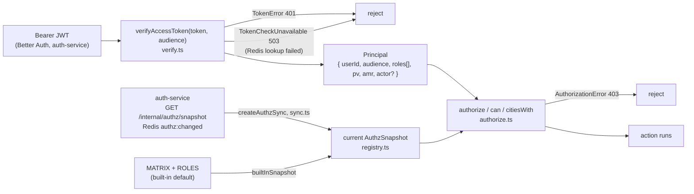

# `@ride-app/shared-authz`

Roles, permissions, scope checks and access-token verification for every Anbessa service and the web app. It is the code side of [Role.md](../../../docs/design/Role.md) (§4 roles, §7 permissions, §8 matrix, §9 checks, §10 tokens) and [Auth.md §10](../../../docs/design/Auth.md#10-verifying-tokens-in-other-services).

Related docs in this folder:

| File | What it covers |
|---|---|
| [roles-and-permissions.md](roles-and-permissions.md) | The full role catalogue, the full permission catalogue (permission → roles → scope), approval permissions, permission groups, the live registry |
| [tokens.md](tokens.md) | `createTokenVerifier`: JWKS, algorithms, audiences, deny list, permission version; the `Principal` shape; role-claim parsing |
| [reference.md](reference.md) | Every export: signature, behaviour, errors, real call sites |

---

## What it does



1. **Catalogues** (`roles.ts`, `permissions.ts`, `matrix.ts`): the built-in roles, the permission list and the default role → permission matrix with scope letters.
2. **Live registry** (`registry.ts`): the matrix actually in force. It starts as the built-in default and is replaced at runtime with `setAuthzSnapshot()`. Custom roles (created by admins in auth-service) exist only in the registry.
3. **Sync** (`sync.ts`): keeps the registry equal to auth-service's copy (load at start, Redis pub/sub on `authz:changed`, 30 s poll).
4. **Token verification** (`verify.ts`): checks a Better Auth JWT and turns it into a `Principal`.
5. **Authorization** (`authorize.ts`): `authorize`, `can`, `citiesWith`, `grantingAssignments`.

## What belongs here and what doesn't

Belongs here:

- anything that decides *whether a principal may do something*, given only the token and the resource's scope attributes (owner user ids, org id, city id);
- the role and permission catalogues and the default matrix;
- token parsing and verification that every service must do the same way.

Does not belong here (and isn't here today):

- database access. The lib has no Prisma, no Redis dependency: Redis is passed in structurally (`RedisLike`) and the deny-list / permission-version lookups are callbacks you supply (`isDenied`, `currentPermissionVersion`);
- domain rules (vehicle must be `VERIFIED`, maker ≠ checker, refund thresholds). Those stay in the owning service;
- the maker–checker workflow and the matrix editing guardrails. Those live in auth-service (`services/auth-service/src/authz/`);
- issuing tokens. auth-service does that with Better Auth.

## Who uses it

Found with `grep -r '@ride-app/shared-authz'` over `services/` and `apps/` (number of importing source files, tests included):

| Package | Files | Symbols imported |
|---|---|---|
| `services/auth-service` | 18 | `MATRIX`, `ROLES`, `ROLE_CODES`, `USER_ROLE_CODES`, `RoleCode`, `roleInfo`, `toRoleClaim`, `RoleAssignment`, `roleFromStored`, `rolesForOrgKind`, `OrgKind`, `roleByStored`, `isPermission`, `AuthzSnapshot`, `Permission`, `RoleInfo`, `AUTHZ_CHANNEL`, `authorize`, `setAuthzSnapshot`, `getAuthzSnapshot`, `builtInSnapshot`, `ScopeLetter`, `createAuthzSync`, `bearerToken`, `createTokenVerifier`, `Audience`, `VerifyAccessToken`, `can`, `hasRole`, `AuthorizationError`, `TokenError`, `Principal` |
| `services/payment-service` | 12 | `createTokenVerifier`, `VerifyAccessToken`, `bearerToken`, `TokenError`, `AuthorizationError`, `Principal`, `authorize`, `can`, `citiesWith`, `Permission`, `createAuthzSync`, `fetchAuthzSnapshotFrom` |
| `services/trip-service` | 9 | `createTokenVerifier`, `VerifyAccessToken`, `bearerToken`, `TokenError`, `AuthorizationError`, `Principal`, `authorize`, `can`, `createAuthzSync`, `fetchAuthzSnapshotFrom` |
| `services/platform-service` | 8 | `createTokenVerifier`, `VerifyAccessToken`, `bearerToken`, `TokenError`, `AuthorizationError`, `Principal`, `authorize`, `createAuthzSync`, `fetchAuthzSnapshotFrom` |
| `services/fleet-service` | 6 | same as trip-service, plus `Permission` |
| `services/audit-service` | 6 | `createTokenVerifier`, `VerifyAccessToken`, `bearerToken`, `TokenError`, `AuthorizationError`, `Principal`, `authorize`, `createAuthzSync`, `fetchAuthzSnapshotFrom` |
| `services/location-service` | 6 | same as audit-service |
| `services/notification-service` | 5 | `createTokenVerifier`, `VerifyAccessToken`, `bearerToken`, `TokenError`, `AuthorizationError`, `createAuthzSync`, `fetchAuthzSnapshotFrom` (no `authorize` call) |
| `services/pricing-service` | 5 | same as notification-service, plus `Principal` (no `authorize` call) |
| `services/mapping-service` | 5 | `createTokenVerifier`, `VerifyAccessToken`, `bearerToken`, `TokenError`, `AuthorizationError` (no `authorize` call, no `createAuthzSync`) |
| `services/realtime-gateway` | 4 | `createTokenVerifier`, `TokenError`, `createAuthzSync`, `fetchAuthzSnapshotFrom`, `can`, `Principal` |
| `apps/web` | 9 | `can`, `Permission`, `Principal`, `ResourceScope`, `Audience`, `roleInfo`, `parseRoleClaims`, `setAuthzSnapshot` (loads the matrix from `GET /api/identity/authz`), `AuthzSnapshot`, `PERMISSION_GROUPS`, `PERMISSIONS`, `permissionGroup`, `RoleInfo`, `ScopeLetter`, `grantableStaffRoles` |

Every service listed with `TokenError` also imports `TokenCheckUnavailable` in its `src/middlewares/error-handler.ts` (mapped to 503 `auth_unavailable`).

Exports not imported anywhere outside the lib (as of this writing): `APPROVAL_PERMISSIONS`, `PENDING_ORG_PERMISSIONS` (used by `authorize`), `GRANTABLE_STAFF_ROLES`, `isRoleCode`, `isKnownRole`, `grantsOf`, `grantingAssignments`, `ROLE_LABELS`, `resetAuthzSnapshot`, `RoleClaim`. Some are used inside the lib (`grantsOf` by `authorize`, `ROLE_LABELS` by `builtInSnapshot`).

Every service's `package.json` lists it as `"@ride-app/shared-authz": "workspace:*"`.

## Build and import

From [`package.json`](../package.json):

```json
"exports": {
  ".": {
    "development": "./src/index.ts",
    "types": "./dist/index.d.ts",
    "default": "./dist/index.js"
  }
}
```

- **`development` condition → TypeScript source.** Services run `tsx watch --conditions=development …` in `pnpm dev` and type-check with `tsc --noEmit --customConditions development` (see any `services/*/package.json`). `apps/web/tsconfig.json` sets `"customConditions": ["development"]`. With this condition, edits to `libs/shared-authz/src` are picked up without a build.
- **Otherwise → `dist/`.** `node dist/server.js` (each service's `start` script) and vitest runs without the condition load the compiled `dist/index.js`. Run `pnpm build` (turbo builds `^build` dependencies first, see [`turbo.json`](../../../turbo.json)).
- ESM only (`"type": "module"`). Compiled with `tsc -p tsconfig.json`, extending [`tsconfig.base.json`](../../../tsconfig.base.json) (`module`/`moduleResolution: NodeNext`, `strict`, `noUncheckedIndexedAccess`, `declaration`).
- Runtime dependency: `jose` (JWT/JWKS). Dev: `vitest`.

Scripts:

| Script | Command |
|---|---|
| `build` | `tsc -p tsconfig.json` |
| `test` | `vitest run --passWithNoTests` (tests in `tests/`: `authorize.test.ts`, `registry.test.ts`, `verify.test.ts`) |
| `lint` | `eslint src` |
| `typecheck` | `tsc --noEmit` |

Import everything from the package root; there are no sub-path exports:

```ts
import { authorize, can, createTokenVerifier, type Principal } from "@ride-app/shared-authz";
```

## Typical service wiring

Taken from `services/trip-service/src/container.ts`, `src/server.ts` and `src/http/routes.ts`:

```ts
// container.ts: one verifier per process
verifyAccessToken: createTokenVerifier({
  issuer: config.AUTH_ISSUER,
  jwksUrl: config.AUTH_JWKS_URL,
  isDenied: async (userId) => (await redis.exists(`deny:${userId}`)) === 1,
  currentPermissionVersion: async (userId) => {
    const v = await redis.get(`pv:${userId}`);
    return v === null ? undefined : Number(v);
  },
}),

// server.ts: keep the matrix in step with auth-service
const authzSync = createAuthzSync({
  fetchSnapshot: fetchAuthzSnapshotFrom(config.AUTH_INTERNAL_URL, config.INTERNAL_SERVICE_TOKEN),
  ...(c.redis ? { redis: c.redis } : {}),
  logger,
});
await authzSync.start();

// routes.ts: principal per request
const token = bearerToken(req.headers.authorization);
const principal = await deps.verifyAccessToken(token, "ride-app");

// trips/service.ts: one authorize() per protected action
authorize(p, "trip:assign", { cityId: t.cityId });

// middlewares/error-handler.ts
if (err instanceof AuthorizationError) return reply.status(403).send({ error: "forbidden", message: err.message });
if (err instanceof TokenError) return reply.status(401).send({ error: err.code, message: err.message });
if (err instanceof TokenCheckUnavailable) {
  req.log.warn({ err: err.cause }, "token check unavailable (Redis)");
  return reply.status(503).header("retry-after", "5").send({ error: err.code, message: err.message });
}
```

The `deny:{userId}` and `pv:{userId}` Redis keys are written by auth-service (`services/auth-service/src/lib/signals.ts`), not by this lib.

## Source map

| File | Exports |
|---|---|
| [`src/roles.ts`](../src/roles.ts) | `Audience`, `ScopeType`, `OrgKind`, `ROLES`, `RoleCode`, `ROLE_CODES`, `roleFromStored`, `isRoleCode`, `USER_ROLE_CODES`, `GRANTABLE_STAFF_ROLES`, `rolesForOrgKind` |
| [`src/permissions.ts`](../src/permissions.ts) | `PERMISSIONS`, `Permission`, `APPROVAL_PERMISSIONS`, `PERMISSION_GROUPS`, `permissionGroup`, `isPermission` |
| [`src/matrix.ts`](../src/matrix.ts) | `ScopeLetter`, `MATRIX` |
| [`src/registry.ts`](../src/registry.ts) | `Grants`, `RoleStorage`, `RoleInfo`, `AuthzSnapshot`, `ROLE_LABELS`, `builtInSnapshot`, `setAuthzSnapshot`, `getAuthzSnapshot`, `resetAuthzSnapshot`, `roleInfo`, `isKnownRole`, `grantsOf`, `roleByStored`, `grantableStaffRoles` |
| [`src/sync.ts`](../src/sync.ts) | `AUTHZ_CHANNEL`, `RedisLike`, `AuthzSyncOptions`, `fetchAuthzSnapshotFrom`, `createAuthzSync`, `AuthzSync` |
| [`src/principal.ts`](../src/principal.ts) | `RoleAssignment`, `Principal`, `RoleClaim`, `toRoleClaim`, `parseRoleClaims`, `hasRole` |
| [`src/authorize.ts`](../src/authorize.ts) | `ResourceScope`, `AuthorizationError`, `grantingAssignments`, `can`, `authorize`, `citiesWith` |
| [`src/verify.ts`](../src/verify.ts) | `VerifierOptions`, `TokenError`, `TokenCheckUnavailable`, `createTokenVerifier`, `VerifyAccessToken`, `bearerToken` |
