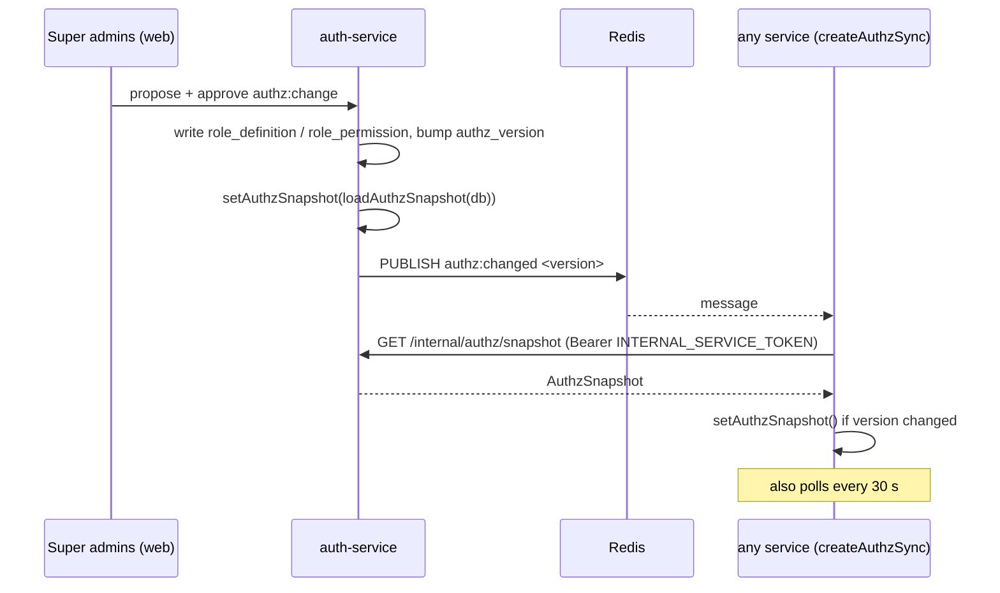

# Roles and permissions

The catalogues in `libs/shared-authz`. The tables below were generated from the source ([`src/roles.ts`](../src/roles.ts), [`src/permissions.ts`](../src/permissions.ts), [`src/matrix.ts`](../src/matrix.ts), [`src/registry.ts`](../src/registry.ts)); if they disagree with the code, the code wins.

What is described here is the **built-in default**. At runtime the matrix in force is the live registry, which auth-service may have changed through approved `authz:change` requests, and which may contain custom roles. See [Live registry](#live-registry).

Contents:

1. [Vocabulary](#vocabulary)
2. [Role catalogue](#role-catalogue)
3. [Permission catalogue](#permission-catalogue)
4. [Permissions by role](#permissions-by-role)
5. [Approval permissions](#approval-permissions)
6. [Permission groups](#permission-groups)
7. [Live registry](#live-registry)
8. [Invariants checked by the tests](#invariants-checked-by-the-tests)

---

## Vocabulary

| Term | Type | Values | Source |
|---|---|---|---|
| Audience | `Audience` | `"ride-app"` (riders, drivers, partners: phone app and partner portals) · `"ride-admin"` (staff dashboard) | `roles.ts` |
| Scope type (on an assignment) | `ScopeType` | `"SELF"` · `"ORG"` · `"CITY"` · `"GLOBAL"` | `roles.ts` |
| Scope letter (on a grant) | `ScopeLetter` | `"S"` own data · `"O"` own organisation · `"C"` assigned city · `"G"` everywhere | `matrix.ts` |
| Organisation kind | `OrgKind` | `"FLEET"` · `"CORPORATE"` · `"STAFF_CITY"` · `"STAFF_HQ"` | `roles.ts` |
| Storage | `RoleStorage` | `{ type: "user" }`: kept on Better Auth's `user.role` · `{ type: "member", orgKinds }`: kept on `member.role` inside an organisation of one of those kinds | `registry.ts` |
| Stored name | `string` | the lower-case name written to `user.role` / `member.role` | `roles.ts` |

A **grant** is `(role, permission) → scope letter`. An **assignment** is `(role, scope type, orgId?, cityId?)`, carried in the token. `authorize()` needs a grant **and** an assignment whose scope covers the resource (see [reference.md → authorize](reference.md#authorize)).

How scope letters relate to scope types (from `covers()` in [`src/authorize.ts`](../src/authorize.ts)):

| Grant letter | Covers the resource when |
|---|---|
| `S` | `resource.ownerUserIds` contains `principal.userId` (the assignment's scope type is not checked) |
| `O` | the assignment is `ORG` and `assignment.orgId === resource.orgId` (both non-empty) |
| `C` | the assignment is `GLOBAL` (covers every city), or the assignment is `CITY` and `assignment.cityId === resource.cityId` (both non-empty) |
| `G` | always |

---

## Role catalogue

20 built-in roles (`ROLE_CODES`, in declaration order). Label from `ROLE_LABELS`. "Scope letters granted" and "# permissions" are from the built-in `MATRIX`.

| Code | Label | Audience | Storage | Stored name | Scope letters granted | # permissions |
|---|---|---|---|---|---|---|
| `RIDER` | Rider | `ride-app` | user | `rider` | S | 8 |
| `DRIVER` | Driver | `ride-app` | user | `driver` | S | 13 |
| `FLEET_OWNER` | Fleet owner | `ride-app` | member (FLEET) | `fleet_owner` | O | 16 |
| `FLEET_DRIVER` | Fleet driver | `ride-app` | member (FLEET) | `fleet_driver` | none | 0 |
| `CORPORATE_ADMIN` | Company account admin | `ride-app` | member (CORPORATE) | `corporate_admin` | O | 13 |
| `CORPORATE_COORDINATOR` | Company travel desk | `ride-app` | member (CORPORATE) | `corporate_coordinator` | O | 7 |
| `CORPORATE_EMPLOYEE` | Company employee | `ride-app` | member (CORPORATE) | `employee` | O | 1 |
| `CALL_CENTER_AGENT` | Call center agent | `ride-admin` | member (STAFF_CITY) | `call_center_agent` | C | 10 |
| `DISPATCHER` | Dispatcher | `ride-admin` | member (STAFF_CITY) | `dispatcher` | C | 11 |
| `SUPPORT_AGENT` | Support agent | `ride-admin` | member (STAFF_CITY) | `support_agent` | C | 12 |
| `ONBOARDING_OFFICER` | Onboarding officer | `ride-admin` | member (STAFF_CITY) | `onboarding_officer` | C | 18 |
| `SAFETY_OFFICER` | Safety officer | `ride-admin` | member (STAFF_CITY) | `safety_officer` | C | 19 |
| `OPERATIONS_MANAGER` | Operations manager | `ride-admin` | member (STAFF_CITY) | `operations_manager` | C | 10 |
| `MARKETING` | Marketing | `ride-admin` | member (STAFF_CITY) | `marketing` | C | 4 |
| `ANALYST` | Analyst | `ride-admin` | member (STAFF_CITY) | `analyst` | C | 3 |
| `FINANCE_OFFICER` | Finance officer | `ride-admin` | user | `finance_officer` | G | 17 |
| `FINANCE_MANAGER` | Finance manager | `ride-admin` | user | `finance_manager` | G | 18 |
| `SUPER_ADMIN` | Super admin | `ride-admin` | user | `super_admin` | G | 16 |
| `AUDITOR` | Auditor | `ride-admin` | user | `auditor` | G | 7 |
| `REGULATOR` | Regulator | `ride-admin` | user | `regulator` | G | 1 |

Groupings exported from `roles.ts`:

| Constant / function | Value (built-in) |
|---|---|
| `USER_ROLE_CODES` (storage `user`) | `RIDER`, `DRIVER`, `FINANCE_OFFICER`, `FINANCE_MANAGER`, `SUPER_ADMIN`, `AUDITOR`, `REGULATOR` |
| `GRANTABLE_STAFF_ROLES` (audience `ride-admin`) | `CALL_CENTER_AGENT`, `DISPATCHER`, `SUPPORT_AGENT`, `ONBOARDING_OFFICER`, `SAFETY_OFFICER`, `OPERATIONS_MANAGER`, `MARKETING`, `ANALYST`, `FINANCE_OFFICER`, `FINANCE_MANAGER`, `SUPER_ADMIN`, `AUDITOR`, `REGULATOR` |
| `rolesForOrgKind("FLEET")` | `FLEET_OWNER`, `FLEET_DRIVER` |
| `rolesForOrgKind("CORPORATE")` | `CORPORATE_ADMIN`, `CORPORATE_COORDINATOR`, `CORPORATE_EMPLOYEE` |
| `rolesForOrgKind("STAFF_CITY")` | `CALL_CENTER_AGENT`, `DISPATCHER`, `SUPPORT_AGENT`, `ONBOARDING_OFFICER`, `SAFETY_OFFICER`, `OPERATIONS_MANAGER`, `MARKETING`, `ANALYST` |
| `rolesForOrgKind("STAFF_HQ")` | empty: no built-in role lists `STAFF_HQ` in its `orgKinds` |

Notes:

- **Attribute roles.** `FLEET_DRIVER` grants nothing. `CORPORATE_EMPLOYEE` grants only `trip:bill_corporate` (O). They exist so a token can say "member of this fleet / company" without a database lookup (comment in `matrix.ts`, Role.md §4).
- **City roles held globally.** The eight `STAFF_CITY` roles have `C` grants. A `GLOBAL` assignment of one of them (token claim `{ r: "ANALYST", g: true }`) covers every city: see `covers()` and the test "a global analyst reads reports in every city" in [`tests/authorize.test.ts`](../tests/authorize.test.ts). The lib parses such claims; how auth-service stores a global assignment of a member-stored role is outside this lib.
- **`SERVICE`** (Role.md §4 C) is not a role code in the lib.

---

## Permission catalogue

95 permissions (`PERMISSIONS`, in declaration order). "Group" is `permissionGroup(p)`. "Needs approval" means the permission is in `APPROVAL_PERMISSIONS`. "Roles" lists every built-in role that holds it, with the scope letter.

| Permission | Group | Needs approval | Roles (scope letter) |
|---|---|---|---|
| `trip:create` | Trips |  | RIDER (S), CORPORATE_ADMIN (O), CORPORATE_COORDINATOR (O) |
| `trip:create_on_behalf` | Trips |  | CORPORATE_ADMIN (O), CORPORATE_COORDINATOR (O), CALL_CENTER_AGENT (C) |
| `trip:read` | Trips |  | RIDER (S), DRIVER (S), FLEET_OWNER (O), CORPORATE_ADMIN (O), CORPORATE_COORDINATOR (O), CALL_CENTER_AGENT (C), DISPATCHER (C), SUPPORT_AGENT (C), SAFETY_OFFICER (C), OPERATIONS_MANAGER (C), ANALYST (C), FINANCE_OFFICER (G), FINANCE_MANAGER (G) |
| `trip:cancel` | Trips |  | RIDER (S), DRIVER (S), CORPORATE_ADMIN (O), CORPORATE_COORDINATOR (O), CALL_CENTER_AGENT (C), DISPATCHER (C), SUPPORT_AGENT (C), SAFETY_OFFICER (C) |
| `trip:accept` | Trips |  | DRIVER (S) |
| `trip:update_status` | Trips |  | DRIVER (S) |
| `trip:assign` | Trips |  | DISPATCHER (C) |
| `trip:reassign` | Trips |  | DISPATCHER (C) |
| `trip:read_gps_trace` | Trips |  | DISPATCHER (C), SAFETY_OFFICER (C) |
| `trip:bill_corporate` | Trips |  | CORPORATE_ADMIN (O), CORPORATE_COORDINATOR (O), CORPORATE_EMPLOYEE (O) |
| `location:stream` | Live location |  | DRIVER (S) |
| `location:read_live` | Live location |  | RIDER (S), FLEET_OWNER (O), DISPATCHER (C), SAFETY_OFFICER (C) |
| `user:read_masked` | Users |  | CALL_CENTER_AGENT (C), DISPATCHER (C), SUPPORT_AGENT (C), ONBOARDING_OFFICER (C), SAFETY_OFFICER (C), OPERATIONS_MANAGER (C), MARKETING (C), ANALYST (C), FINANCE_OFFICER (G), FINANCE_MANAGER (G), SUPER_ADMIN (G) |
| `user:read_pii` | Users |  | SUPPORT_AGENT (C), ONBOARDING_OFFICER (C), SAFETY_OFFICER (C), FINANCE_OFFICER (G), FINANCE_MANAGER (G) |
| `user:create_guest` | Users |  | CALL_CENTER_AGENT (C) |
| `user:suspend` | Users |  | SAFETY_OFFICER (C) |
| `user:reinstate` | Users |  | SAFETY_OFFICER (C) |
| `driver:apply` | Drivers and vehicles |  | RIDER (S) |
| `driver:read` | Drivers and vehicles |  | FLEET_OWNER (O), ONBOARDING_OFFICER (C), SAFETY_OFFICER (C) |
| `driver:verify` | Drivers and vehicles |  | ONBOARDING_OFFICER (C) |
| `driver:activate` | Drivers and vehicles |  | ONBOARDING_OFFICER (C) |
| `driver:suspend` | Drivers and vehicles |  | ONBOARDING_OFFICER (C), SAFETY_OFFICER (C) |
| `driver:reinstate` | Drivers and vehicles |  | ONBOARDING_OFFICER (C), SAFETY_OFFICER (C) |
| `vehicle:register` | Drivers and vehicles |  | DRIVER (S), FLEET_OWNER (O) |
| `vehicle:read` | Drivers and vehicles |  | FLEET_OWNER (O), ONBOARDING_OFFICER (C), SAFETY_OFFICER (C) |
| `vehicle:verify` | Drivers and vehicles |  | ONBOARDING_OFFICER (C) |
| `vehicle:authorize_driver` | Drivers and vehicles |  | FLEET_OWNER (O) |
| `vehicle:retire` | Drivers and vehicles |  | DRIVER (S), FLEET_OWNER (O) |
| `vehicle:transfer` | Drivers and vehicles |  | ONBOARDING_OFFICER (C) |
| `document:upload` | Drivers and vehicles |  | DRIVER (S), FLEET_OWNER (O), CORPORATE_ADMIN (O) |
| `document:read` | Drivers and vehicles |  | ONBOARDING_OFFICER (C) |
| `document:review` | Drivers and vehicles |  | ONBOARDING_OFFICER (C) |
| `org:create` | Organisations |  | **none** |
| `org:read` | Organisations |  | ONBOARDING_OFFICER (C) |
| `org:update` | Organisations |  | FLEET_OWNER (O), CORPORATE_ADMIN (O) |
| `org:verify` | Organisations |  | ONBOARDING_OFFICER (C) |
| `org:manage_members` | Organisations |  | FLEET_OWNER (O), CORPORATE_ADMIN (O) |
| `org:suspend` | Organisations |  | SAFETY_OFFICER (C), FINANCE_OFFICER (G) |
| `corporate:manage_policies` | Organisations |  | CORPORATE_ADMIN (O) |
| `corporate:read_invoices` | Organisations |  | CORPORATE_ADMIN (O) |
| `earnings:read` | Money |  | DRIVER (S), FLEET_OWNER (O) |
| `payment:read` | Money |  | RIDER (S), FLEET_OWNER (O), CORPORATE_ADMIN (O) |
| `refund:request` | Money |  | CALL_CENTER_AGENT (C), SUPPORT_AGENT (C), SAFETY_OFFICER (C), FINANCE_OFFICER (G) |
| `refund:approve` | Money | yes | FINANCE_MANAGER (G) |
| `payout:prepare` | Money |  | FINANCE_OFFICER (G) |
| `payout:approve` | Money | yes | FINANCE_MANAGER (G) |
| `commission:read` | Money |  | FINANCE_OFFICER (G), FINANCE_MANAGER (G) |
| `commission:collect` | Money |  | FINANCE_OFFICER (G), FINANCE_MANAGER (G) |
| `invoice:issue` | Money |  | FINANCE_OFFICER (G) |
| `balance:read` | Money |  | DRIVER (S), FLEET_OWNER (O), SUPPORT_AGENT (C), FINANCE_OFFICER (G), FINANCE_MANAGER (G) |
| `topup:create` | Money |  | DRIVER (S), FLEET_OWNER (O) |
| `topup:record_cash` | Money |  | FINANCE_OFFICER (G) |
| `topup:approve_cash` | Money | yes | FINANCE_MANAGER (G) |
| `adjustment:request` | Money |  | SUPPORT_AGENT (C), FINANCE_OFFICER (G) |
| `adjustment:approve` | Money | yes | FINANCE_MANAGER (G) |
| `writeoff:request` | Money |  | FINANCE_OFFICER (G) |
| `writeoff:approve` | Money | yes | FINANCE_MANAGER (G) |
| `commission_rule:propose` | Money |  | OPERATIONS_MANAGER (C) |
| `commission_rule:approve` | Money | yes | FINANCE_MANAGER (G) |
| `balance_policy:propose` | Money |  | OPERATIONS_MANAGER (C) |
| `balance_policy:approve` | Money | yes | FINANCE_MANAGER (G) |
| `policy_override:request` | Money |  | ONBOARDING_OFFICER (C) |
| `policy_override:approve` | Money | yes | FINANCE_MANAGER (G) |
| `zone:manage` | Pricing and operations |  | OPERATIONS_MANAGER (C) |
| `vehicle_type:manage` | Pricing and operations |  | OPERATIONS_MANAGER (C) |
| `pricing:propose` | Pricing and operations |  | OPERATIONS_MANAGER (C) |
| `pricing:approve` | Pricing and operations | yes | OPERATIONS_MANAGER (C), FINANCE_MANAGER (G) |
| `incentive:propose` | Pricing and operations |  | OPERATIONS_MANAGER (C) |
| `incentive:approve` | Pricing and operations | yes | FINANCE_MANAGER (G) |
| `promo:manage` | Marketing |  | MARKETING (C) |
| `campaign:send` | Marketing |  | MARKETING (C) |
| `ticket:create` | Support and safety |  | RIDER (S), DRIVER (S), FLEET_OWNER (O), CORPORATE_ADMIN (O), CORPORATE_COORDINATOR (O), CALL_CENTER_AGENT (C), SUPPORT_AGENT (C) |
| `ticket:read` | Support and safety |  | CALL_CENTER_AGENT (C), DISPATCHER (C), SUPPORT_AGENT (C), ONBOARDING_OFFICER (C), SAFETY_OFFICER (C), FINANCE_OFFICER (G) |
| `ticket:update` | Support and safety |  | CALL_CENTER_AGENT (C), DISPATCHER (C), SUPPORT_AGENT (C), ONBOARDING_OFFICER (C), SAFETY_OFFICER (C), FINANCE_OFFICER (G) |
| `lost_item:manage` | Support and safety |  | CALL_CENTER_AGENT (C), SUPPORT_AGENT (C) |
| `sos:trigger` | Support and safety |  | RIDER (S), DRIVER (S), FLEET_OWNER (O), CORPORATE_ADMIN (O), CORPORATE_COORDINATOR (O) |
| `sos:respond` | Support and safety |  | DISPATCHER (C), SAFETY_OFFICER (C) |
| `incident:manage` | Support and safety |  | SAFETY_OFFICER (C) |
| `staff:manage` | Administration |  | SUPER_ADMIN (G) |
| `role:request` | Administration |  | SUPER_ADMIN (G) |
| `role:approve` | Administration | yes | SUPER_ADMIN (G) |
| `audit_log:read` | Administration |  | SUPER_ADMIN (G), AUDITOR (G) |
| `report:read` | Administration |  | DISPATCHER (C), SUPPORT_AGENT (C), ONBOARDING_OFFICER (C), SAFETY_OFFICER (C), OPERATIONS_MANAGER (C), MARKETING (C), ANALYST (C), FINANCE_OFFICER (G), FINANCE_MANAGER (G), SUPER_ADMIN (G), AUDITOR (G) |
| `report:read_finance` | Administration |  | FINANCE_OFFICER (G), FINANCE_MANAGER (G), AUDITOR (G) |
| `report:read_regulatory` | Administration |  | AUDITOR (G), REGULATOR (G) |
| `authz:read` | Administration |  | SUPER_ADMIN (G), AUDITOR (G) |
| `authz:propose` | Administration |  | SUPER_ADMIN (G) |
| `authz:approve` | Administration | yes | SUPER_ADMIN (G) |
| `settings:read` | Administration |  | SUPER_ADMIN (G), AUDITOR (G) |
| `settings:propose` | Administration |  | SUPER_ADMIN (G) |
| `settings:approve` | Administration | yes | SUPER_ADMIN (G) |
| `city:manage` | Administration |  | SUPER_ADMIN (G) |
| `announcement:manage` | Administration |  | SUPER_ADMIN (G) |
| `system:read` | Administration |  | SUPER_ADMIN (G), AUDITOR (G) |
| `session:revoke` | Users |  | SUPER_ADMIN (G) |

Permissions held by **no** built-in role: `org:create`.

---

## Permissions by role

| Role | Scope | Permissions |
|---|---|---|
| `RIDER` | S | `trip:create`, `trip:read`, `trip:cancel`, `location:read_live`, `driver:apply`, `payment:read`, `ticket:create`, `sos:trigger` |
| `DRIVER` | S | `trip:read`, `trip:cancel`, `trip:accept`, `trip:update_status`, `location:stream`, `vehicle:register`, `vehicle:retire`, `document:upload`, `earnings:read`, `balance:read`, `topup:create`, `ticket:create`, `sos:trigger` |
| `FLEET_OWNER` | O | `trip:read`, `location:read_live`, `vehicle:register`, `vehicle:read`, `vehicle:authorize_driver`, `vehicle:retire`, `driver:read`, `document:upload`, `org:update`, `org:manage_members`, `earnings:read`, `payment:read`, `balance:read`, `topup:create`, `ticket:create`, `sos:trigger` |
| `FLEET_DRIVER` | — | none (attribute role) |
| `CORPORATE_ADMIN` | O | `trip:create`, `trip:create_on_behalf`, `trip:read`, `trip:cancel`, `trip:bill_corporate`, `document:upload`, `org:update`, `org:manage_members`, `corporate:manage_policies`, `corporate:read_invoices`, `payment:read`, `ticket:create`, `sos:trigger` |
| `CORPORATE_COORDINATOR` | O | `trip:create`, `trip:create_on_behalf`, `trip:read`, `trip:cancel`, `trip:bill_corporate`, `ticket:create`, `sos:trigger` |
| `CORPORATE_EMPLOYEE` | O | `trip:bill_corporate` |
| `CALL_CENTER_AGENT` | C | `trip:read`, `trip:create_on_behalf`, `trip:cancel`, `user:create_guest`, `user:read_masked`, `refund:request`, `ticket:create`, `ticket:read`, `ticket:update`, `lost_item:manage` |
| `DISPATCHER` | C | `trip:read`, `trip:cancel`, `trip:assign`, `trip:reassign`, `trip:read_gps_trace`, `location:read_live`, `user:read_masked`, `ticket:read`, `ticket:update`, `sos:respond`, `report:read` |
| `SUPPORT_AGENT` | C | `trip:read`, `trip:cancel`, `user:read_masked`, `user:read_pii`, `refund:request`, `adjustment:request`, `balance:read`, `ticket:create`, `ticket:read`, `ticket:update`, `lost_item:manage`, `report:read` |
| `ONBOARDING_OFFICER` | C | `user:read_masked`, `user:read_pii`, `driver:read`, `driver:verify`, `driver:activate`, `driver:suspend`, `driver:reinstate`, `vehicle:read`, `vehicle:verify`, `vehicle:transfer`, `document:read`, `document:review`, `org:read`, `org:verify`, `policy_override:request`, `ticket:read`, `ticket:update`, `report:read` |
| `SAFETY_OFFICER` | C | `trip:read`, `trip:cancel`, `trip:read_gps_trace`, `location:read_live`, `user:read_masked`, `user:read_pii`, `user:suspend`, `user:reinstate`, `driver:read`, `driver:suspend`, `driver:reinstate`, `vehicle:read`, `org:suspend`, `refund:request`, `ticket:read`, `ticket:update`, `sos:respond`, `incident:manage`, `report:read` |
| `OPERATIONS_MANAGER` | C | `trip:read`, `user:read_masked`, `zone:manage`, `vehicle_type:manage`, `pricing:propose`, `pricing:approve`, `incentive:propose`, `commission_rule:propose`, `balance_policy:propose`, `report:read` |
| `MARKETING` | C | `user:read_masked`, `promo:manage`, `campaign:send`, `report:read` |
| `ANALYST` | C | `trip:read`, `user:read_masked`, `report:read` |
| `FINANCE_OFFICER` | G | `trip:read`, `user:read_masked`, `user:read_pii`, `org:suspend`, `refund:request`, `payout:prepare`, `commission:read`, `commission:collect`, `invoice:issue`, `balance:read`, `topup:record_cash`, `adjustment:request`, `writeoff:request`, `ticket:read`, `ticket:update`, `report:read`, `report:read_finance` |
| `FINANCE_MANAGER` | G | `trip:read`, `user:read_masked`, `user:read_pii`, `refund:approve`, `payout:approve`, `commission:read`, `commission:collect`, `pricing:approve`, `incentive:approve`, `balance:read`, `topup:approve_cash`, `adjustment:approve`, `writeoff:approve`, `commission_rule:approve`, `balance_policy:approve`, `policy_override:approve`, `report:read`, `report:read_finance` |
| `SUPER_ADMIN` | G | `user:read_masked`, `staff:manage`, `role:request`, `role:approve`, `audit_log:read`, `report:read`, `authz:read`, `authz:propose`, `authz:approve`, `settings:read`, `settings:propose`, `settings:approve`, `city:manage`, `announcement:manage`, `system:read`, `session:revoke` |
| `AUDITOR` | G | `audit_log:read`, `report:read`, `report:read_finance`, `report:read_regulatory`, `authz:read`, `settings:read`, `system:read` |
| `REGULATOR` | G | `report:read_regulatory` |

---

## Approval permissions

`APPROVAL_PERMISSIONS` (`permissions.ts`): "Permissions whose execution must be approved by a different person (Role.md §11)." These are the *checker* halves:

`refund:approve`, `payout:approve`, `pricing:approve`, `incentive:approve`, `role:approve`, `topup:approve_cash`, `adjustment:approve`, `writeoff:approve`, `commission_rule:approve`, `balance_policy:approve`, `policy_override:approve`, `authz:approve`, `settings:approve`.

The lib only lists them. Enforcing maker ≠ checker is the job of the owning service (auth-service for `role:approve` / `authz:approve`, platform-service for `settings:approve`, payment-service for money approvals). The constant itself is not imported outside the lib.

---

## Permission groups

`PERMISSION_GROUPS` drives the admin matrix editor in `apps/web`. `permissionGroup(p)` matches on the part before `:` and returns `"Other"` if no group lists it.

| Group | Prefixes |
|---|---|
| Trips | `trip` |
| Live location | `location` |
| Users | `user`, `session` |
| Drivers and vehicles | `driver`, `vehicle`, `document` |
| Organisations | `org`, `corporate` |
| Money | `earnings`, `payment`, `refund`, `payout`, `commission`, `invoice`, `balance`, `topup`, `adjustment`, `writeoff`, `commission_rule`, `balance_policy`, `policy_override` |
| Pricing and operations | `zone`, `vehicle_type`, `pricing`, `incentive` |
| Marketing | `promo`, `campaign` |
| Support and safety | `ticket`, `lost_item`, `sos`, `incident` |
| Administration | `staff`, `role`, `audit_log`, `report`, `authz`, `settings`, `city`, `announcement`, `system` |

Every permission in `PERMISSIONS` falls in one of these groups.

---

## Live registry

`registry.ts` holds one module-level `AuthzSnapshot`:

```ts
interface AuthzSnapshot {
  version: number;                       // 0 for the built-in snapshot
  roles: RoleInfo[];                     // built-in and custom roles
  matrix: Record<string, Grants>;        // role code → { permission: scope letter }
}
interface RoleInfo {
  code: string; label: string; description?: string;
  audience: Audience; storage: RoleStorage; stored: string;
  builtIn: boolean; archived?: boolean;
}
```



- At import time the registry is `builtInSnapshot()`: version 0, the 20 built-in roles (with `builtIn: true`), a copy of `MATRIX`.
- `setAuthzSnapshot(s)` rebuilds the matrix **only for roles listed in `s.roles`**, dropping any permission not in `PERMISSIONS` and any scope letter not in `S/O/C/G`. A matrix entry for a role missing from `s.roles` is ignored.
- `authorize`, `can`, `citiesWith` and `parseRoleClaims` always read the current snapshot, so a change applies without restart (test "authorize follows a swapped matrix without a restart").
- **Custom roles** (code `CUSTOM_*` by convention, see the RoleDefinition comment in auth-service's Prisma schema) exist only in snapshots. They're parsed from tokens once the registry knows them; archived ones are dropped (test "custom roles are parsed from tokens…").
- Publisher side: `services/auth-service/src/authz/service.ts` (publishes `AUTHZ_CHANNEL` after commit; on publish failure services catch up on their next poll).
- The web app loads the snapshot from `GET /api/identity/authz` and calls `setAuthzSnapshot` (`apps/web/src/lib/session.tsx`), so its menus use the same matrix as the services.

The editing guardrails (staff roles only C/G, partner roles only S/O, super admins keep `staff:manage` etc.) are enforced in auth-service, not here. The tests below check them only for the built-in matrix.

---

## Invariants checked by the tests

From [`tests/authorize.test.ts`](../tests/authorize.test.ts), for the built-in matrix:

- every permission in `MATRIX` is in `PERMISSIONS`;
- `ride-admin` roles never have `S` grants; `ride-app` roles only have `S` or `O`;
- no role holds both halves of `refund:request/approve`, `payout:prepare/approve`, `topup:record_cash/approve_cash`, `writeoff:request/approve`;
- `SUPER_ADMIN` has none of `refund:approve`, `payout:approve`, `user:suspend`, `trip:assign`, `user:read_pii`.
