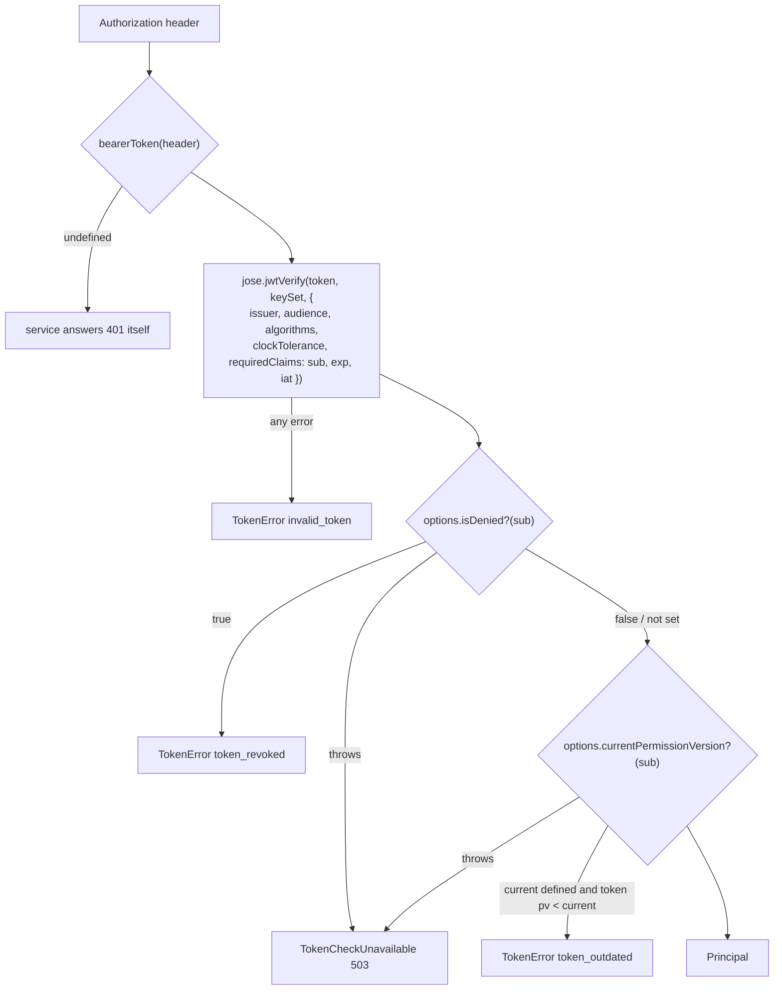

# Tokens: verification, principal, role claims

How a service turns an `Authorization: Bearer …` header into a `Principal`. Source: [`src/verify.ts`](../src/verify.ts), [`src/principal.ts`](../src/principal.ts). Tests: [`tests/verify.test.ts`](../tests/verify.test.ts), the "claims" block of [`tests/authorize.test.ts`](../tests/authorize.test.ts).

Tokens are issued by auth-service (Better Auth `jwt` plugin, see [Auth.md §8](../../../docs/design/Auth.md#8-sessions-and-tokens)). This lib only verifies them.

---

## Verification flow



The order matters: the signature and standard claims are checked first, so the deny-list and permission-version callbacks only run for tokens that are genuine.

## `createTokenVerifier(options)`

```ts
function createTokenVerifier(options: VerifierOptions): (token: string, audience: Audience) => Promise<Principal>;
type VerifyAccessToken = ReturnType<typeof createTokenVerifier>;
```

| Option | Type | Default | Meaning |
|---|---|---|---|
| `issuer` | `string` | required | Expected `iss`. Services pass `AUTH_ISSUER` (default in service configs: `http://localhost:3001`) |
| `jwksUrl` | `string?` | — | JWKS endpoint, e.g. `http://auth-service:3001/api/auth/jwks`. Wrapped in `jose.createRemoteJWKSet(new URL(jwksUrl))` (jose caches keys and refetches on an unknown `kid`) |
| `keySet` | `JWTVerifyGetKey?` | — | Alternative to `jwksUrl`. Takes precedence when both are given. Tests use `createLocalJWKSet` |
| `algorithms` | `string[]?` | `["ES256"]` | Allowed `alg` values. Pinned, so a token signed with another algorithm is rejected (test "rejects an algorithm that isn't pinned") |
| `clockToleranceSeconds` | `number?` | `30` | Passed to jose as `clockTolerance` for `exp`/`iat`/`nbf` |
| `isDenied` | `(userId) => Promise<boolean>` | — | Deny list. Return `true` for a suspended user |
| `currentPermissionVersion` | `(userId) => Promise<number \| undefined>` | — | Latest permission version for the user. `undefined` = unknown, accept the token |

Throws `Error("createTokenVerifier needs jwksUrl or keySet")` at construction if neither is given.

The returned function `verifyAccessToken(token, audience)`:

- verifies with `jose.jwtVerify` against `issuer`, the given `audience`, `algorithms`, the clock tolerance, and requires `sub`, `exp`, `iat`;
- a failure to get the key set (the fetch throws, `JWKSTimeout`, `JWKSInvalid`, or a non-200 from the JWKS endpoint) becomes `TokenCheckUnavailable` (503): it says nothing about the token;
- any other jose failure (bad signature, wrong `iss`/`aud`, expired, missing claim, disallowed alg, malformed token) becomes `TokenError("invalid_token", "invalid or expired access token")`. The original error is discarded;
- `isDenied(sub)` true → `TokenError("token_revoked", "account suspended")`;
- `pv` claim: used if it's a number, else `0`. If `currentPermissionVersion(sub)` returns a number and `pv < current` → `TokenError("token_outdated", "roles changed, refresh the token")`;
- if `isDenied` or `currentPermissionVersion` throws (e.g. Redis down) → `TokenCheckUnavailable` (the original error kept as `cause`). The token is still refused (fail closed), but as a temporary failure, not as a bad token;
- returns the [`Principal`](#principal).

### `TokenError`

```ts
class TokenError extends Error {
  readonly statusCode = 401;
  readonly code: "invalid_token" | "token_revoked" | "token_outdated";
}
```

Services map it to `401 { error: err.code, message: err.message }` (e.g. `services/trip-service/src/middlewares/error-handler.ts`).

### `TokenCheckUnavailable`

```ts
class TokenCheckUnavailable extends Error {
  readonly statusCode = 503;
  readonly code = "auth_unavailable";
  readonly cause: unknown;   // the error the callback threw
  // message: "cannot check the token right now, try again"
}
```

Thrown when the deny-list or permission-version lookup fails. It is not a `TokenError`, so the audience fallback below doesn't retry it. Every service's `src/middlewares/error-handler.ts` maps it to `503` with `retry-after: 5` and `{ error: "auth_unavailable", message }`, and logs warn `token check unavailable (Redis)`. Clients treat it as "try again", not as signed out. Test: "a failed suspension / version lookup refuses the token as temporarily unavailable, not as invalid" in `tests/verify.test.ts`.

### Audiences

The audience is chosen **per call**, not per verifier. One verifier serves both `ride-app` and `ride-admin` routes. A route group that accepts both tries one then the other, only falling back on `invalid_token` (so a revoked or outdated token is not retried with the other audience). From `services/trip-service/src/http/routes.ts`:

```ts
async function principal(req: FastifyRequest): Promise<Principal> {
  const token = bearerToken(req.headers.authorization);
  if (!token) throw unauthorized();
  try {
    return await deps.verifyAccessToken(token, "ride-app");
  } catch (err) {
    if (!(err instanceof TokenError) || err.code !== "invalid_token") throw err;
    return deps.verifyAccessToken(token, "ride-admin");
  }
}
```

### Deny list and permission version

The lib does not know about Redis. Every service in the repo wires the callbacks to two keys written by auth-service (`services/auth-service/src/lib/signals.ts`):

| Key | Meaning | Written when | TTL |
|---|---|---|---|
| `deny:{userId}` | present while the user is suspended (value `"1"`) | suspension (after commit) | `min(until − now, 30 min)` with a 60 s floor; 30 min (`DENY_TTL_SECONDS`) when there is no end date. The comment says it is refreshed while banned |
| `pv:{userId}` | latest permission version (a number as a string) | role grant / revoke (after commit) | 24 h |

Typical wiring (`services/trip-service/src/container.ts`):

```ts
createTokenVerifier({
  issuer: config.AUTH_ISSUER,
  jwksUrl: config.AUTH_JWKS_URL,
  isDenied: async (userId) => (await redis.exists(`deny:${userId}`)) === 1,
  currentPermissionVersion: async (userId) => {
    const v = await redis.get(`pv:${userId}`);
    return v === null ? undefined : Number(v);
  },
});
```

If the callbacks throw (e.g. Redis down), `verifyAccessToken` throws [`TokenCheckUnavailable`](#tokencheckunavailable) (503 `auth_unavailable`), not a `TokenError`; the token is refused. auth-service's own `SecuritySignals.isDenied` / `currentPermissionVersion` catch Redis errors and return a fallback, so they never throw; services that call Redis directly, like trip-service above, get the 503.

## `bearerToken(header)`

```ts
function bearerToken(header: string | undefined): string | undefined;
```

Splits on a single space. Returns the second part when the first is `bearer` (case-insensitive) and the second is non-empty, else `undefined`. `"Bearer  abc"` (two spaces) returns `undefined`; anything after a third space-separated part is ignored.

---

## Principal

```ts
interface Principal {
  userId: string;            // JWT sub
  audience: Audience;        // the audience it was verified for
  roles: RoleAssignment[];   // parseRoleClaims(payload.roles, audience)
  permissionVersion: number; // payload.pv if a number, else 0
  amr: string[];             // payload.amr, strings only; [] if absent
  actor?: string;            // payload.act.sub if act is an object with a string sub (RFC 8693)
}

interface RoleAssignment {
  role: string;              // built-in RoleCode or a custom role code
  scope: ScopeType;          // "SELF" | "ORG" | "CITY" | "GLOBAL"
  orgId?: string;            // set for ORG
  cityId?: string;           // set for CITY
}
```

Other JWT claims (`iat`, `exp`, `setup`, …) are not copied onto the principal. `amr` is exposed so staff routes can require MFA (Role.md §10 says staff routes require `otp`); that check is not in this lib.

`hasRole(principal, role)` is true if any assignment has that role code, whatever its scope.

## Role claims

Tokens carry roles, not permissions, in a compact form (`RoleClaim`):

```ts
interface RoleClaim { r: string; org?: string; city?: string; g?: true }
```

| Claim | Assignment |
|---|---|
| `{ r: "RIDER" }` | `{ role: "RIDER", scope: "SELF" }` |
| `{ r: "FLEET_OWNER", org: "o1" }` | `{ role: "FLEET_OWNER", scope: "ORG", orgId: "o1" }` |
| `{ r: "DISPATCHER", city: "addis-ababa" }` | `{ role: "DISPATCHER", scope: "CITY", cityId: "addis-ababa" }` |
| `{ r: "FINANCE_OFFICER", g: true }` | `{ role: "FINANCE_OFFICER", scope: "GLOBAL" }` |

### `toRoleClaim(assignment)`

Inverse of the table above: `ORG` → `{ r, org }`, `CITY` → `{ r, city }`, `GLOBAL` → `{ r, g: true }`, otherwise `{ r }`. Used by auth-service when it builds the token payload. `parseRoleClaims(roles.map(toRoleClaim), audience)` round-trips (test "round-trips assignments through the compact claim form").

### `parseRoleClaims(raw, audience)`

```ts
function parseRoleClaims(raw: unknown, audience: Audience): RoleAssignment[];
```

Defensive parsing; nothing in the claim is trusted:

1. not an array → `[]`;
2. each item that is not a non-null object, or has no string `r`, is skipped;
3. the role is looked up in the **current registry** (`roleInfo(r)`): unknown, archived, or belonging to the other audience → skipped. So a staff role smuggled into a `ride-app` token is dropped (test "drops staff roles smuggled into an app-audience token");
4. scope is decided by precedence: non-empty string `org` → `ORG`; else non-empty string `city` → `CITY`; else `g === true` → `GLOBAL`; else `SELF`.

Step 4 does **not** check that the scope fits the role (e.g. `{ r: "RIDER", g: true }` becomes a `GLOBAL` RIDER assignment). It doesn't matter for authorization: a RIDER's grants are all `S`, and `S` is checked against `ownerUserIds`, not the assignment's scope. The general rule: the scope letter of the *grant* decides what the scope type of the *assignment* must be (see [roles-and-permissions.md → Vocabulary](roles-and-permissions.md#vocabulary)).

Example (from the tests):

```ts
parseRoleClaims([{ r: "RIDER" }, { r: "GOD_MODE" }, null, 42, { r: "SUPER_ADMIN", g: true }], "ride-app");
// → [{ role: "RIDER", scope: "SELF" }]
```

### Claims the verifier reads

| JWT claim | Required | Used for |
|---|---|---|
| `iss` | yes (checked against `issuer`) | — |
| `aud` | yes (checked against the call's `audience`) | `principal.audience` |
| `sub` | yes | `principal.userId`, deny list, permission version |
| `exp`, `iat` | yes | expiry (with clock tolerance) |
| `roles` | no (absent → `[]`) | `principal.roles` |
| `pv` | no (absent or non-number → `0`) | `principal.permissionVersion`, `token_outdated` check |
| `amr` | no | `principal.amr` |
| `act.sub` | no | `principal.actor` |
