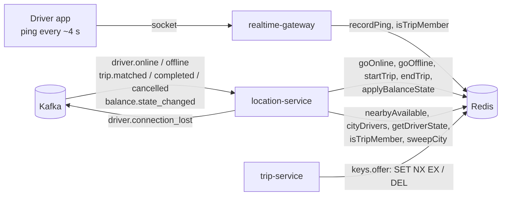

# `@ride-app/shared-location`

The one place that knows how live driver location is kept in Redis, so the writer (realtime-gateway) and the reader (location-service) can't drift apart ([Database.md §10, "Implementation (v1)"](../../../docs/design/Database.md#10-hot-path-live-location-in-redis)). It also holds the geo helpers and the list of served cities.

| File | What it covers |
|---|---|
| [reference.md](reference.md) | Redis key layout, driver state and its state machine, ping validation, every function (`recordPing`, `goOnline`, `nearbyAvailable`, `sweepCity`, …), geo helpers, cities and bounds |

---

## Who calls what

From the header comment of [`src/drivers.ts`](../src/drivers.ts) and the import sites in the repo:



| Package | Files | Symbols |
|---|---|---|
| `services/location-service` | 6 | `goOnline`, `goOffline`, `startTrip`, `endTrip`, `applyBalanceState` (event handlers; `goOnline`/`goOffline` also behind dev-only `POST /internal/dev/drivers/:driverId/online|offline`), `nearbyAvailable`, `cityDrivers`, `getDriverState`, `isTripMember`, `cityAt`, `haversineMeters`, `keys`, `sweepCity`, `assertCity`, `assertVehicleType`, types |
| `services/realtime-gateway` | 2 | `recordPing`, `isTripMember`, `Ping` (+ `getDriverState`, `goOnline`, `startTrip` in tests) |
| `services/trip-service` | 5 | `keys` (as `locationKeys`, for `keys.offer`), `haversineMeters`, `cityAt`, `LatLng` (+ `recordPing`, `goOnline`, `startTrip`, `nearbyAvailable` in the test harness) |
| `services/mapping-service` | 5 | re-exports `CITIES`, `COUNTRY_CODES`, `inBox`, `inServiceArea`, `SERVICE_AREA`, `BBox` from `src/regions.ts`; `haversineMeters`, `LatLng` |
| `services/pricing-service` | 4 | `cityAt`, `LatLng` |
| `services/fleet-service` | 1 | `CITIES` |
| `services/platform-service` | 1 | `CITIES` |
| `apps/web` | 6 | `CITIES`, `haversineMeters`, `LatLng` |

## What belongs here and what doesn't

Belongs here:

- every Redis key name used for live location and the read/write sequences on them;
- the rules that decide whether a ping is accepted and which geo set a driver is in;
- pure geo helpers and static geography (cities, service area).

Does not belong here:

- Kafka. The functions are called *from* event handlers; consuming and producing is in location-service (`src/events/`) and realtime-gateway (`src/kafka.ts`);
- ETA. `etaToPickup` and nearby-car ETAs live in location-service (`src/locations.ts`), on top of `nearbyAvailable` and mapping-service; not in this lib;
- the offer lock logic. The key `offer:driver:{id}` is named here, but trip-service's matcher writes it (`SET … EX offerSeconds NX` in `src/matching/matcher.ts`);
- the sweeper loop and its lock. location-service's `src/sweeper.ts` runs every interval, takes `keys.sweepLock(city)` with `SET NX PX` and calls `sweepCity`.

## Build and import

[`package.json`](../package.json):

```json
"exports": { ".": { "development": "./src/index.ts", "types": "./dist/index.d.ts", "default": "./dist/index.js" } },
"peerDependencies": { "ioredis": "^6.0.0" },
"devDependencies": { "ioredis": "^6.0.0", "vitest": "^5.0.5" }
```

- `ioredis` is a **peer** dependency: functions take your `Redis` client; the lib only imports the `Redis` type.
- `development` condition → `src/index.ts` (used by `tsx --conditions=development` in `pnpm dev`, service typechecks and `apps/web`); otherwise `dist/`. Build with `pnpm build` (`tsc -p tsconfig.json`).
- Scripts: `build`, `test` (`vitest run`, [`tests/geo.test.ts`](../tests/geo.test.ts): haversine, `checkPing`, key hash tags), `lint`, `typecheck`.
- The Redis functions have no unit tests here; they're covered by integration tests in `services/location-service/tests/integration/location.test.ts` and `services/realtime-gateway/tests/integration/location.test.ts` (need a real Redis).
- `apps/web` imports it too, for `CITIES` and `haversineMeters`. Importing the package root also pulls `drivers.ts`, which has a type-only `ioredis` import.

```ts
import { recordPing, keys, haversineMeters, type LatLng } from "@ride-app/shared-location";
```

## Source map

| File | Exports |
|---|---|
| [`src/keys.ts`](../src/keys.ts) | `assertCity`, `assertVehicleType`, `GeoSet`, `keys` |
| [`src/geo.ts`](../src/geo.ts) | `LatLng`, `haversineMeters`, `isValidLatLng`, `Ping`, `PingRejection`, `PING_LIMITS`, `checkPing` |
| [`src/drivers.ts`](../src/drivers.ts) | `DriverStatus`, `DriverState`, `LOCATION_TIMING`, `getDriverState`, `PingResult`, `recordPing`, `OnlineInput`, `goOnline`, `applyBalanceState`, `goOffline`, `startTrip`, `endTrip`, `isTripMember`, `NearbyDriver`, `nearbyAvailable`, `cityDrivers`, `sweepCity` |
| [`src/cities.ts`](../src/cities.ts) | `BBox`, `SERVICE_AREA`, `COUNTRY_CODES`, `CITIES`, `inBox`, `inServiceArea`, `cityAt` |
