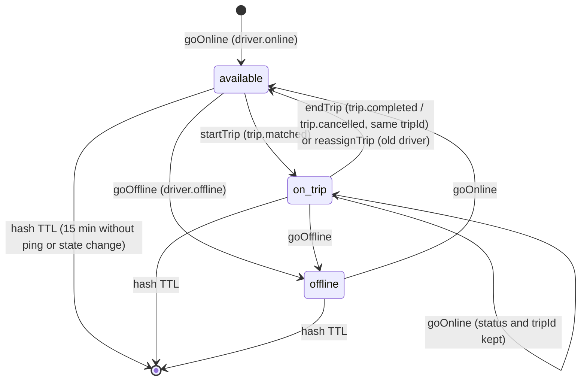

# API reference: `@ride-app/shared-location`

Contents: [Redis key layout](#redis-key-layout) · [Driver state](#driver-state) · [State machine](#state-machine) · [Timing constants](#timing-constants) · [Ping validation](#ping-validation) · [Writes](#writes) · [Reads](#reads) · [Staleness sweep](#staleness-sweep) · [Geo helpers](#geo-helpers) · [Cities and bounds](#cities-and-bounds)

All functions that touch Redis take an ioredis `Redis` client as their first argument and return promises. None of them catch Redis errors: they propagate to the caller.

---

## Redis key layout

From [`src/keys.ts`](../src/keys.ts). City keys use a hash tag (`{city}`) so all of one city's sets land in the same cluster slot.

| `keys.` function | Key | Type | Contents | Written by | Expiry / cleanup |
|---|---|---|---|---|---|
| `geo(cityId, vehicleType, "available")` | `geo:{city}:{vehicleType}:available` | GEO (sorted set) | online drivers that are free | `recordPing` (status `available`), `endTrip` | `ZREM` on trip start, offline, stale sweep |
| `geo(cityId, vehicleType, "busy")` | `geo:{city}:{vehicleType}:busy` | GEO | online drivers on a trip | `recordPing` (status `on_trip`), `startTrip` | `ZREM` on trip end, offline, stale sweep |
| `seen(cityId)` | `seen:{city}` | sorted set, score = **server** time of the last accepted ping (unix ms) | every online driver with a ping | `recordPing` | `ZREM` on offline, city/vehicle-type switch, and by the sweeper when *lost* |
| `vehicleTypes(cityId)` | `vtypes:{city}` | set | vehicle types that have had drivers in the city | `goOnline` | never removed |
| `cities()` | `location:cities` | set | cities with online drivers (the sweeper iterates these) | `goOnline` | never removed |
| `driver(driverId)` | `driver:{driverId}` | hash | the driver's live state ([fields](#driver-state)) | `goOnline`, `recordPing`, `goOffline`, `startTrip`, `endTrip`, `applyBalanceState`, sweeper | `EXPIRE 900` (15 min) on `goOnline`, `recordPing`, `goOffline` |
| `offer(driverId)` | `offer:driver:{driverId}` | string (trip id) | soft lock: trip currently offered to the driver | **trip-service** matcher (`SET … EX offerSeconds NX`) | trip-service `DEL`; `startTrip` `DEL`s it |
| `tripLast(tripId)` | `trip:{tripId}:last` | hash `{ driverId, lat, lng, at, stale, heading? }` | last driver position for the rider screen | `recordPing` while on trip | `EXPIRE 3600` per ping; `300` s after `endTrip` |
| `tripMembers(tripId)` | `trip:{tripId}:members` | set | rider, driver and booker (who may watch the trip live) | `startTrip`, `reassignTrip` (old driver removed, new one added) | `EXPIRE 43200` (12 h); `300` s after `endTrip` |
| `tripBillingOrg(tripId)` | `trip:{tripId}:billing_org` | string | the company a trip is billed to (its `trip:read` holders may watch the car) | `startTrip` (only with `billingOrgId`) | `EX 43200` (12 h); `300` s after `endTrip` |
| `balance(beneficiaryId)` | `balance:{beneficiaryId}` | hash `{ state, cashAllowed: "1"/"0", at }` | last balance state payment-service published | `applyBalanceState` | `EXPIRE 2592000` (30 days) |
| `beneficiaryDrivers(beneficiaryId)` | `beneficiary:{beneficiaryId}:drivers` | set | online drivers earning for a beneficiary | `goOnline` | `EXPIRE 86400`; `SREM` on offline or beneficiary change |
| `sweepLock(cityId)` | `lock:sweep:{city}` | string | one sweeper per city | location-service `sweeper.ts` (`SET NX PX`) | `PX max(1000, interval − 500)` |

### Id validation

| Function | Rule | On failure |
|---|---|---|
| `assertCity(cityId)` | `/^[a-z0-9-]{1,40}$/` | throws `Error("invalid city id: …")` |
| `assertVehicleType(vehicleType)` | `/^[a-z0-9_]{1,30}$/` | throws `Error("invalid vehicle type: …")` |

`keys.geo`, `seen`, `vehicleTypes` and `sweepLock` call these, so a bad id throws **synchronously** while building the key (this blocks key injection such as `eco}nomy`). Driver, trip and beneficiary ids are **not** validated here; location-service's zod schemas require UUIDs before calling in.

`GeoSet = "available" | "busy"`.

---

## Driver state

```ts
type DriverStatus = "available" | "on_trip" | "offline";

interface DriverState {
  driverId: string;
  status: DriverStatus;
  cityId: string;
  vehicleType: string;
  vehicleId: string;
  fleetOrgId?: string;      // fleet that owns the vehicle (location:read_live @ ORG)
  beneficiaryId?: string;   // who earns the trips (Payment.md D1)
  tripId?: string;
  cashAllowed: boolean;
  balanceState?: string;
  lat?: number;
  lng?: number;
  heading?: number;
  at?: number;              // last accepted ping, device time, unix ms
  receivedAt?: number;      // when the server received it (hash field `rt`), unix ms: freshness for arrival/start/no-show/completion
  stale: boolean;           // removed from the geo index by the sweeper until pings resume
}
```

Stored as a Redis hash of strings. Parsing rules (`parseState`, internal):

- missing `status`, `cityId` or `vehicleType` → `null` (treated as "no state");
- empty strings for `fleetOrgId`, `beneficiaryId`, `tripId`, `balanceState` → `undefined`;
- `cashAllowed` and `stale` are `"1"` / `"0"`;
- numbers are parsed with `Number()`; empty or missing → `undefined`;
- `vehicleId` missing → `""`.

### `getDriverState(redis, driverId): Promise<DriverState | null>`

`HGETALL driver:{id}` → `parseState`.

---

## State machine



Orthogonal to `status`:

| Flag / membership | Set by | Cleared by |
|---|---|---|
| in a geo set | first accepted ping after going online (`recordPing`); moved between sets by `startTrip` / `endTrip` | `goOffline`, `sweepCity` (stale), `startTrip` / `endTrip` move it |
| `stale = "1"` | `sweepCity` (no ping for 20 s) | next accepted ping; `goOnline` |
| in `seen:{city}` | `recordPing` | `goOffline`; `sweepCity` once *lost* (stale 10 min, not on a trip) |

Notes:

- Going online does **not** put the driver in a geo set. They become visible to matching with their first accepted ping (`recordPing` picks the set from the status).
- `goOnline` deletes and rewrites the hash, so position fields are cleared; the first ping after going online is never speed-checked.
- `startTrip` on a missing or `offline` state only records trip members and deletes the offer lock; the status isn't changed.
- `endTrip` changes the status only if the driver is `on_trip` **with the same `tripId`**; a late event for an older trip does nothing.
- A *lost* driver is removed from `seen` but its hash is left to expire. fleet-service is told through `driver.connection_lost` and ends the session, which produces `driver.offline`.
- `startTrip`, `endTrip`, `applyBalanceState` and the sweeper's `HSET stale` don't refresh the hash TTL.

---

## Timing constants

### `LOCATION_TIMING`

| Field | Value | Meaning |
|---|---|---|
| `staleAfterMs` | `20_000` | no ping for this long → out of the geo index (workflow 04, step 13) |
| `lostAfterMs` | `600_000` (10 min) | stale this long without a trip → reported as connection lost (step 14) |
| `stateTtlSeconds` | `900` (15 min) | driver hash TTL; longer than `lostAfterMs` so the sweeper still knows city and vehicle type |
| `tripMembersTtlSeconds` | `43_200` (12 h) | `trip:{id}:members`, `trip:{id}:billing_org` |
| `tripLastTtlSeconds` | `3600` | `trip:{id}:last` |

Hard-coded elsewhere in `drivers.ts`: 300 s grace after `endTrip`, 30-day `balance:*` TTL, 1-day `beneficiary:*:drivers` TTL.

---

## Ping validation

From [`src/geo.ts`](../src/geo.ts) (workflow 04, step 9).

```ts
interface LatLng { lat: number; lng: number }
interface Ping extends LatLng {
  heading?: number;
  speed?: number;
  accuracy?: number;   // GPS accuracy radius, metres
  at: number;          // device time, unix ms
}
type PingRejection = "invalid" | "inaccurate" | "future" | "out_of_order" | "too_fast";

const PING_LIMITS = {
  maxAccuracyMeters: 100,
  maxSpeedMps: 200 / 3.6,   // 200 km/h between two pings
  maxClockSkewMs: 5_000,
  maxDeviceLeadMs: 60_000,  // the phone may claim at most this much more time passed than the server saw
};
```

### `checkPing(ping, previous, now): PingRejection | undefined`

`previous` is the last accepted ping (`{ lat, lng, at, receivedAt? }`) or `undefined`. For `too_fast` the interval is the phone's (`ping.at − previous.at`) but never more than the server-seen interval (`now − previous.receivedAt`) + `maxDeviceLeadMs`, so a phone clock set back can't hide a teleport. Matching (`nearbyAvailable`) still judges freshness by `at`. Checks in order, first failure wins:

| # | Rejection | Condition |
|---|---|---|
| 1 | `invalid` | `!isValidLatLng(ping)` or `ping.at` not finite |
| 2 | `inaccurate` | `ping.accuracy !== undefined && ping.accuracy > 100` |
| 3 | `future` | `ping.at > now + 5000` |
| 4 | `out_of_order` | `previous` and `ping.at <= previous.at` |
| 5 | `too_fast` | `previous` and `haversineMeters(previous, ping) / ((ping.at − previous.at) / 1000) > 200 km/h` |

Returns `undefined` when the ping is accepted. `speed` and `heading` aren't checked. Example from `tests/geo.test.ts`: Bole → Piassa (≈ 5.9 km) in 4 s is `too_fast`; in 5 min it's accepted.

### `isValidLatLng(p: { lat: unknown; lng: unknown }): p is LatLng`

Both are finite numbers, `|lat| ≤ 85.05112878` (Redis GEO limit), `|lng| ≤ 180`. Narrows the type.

---

## Writes

### `recordPing(redis, driverId, ping, now = Date.now()): Promise<PingResult>`

Called by realtime-gateway for every `location` socket message (`src/sockets/location.handler.ts`).

```ts
type PingResult =
  | { accepted: true; state: DriverState }
  | { accepted: false; reason: PingRejection | "not_online" };
```

1. `getDriverState`. No state, or `status === "offline"` → `{ accepted: false, reason: "not_online" }`. A ping never brings a driver online.
2. `checkPing(ping, previous, now)` where `previous` is the stored `lat/lng/at` if all three exist. Rejected → `{ accepted: false, reason }`.
3. One **pipeline** (not a transaction): `GEOADD` into the set for the status (`on_trip` → `busy`, else `available`) · `ZREM` from the other set · `ZADD seen:{city} now driverId` · `HSET driver:{id}` `lat, lng, at (= ping.at), stale "0"`, plus `heading` if finite · `EXPIRE driver:{id} 900`. If `on_trip` with a `tripId`, also `HSET trip:{tripId}:last { driverId, …same fields }` and `EXPIRE 3600`.
4. Returns the updated state.

The client can't choose its set: the set comes from the stored status. Database.md §10 explains why this is a read + pipeline rather than a Lua script (keys computed from state would be undeclared keys in Redis Cluster). The read and the pipeline are not atomic.

### `goOnline(redis, input: OnlineInput): Promise<void>`

```ts
interface OnlineInput {
  driverId: string; cityId: string; vehicleType: string; vehicleId: string;
  fleetOrgId?: string; beneficiaryId?: string; cashAllowed: boolean; balanceState?: string;
}
```

Handler for `driver.online` (location-service). Steps:

1. Read previous state.
2. If `beneficiaryId` is set and `balance:{beneficiaryId}` has a `state`, it overrides the event's `balanceState` and `cashAllowed` ("a balance state that payment-service published after fleet-service looked it up wins").
3. One `MULTI`:
   - if the previous state had a different city or vehicle type: `ZREM` from the old `available`, `busy` and `seen` sets;
   - `DEL driver:{id}` then `HSET` `status` (`on_trip` if it was `on_trip`, else `available`), `cityId`, `vehicleType`, `vehicleId`, `fleetOrgId`, `beneficiaryId`, `tripId` (kept only if it was `on_trip`), `cashAllowed`, `balanceState`, `stale "0"`; `EXPIRE 900`;
   - `SADD location:cities city`, `SADD vtypes:{city} vehicleType`;
   - if the beneficiary changed: `SREM` from the old beneficiary's set;
   - if `beneficiaryId`: `SADD beneficiary:{id}:drivers driverId`, `EXPIRE 86400`.

Throws synchronously-in-promise if `cityId` / `vehicleType` fail `assertCity` / `assertVehicleType`.

### `applyBalanceState(redis, { beneficiaryId, state, cashAllowed }): Promise<number>`

Handler for `balance.state_changed`. Writes `balance:{beneficiaryId}` (`state`, `cashAllowed`, `at = Date.now()`, 30-day TTL), then for each member of `beneficiary:{id}:drivers`: if the driver has no state or now earns for someone else, `SREM` it; otherwise `HSET balanceState, cashAllowed`. Returns the number of drivers updated. Sequential commands, not one transaction.

### `goOffline(redis, driverId): Promise<void>`

Handler for `driver.offline`. No state → no-op. Otherwise `ZREM` from `available`, `busy` and `seen` of its city/vehicle type, `SREM` from its beneficiary set, then `HSET status "offline", tripId ""` and `EXPIRE 900`. Pings are ignored (`not_online`) until the next `goOnline`.

### `startTrip(redis, { tripId, driverId, riderId, bookedById?, billingOrgId? }): Promise<void>`

Handler for `trip.matched`. One `MULTI`: `SADD trip:{tripId}:members riderId driverId` (plus `bookedById` when given and different from the rider), `EXPIRE 43200`, `DEL offer:driver:{driverId}`; with `billingOrgId`: `SET trip:{tripId}:billing_org billingOrgId EX 43200`; if the driver has a non-offline state: `HSET status "on_trip", tripId`, and if it has a position and isn't stale: `ZREM` from `available`, `GEOADD` into `busy` at the stored position.

### `endTrip(redis, { tripId, driverId }): Promise<void>`

Handler for `trip.completed` and `trip.cancelled` (only when the event has a `driverId`). One `MULTI`: `EXPIRE trip:{tripId}:members 300`, `EXPIRE trip:{tripId}:billing_org 300`, `EXPIRE trip:{tripId}:last 300` (grace period so the rider screen can show the final position); if the driver is `on_trip` with this `tripId`: `HSET status "available", tripId ""`, and if it has a fresh position: `ZREM busy`, `GEOADD available`.

### `reassignTrip(redis, { tripId, riderId, fromDriverId, toDriverId? }): Promise<void>`

Handler for `trip.reassigned` (a dispatcher took a matched trip from its driver). Reads both drivers' state and `HGET trip:{tripId}:last driverId`, then one `MULTI`:

- old driver: `SREM trip:{tripId}:members fromDriverId`; `DEL trip:{tripId}:last` if that position was theirs; if `on_trip` with this `tripId`: `HSET status "available", tripId ""` and, with a fresh position, `ZREM busy` / `GEOADD available`.
- with `toDriverId`: `SADD trip:{tripId}:members riderId toDriverId`, `EXPIRE 43200`, `DEL offer:driver:{toDriverId}`; if the new driver is online and not on **another** trip: `HSET status "on_trip", tripId`, with a fresh position `ZREM available` / `GEOADD busy` and `HSET trip:{tripId}:last` from that position (unless the last position is already theirs), `EXPIRE 3600`.

Idempotent, and correct whether or not `trip.matched` for the new driver (which trip-service writes just before, same key) was handled first. Booker and `billing_org` are left as they are (they don't change on reassignment).

---

## Reads

### `isTripMember(redis, tripId, userId): Promise<boolean>`

`SISMEMBER trip:{tripId}:members userId`. Used by realtime-gateway before letting a socket join a trip room, and by location-service for live trip views.

### `tripBillingOrg(redis, tripId): Promise<string | null>`

`GET trip:{tripId}:billing_org`: the company a trip is billed to, or `null`. Used by location-service (`tripDriver()`) to let that company's `trip:read` holders see the driver's position.

### `nearbyAvailable(redis, q, now = Date.now()): Promise<NearbyDriver[]>`

```ts
q: { cityId: string; vehicleType: string; lat: number; lng: number; radiusMeters: number; limit: number; cashOnly?: boolean }

interface NearbyDriver {
  driverId: string; lat: number; lng: number;
  distanceMeters: number;   // rounded
  heading?: number; cashAllowed: boolean; balanceState?: string; vehicleId: string;
  at: number;               // last ping, unix ms
}
```

Matching candidates (workflow 05, step 12):

1. `GEOSEARCH geo:{city}:{type}:available FROMLONLAT lng lat BYRADIUS radiusMeters m ASC COUNT min(limit × 2, 100) WITHCOORD WITHDIST`.
2. One pipeline: `HGETALL driver:{id}` and `EXISTS offer:driver:{id}` per candidate.
3. Drop a candidate if: no state; `status !== "available"`; `stale`; holds an offer; `at` missing or older than 20 s (`now − at > staleAfterMs`); `cashOnly` and not `cashAllowed`; `balanceState === "BLOCKED"`.
4. Return at most `limit`, nearest first. Coordinates come from the geo set.

Over-fetching ×2 (capped at 100) leaves room for filtered candidates; if more than half are filtered you can get fewer than `limit` even when more drivers exist further out.

Call sites: location-service `nearby()` and `etaToPickup()` (`src/locations.ts`, radius 6000 m / limit 5 for ETA, 2000 m / limit 15 for nearby cars), trip-service integration harness.

### `cityDrivers(redis, cityId): Promise<DriverState[]>`

Every driver in `seen:{city}` (`ZRANGE 0 -1`) whose state exists, isn't `offline`, and has a position. Includes stale drivers (they stay in `seen` until lost). For the ops map (`location:read_live` @ CITY).

---

## Staleness sweep

### `sweepCity(redis, cityId, now = Date.now()): Promise<{ stale: string[]; lost: { driverId: string; lastSeen: number }[] }>`

Workflow 04, steps 13–14. One call per city; location-service's sweeper calls it every interval for every city in `location:cities`, holding `lock:sweep:{city}`.

1. `ZRANGEBYSCORE seen:{city} -inf (now − 20 s)` → stale ids. None → `{ stale: [], lost: [] }`.
2. `ZMSCORE` for their last-seen times; `SMEMBERS vtypes:{city}`.
3. Per driver, one pipeline:
   - `ZREM` from `available` and `busy` of **every** vehicle type of the city (plus the driver's own type, in case the state still exists), because the hash may already be gone;
   - if last seen is older than 10 min and the driver isn't `on_trip`: `ZREM seen:{city}` and add to `lost`;
   - otherwise add to `stale`;
   - if the state exists and isn't marked stale yet: `HSET stale "1"`.

`lost` drivers are what location-service publishes as `driver.connection_lost`. On-trip drivers are never reported lost; they stay stale until pings resume or the trip ends.

---

## Geo helpers

### `haversineMeters(a: LatLng, b: LatLng): number`

Great-circle distance in metres, Earth radius 6 371 008.8 m. Used by trip-service (distance to pickup on arrival in `trips/service.ts`; a rough ETA in `matching/matcher.ts`: `haversine × 1.35 / (22 km/h)`), mapping-service, location-service and `apps/web`.

```ts
haversineMeters({ lat: 8.9806, lng: 38.7578 }, { lat: 9.0333, lng: 38.75 }); // ≈ 5.9 km (Bole → Piassa)
```

---

## Cities and bounds

From [`src/cities.ts`](../src/cities.ts). Static, compiled into every consumer.

```ts
interface BBox { minLng: number; minLat: number; maxLng: number; maxLat: number }
```

| Export | Value |
|---|---|
| `SERVICE_AREA` | Ethiopia: `{ minLng: 32.9, minLat: 3.3, maxLng: 48.1, maxLat: 15.0 }` |
| `COUNTRY_CODES` | `"et"` (passed to Nominatim by mapping-service) |
| `CITIES["addis-ababa"]` | `{ minLng: 38.63, minLat: 8.83, maxLng: 38.92, maxLat: 9.1 }` |
| `CITIES.hawassa` | `{ minLng: 38.42, minLat: 6.98, maxLng: 38.54, maxLat: 7.12 }` |

City ids "match auth-service's `city` table" (comment). Adding a city means editing this file and redeploying every consumer.

| Function | Behaviour |
|---|---|
| `inBox(p, b)` | inclusive bounds check |
| `inServiceArea(p)` | `inBox(p, SERVICE_AREA)`. mapping-service rejects points outside with `400 outside_service_area` and filters geocoding results |
| `cityAt(p): string \| undefined` | first city (in object order) whose box contains the point. Used by trip-service and pricing-service (which city a quote belongs to) and location-service (nearby cars) |

platform-service seeds its `city` table from `CITIES` on first start (`seed()` in `services/platform-service/src/catalog/service.ts`) and from then on serves its own, editable city list with bounding boxes (`SettingsSnapshot.cityList`, see shared-settings). Cities added there are **not** known to `cityAt` / `CITIES`, which stay the compiled-in two; nothing in the code keeps the two in sync after seeding.
