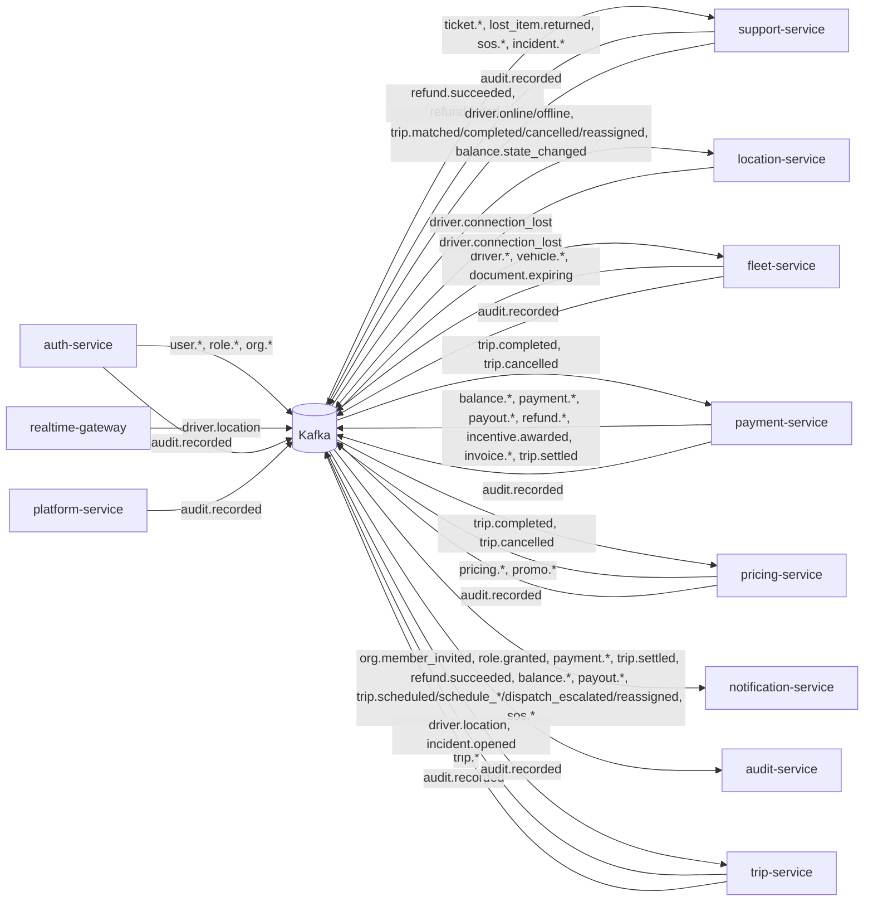

# Event catalogue

Every Kafka topic found in the code, with its key, producer, payload and consumers. Built by grepping `services/*/src` for topic strings in outbox unions (`src/outbox/outbox.ts`), `writeOutbox(...)` / `producer.send(...)` calls, and consumer `subscribe(...)` lists / handler maps. Tests and generated code excluded.

"Type here" = the payload type exported by `@ride-app/shared-types`. "local" = the producer declares the payload in its own `src/outbox/outbox.ts` and no type exists here.

## How events are sent

| Producer | Path to Kafka | Envelope | Producer settings |
|---|---|---|---|
| auth-service, fleet-service, payment-service, platform-service, pricing-service, support-service, trip-service | transactional outbox table written in the business transaction, published by `src/outbox/relay.ts` | `{ eventId: uuidv7(), version: 1, at: ISO }` merged into the payload | relay producer: `idempotent: true, maxInFlightRequests: 1` |
| location-service | `producer.send` directly from the sweeper callback (`src/events/kafka.ts`) | same envelope | `idempotent: true, maxInFlightRequests: 1`, `acks: -1` |
| realtime-gateway | `producer.send` directly, fire-and-forget (`src/kafka.ts`); messages are dropped and counted when the producer isn't connected | **none** | `allowAutoTopicCreation: true`, `acks: 1` |

All payloads are JSON (`JSON.stringify`) in the message value. Message key = the "Key" column below.

## Consumers

| Consumer (group id) | Topics | Where | Invalid messages |
|---|---|---|---|
| location-service (`location-service`) | `driver.online`, `driver.offline`, `trip.matched`, `trip.completed`, `trip.cancelled`, `trip.reassigned`, `balance.state_changed` | `src/events/handlers.ts` (zod schemas → shared-location functions; `trip.reassigned` → `reassignTrip`) | SyntaxError / ZodError skipped; other errors rethrown (kafkajs retries) |
| fleet-service (`fleet-service`) | `driver.connection_lost` | `src/events/consumer.ts` (ends the driving session with reason `CONNECTION_LOST`) | SyntaxError / ZodError skipped; other errors rethrown so kafkajs retries |
| payment-service (`payment-service`) | `trip.completed`, `trip.cancelled` | `src/events/consumer.ts` → `money/payments.ts` (`onTripCompleted`, `onTripCancelled`, deduped with an inbox `once(tx, eventId, topic)`) | SyntaxError / ZodError skipped; other errors rethrown |
| notification-service (`notification-service`) | `org.member_invited`, `role.granted`, `payment.action_required`, `trip.settled`, `payment.failed`, `refund.succeeded`, `balance.state_changed`, `balance.topped_up`, `balance.payment_due`, `payout.sent`, `payout.failed`, `trip.scheduled`, `trip.schedule_cancelled`, `trip.schedule_failed`, `trip.dispatch_escalated`, `trip.reassigned`, `sos.triggered`, `sos.acknowledged`, `sos.resolved` | `src/notify/handlers.ts`, `src/notify/consumer.ts` (requires a string `eventId`; the notifier dedupes on `eventId:channel`, per recipient `eventId:userId:channel` for events that tell several people) | malformed JSON / missing `eventId` skipped; handler errors propagate (kafkajs retries) |
| audit-service (`audit-service`) | `audit.recorded` (`fromBeginning: true`) | `src/events/consumer.ts` | invalid events skipped; other errors rethrown |
| trip-service (`trip-service`) | `driver.location`, `incident.opened` | `src/events/consumer.ts` (zod) → `trips/trace.ts` (thinned GPS trace in `trip_trace`), `trips/regulatory.ts` (`regulatory_incident`, for the regulatory report; replays ignored) | SyntaxError / ZodError skipped; other errors rethrown |
| pricing-service (`pricing-service`) | `trip.completed`, `trip.cancelled` | `src/events/consumer.ts` → `promos/service.ts` (`redeem` writes `promo.redeemed` / `promo.exhausted`; `release` gives a cancelled trip's discount back; idempotent per trip) | SyntaxError / ZodError skipped; other errors rethrown |
| support-service (`support-service`) | `refund.succeeded`, `refund.failed` | `src/events/consumer.ts` → `tickets.onRefundOutcome` (marks refunds linked to tickets SUCCEEDED / FAILED; only `REQUESTED` links change, so replays are harmless) | SyntaxError / ZodError skipped; other errors rethrown |

realtime-gateway, auth-service, mapping-service and platform-service consume no Kafka topics. (platform-service reads consumer-group **lag** for its system page, `src/system/health.ts`.)

---

## All topics

| Topic | Key | Producer | Payload | Type here | Consumers |
|---|---|---|---|---|---|
| `driver.location` | `driverId` | realtime-gateway | `{ driverId, tripId?, cityId, lat, lng, heading?, speed?, accuracy?, at (unix ms) }`, no envelope | `DriverLocationEvent` | trip-service (GPS trace) |
| `driver.online` | `driverId` | fleet-service | `{ driverId, vehicleId, vehicleType, cityId, fleetOrgId?, beneficiaryId, balanceState, cashAllowed }` | `DriverOnlineEvent` | location-service (`goOnline`) |
| `driver.offline` | `driverId` | fleet-service | `{ driverId, reason }` | `DriverOfflineEvent` | location-service (`goOffline`) |
| `driver.connection_lost` | `driverId` | location-service | `{ driverId, cityId, lastSeenAt }` | `DriverConnectionLostEvent` | fleet-service |
| `driver.applied` | `driverId` | fleet-service | `{ driverId, cityId }` | local | none |
| `driver.submitted` | `driverId` | fleet-service | `{ driverId, cityId }` | local | none |
| `driver.activated` | `driverId` | fleet-service | `{ driverId, cityId, byUserId }` | local | none (notification-service sends the "driver activated" push from `role.granted` instead) |
| `driver.reinstated` | `driverId` | fleet-service | `{ driverId, cityId, byUserId }` | local | none |
| `driver.changes_requested` | `driverId` | fleet-service | `{ driverId, cityId, reason, byUserId }` | local | none |
| `driver.suspended` | `driverId` | fleet-service | `{ driverId, cityId, reason, byUserId \| null }` (`null` + `"LICENSE expired"` from the expiry job) | local | none |
| `vehicle.submitted` | `vehicleId` | fleet-service | `{ vehicleId, cityId, ownerType }` | local | none |
| `vehicle.verified` | `vehicleId` | fleet-service | `{ vehicleId, cityId, vehicleType, ownerType, ownerId, byUserId }` | local | none |
| `vehicle.rejected` | `vehicleId` | fleet-service | `{ vehicleId, cityId, reason, byUserId }` | local | none |
| `vehicle.suspended` | `vehicleId` | fleet-service | `{ vehicleId, cityId, reason, byUserId }` (`byUserId: null` for document expiry; the staff member for a manual suspension) | local | none |
| `vehicle.reinstated` | `vehicleId` | fleet-service | `{ vehicleId, cityId, reason, byUserId }` (`VehicleReinstatedEvent`): staff lifted a vehicle suspension | local | none |
| `vehicle.transferred` | `vehicleId` | fleet-service | `{ vehicleId, transferId, cityId, fromOwnerType, fromOwnerId, toOwnerType, toOwnerId, requestedBy, makerId, byUserId }` (`VehicleTransferredEvent`): an approved ownership transfer ran (V9) | local | none |
| `vehicle.retired` | `vehicleId` | fleet-service | `{ vehicleId, cityId, reason, byUserId }` | local | none |
| `vehicle.driver_authorized` | `vehicleId` | fleet-service | `{ vehicleId, driverId, orgId, byUserId }` | local | none |
| `vehicle.driver_unauthorized` | `vehicleId` | fleet-service | `{ vehicleId, driverId, orgId, byUserId }` | local | none |
| `document.expiring` | `subjectId` | fleet-service (daily `remindExpiring`) | `{ documentId, subjectType, subjectId, kind, expiresAt }` | local | **none** (the producer's comment says notification-service sends push + SMS; it has no handler) |
| `trip.requested` | `tripId` | trip-service | `{ tripId, riderId, bookedById, cityId, vehicleType, channel, paymentMethod, fareEstimateMinor }` | `TripRequestedEvent` | none |
| `trip.matched` | `tripId` | trip-service | `{ tripId, riderId, driverId, cityId, vehicleType }` | `TripMatchedEvent` | location-service (`startTrip`) |
| `trip.driver_en_route` | `tripId` | trip-service | `{ tripId, riderId, driverId, cityId }` | `TripProgressEvent` | none |
| `trip.driver_arrived` | `tripId` | trip-service | same | `TripProgressEvent` | none |
| `trip.started` | `tripId` | trip-service | same | `TripProgressEvent` | none |
| `trip.completed` | `tripId` | trip-service | `{ tripId, riderId, driverId, cityId, vehicleType, vehicleId, beneficiary, paymentMethod, billingType, billingOrgId?, fareMinor, waitingFeeMinor, quoteId?, promoDiscountMinor?, currency, distanceMeters, durationSeconds, completedAt }` (`fareMinor` is the full fare; the rider pays `fareMinor − promoDiscountMinor`) | `TripCompletedEvent` | location-service (`endTrip`), payment-service (settlement), pricing-service (promo redemption) |
| `trip.cancelled` | `tripId` | trip-service | `{ tripId, riderId, driverId?, cityId, by, reason, paymentMethod, feeMinor, driverCompensationMinor, beneficiary?, billingOrgId?, quoteId?, currency }` | `TripCancelledEvent` | location-service (`endTrip`), payment-service (fee), pricing-service (promo release) |
| `trip.scheduled` | `scheduledTripId` | trip-service | `{ scheduledTripId, riderId, bookedById, cityId, vehicleType, channel, paymentMethod, billingOrgId?, fareEstimateMinor, currency, scheduledFor, matchAt, updated? }` (booked, or edited with `updated: true`) | `TripScheduledEvent` | notification-service (booking confirmation push to the rider and, when someone else booked, the booker). No reminder event exists: dispatch at `matchAt` publishes a plain `trip.requested` (no `scheduledTripId`); the apps get `scheduled:status` over the socket |
| `trip.schedule_cancelled` | `scheduledTripId` | trip-service | `{ scheduledTripId, riderId, bookedById, cityId, by: RIDER\|BOOKER\|STAFF, byUserId, scheduledFor }` | `TripScheduleCancelledEvent` | notification-service (push to rider / booker, except whoever cancelled) |
| `trip.schedule_failed` | `scheduledTripId` | trip-service | `{ scheduledTripId, riderId, bookedById, cityId, reason, scheduledFor }` | `TripScheduleFailedEvent` | notification-service (push to rider and booker) |
| `trip.dispatch_escalated` | `tripId` | trip-service | `{ tripId, scheduledTripId, riderId, cityId, vehicleType, scheduledFor }` | `TripDispatchEscalatedEvent` | notification-service ("still finding your driver" push to the rider); the board shows the `DISPATCH_ESCALATED` flag |
| `trip.reassigned` | `tripId` | trip-service | `{ tripId, riderId, cityId, fromDriverId, toDriverId?, byUserId, reason? }` | `TripReassignedEvent` | location-service (`reassignTrip`: frees `fromDriverId`, drops them from the trip's members and its last position; with `toDriverId` makes the new driver a member and `on_trip` unless busy elsewhere, and seeds the last position from them. trip-service also frees the old driver in Redis synchronously and writes `trip.matched` for the new driver just before this event, same key), notification-service (push to the rider and the old driver) |
| `corporate.policy_updated` | `orgId` | trip-service | `{ orgId, byUserId, allowedVehicleTypes, allowedDays, startMinute, endMinute, maxFareMinor, monthlyBudgetMinor, requirePurpose }` | `CorporatePolicyUpdatedEvent` | none |
| `trip.settled` | `tripId` | payment-service | `{ tripId, riderId, driverId?, beneficiary?, purpose, paymentMethod, fareMinor, commissionMinor, vatMinor, earningsMinor, promoDiscountMinor?, currency }` | `TripSettledEvent` | notification-service (receipt push) |
| `payment.action_required` | `riderId` | payment-service | `{ paymentId, tripId, riderId, purpose, provider, amountMinor, currency, checkoutUrl }` | `PaymentActionRequiredEvent` | notification-service (approve push) |
| `payment.captured` | `riderId` | payment-service | `{ paymentId, tripId, riderId, purpose, provider, method, amountMinor, currency }` | `PaymentOutcomeEvent` | **none** |
| `payment.failed` | `riderId` | payment-service | same + `final`, `nextAttemptAt?` | `PaymentOutcomeEvent` | notification-service |
| `refund.succeeded` | `riderId` | payment-service | `{ refundId, paymentId, tripId, riderId, amountMinor, currency }` | `RefundOutcomeEvent` | notification-service, support-service |
| `refund.failed` | `riderId` | payment-service | same | `RefundOutcomeEvent` | support-service |
| `balance.state_changed` | beneficiary owner id | payment-service | `{ accountId, beneficiary, cityId, state, previousState, cashAllowed, balanceMinor }` | `BalanceStateChangedEvent` | location-service (`applyBalanceState`), notification-service (owner-drivers only) |
| `balance.topped_up` | beneficiary owner id | payment-service | `{ accountId, beneficiary, amountMinor, balanceMinor, currency, channel?, provider? }` | `BalanceMoneyEvent` | notification-service |
| `balance.payment_due` | beneficiary owner id | payment-service | same + `minimumMinor`, `dueAt` | `BalanceMoneyEvent` | notification-service |
| `payout.sent` | beneficiary owner id | payment-service | same as `balance.topped_up` | `BalanceMoneyEvent` | notification-service |
| `payout.failed` | beneficiary owner id | payment-service | same + `failure?` | `BalanceMoneyEvent` | notification-service |
| `balance.adjusted` | beneficiary owner id | payment-service | `{ adjustmentId, accountId, beneficiary, direction, amountMinor, category, balanceMinor, currency, tripId?, ticketId? }` | `BalanceAdjustedEvent` | none |
| `balance.written_off` | beneficiary owner id | payment-service | `{ writeOffId, accountId, beneficiary, amountMinor, balanceMinor, currency }` | `BalanceWrittenOffEvent` | none |
| `incentive.awarded` | beneficiary owner id | payment-service | `{ awardId, programId, programName, cityId, driverId, accountId, beneficiary, trips, amountMinor, balanceMinor, currency }` | `IncentiveAwardedEvent` | none |
| `invoice.issued` | `orgId` | payment-service | `{ invoiceId, orgId, number, period, totalMinor, paidMinor, currency, dueAt }` | `InvoiceEvent` | none |
| `invoice.paid` | `orgId` | payment-service | same + `paidAt` | `InvoiceEvent` | none |
| `user.created` | `userId` | auth-service | `{ userId, guest }` | `UserCreatedEvent` (not imported by auth-service) | none |
| `user.claimed` | `userId` | auth-service | `{ userId }` | local | none |
| `user.suspended` | `userId` | auth-service | `{ userId, until: ISO \| null, byUserId }` | local | none (verifiers use the Redis `deny:{userId}` key instead) |
| `user.reinstated` | `userId` | auth-service | `{ userId, byUserId }` | local | none |
| `role.granted` | `userId` | auth-service | `{ userId, role, orgId?, cityId?, byUserId \| null }` | local | notification-service (only `role === "DRIVER"`: "driver activated" push) |
| `role.revoked` | `userId` | auth-service | same | local | none |
| `org.created` | `orgId` | auth-service | `{ orgId, kind, cityId }` | local | none |
| `org.verified` | `orgId` | auth-service | `{ orgId, kind, cityId, byUserId }` | local | none |
| `org.suspended` | `orgId` | auth-service | `{ orgId, kind, byUserId }` | local | none |
| `org.reinstated` | `orgId` | auth-service | `{ orgId, kind, cityId, status, byUserId }` (`OrgReinstatedEvent`; `status` = restored `VERIFIED` or `PENDING`) | local | none |
| `org.member_invited` | `orgId` | auth-service | `{ invitationId, orgId, orgName, role, phoneNumber? }` | local | notification-service (invitation SMS) |
| `ticket.created` | `ticketId` | support-service | `{ ticketId, ref, cityId, category, priority, source, requesterUserId, tripId?, firstResponseDueAt }` | `TicketCreatedEvent` | none |
| `ticket.resolved` | `ticketId` | support-service | `{ ticketId, cityId, category, requesterUserId, tripId?, resolution, byUserId \| null }` (`null` = the 72 h no-reply timer) | `TicketResolvedEvent` | none (a "your ticket was resolved" push needs a notification-service template) |
| `ticket.closed` | `ticketId` | support-service | `{ ticketId, cityId, requesterUserId, automatic, byUserId \| null }` | `TicketClosedEvent` | none |
| `lost_item.returned` | `lostItemId` | support-service | `{ lostItemId, ticketId, tripId, cityId, riderUserId, driverUserId?, byUserId }` | `LostItemReturnedEvent` | none |
| `sos.triggered` | `alertId` | support-service | `{ alertId, cityId, tripId, userId, role, source, lat, lng, triggeredAt, riderUserId?, driverUserId?, tripVerified }` | `SosTriggeredEvent` | notification-service (confirmation push to `userId`, the person who pressed it, for `source: APP` only; never to the other party). Emergency-contact SMS and on-call paging are not built; staff consoles poll the queue |
| `sos.acknowledged` | `alertId` | support-service | `{ alertId, cityId, tripId, userId, byUserId, acknowledgedAt }` | `SosAcknowledgedEvent` | notification-service (push to `userId`) |
| `sos.resolved` | `alertId` | support-service | `{ alertId, cityId, tripId, userId, outcome, byUserId, resolvedAt, incidentId? }` | `SosResolvedEvent` | notification-service (push to `userId`) |
| `incident.opened` | `incidentId` | support-service | `{ incidentId, ref, cityId, category, severity, source, tripId?, subjectUserIds, sosAlertId?, ticketId?, byUserId \| null }` | `IncidentOpenedEvent` | trip-service (regulatory report counts) |
| `incident.resolved` | `incidentId` | support-service | `{ incidentId, cityId, outcome, subjectUserIds, byUserId }` | `IncidentResolvedEvent` | none |
| `pricing.rule_scheduled` | `cityId` | pricing-service | `{ ruleId, changeRequestId, cityId, vehicleType, validFrom, baseMinor, perKmMinor, perMinMinor, minFareMinor, waitingPerMinMinor, proposedBy, approvedBy, emergency }` (a fare change approved, maker–checker) | `FareRuleScheduledEvent` | none (notification-service could warn drivers; not built) |
| `pricing.rule_activated` | `cityId` | pricing-service | `{ ruleId, cityId, vehicleType, validFrom }` (the sweep passed `validFrom`, or at approval for an emergency change) | `FareRuleActivatedEvent` | none |
| `pricing.zone_changed` | `cityId` | pricing-service | `{ zoneId, cityId, kind: SERVICE_AREA\|NO_PICKUP\|AIRPORT\|SURGE, change: CREATED\|UPDATED\|ARCHIVED, zoneVersion, byUserId }` | `ZoneChangedEvent` | none |
| `promo.activated` | `promoId` | pricing-service | `{ promoId, code, cityIds, budgetMinor, startsAt, endsAt, fundedBy, byUserId }` | `PromoActivatedEvent` | none |
| `promo.redeemed` | `tripId` | pricing-service | `{ promoId, code, redemptionId, tripId, riderId, cityId, quoteId?, fareMinor, discountMinor, currency, fundedBy }` (`trip.completed` closed a booked reservation) | `PromoRedeemedEvent` | none (payment-service books promo expense from `trip.completed`'s `promoDiscountMinor`) |
| `promo.exhausted` | `promoId` | pricing-service | `{ promoId, code, spentMinor, budgetMinor, redemptionCount }` | `PromoExhaustedEvent` | none |
| `audit.recorded` | `actorId` or `"system"` | auth-service, fleet-service, payment-service, platform-service, pricing-service (zones, fare changes, promos, automatic expiries), support-service, trip-service (`trip:reassign`, `corporate:manage_policies`, `trip:read_gps_trace`) | `{ actorId, action, resource: { type, id }, outcome: "ALLOWED" \| "DENIED" \| "EXECUTED", reason?, onBehalfOf?, service }` (`AuditPayload`, declared separately in each producer's outbox) | local (×7) | audit-service |

### Summary

- **Produced, never consumed:** `driver.applied`, `driver.submitted`, `driver.activated`, `driver.reinstated`, `driver.changes_requested`, `driver.suspended`, all nine `vehicle.*`, `document.expiring`, `trip.requested`, `trip.driver_en_route`, `trip.driver_arrived`, `trip.started`, `payment.captured`, `balance.adjusted`, `balance.written_off`, `incentive.awarded`, `invoice.issued`, `invoice.paid`, `user.created`, `user.claimed`, `user.suspended`, `user.reinstated`, `role.revoked`, `org.created`, `org.verified`, `org.suspended`, `org.reinstated`, every support-service topic except `audit.recorded`, `incident.opened` and `sos.*` (`ticket.*`, `lost_item.returned`, `incident.resolved`), trip-service's `corporate.policy_updated` (the other `TRIP_EXTRA_TOPICS` are now read by notification-service and, for `trip.reassigned`, location-service), and every pricing-service topic (`pricing.rule_scheduled`, `pricing.rule_activated`, `pricing.zone_changed`, `promo.activated`, `promo.redeemed`, `promo.exhausted`; names exported as `PRICING_TOPICS`).
- **Consumed, never produced:** none found.
- trip-service, payment-service, pricing-service and support-service produce **from types in this lib** (support-service topic names are also exported as `SUPPORT_TOPICS`, payment-service's money-control topics as `PAYMENT_CONTROL_TOPICS`); auth-service and most of fleet-service don't.

## Who creates topics

In production topics are provisioned (comment in notification-service's consumer). In dev/test, consumers create the topics they subscribe to when started with `createTopics` (location-service also creates `driver.connection_lost`; trip-service creates `driver.location` and `incident.opened` at start; audit-service creates `audit.recorded`; support-service creates `refund.succeeded` and `refund.failed`; pricing-service creates `trip.completed` and `trip.cancelled` outside production; notification-service creates every topic in its handler map, now including `sos.*` and the scheduled / reassigned trip topics). realtime-gateway relies on `allowAutoTopicCreation`. Partition counts and retention targets are in [Database.md §11](../../../docs/design/Database.md#11-kafka-topics-as-data); the code doesn't set them.
