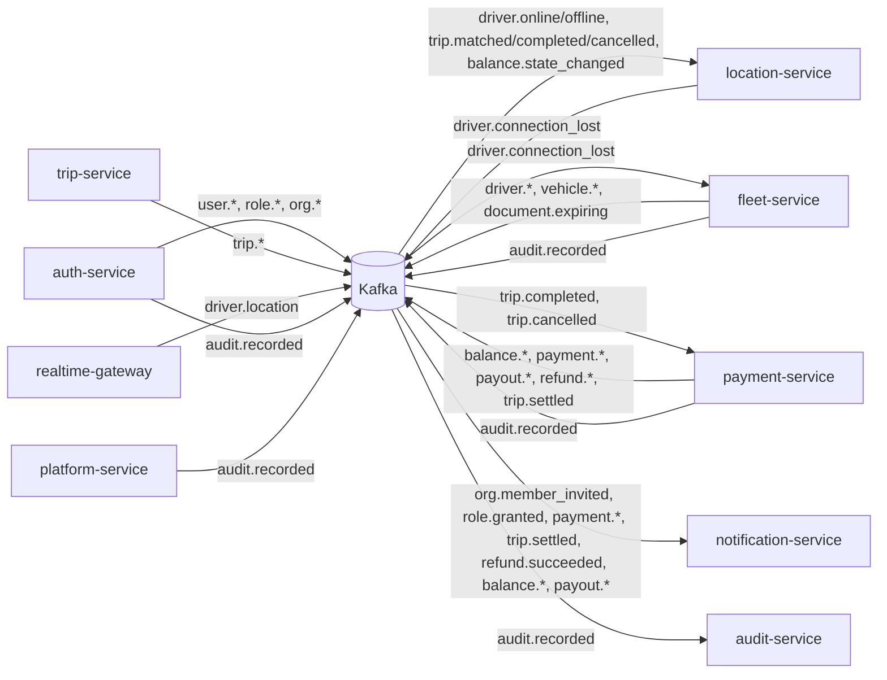

# Event catalogue

Every Kafka topic found in the code, with its key, producer, payload and consumers. Built by grepping `services/*/src` for topic strings in outbox unions (`src/outbox/outbox.ts`), `writeOutbox(...)` / `producer.send(...)` calls, and consumer `subscribe(...)` lists / handler maps. Tests and generated code excluded.

"Type here" = the payload type exported by `@ride-app/shared-types`. "local" = the producer declares the payload in its own `src/outbox/outbox.ts` and no type exists here.

## How events are sent

| Producer | Path to Kafka | Envelope | Producer settings |
|---|---|---|---|
| auth-service, fleet-service, payment-service, platform-service, trip-service | transactional outbox table written in the business transaction, published by `src/outbox/relay.ts` | `{ eventId: uuidv7(), version: 1, at: ISO }` merged into the payload | relay producer: `idempotent: true, maxInFlightRequests: 1` |
| location-service | `producer.send` directly from the sweeper callback (`src/events/kafka.ts`) | same envelope | `idempotent: true, maxInFlightRequests: 1`, `acks: -1` |
| realtime-gateway | `producer.send` directly, fire-and-forget (`src/kafka.ts`); messages are dropped and counted when the producer isn't connected | **none** | `allowAutoTopicCreation: true`, `acks: 1` |

All payloads are JSON (`JSON.stringify`) in the message value. Message key = the "Key" column below.

## Consumers

| Consumer (group id) | Topics | Where | Invalid messages |
|---|---|---|---|
| location-service (`location-service`) | `driver.online`, `driver.offline`, `trip.matched`, `trip.completed`, `trip.cancelled`, `balance.state_changed` | `src/events/handlers.ts` (zod schemas → shared-location functions) | SyntaxError / ZodError skipped; other errors rethrown (kafkajs retries) |
| fleet-service (`fleet-service`) | `driver.connection_lost` | `src/events/consumer.ts` (ends the driving session with reason `CONNECTION_LOST`) | SyntaxError / ZodError skipped; other errors rethrown so kafkajs retries |
| payment-service (`payment-service`) | `trip.completed`, `trip.cancelled` | `src/events/consumer.ts` → `money/payments.ts` (`onTripCompleted`, `onTripCancelled`, deduped with an inbox `once(tx, eventId, topic)`) | SyntaxError / ZodError skipped; other errors rethrown |
| notification-service (`notification-service`) | `org.member_invited`, `role.granted`, `payment.action_required`, `trip.settled`, `payment.failed`, `refund.succeeded`, `balance.state_changed`, `balance.topped_up`, `balance.payment_due`, `payout.sent`, `payout.failed` | `src/notify/handlers.ts`, `src/notify/consumer.ts` (requires a string `eventId`; the notifier dedupes) | malformed JSON / missing `eventId` skipped; handler errors propagate (kafkajs retries) |
| audit-service (`audit-service`) | `audit.recorded` (`fromBeginning: true`) | `src/events/consumer.ts` | invalid events skipped; other errors rethrown |

trip-service, realtime-gateway, auth-service, mapping-service, pricing-service and platform-service consume no Kafka topics. (platform-service reads consumer-group **lag** for its system page, `src/system/health.ts`.)

---

## All topics

| Topic | Key | Producer | Payload | Type here | Consumers |
|---|---|---|---|---|---|
| `driver.location` | `driverId` | realtime-gateway | `{ driverId, tripId?, cityId, lat, lng, heading?, speed?, accuracy?, at (unix ms) }`, no envelope | `DriverLocationEvent` | **none** |
| `driver.online` | `driverId` | fleet-service | `{ driverId, vehicleId, vehicleType, cityId, fleetOrgId?, beneficiaryId, balanceState, cashAllowed }` | `DriverOnlineEvent` | location-service (`goOnline`) |
| `driver.offline` | `driverId` | fleet-service | `{ driverId, reason }` | `DriverOfflineEvent` | location-service (`goOffline`) |
| `driver.connection_lost` | `driverId` | location-service | `{ driverId, cityId, lastSeenAt }` | `DriverConnectionLostEvent` | fleet-service |
| `driver.applied` | `driverId` | fleet-service | `{ driverId, cityId }` | local | none |
| `driver.submitted` | `driverId` | fleet-service | `{ driverId, cityId }` | local | none |
| `driver.activated` | `driverId` | fleet-service | `{ driverId, cityId, byUserId }` | local | none (notification-service sends the "driver activated" push from `role.granted` instead) |
| `driver.reinstated` | `driverId` | fleet-service | `{ driverId, cityId, byUserId }` | local | none |
| `driver.changes_requested` | `driverId` | fleet-service | `{ driverId, cityId, reason, byUserId }` | local | none |
| `driver.suspended` | `driverId` | fleet-service | `{ driverId, cityId, reason, byUserId \| null }` (`null` + `"LICENSE expired"` from the expiry job) | local | none |
| `vehicle.submitted` | `vehicleId` | fleet-service | `{ vehicleId, cityId, ownerType }` | local | none |
| `vehicle.verified` | `vehicleId` | fleet-service | `{ vehicleId, cityId, vehicleType, ownerType, ownerId, byUserId }` | local | none |
| `vehicle.rejected` | `vehicleId` | fleet-service | `{ vehicleId, cityId, reason, byUserId }` | local | none |
| `vehicle.suspended` | `vehicleId` | fleet-service | `{ vehicleId, cityId, reason, byUserId: null }` (document expiry) | local | none |
| `vehicle.retired` | `vehicleId` | fleet-service | `{ vehicleId, cityId, reason, byUserId }` | local | none |
| `vehicle.driver_authorized` | `vehicleId` | fleet-service | `{ vehicleId, driverId, orgId, byUserId }` | local | none |
| `vehicle.driver_unauthorized` | `vehicleId` | fleet-service | `{ vehicleId, driverId, orgId, byUserId }` | local | none |
| `document.expiring` | `subjectId` | fleet-service (daily `remindExpiring`) | `{ documentId, subjectType, subjectId, kind, expiresAt }` | local | **none** (the producer's comment says notification-service sends push + SMS; it has no handler) |
| `trip.requested` | `tripId` | trip-service | `{ tripId, riderId, bookedById, cityId, vehicleType, channel, paymentMethod, fareEstimateMinor }` | `TripRequestedEvent` | none |
| `trip.matched` | `tripId` | trip-service | `{ tripId, riderId, driverId, cityId, vehicleType }` | `TripMatchedEvent` | location-service (`startTrip`) |
| `trip.driver_en_route` | `tripId` | trip-service | `{ tripId, riderId, driverId, cityId }` | `TripProgressEvent` | none |
| `trip.driver_arrived` | `tripId` | trip-service | same | `TripProgressEvent` | none |
| `trip.started` | `tripId` | trip-service | same | `TripProgressEvent` | none |
| `trip.completed` | `tripId` | trip-service | `{ tripId, riderId, driverId, cityId, vehicleType, vehicleId, beneficiary, paymentMethod, billingType, billingOrgId?, fareMinor, waitingFeeMinor, currency, distanceMeters, durationSeconds, completedAt }` | `TripCompletedEvent` | location-service (`endTrip`), payment-service (settlement) |
| `trip.cancelled` | `tripId` | trip-service | `{ tripId, riderId, driverId?, cityId, by, reason, paymentMethod, feeMinor, driverCompensationMinor, beneficiary?, billingOrgId?, currency }` | `TripCancelledEvent` | location-service (`endTrip`), payment-service (fee) |
| `trip.settled` | `tripId` | payment-service | `{ tripId, riderId, driverId?, beneficiary?, purpose, paymentMethod, fareMinor, commissionMinor, vatMinor, earningsMinor, currency }` | `TripSettledEvent` | notification-service (receipt push) |
| `payment.action_required` | `riderId` | payment-service | `{ paymentId, tripId, riderId, purpose, provider, amountMinor, currency, checkoutUrl }` | `PaymentActionRequiredEvent` | notification-service (approve push) |
| `payment.captured` | `riderId` | payment-service | `{ paymentId, tripId, riderId, purpose, provider, method, amountMinor, currency }` | `PaymentOutcomeEvent` | **none** |
| `payment.failed` | `riderId` | payment-service | same + `final`, `nextAttemptAt?` | `PaymentOutcomeEvent` | notification-service |
| `refund.succeeded` | `riderId` | payment-service | `{ refundId, paymentId, tripId, riderId, amountMinor, currency }` | `RefundOutcomeEvent` | notification-service |
| `refund.failed` | `riderId` | payment-service | same | `RefundOutcomeEvent` | **none** |
| `balance.state_changed` | beneficiary owner id | payment-service | `{ accountId, beneficiary, cityId, state, previousState, cashAllowed, balanceMinor }` | `BalanceStateChangedEvent` | location-service (`applyBalanceState`), notification-service (owner-drivers only) |
| `balance.topped_up` | beneficiary owner id | payment-service | `{ accountId, beneficiary, amountMinor, balanceMinor, currency, channel?, provider? }` | `BalanceMoneyEvent` | notification-service |
| `balance.payment_due` | beneficiary owner id | payment-service | same + `minimumMinor`, `dueAt` | `BalanceMoneyEvent` | notification-service |
| `payout.sent` | beneficiary owner id | payment-service | same as `balance.topped_up` | `BalanceMoneyEvent` | notification-service |
| `payout.failed` | beneficiary owner id | payment-service | same + `failure?` | `BalanceMoneyEvent` | notification-service |
| `user.created` | `userId` | auth-service | `{ userId, guest }` | `UserCreatedEvent` (not imported by auth-service) | none |
| `user.claimed` | `userId` | auth-service | `{ userId }` | local | none |
| `user.suspended` | `userId` | auth-service | `{ userId, until: ISO \| null, byUserId }` | local | none (verifiers use the Redis `deny:{userId}` key instead) |
| `user.reinstated` | `userId` | auth-service | `{ userId, byUserId }` | local | none |
| `role.granted` | `userId` | auth-service | `{ userId, role, orgId?, cityId?, byUserId \| null }` | local | notification-service (only `role === "DRIVER"`: "driver activated" push) |
| `role.revoked` | `userId` | auth-service | same | local | none |
| `org.created` | `orgId` | auth-service | `{ orgId, kind, cityId }` | local | none |
| `org.verified` | `orgId` | auth-service | `{ orgId, kind, cityId, byUserId }` | local | none |
| `org.suspended` | `orgId` | auth-service | `{ orgId, kind, byUserId }` | local | none |
| `org.member_invited` | `orgId` | auth-service | `{ invitationId, orgId, orgName, role, phoneNumber? }` | local | notification-service (invitation SMS) |
| `audit.recorded` | `actorId` or `"system"` | auth-service, fleet-service, payment-service, platform-service | `{ actorId, action, resource: { type, id }, outcome: "ALLOWED" \| "DENIED" \| "EXECUTED", reason?, service }` (`AuditPayload`, declared separately in each producer's outbox) | local (×4) | audit-service |

### Summary

- **Produced, never consumed:** `driver.location`, `driver.applied`, `driver.submitted`, `driver.activated`, `driver.reinstated`, `driver.changes_requested`, `driver.suspended`, all seven `vehicle.*`, `document.expiring`, `trip.requested`, `trip.driver_en_route`, `trip.driver_arrived`, `trip.started`, `payment.captured`, `refund.failed`, `user.created`, `user.claimed`, `user.suspended`, `user.reinstated`, `role.revoked`, `org.created`, `org.verified`, `org.suspended`.
- **Consumed, never produced:** none found.
- trip-service and payment-service produce **from types in this lib**; auth-service and most of fleet-service don't.

## Who creates topics

In production topics are provisioned (comment in notification-service's consumer). In dev/test, consumers create the topics they subscribe to when started with `createTopics` (location-service also creates `driver.connection_lost`; audit-service creates `audit.recorded`). realtime-gateway relies on `allowAutoTopicCreation`. Partition counts and retention targets are in [Database.md §11](../../../docs/design/Database.md#11-kafka-topics-as-data); the code doesn't set them.
