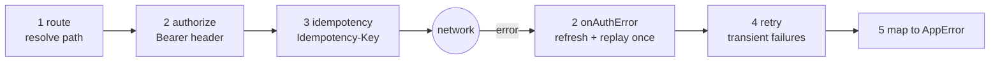

# API client

Source: `packages/core/lib/src/api/` (`api_client.dart`, `app_error.dart`, `auth_api.dart`, `service_apis.dart`).

Every HTTP call the phone app makes goes through one `ApiClient`, a Dio instance with five interceptors. The typed API classes (`AuthApi`, `TripsApi`, …) are thin, stateless wrappers over it. Core has no Riverpod: the app builds the client and hands in the hooks (`apps/phone-app/lib/core/network/providers.dart`).

## Construction

```dart
ApiClient({
  required ApiEndpoints endpoints,
  AccessTokenSource? tokens,                      // the app's TokenManager
  Future<String?> Function()? sessionToken,       // reads the bearer session from secure storage
  required IdGenerator newId,                     // uuid v4 in the app
  Duration connectTimeout = 10 s,
  Duration receiveTimeout = 20 s,
  Dio? dio,
  List<Duration> retryDelays = [500 ms, 1 s, 2 s],
  String userAgent = 'anbessa-app',
})
```

Base headers: `accept: application/json`. On the IO adapter the HTTP client's user agent is set to `userAgent`.

The app creates two clients (`apps/phone-app/lib/core/network/providers.dart`):

| Provider | Tokens hook | Used for |
|---|---|---|
| `tokenManagerProvider` (inner client) | none | only `AuthApi.accessToken()` inside `TokenManager`, so minting a JWT never needs a JWT |
| `apiClientProvider` | `TokenManager` | everything else |

## Routing: gateway vs host (`ApiEndpoints`)

| Mode | Constructor | Behaviour |
|---|---|---|
| gateway | `ApiEndpoints.gateway(baseUrl)` | every path becomes `baseUrl + path` (Kong, or production) |
| host | `ApiEndpoints.host(hostBase: 'http://localhost', hostPorts: defaultHostPorts)` | the path's `/api/<prefix>` picks the service's own port on `hostBase` (how `make dev-services` runs, with no Kong) |

`resolve(path)` leaves absolute `http://` / `https://` URLs alone (document uploads use this). In host mode a prefix matches when the path equals it, or continues with `/` or `?`. A path with no matching prefix goes to port 3001.

`defaultHostPorts` (same table as `apps/web/vite.config.ts`, per the code comment):

| Prefix | Port | Service |
|---|---|---|
| `/api/auth`, `/api/identity`, `/api/dev` | 3001 | auth-service |
| `/api/trips` | 3002 | trip-service |
| `/api/locations` | 3003 | location-service |
| `/api/pricing` | 3004 | pricing-service |
| `/api/payments` | 3005 | payment-service |
| `/api/notifications` | 3006 | notification-service |
| `/api/maps` | 3007 | mapping-service |
| `/api/fleet` | 3008 | fleet-service |
| `/api/audit` | 3010 | audit-service (no API class calls it) |
| `/api/platform` | 3011 | platform-service |

The service names come from the ports in `services/*/.env.example`. realtime-gateway (port 3000) is not an HTTP API for the app; it is reached through Socket.io (see [realtime.md](realtime.md)).

## Interceptor chain

Requests pass through the interceptors in this order; errors pass through the error handlers in the same order.



### 1. Route

`o.path = endpoints.resolve(o.path)`.

### 2. Authorize and refresh

Per-request switches live in `RequestOptions.extra` (`ReqExtra`):

| Key | Meaning |
|---|---|
| `auth` | `false`: send no `Authorization` header (public endpoints, upload URLs) |
| `sessionBearer` | `true`: send the **session token** as the bearer instead of the JWT (Better Auth routes) |
| `idempotent` | `true`: add an `Idempotency-Key` if the caller did not pass one |
| `retriedAuth` | set internally on the replay after a refresh |
| `noRetry` | skip the retry interceptor |

On request: with `sessionBearer`, the header is `Bearer <session token>`; otherwise `Bearer <tokens.accessToken()>`. If reading the token throws, the request is rejected with that error.

On error, a refresh and replay happens only when **all** of these hold:

- the status is 401, the request was authenticated with the JWT (`auth != false`, not `sessionBearer`) and a token source exists;
- it has not been replayed already (`retriedAuth`);
- the error code is one of `token_outdated`, `token_revoked`, `invalid_token`, `expired`, `unauthorized`, or there is no code.

Then the client calls `tokens.accessToken(force: true)` and replays the request once with the new bearer.

| Outcome | What happens |
|---|---|
| no fresh token (`null`) | the original error continues |
| replay succeeds | its response is returned to the caller |
| replay fails with 401 | `tokens.onSessionEnded(<mapped error>)`, then the error continues |
| replay fails otherwise | the error continues |
| the refresh throws an `AppError` that `isAuth` or `isForbidden` | `tokens.onSessionEnded(<that error>)`, then the original error continues carrying it |
| the refresh throws any other `AppError` (network, 5xx) | the session is **not** ended; the original error continues carrying that `AppError`, so the caller sees e.g. `network` and can retry |
| the refresh throws something else (a bug, a corrupt token) | the session is not ended; the original error continues |

A network failure during a refresh that follows a 401 therefore no longer signs the person out (fixed 2026-10-27; see `ApiClient._onAuthError`). Test: "a refresh that fails for lack of network surfaces the error and keeps the session" in `test/api_client_test.dart`.

### 3. Idempotency

If `extra.idempotent == true` and no `idempotency-key` header is present (case-insensitive), the header `idempotency-key: app-<newId()>` is added. Callers that pass `idempotencyKey:` set the header directly (no `app-` prefix). The app always passes its own keys (`newIdempotencyKey()`, a uuid v4); nothing in `apps/phone-app/lib` sets `idempotent: true`.

### 4. Retry

A request is retried when it is **safe** (method GET, or it carries an `idempotency-key` header) and the failure is **transient** (connection error, connect/send/receive timeout, or HTTP 502, 503, 504), unless `noRetry` is set. It is retried up to `retryDelays.length` times (default three retries, so at most four requests), waiting 500 ms, 1 s, then 2 s. Plain POSTs without a key are never retried.

### 5. Error mapping

Every failure becomes an `AppError` (`ApiClient.toAppError`):

| Situation | `status` | `code` | `message` | `retryable` |
|---|---|---|---|---|
| the error already is an `AppError` | as is | as is | as is | as is |
| cancelled | 0 | `cancelled` | `Cancelled` | false |
| connect/send/receive timeout, no response | 0 | `timeout` | "Can't reach the server. Check your connection and try again." | true |
| other failure without a response | 0 | `network` | same | true |
| HTTP response | the status | body `error` or `code` (a string, or `{code}`), else `unauthorized` (401), `forbidden` (403), `not_found` (404), `rate_limited` (429), else `http_<status>` | body `message`, or a short (< 200 chars) string body, else `Request failed (<status>)`; on 429 always "Too many attempts. Wait a minute and try again." | true for 429, 502, 503, 504 |

`issues` is filled from a body `issues[]` (`path`, `message`), the shape of zod validation errors.

`AppError` getters: `isNetwork` (status 0), `isAuth` (401 or `session_ended`), `isForbidden` (403), `isNotFound` (404), `isConflict` (409), `is_(code)`.

`ErrorCodes` lists every code the services answer with, grouped as transport, auth, common, trips, fleet, payments and dev. The app turns them into words in `apps/phone-app/lib/core/l10n/l10n.dart` (`describeError`).

## Calling

```dart
Future<T> call<T>(String method, String path, {Object? body, Map<String, dynamic>? query, Map<String, String>? headers,
    bool auth = true, bool idempotent = false, String? idempotencyKey, bool sessionBearer = false, bool noRetry = false,
    ResponseType responseType = ResponseType.json, required T Function(Response) parse})
getJson(path, {query, auth, headers})          // → Map (non-map bodies become {})
postJson(path, {body = {}, auth, idempotent, idempotencyKey, headers})
putJson(path, {body, auth})
delete(path, {auth})
```

`call` catches every `DioException` and throws `AppError`.

## API classes and their paths

`Apis(client)` builds every service class from one client: `platform`, `maps`, `pricing`, `trips`, `locations`, `payments`, `fleet`, `notifications`. `AuthApi`, `IdentityApi` and `OrganizationsApi` are built separately.

"Bearer" below: **JWT** (the default), **session** (`sessionBearer: true`) or **none** (`auth: false`).

### AuthApi (auth-service, `auth_api.dart`)

| Method | HTTP | Bearer | Returns / notes |
|---|---|---|---|
| `sendOtp(phoneE164)` | `POST /api/auth/phone-number/send-otp` `{phoneNumber}` | none | |
| `verifyOtp(phoneE164, code)` | `POST /api/auth/phone-number/verify` `{phoneNumber, code}` | none | `VerifiedSession`. The session token is read from the `set-auth-token` header, else from a `*.session_token` cookie in `set-cookie`, else from body `token`; none → `AppError(500, no_session_token)` |
| `accessToken()` | `GET /api/auth/token` | session | the 15-minute JWT from body `token`; missing → `AppError(401, session_ended)` |
| `session()` | `GET /api/auth/get-session` | session | `Profile?` from body `user` |
| `signOut()` | `POST /api/auth/sign-out` `{}` | session | `noRetry` |
| `updateProfile({name, image})` | `POST /api/auth/update-user` | session | `Profile` (body `user`, or the body itself) |
| `updateName(name)` | `POST /api/auth/update-user` `{name}` | session | `Profile`. No caller in the app |
| `listSessions()` | `GET /api/auth/list-sessions` | session | `List<SessionInfo>` (body is a list, or `{sessions}`) |
| `revokeSession(token)` | `POST /api/auth/revoke-session` `{token}` | session | |
| `revokeOtherSessions()` | `POST /api/auth/revoke-other-sessions` `{}` | session | |
| `devAccounts()` | `GET /api/dev/accounts` | none | `List<DevAccount>` (only entries with a `phone` string). DEV_LOGIN=on only |
| `devCode(phoneE164)` | `GET /api/dev/code?phone=` | none | the pending OTP (body `code`). DEV_LOGIN=on only |

### IdentityApi (auth-service)

| Method | HTTP | Returns |
|---|---|---|
| `me()` | `GET /api/identity/me` | `Me` |
| `cities()` | `GET /api/identity/cities` | raw list of maps |

The app builds `identityApiProvider` but nothing calls it.

### OrganizationsApi (auth-service, Better Auth organization plugin)

All with the session bearer.

| Method | HTTP |
|---|---|
| `mine()` | `GET /api/auth/organization/list` → `List<Organization>` |
| `invitations()` | `GET /api/auth/organization/list-user-invitations` → `List<OrgInvitation>` |
| `accept(id)` | `POST /api/auth/organization/accept-invitation` `{invitationId}` |
| `reject(id)` | `POST /api/auth/organization/reject-invitation` `{invitationId}` |

### PlatformApi (platform-service)

| Method | HTTP | Bearer |
|---|---|---|
| `clientConfig({audience, cityId})` | `GET /api/platform/client-config?audience=&cityId=` | none |

The app does not use this wrapper; `ClientConfigController` calls `apiClient.getJson('/api/platform/client-config', query: {audience}, auth: false)` directly so it can cache the raw JSON.

### MapsApi (mapping-service)

| Method | HTTP | Returns |
|---|---|---|
| `search(q, {cityId, language = 'en', limit = 8})` | `GET /api/maps/search?q=&cityId=&language=&limit=` | `List<Place>` from `results` |
| `reverse(lat, lng, {language})` | `GET /api/maps/reverse?lat=&lng=&language=` | `Place?` (null on an empty body) |
| `snap(lat, lng)` | `GET /api/maps/snap?lat=&lng=` | `(lat, lng)`; missing fields keep the input |
| `route({fromLat, fromLng, toLat, toLng, steps = false})` | `GET /api/maps/route?from=lat,lng&to=lat,lng&steps=0|1` | `RouteSteps` |

### PricingApi (pricing-service)

| Method | HTTP | Returns |
|---|---|---|
| `estimates({pickup, dropoff, vehicleTypes})` | `POST /api/pricing/estimates` `{pickup:{lat,lng}, dropoff:{lat,lng}, vehicleTypes?, pickupAddress, dropoffAddress}` | `List<Quote>`. No caller in the app |
| `estimatesWithRoute(...)` | same request | `Estimates` (quotes + shared route) |
| `fares(cityId)` | `GET /api/pricing/fares?cityId=` (no bearer) | `List<FareCard>`. No caller in the app |

`pickupAddress` / `dropoffAddress` are sent from `Place.name`.

### TripsApi (trip-service, base `/api/trips`)

| Method | HTTP | Body / key | Returns |
|---|---|---|---|
| `request({quoteId, paymentMethod, billingOrgId, idempotencyKey})` | `POST /api/trips` | `{quoteId, paymentMethod, billingOrgId?}`, `Idempotency-Key` | `Trip` |
| `active()` | `GET /api/trips/active` | | `Trip?` from `trip` |
| `list({as, before, limit = 20})` | `GET /api/trips?as=rider|driver&before=&limit=` | | `(trips, next)` |
| `get(id)` | `GET /api/trips/:id` | | `Trip` |
| `parties(id)` | `GET /api/trips/:id/parties` | | `TripParties` |
| `accept(id, offerId, {idempotencyKey})` | `POST /api/trips/:id/accept` | `{offerId}`, key | `Trip` |
| `decline(id, offerId)` | `POST /api/trips/:id/decline` | `{offerId}` | |
| `enRoute(id)` | `POST /api/trips/:id/en-route` | `{}` | `Trip` |
| `arrive(id)` | `POST /api/trips/:id/arrive` | `{}` | `Trip` |
| `start(id, {pin})` | `POST /api/trips/:id/start` | `{pin?}` | `Trip` |
| `complete(id, {idempotencyKey})` | `POST /api/trips/:id/complete` | `{}`, key | `Trip` |
| `cancel(id, reason, {idempotencyKey})` | `POST /api/trips/:id/cancel` | `{reason}` (UPPER_SNAKE), key | `Trip` |
| `places()` | `GET /api/trips/places` | | `List<SavedPlace>` |
| `setFixedPlace(label, place)` | `PUT /api/trips/places/:label` (`home`, `work`) | `{name, address?, lat, lng}` | `SavedPlace` |
| `addPlace(place)` | `POST /api/trips/places` | `{name, address?, lat, lng}` | `SavedPlace` |
| `removePlace(id)` | `DELETE /api/trips/places/:id` | | |
| `rate(id, {stars, comment, tags})` | `POST /api/trips/:id/rating` | `{stars, comment?, tags?}` (empty ones left out) | |
| `ratingOf(id)` | `GET /api/trips/:id/rating` | | `GivenRating?` from `mine`. No caller in the app |
| `myRating()` | `GET /api/trips/me/rating` | | `MyRating` |
| `share(id)` | `POST /api/trips/:id/share` | `{}` | `TripShare` |
| `stopSharing(id)` | `DELETE /api/trips/:id/share` | | |

`address` in the saved-place body comes from `Place.label`.

### LocationsApi (location-service)

| Method | HTTP | Returns |
|---|---|---|
| `tripDriver(tripId)` | `GET /api/locations/trips/:tripId/driver` | `DriverPosition?` (null unless `lat` is a number) |
| `nearby(lat, lng, {vehicleType})` | `GET /api/locations/nearby?lat=&lng=&vehicleType=` | `NearbyCars` |

### PaymentsApi (payment-service, base `/api/payments`)

| Method | HTTP | Returns |
|---|---|---|
| `methods({cityId})` | `GET /api/payments/methods?cityId=` (no bearer) | `PaymentMethodsConfig` |
| `myBalance({cityId, open = false})` | `GET /api/payments/balances/me?cityId=&open=` | `Balance` |
| `orgBalance(orgId, {cityId, open})` | `GET /api/payments/balances/org/:orgId?cityId=&open=` | `Balance`. No caller in the app |
| `balance(accountId)` | `GET /api/payments/balances/:accountId` | `Balance`. No caller in the app |
| `statement(accountId, {before, limit = 30})` | `GET /api/payments/balances/:accountId/statement?before=&limit=` | `(entries, next)` |
| `topUps(accountId)` | `GET /api/payments/balances/:accountId/top-ups` | `List<TopUp>` |
| `createTopUp(accountId, {amountMinor, provider, idempotencyKey})` | `POST /api/payments/balances/:accountId/top-ups` `{amountMinor, provider}` | `TopUp` |
| `topUp(id)` | `GET /api/payments/top-ups/:id` | `TopUp` |
| `setPayoutMethod(accountId, {provider, destination})` | `PUT /api/payments/balances/:accountId/payout-method` | `Balance` |
| `tripPayments(tripId)` | `GET /api/payments/trips/:tripId` | `TripPayments` |
| `payNow(paymentId, {idempotencyKey})` | `POST /api/payments/payments/:paymentId/pay` | `Payment` |
| `earnings({period = 'today', from, to})` | `GET /api/payments/earnings/me?period=&from=&to=` | `EarningsSummary` |
| `preference()` | `GET /api/payments/me/preferences` | `mobileMoneyProvider` string or null |
| `setPreference(provider)` | `PUT /api/payments/me/preferences` `{mobileMoneyProvider}` | |

### FleetApi (fleet-service, base `/api/fleet`)

| Method | HTTP | Returns |
|---|---|---|
| `me()` | `GET /api/fleet/drivers/me` | `DriverHome` |
| `apply({fullName, licenseNumber, cityId})` | `POST /api/fleet/drivers/apply` | `DriverProfile` |
| `submit()` | `POST /api/fleet/drivers/me/submit` | `DriverProfile` |
| `drivableVehicles()` | `GET /api/fleet/drivers/me/vehicles` | `List<Vehicle>` with `canDrive` / `denial` |
| `registerVehicle({plateNumber, vehicleType, make, model, year, color, seats})` | `POST /api/fleet/vehicles` (`ownerType: INDIVIDUAL` always) | `Vehicle` |
| `vehicle(id)` | `GET /api/fleet/vehicles/:id` | `Vehicle` |
| `vehicleChecklist(id)` | `GET /api/fleet/vehicles/:id` (same endpoint, parsed as `Checklist`) | `Checklist` |
| `submitVehicle(id)` | `POST /api/fleet/vehicles/:id/submit` | `Vehicle` |
| `retireVehicle(id)` | `POST /api/fleet/vehicles/:id/retire` | No caller in the app |
| `uploadUrl({subjectType, subjectId, kind, contentType, sizeBytes, sha256Hex})` | `POST /api/fleet/documents/upload-url` `{subjectType, subjectId, kind, contentType, sizeBytes, sha256}` | `UploadTicket` |
| `putFile(ticket, bytes, {onProgress})` | `PUT <ticket.uploadUrl>` with exactly `ticket.headers` plus `content-length` | no bearer, `noRetry`, plain response; the body is streamed in 64 KB pieces and `onProgress(sent, total)` fires per piece |
| `documentUrl(id)` | `GET /api/fleet/documents/:id/url` | `DocumentUrl` |
| `confirmDocument(ticket, {expiresAt})` | `POST /api/fleet/documents` `{ticket, expiresAt?}` | `DocumentView` |
| `documents({subjectType, subjectId})` | `GET /api/fleet/documents?subjectType=&subjectId=` | `List<ChecklistItem>` |
| `goOnline(vehicleId, {idempotencyKey})` | `POST /api/fleet/sessions` `{vehicleId}` | `DrivingSession` |
| `currentSession()` | `GET /api/fleet/sessions/current` | `DrivingSession?`. No caller in the app |
| `goOffline()` | `DELETE /api/fleet/sessions/current` | |

### NotificationsApi (notification-service)

| Method | HTTP |
|---|---|
| `registerDevice(token, platform)` | `POST /api/notifications/devices` `{token, platform}` (`android` or `ios`) |
| `removeDevice(token)` | `POST /api/notifications/devices/remove` `{token}` |
