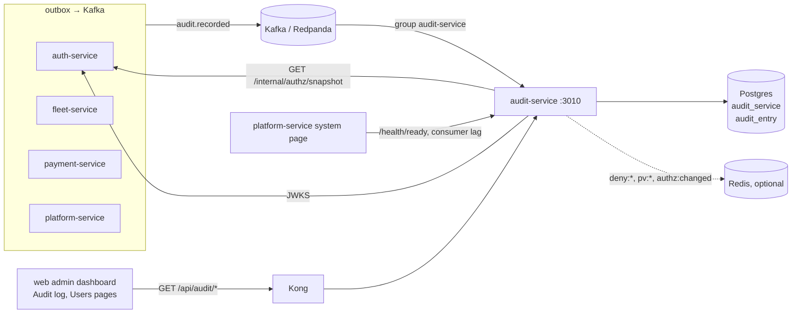

# audit-service: reference documentation

Reference for engineers working on `services/audit-service`. It describes what the code does today; source paths are relative to the service folder unless they start with `libs/`, `infra/`, `docs/` or `services/`. For the intent, read [Role.md §12](../../../docs/design/Role.md#12-audit-log) and the audit rows of [Database.md](../../../docs/design/Database.md) (§7.5, §11, §15).

## What it owns

| Area | What the service does | Main code |
|---|---|---|
| Audit log storage | Consumes `audit.recorded` from Kafka and inserts each event once into `audit_entry` | `src/events/consumer.ts`, `src/store.ts` |
| Write-once guarantee | A database trigger refuses every `UPDATE` and `DELETE` on `audit_entry` | `prisma/migrations/20261027170000_init/migration.sql` |
| Partitions | `audit_entry` is range-partitioned by month on `at`; `ensure_audit_partitions(2)` runs at start and every 24 h | migration, `src/server.ts` |
| Read API | Search with filters and cursor paging, CSV export (which is itself audited), for staff with `audit_log:read` | `src/http/routes.ts`, `src/store.ts` |

## What it does not own

- **Deciding what is audited.** Each producing service calls its own `audit()` helper (`src/outbox/outbox.ts` in auth, fleet, payment and platform services) and writes the event through its outbox.
- **Archiving and retention.** No code exports, detaches or drops partitions. Database.md and docs/production/README.md describe it as an ops task.
- **Integrity proofs.** There is no hash chain, signature or checksum on entries: not found in code. Tamper resistance is the trigger plus database permissions.
- **Writes over HTTP.** There is no write, update or delete route. The only row the service writes itself is the record of a CSV export.

## Neighbours

## Index

| File | Contents |
|---|---|
| [architecture.md](architecture.md) | Modules, ingest flow, idempotency, write-once trigger, partitions, query path, security |
| [api.md](api.md) | The two read routes and health routes |
| [events.md](events.md) | `audit.recorded`: producers, key, payload, validation, retries |
| [data-model.md](data-model.md) | `audit_entry`, partitions, trigger and function, migration, Redis keys read |
| [integrations.md](integrations.md) | Producers, auth-service, Redis, Kong, web app; sequence diagram from outbox to query |
| [configuration.md](configuration.md) | Every environment variable |
| [operations.md](operations.md) | Running, testing, building, health, logs, failure modes, partition maintenance |

The service's top-level [README](../README.md) has the quick start.
