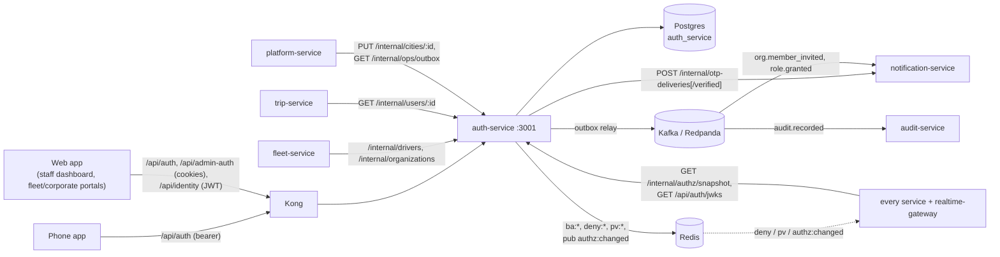

# auth-service: reference documentation

Reference for engineers who work on auth-service or integrate with it. These pages describe what the code **does**, with links to the source. For the reasoning behind the design, read the design docs:

- [docs/design/Auth.md](../../../docs/design/Auth.md): authentication with Better Auth (what was built: [§17](../../../docs/design/Auth.md#17-implementation-notes-v1))
- [docs/design/Role.md](../../../docs/design/Role.md): roles, permissions, scopes, maker–checker
- [docs/design/workflows/01-rider-signup-signin.md](../../../docs/design/workflows/01-rider-signup-signin.md): rider sign-up and sign-in
- [docs/architecture/overview.md](../../../docs/architecture/overview.md): the whole platform

Where these design docs and the code disagree, the code wins. See the notes in each page.

## What the service owns

| Owns | Where |
|---|---|
| User identities (riders, drivers, partners, staff) and their stored roles | `app_user.role`, `member.role` ([data-model.md](data-model.md)) |
| Sign-in: phone OTP for the app, email + password + TOTP for staff | Better Auth, `src/auth/instances.ts` |
| Sessions (app 30 days, admin 12 h) and short-lived ES256 access JWTs (app 15 min, admin 10 min) | Better Auth `jwt` plugin, `src/auth/claims.ts` |
| The JWKS that every other service verifies tokens against | `GET /api/auth/jwks`, `jwks` table |
| Partner organisations (FLEET, CORPORATE), their members and invitations | Better Auth `organization` plugin + `src/auth/hooks.ts` |
| Staff city organisations (STAFF_CITY) and staff role grants, through maker–checker approvals | `src/identity/service.ts`, `src/identity/approvals.ts` |
| Suspension of users (ban, session revocation, Redis denylist) | `src/identity/service.ts`, `src/lib/signals.ts` |
| The live permission matrix (roles and their permissions as data), edited through approvals | `src/authz/*`, `role_definition`, `role_permission` |
| A copy of every city (with its staff organisation) | `city` table, written by platform-service |
| Identity events on Kafka, through a transactional outbox | `src/outbox/*` ([events.md](events.md)) |

## What it does not own

| Not here | Owner |
|---|---|
| Delivering OTP codes (Telegram Gateway, SMS) | notification-service. auth-service generates and verifies the code, and hands it over by internal HTTP |
| Verifying tokens in other services | each service, with `libs/shared-authz` (`createTokenVerifier`). Kong does not verify JWTs |
| The permission and role **catalog in code** (built-in roles, permission names, the default matrix) | `libs/shared-authz`. auth-service seeds its tables from it once, then serves the live copy |
| Cities as a product concept (creating, naming) | platform-service. auth-service only keeps a copy |
| Driver onboarding, vehicles | fleet-service. It tells auth-service when a driver is activated, suspended or reinstated (`POST /internal/drivers/:userId/role`) |
| The audit log | audit-service consumes `audit.recorded` |
| Rider profile data beyond name and photo, trips, payments | trip-service, payment-service |

## Overview

- **Two Better Auth instances over one database.** The *app* surface (`/api/auth`, phone OTP, bearer sessions, `aud=ride-app`) and the *admin* surface (`/api/admin-auth`, password + TOTP, cookies, `aud=ride-admin`). A session is stamped with its surface and can only mint tokens on that surface.
- **Allowlist.** Only the Better Auth endpoints listed in `src/auth/allowlist.ts` are served; everything else under those prefixes is 404.
- **Identity API** (`/api/identity/*`) for what Better Auth doesn't do: guests, staff accounts, staff role grants (maker–checker), suspension, organisation verification, the approvals inbox, the permission-matrix editor, the user directory.
- **Internal API** (`/internal/*`, shared service token) for other services: driver role, organisations and memberships, public user names, the permission-matrix snapshot, city sync, outbox backlog.
- **Every state change** that matters is one Postgres transaction: state + `permissionVersion` bump + outbox rows (domain event and `audit.recorded`). After commit, Redis keys `deny:{userId}` / `pv:{userId}` let every verifier refuse old tokens at once.
- **Background work** in the same process: the outbox relay (every 500 ms), the approval expiry sweep (hourly), the permission-matrix sync (Redis pub/sub + 30 s poll).
- No WebSocket or socket events.

## Neighbours

## Index

| Page | Contents |
|---|---|
| [architecture.md](architecture.md) | Folders and layers, request flow, design decisions, background jobs, caching, concurrency, security model |
| [api.md](api.md) | Every HTTP route: who may call it, request and response, errors, limits |
| [events.md](events.md) | Kafka topics produced (via the outbox), payloads, Redis pub/sub and signal keys |
| [data-model.md](data-model.md) | Tables, constraints, indexes, migrations, Redis keys |
| [integrations.md](integrations.md) | Calls in and out, Kafka summary, external providers, Kong routes, sequence diagrams |
| [configuration.md](configuration.md) | Every environment variable and its validation rules |
| [operations.md](operations.md) | Running, testing, building, health, logging, failure modes, troubleshooting |
