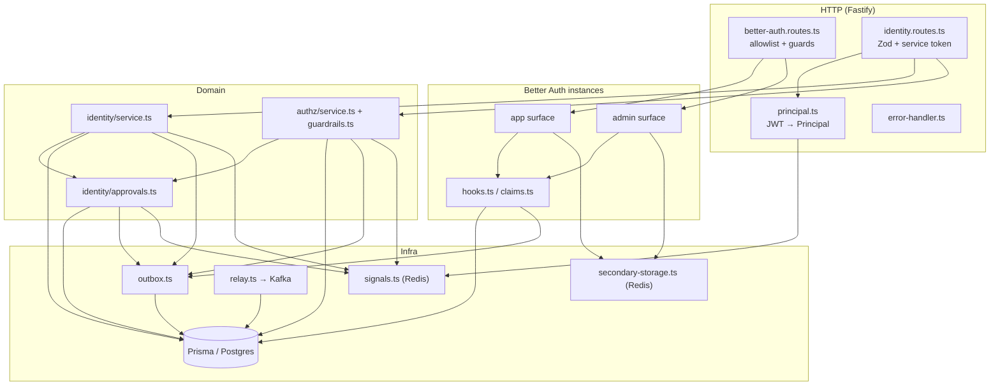

# Architecture

How auth-service is put together internally. For the design rationale see [Auth.md](../../../docs/design/Auth.md) and [Role.md](../../../docs/design/Role.md).

## Folders and modules

| Path | Layer | What it does |
|---|---|---|
| `src/server.ts` | entry point | Loads config, builds the container, seeds the permission matrix if empty, starts the authz sync, the approval sweep and the outbox relay, listens, handles `SIGTERM`/`SIGINT` |
| `src/container.ts` | composition root | Builds every dependency from config: Prisma, Redis, signals, OTP sender, both Better Auth instances, the authz and identity services, the JWT principal resolver. Shared by the server, tests (with overrides) |
| `src/app.ts` | HTTP app | Builds the Fastify instance (no `listen()`, so tests use `inject`): error handler, helmet, CORS, rate limit, health routes, Better Auth mounts, identity and internal routes, dev routes |
| `src/config/index.ts` | config | Zod schema for env vars; refuses insecure production settings ([configuration.md](configuration.md)) |
| `src/auth/instances.ts` | Better Auth | `createAppAuth` and `createAdminAuth`: plugins, session lifetimes, cookie settings, rate-limit rules, database hooks |
| `src/auth/allowlist.ts` | Better Auth | Endpoints each surface serves. Everything else is 404 |
| `src/auth/claims.ts` | Better Auth | `definePayload` for the `jwt` plugin: surface check, ban check, roles per surface, 2FA/password gate, `pv`, `amr`, `setup` |
| `src/auth/hooks.ts` | Better Auth | Organisation hooks: partner-org validation, staff orgs frozen, allowed roles per org kind, `pv` bumps, outbox writes |
| `src/auth/access-control.ts` | Better Auth | Better Auth access control generated from the `shared-authz` matrix (organization plugin) and an empty one for the admin plugin |
| `src/auth/roles-codec.ts` | domain | Stored `user.role` / `member.role` strings → scoped `RoleAssignment`s |
| `src/auth/password.ts` | domain | argon2id hasher, Ethiopian mobile regex, phone ↔ placeholder email |
| `src/auth/otp-delivery.ts` | adapter | OTP sender: `notification` (HTTP to notification-service) or `console` (logs the code) |
| `src/http/better-auth.routes.ts` | HTTP | Mounts a Better Auth instance under a prefix behind the allowlist, the phone-change block and the staff-org guard |
| `src/http/identity.routes.ts` | HTTP | `/api/identity/*` and `/internal/*`, Zod validation, service-token check |
| `src/http/principal.ts` | HTTP | Verifies bearer JWTs with `shared-authz` against Better Auth's own key set, in process |
| `src/http/dev.routes.ts` | HTTP | `/api/dev/*`, only with `DEV_LOGIN=on` |
| `src/identity/service.ts` | domain | Guests, staff accounts, role requests and revocation, suspension, directory, MFA reset, stats, organisations, driver role, internal lookups |
| `src/identity/approvals.ts` | domain | Generic maker–checker: create, list, approve, reject, cancel, expire, with pluggable executors |
| `src/authz/service.ts` | domain | Permission-matrix changes: propose, preview, the `authz:change` executor, reload + publish |
| `src/authz/guardrails.ts` | domain | Rules no matrix change may break (pure functions) |
| `src/authz/store.ts` | data | Seeds `role_definition`/`role_permission` from `shared-authz`, loads the snapshot |
| `src/outbox/outbox.ts` | data | Event types, the event envelope, `writeOutbox`, `audit()` |
| `src/outbox/relay.ts` | worker | Publishes outbox rows to Kafka |
| `src/lib/signals.ts` | adapter | Redis `deny:{userId}` and `pv:{userId}` |
| `src/lib/secondary-storage.ts` | adapter | Better Auth secondary storage on Redis (`ba:` prefix) |
| `src/lib/errors.ts` | shared | `AppError` helpers: `badRequest`, `forbidden`, `notFound`, `conflict`, `unauthorized` |
| `src/middlewares/error-handler.ts` | HTTP | Maps errors to JSON responses; registered before routes |
| `src/cli/bootstrap-super-admin.ts` | CLI | Creates one of the first two super admins |
| `src/dev/accounts.ts`, `src/dev/seed.ts` | dev only | Fixed development accounts and the `seed:dev` script |
| `src/generated/prisma/` | generated | Prisma client (`prisma generate`), not hand-edited |

## Layers



## How a request flows

### Better Auth routes (`/api/auth/*`, `/api/admin-auth/*`)

`mountBetterAuth` in `src/http/better-auth.routes.ts` registers one catch-all route per prefix (`GET` and `POST`):

1. Strip the prefix and query. If `METHOD path` is not in the surface's allowlist (`src/auth/allowlist.ts`), answer **404** `{ error: "not_found" }`.
2. `POST /phone-number/verify` with a truthy `updatePhoneNumber` in the body is refused with **400** (`changing the phone number is not supported`).
3. App surface, `/organization/*`: if the body or query names an `organizationId` or `organizationSlug` of a `STAFF_CITY` / `STAFF_HQ` organisation, answer **404**.
4. Rebuild a Fetch `Request` (the Fastify-parsed JSON body is re-serialised) and call Better Auth's `handler`.
5. Copy status, headers and `set-cookie` back to the Fastify reply.

The Fastify rate limiter is disabled on these routes; Better Auth applies its own per-endpoint limits ([api.md](api.md#rate-limits)). Better Auth then runs its own logic plus our hooks:

- `databaseHooks` (`src/auth/instances.ts`): `user.create.after` writes `user.created`; `user.update.before` validates the profile image; `session.create.after` audits staff sign-ins; `account.update.after` clears `mustChangePassword` on the first password change.
- `organizationHooks` (`src/auth/hooks.ts`): partner-org validation, staff-org freeze, role checks, `pv` bumps, outbox rows.
- `definePayload` (`src/auth/claims.ts`) on `GET /token`.

### Identity and internal routes

```mermaid
sequenceDiagram
  participant C as Client
  participant R as identity.routes.ts
  participant P as principal.ts
  participant S as identity/service.ts
  participant DB as Postgres
  participant X as Redis
  C->>R: POST /api/identity/... (Bearer JWT)
  R->>R: Zod parse params / body / query (400 validation_error)
  R->>P: requirePrincipal(req, "ride-admin")
  P->>P: verify ES256, iss, aud, exp (local JWKS cache)
  P->>X: deny:{sub}? pv:{sub}?
  P-->>R: Principal {userId, roles, pv}
  R->>S: operation(principal, input)
  S->>S: authorize(principal, permission, {cityId?})
  S->>DB: BEGIN; state + permission_version+1 + outbox rows; COMMIT
  S->>X: after commit: pv:{userId}, deny:{userId} (best effort)
  S-->>R: result
  R-->>C: JSON
```

Zod parsing happens before the principal is resolved on most routes, so a malformed request without a token answers 400, not 401.

`/internal/*` routes call `internal(req)` instead of `requirePrincipal`: the `Authorization: Bearer` value must equal `INTERNAL_SERVICE_TOKEN` (constant-time compare). The `x-service-name` header is read and used only as the audit reason of the driver-role change.

## Key design decisions (as implemented)

| Decision | Where | Effect |
|---|---|---|
| Two Better Auth instances on one database, `session.surface` stamped per instance | `instances.ts`, `claims.ts` | An app session can't mint admin tokens (403 `session does not belong to this surface`) and vice versa |
| Endpoint allowlist per surface | `allowlist.ts` | The admin plugin's HTTP endpoints (set role, ban, impersonate, list users), sign-up, organisation deletion, `/organization/leave` etc. are never served |
| The admin plugin is used for its schema and ban enforcement only | `access-control.ts` | No role gets any admin-plugin permission |
| Staff organisations never change through Better Auth | `hooks.ts` `assertNotStaff`, `better-auth.routes.ts` guard | Staff grants and revocations happen only in `identity/service.ts`, in one transaction |
| Staff roles appear in tokens only after TOTP is enabled **and** the initial password is changed | `claims.ts` `selectRolesForSurface` | Until then the admin token has `roles: []` and a `setup` claim |
| Claims are built from a fresh database read of the user, not Better Auth's cached session user | `claims.ts` | A role granted after sign-in reaches the next token |
| Partner roles other than `FLEET_OWNER` / `CORPORATE_ADMIN` count only while the organisation is `VERIFIED`; suspended orgs and expired memberships count for nothing | `roles-codec.ts` `toAssignments` | |
| Phone-only users get a deterministic placeholder email `<digits>@phone.anbessa.invalid` | `password.ts` | Better Auth requires an email; invitations by phone use it |
| Changing the phone number is not self-service | `better-auth.routes.ts` | `updatePhoneNumber` refused |
| Permission matrix stored as data, edited with maker–checker | `authz/*` | Changes take effect without a release; guardrails keep super admins in control |
| Transactional outbox for every event | `outbox/*` | Kafka outages never fail a request |
| Minimal JWT: `sub`, `roles`, `pv`, `amr` (+ `setup` on admin) | `claims.ts` | No name, phone or email in tokens |

## Background jobs

All run inside the API process (`src/server.ts`); there is no separate worker.

| Job | Schedule | What it does | Multi-replica safety |
|---|---|---|---|
| Outbox relay (`src/outbox/relay.ts`) | `setInterval` every 500 ms; drains in batches of 100 while full batches keep coming | `SELECT … WHERE published_at IS NULL ORDER BY created_at LIMIT 100 FOR UPDATE SKIP LOCKED`, sends each row to Kafka (`acks: -1`, idempotent producer, `maxInFlightRequests: 1`), then sets `published_at` | `SKIP LOCKED`: replicas take different rows. Only started when `KAFKA_BROKERS` is set |
| Approval expiry sweep (`approvals.expire`) | once at start, then every hour | `UPDATE approval_request SET status='EXPIRED' WHERE status='PENDING' AND expires_at <= now()` | Idempotent update |
| Permission-matrix sync (`createAuthzSync` from `libs/shared-authz`) | at start, on Redis `authz:changed`, and every 30 s | Reloads this process's in-memory registry from the database when `authz_version` moved | Read-only |
| Permission-matrix seed (`ensureAuthzSeeded`) | once at start | If `role_definition` is empty, copies the built-in roles and matrix from `shared-authz` and bumps `authz_version` | Not locked: two replicas starting together on an empty table could both try to insert (see [operations.md](operations.md#common-failure-modes)) |

Shutdown (`SIGTERM`/`SIGINT`): clear the sweep interval, `app.close()`, stop the relay (clears the timer and disconnects the producer; it does not run a final flush), stop the authz sync, disconnect Prisma and Redis, `process.exit(0)`.

## Caching

| What | Where | Lifetime / invalidation |
|---|---|---|
| Sessions and Better Auth rate-limit counters | Redis secondary storage, `ba:` prefix (`src/lib/secondary-storage.ts`). Sessions are also stored in Postgres (`storeSessionInDatabase: true`) so the directory can list them | Managed by Better Auth. Without `REDIS_URL`, sessions come from Postgres only and rate limits are in memory |
| JWKS for verifying JWTs on `/api/identity` | in-process key set (`src/http/principal.ts` `betterAuthKeySet`), loaded from Better Auth's `getJwks()` | 5 minutes, and reloaded at once when a token carries an unknown `kid` |
| Permission matrix | in-process registry (`shared-authz` `setAuthzSnapshot`) | Swapped right after an approved change commits; otherwise the sync above |
| Dev OTP inbox | in memory (`createOtpInbox`) | 5 minutes, `DEV_LOGIN=on` only |

## Concurrency and idempotency

- **One transaction per operation** in `identity/service.ts` and `approvals.ts`: state change, `permissionVersion` increment, outbox rows and audit rows commit together. Redis signals are written after commit and are best effort.
- **Approvals are locked** with `SELECT … FOR UPDATE` on the request row before approve/reject/cancel (`lockPending`). A second decision sees `status ≠ PENDING` and gets 409 `not_pending`. The approve transaction has a 20 s timeout.
- **Executor failure** inside approve rolls back the whole transaction: the request stays `PENDING` and the caller gets the executor's error. Nothing in the code writes `FAILED`.
- **Duplicate pending requests**: `requestStaffRole` refuses an identical pending `role:grant` (same JSON payload) and `authz.propose` refuses a second pending change for the same `roleCode` (409 `change_pending`). The `role:grant` check runs outside the creating transaction and there is no unique index, so two simultaneous identical requests could both be created.
- **Bootstrap** serialises with `pg_advisory_xact_lock(hashtext('bootstrap-super-admin'))`.
- **Idempotent internal calls**: `POST /internal/drivers/:userId/role` is a no-op when the role is already in the requested state (no `pv` bump, no event). `PUT /internal/cities/:id` is an upsert. `POST /api/identity/guests` returns the existing user (200) when the phone is known.
- **Outbox delivery is at-least-once**: if Kafka accepts a message and the `published_at` update then fails, the row is sent again. Consumers dedupe on `eventId`.
- **Better Auth flows are not one transaction with their events.** Organisation and user hooks call `writeOutbox(db, …)` outside Better Auth's own insert ([Auth.md §13](../../../docs/design/Auth.md#13-events-and-audit) "Known limitation"). A crash between the two loses that event.
- No `Idempotency-Key` header support on any route.

## Security model

### Authentication

| Caller | Credential | Checked by |
|---|---|---|
| Phone app | Better Auth session token as `Authorization: Bearer` (bearer plugin), then 15-min JWT from `GET /api/auth/token` | Better Auth |
| Web portals (fleet, corporate) | app-surface session cookie (`anb` prefix, `SameSite=Lax`, `HttpOnly`) | Better Auth, `APP_TRUSTED_ORIGINS` |
| Staff dashboard | admin-surface session cookie (`anb-admin` prefix, `SameSite=Strict`, `HttpOnly`, `Secure` in production), then 10-min JWT from `GET /api/admin-auth/token` | Better Auth, `ADMIN_TRUSTED_ORIGINS` |
| `/api/identity/*` | `Authorization: Bearer <JWT>` | `src/http/principal.ts`: ES256 only, `iss = AUTH_ISSUER`, `aud`, `exp`, 30 s clock tolerance, Redis `deny:{sub}` (`token_revoked`), Redis `pv:{sub}` newer than the token's `pv` (`token_outdated`) |
| `/internal/*` | `Authorization: Bearer <INTERNAL_SERVICE_TOKEN>` | `identity.routes.ts` `internal()`. Without the token configured, every internal route answers 403 `internal API disabled` |
| `/api/dev/*` | none | only mounted with `DEV_LOGIN=on`, which config refuses in production |

Staff sign-in: email + password (argon2id, 12–128 characters, sign-up disabled), then TOTP (two-factor plugin, issuer `Anbessa`). Staff tokens carry `amr: ["pwd","otp"]` once 2FA is enabled; app tokens carry `amr: ["otp"]`.

### Authorization

Every identity operation calls `authorize(principal, permission, resource?)` from `libs/shared-authz` against the live matrix. Scope letters: `S` self, `O` organisation, `C` city, `G` global. A `C` grant covers a resource only when the call passes a matching `cityId`, or when the role is held `GLOBAL`. Several operations call `authorize` **without** a city (directory, stats, approvals inbox), so in practice they need a `G` grant or a globally held role. The per-route permissions are in [api.md](api.md).

Additional rules in code:

- Maker and checker must be different user ids (`maker_is_checker`), also enforced by a database check constraint.
- At least two non-banned super admins must remain: revoking or suspending a super admin is refused when two or fewer are left.
- Nobody suspends themselves; nobody resets their own MFA; resetting a super admin's MFA needs an approval.
- Suspending a **staff** account needs `staff:manage`; anyone else needs `user:suspend` in the given `cityId`. The `cityId` is caller-asserted (riders have no home city in this database; see [Auth.md §17](../../../docs/design/Auth.md#not-done-yet)).
- Phones in the directory are masked (`+25191 ••• ••44`) without `user:read_pii`. Email is shown only for staff accounts.
- Better Auth's organization plugin access control is generated from the matrix: member roles with `org:manage_members @ O` get `organization:update`, `member:create/update/delete`, `invitation:create/cancel`; others get nothing.

### Revocation

| Event | Effect |
|---|---|
| Any role change, org verify/suspend, MFA reset, "sign out everywhere" | `permission_version + 1`; after commit `pv:{userId}` in Redis (24 h TTL). Verifiers refuse tokens with an older `pv` |
| Suspension | `banned = true`, all sessions deleted (both surfaces), `deny:{userId}` (≤ 30 min TTL) and `pv`. `/token` refuses banned users |
| Without Redis | No `deny`/`pv` keys: sessions are still deleted, but an issued JWT stays valid until it expires (≤ 15 min) |

### Other protections

- `@fastify/helmet` headers; CORS limited to the union of both trusted-origin lists, with credentials.
- Request body limit 64 KB (Fastify `bodyLimit`).
- Profile image must be `data:image/jpeg;base64,…` and at most 48 KB + 32 characters.
- OTP: 6 digits, 5-minute expiry, 3 attempts; codes never written to Kafka or logs in production (the console sender logs them, development only). The notification sender logs only a masked phone.
- JWT signing keys: ES256, rotated every 90 days with a 30-day grace period; private keys encrypted with `BETTER_AUTH_SECRET` in the `jwks` table (Better Auth default).
- Error handler never returns internal error details (500 `internal_error`).
