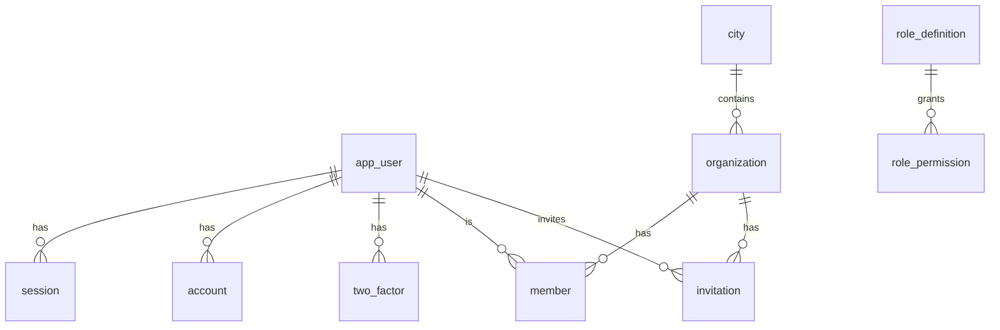

# Data model

Postgres database `auth_service` (see `DATABASE_URL`). Schema: `prisma/schema.prisma`; migrations: `prisma/migrations/`. Prisma 7 with `prisma.config.ts` and the `@prisma/adapter-pg` driver adapter; the client is generated into `src/generated/prisma`.

Better Auth owns the shape of `app_user`, `session`, `account`, `verification`, `jwks`, `two_factor`, `organization`, `member` and `invitation` (field names must match Better Auth's models). We add fields to some of them. `city`, `approval_request`, `role_definition`, `role_permission`, `authz_version` and `outbox` are ours. Tables and columns are snake_case via `@map`.

Ids: UUIDv7. Better Auth rows get theirs from `advanced.database.generateId` (`uuid` v7); `approval_request` and `outbox` default to the Postgres function `uuidv7()` (Postgres 18).

Several roles are stored in one column as a **comma-separated, sorted, de-duplicated** list of stored role names (`src/auth/roles-codec.ts` `joinRoles`/`splitRoles`), e.g. `driver,rider`.

## Tables

### `app_user` (model `User`)

| Column | Type | Null | Default | Notes |
|---|---|---|---|---|
| `id` | uuid | no | | PK |
| `name` | text | no | | Phone users: the phone number until they set a name |
| `email` | text | no | | **unique**. Phone users: `<digits>@phone.anbessa.invalid` |
| `email_verified` | bool | no | false | Set true when the phone is verified (needed for invitations) |
| `image` | text | yes | | JPEG data URL ≤ 48 KB (validated in a Better Auth hook) |
| `created_at`, `updated_at` | timestamptz | no | now() | |
| `phone_number` | text | yes | | **unique**; check `ck_app_user_phone_e164_et`: NULL or `^\+251[79][0-9]{8}$` |
| `phone_number_verified` | bool | yes | | |
| `role` | text | yes | | Comma-separated global roles (stored names: `rider`, `driver`, `super_admin`, `custom_…`) |
| `banned` | bool | yes | false | The suspension flag (admin plugin field) |
| `ban_reason` | text | yes | | |
| `ban_expires` | timestamptz | yes | | From `until` on suspension |
| `two_factor_enabled` | bool | yes | false | |
| `account_status` | text | no | `ACTIVE` | ours. Check `ck_app_user_account_status`: `ACTIVE`, `GUEST`, `DELETED`. Nothing in the code sets `DELETED` |
| `permission_version` | int | no | 0 | ours. Bumped on every role/permission-affecting change; the JWT `pv` |
| `must_change_password` | bool | no | false | ours. Staff accounts start true; cleared on the first password change |

### `session`

| Column | Type | Null | Notes |
|---|---|---|---|
| `id` | uuid | no | PK |
| `expires_at` | timestamptz | no | |
| `token` | text | no | **unique** |
| `created_at` | timestamptz | no | default now() |
| `updated_at` | timestamptz | no | shown as `lastActiveAt` in the directory |
| `ip_address`, `user_agent` | text | yes | |
| `user_id` | uuid | no | FK → `app_user.id`, cascade delete; index `session_user_id_idx` |
| `active_organization_id` | text | yes | organization plugin |
| `impersonated_by` | text | yes | admin plugin (impersonation is not served) |
| `surface` | text | no | ours, default `app`; check `ck_session_surface`: `app`, `admin` |

Sessions are stored in Postgres and, with Redis, also in Better Auth's secondary storage.

### `account`

`id` uuid PK · `account_id` text · `provider_id` text (`credential` for staff passwords) · `user_id` uuid FK → `app_user` (cascade), indexed · `access_token`, `refresh_token`, `id_token`, `scope` text null · `access_token_expires_at`, `refresh_token_expires_at` timestamptz null · `password` text null (argon2id hash) · `created_at`, `updated_at`.

"Staff account" in the code means "has an `account` with `provider_id = 'credential'`".

### `verification`

`id` uuid PK · `identifier` text (indexed) · `value` text · `expires_at` · `created_at` · `updated_at`. Better Auth stores OTP codes and similar here.

### `jwks`

`id` uuid PK · `public_key` text · `private_key` text (encrypted with `BETTER_AUTH_SECRET`, Better Auth default) · `created_at` · `expires_at` null · `alg` · `crv`. Keys are ES256, rotated every 90 days with a 30-day grace period (`jwtPlugin` in `src/auth/instances.ts`).

### `two_factor`

`id` uuid PK · `secret` text (encrypted by Better Auth) · `backup_codes` text · `user_id` uuid FK (cascade), indexed · `verified` bool default true · `failed_verification_count` int default 0 · `locked_until` timestamptz null.

### `organization`

| Column | Type | Null | Default | Notes |
|---|---|---|---|---|
| `id` | uuid | no | | PK |
| `name` | text | no | | |
| `slug` | text | no | | **unique** |
| `logo`, `metadata` | text | yes | | |
| `created_at` | timestamptz | no | | no default (set by Better Auth or our code) |
| `kind` | text | no | | ours. Check `ck_organization_kind`: `FLEET`, `CORPORATE`, `STAFF_CITY`, `STAFF_HQ` |
| `city_id` | text | no | | ours. FK → `city.id` (restrict delete) |
| `legal_name` | text | yes | | ours; required on create by a hook |
| `tin` | text | yes | | ours; 10 digits (hook) |
| `status` | text | no | `PENDING` | ours. Check `ck_organization_status`: `PENDING`, `VERIFIED`, `SUSPENDED` |

Indexes: `organization_kind_city_id_idx (kind, city_id)`; `ux_organization_kind_tin` unique `(kind, tin) WHERE tin IS NOT NULL`; `ux_organization_staff_city` unique `(city_id) WHERE kind = 'STAFF_CITY'` (one staff organisation per city).

Nothing in the code creates a `STAFF_HQ` organisation.

### `member`

`id` uuid PK · `organization_id` uuid FK → `organization` (cascade) · `user_id` uuid FK → `app_user` (cascade), indexed · `role` text default `member` (comma-separated stored org roles) · `created_at` · `valid_until` timestamptz null (ours; memberships past it are ignored in tokens and internal lookups. Nothing in the code sets it). Unique `(organization_id, user_id)`.

Staff city roles (e.g. `dispatcher`) are memberships of the city's `STAFF_CITY` organisation.

### `invitation`

`id` uuid PK · `organization_id` uuid FK (cascade) · `email` text (indexed; phone invites use the placeholder email) · `role` text null · `status` text default `pending` · `expires_at` · `created_at` · `inviter_id` uuid FK → `app_user` (cascade).

### `city`

| Column | Type | Notes |
|---|---|---|
| `id` | text | PK, e.g. `addis-ababa` (`^[a-z0-9-]{1,40}$` when written via `/internal/cities/:id`) |
| `name` | text | |
| `timezone` | text | default `Africa/Addis_Ababa` |

A copy of platform-service's cities. Seeded with `addis-ababa`.

### `approval_request`

| Column | Type | Null | Default | Notes |
|---|---|---|---|---|
| `id` | uuid | no | `uuidv7()` | PK |
| `action` | text | no | | `role:grant`, `staff:reset_mfa`, `authz:change` |
| `payload` | jsonb | no | | `role:grant`: `{ userId, role, cityId \| null }`; `staff:reset_mfa`: `{ userId }`; `authz:change`: the `AuthzChange` (`roleCode`, `set`, `create?`, `label?`, `description?`, `archive?`) |
| `reason` | text | no | | the maker's reason |
| `maker_id` | uuid | no | | |
| `checker_id` | uuid | yes | | check `ck_approval_maker_not_checker`: NULL or ≠ `maker_id` |
| `status` | text | no | `PENDING` | check `ck_approval_status`: `PENDING`, `APPROVED`, `REJECTED`, `EXECUTED`, `EXPIRED`, `CANCELLED`, `FAILED`. The code only writes `PENDING`, `EXECUTED`, `REJECTED`, `CANCELLED`, `EXPIRED` |
| `decision_reason` | text | yes | | |
| `created_at` | timestamptz | no | now() | |
| `decided_at` | timestamptz | yes | | not set by the expiry sweep |
| `expires_at` | timestamptz | no | | created + 7 days |

Indexes: `approval_request_status_created_at_idx (status, created_at)`, `ix_approval_action_status (action, status, created_at DESC)`. No foreign keys to `app_user`.

### `role_definition`

| Column | Type | Null | Default | Notes |
|---|---|---|---|---|
| `code` | text | no | | PK, e.g. `DISPATCHER`, `CUSTOM_…` |
| `label` | text | no | | |
| `description` | text | yes | | |
| `audience` | text | no | | check `ck_role_audience`: `ride-app`, `ride-admin` |
| `storage_type` | text | no | | check `ck_role_storage`: `user` (in `app_user.role`), `member` (in `member.role`) |
| `org_kinds` | text[] | yes (SQL) | | org kinds a member role may live in |
| `stored` | text | no | | **unique**; the name in `app_user.role` / `member.role` (custom roles: lowercased code) |
| `built_in` | bool | no | false | |
| `archived` | bool | no | false | |
| `created_at`, `updated_at` | timestamptz | no | now() | |

Check `ck_role_custom_staff`: `built_in OR (audience = 'ride-admin' AND code LIKE 'CUSTOM\_%')`.

### `role_permission`

PK `(role_code, permission)` · `role_code` text FK → `role_definition.code` (cascade) · `permission` text · `scope` text, check `ck_role_permission_scope`: `S`, `O`, `C`, `G`.

### `authz_version`

One row: `id` int PK default 1 (check `ck_authz_version_single`: `id = 1`) · `version` int default 0. Bumped by every executed `authz:change` and by the first seed. Services reload when it moves.

### `outbox`

| Column | Type | Null | Default | Notes |
|---|---|---|---|---|
| `id` | uuid | no | `uuidv7()` | PK |
| `topic` | text | no | | Kafka topic |
| `key` | text | no | | Kafka message key |
| `payload` | jsonb | no | | the event envelope |
| `created_at` | timestamptz | no | now() | |
| `published_at` | timestamptz | yes | | set by the relay |
| `attempts` | int | no | 0 | never written by the code |

Index `ix_outbox_unpublished (created_at) WHERE published_at IS NULL` (partial in SQL; `schema.prisma` declares it as a plain index on `created_at`). Published rows are never deleted by the code.

## Seed data

| What | Where |
|---|---|
| City `addis-ababa` and organisation `staff-addis-ababa` (`STAFF_CITY`, `VERIFIED`) | migration `20261025120000_better_auth_identity` |
| `authz_version` row `(1, 0)` | migration `20261027150000_authz_registry` |
| Built-in roles and matrix from `libs/shared-authz` (`builtInSnapshot()`) | `ensureAuthzSeeded` at server start when `role_definition` is empty (`src/authz/store.ts`). Code additions to the built-in catalog after that need a migration (comment in `store.ts`) |
| First two super admins | `pnpm bootstrap:super-admin` |
| Development accounts and orgs `dev-fleet`, `dev-corporate` | `pnpm seed:dev` (development only) |

## Migrations (in order)

| Migration | What it does |
|---|---|
| `20261024173713_init` | The original hand-written schema: enum `Role` (`RIDER`, `DRIVER`, `ADMIN`) and table `"User"` (`id`, `email`, `phone`, `passwordHash`, `role`, timestamps) with unique email and phone |
| `20261025120000_better_auth_identity` | Creates every Better Auth table and `city`, `approval_request`, `outbox`, with indexes and FKs. Copies `"User"` rows into `app_user` (role `RIDER → rider`, `DRIVER → driver`, `ADMIN → super_admin`; phone kept only if it matches the Ethiopian pattern; `permission_version = 1`) and their password hashes into `account` (`provider_id = 'credential'`). Drops `"User"` and `Role`. Adds the check constraints and partial unique indexes listed above and makes `ix_outbox_unpublished` partial. Seeds `addis-ababa` and its staff organisation |
| `20261025130000_phone_email_verified` | Sets `email_verified = true` for users whose phone is verified and whose email is the placeholder derived from it |
| `20261027150000_authz_registry` | Creates `role_definition`, `role_permission`, `authz_version` (with its row) and their checks; widens `ck_approval_status` with `CANCELLED` and `FAILED`; adds `ix_approval_action_status` |

New migration: edit `schema.prisma`, then `pnpm prisma migrate dev --name <change>` (the root Makefile's `db-migrate` uses `migrate deploy`). Check constraints and partial indexes live only in the SQL files.

## Redis keys

| Pattern | Type | TTL | Purpose | Code |
|---|---|---|---|---|
| `ba:<Better Auth key>` | string | as set by Better Auth | Better Auth secondary storage: sessions (fast path) and rate-limit counters (fixed window via a Lua `INCR` + `EXPIRE` on first increment). The key names after the prefix are Better Auth internals | `src/lib/secondary-storage.ts` |
| `deny:{userId}` | string `"1"` | `min(1800, max(60, until − now))` seconds | Suspended user: verifiers answer `token_revoked` | `src/lib/signals.ts` |
| `pv:{userId}` | string (integer) | 24 h | Latest permission version: verifiers refuse older tokens | `src/lib/signals.ts` |
| channel `authz:changed` | pub/sub | — | Message = new matrix version | `src/authz/service.ts`, `libs/shared-authz/src/sync.ts` |

All Redis use is optional outside production (`REDIS_URL` unset → in-memory rate limits, no signals, no pub/sub).
