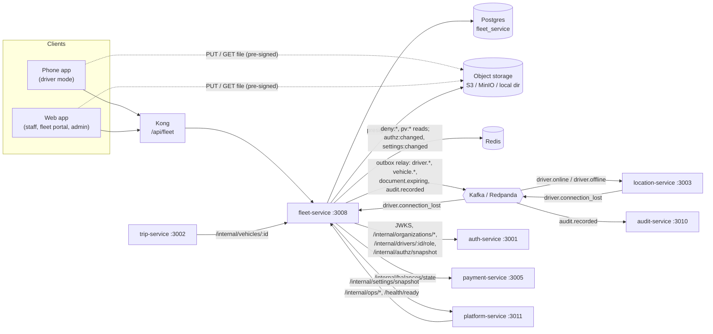

# fleet-service documentation

Reference for engineers who work on fleet-service or integrate with it. Everything here describes what the code does today; paths are relative to `services/fleet-service/` unless they start with `libs/`, `services/`, `apps/`, `infra/` or `docs/`. For the intended behaviour (the design), read the workflows linked below. Where the two differ, the code wins and this documentation says so.

## What the service owns

| Owns | Table / thing | Code |
|---|---|---|
| Driver applications and driver status (`APPLIED` → `PENDING_REVIEW` → `ACTIVE` ⇄ `SUSPENDED`) | `driver_profile` | `src/fleet/service.ts` (`apply`, `submitDriver`, `approveDriver`, …) |
| Licence numbers (encrypted, blind-indexed for duplicates) | `driver_profile.license_*` | `src/lib/crypto.ts` |
| Vehicles and who owns them (a driver **or** a fleet organisation, never both) | `vehicle` | `registerVehicle`, `ck_vehicle_single_owner` |
| Which fleet driver may drive which fleet car | `vehicle_authorization` | `authorizeDriver`, `revokeDriver` |
| Driving sessions (online with one vehicle) | `driving_session` | `startSession`, `endSession` |
| Onboarding documents (metadata; the files live in object storage) | `document` | `uploadTicket`, `confirmUpload`, `reviewDocument` |
| The onboarding review queue and document expiry | — | `queue`, `expireDocuments`, `remindExpiring` |
| `driver.*`, `vehicle.*`, `document.expiring` events and its own `audit.recorded` entries | `outbox` | `src/outbox/` |

## What it does not own

| Not here | Where it lives |
|---|---|
| User accounts, sign-in, tokens, the `DRIVER` role itself | auth-service (fleet-service asks it to add the role on approval) |
| Organisations (fleets, corporates), their status (`PENDING`/`VERIFIED`/`SUSPENDED`), memberships and invitations | auth-service (`/internal/organizations/*`) |
| The role → permission matrix | `libs/shared-authz`, kept live from auth-service |
| Where drivers are, who is available, staleness | location-service (Redis), fed by `driver.online` / `driver.offline` |
| Balances, cash eligibility | payment-service (`/internal/balances/state`) |
| Notifications (push / SMS) | notification-service (it does not consume any fleet event today, see [events.md](events.md)) |
| The audit log | audit-service (consumes `audit.recorded`) |
| Live settings (expiry warning window, reminder days) | platform-service (`/internal/settings/snapshot`) |
| Trips | trip-service (it reads vehicles from fleet-service) |
| Cities and vehicle types | hard-coded: `CITIES` in `libs/shared-location/src/cities.ts`, `VEHICLE_TYPES` in `src/fleet/rules.ts` |

## One-screen overview

- **Port** 3008. **Database** `fleet_service` (Postgres 18, `uuidv7()` defaults). **Public prefix** `/api/fleet` (one Kong route). **Internal** `/internal/*` (service token, never routed by Kong).
- **Stack**: Fastify 5, Prisma 7 (`@prisma/adapter-pg`), zod 4, kafkajs, ioredis, AWS SDK v3 for S3.
- **Callers**: the phone app (driver mode: apply, documents, vehicles, go online/offline), the web app (staff onboarding queue, driver/vehicle records, fleet portal, admin overview), trip-service (`/internal/vehicles/:id`), platform-service (`/internal/ops/*`, `/health/ready`).
- **Tokens**: both audiences are accepted on every public route (`ride-app` tried first, then `ride-admin`); each action is checked with `authorize()` / `can()` from `libs/shared-authz`.
- **Writes and events commit together**: every state change writes its events into the `outbox` table in the same transaction; a relay publishes them to Kafka every 500 ms.
- **Consumes one topic**: `driver.connection_lost` (location-service) → ends the driving session.
- **Background work** in the same process: outbox relay (500 ms), document expiry (hourly) + reminders (once per UTC day), idempotency-key purge (daily), permission-matrix sync and settings sync (Redis pub/sub + 30 s poll).
- **Files** never pass through the database: pre-signed S3 URLs (`STORAGE=s3`), or a signed local directory served at `/api/fleet/files/:ticket` (`STORAGE=local`, refused in production).

## Neighbours

## Index

| File | What's in it |
|---|---|
| [architecture.md](architecture.md) | Folders and layers, request flow, driver / vehicle / document / session lifecycles, uploads, review queue, fleet authorisations, sessions, expiry, caching, idempotency, security model |
| [api.md](api.md) | Every HTTP route: who may call it, inputs and limits, responses, error codes |
| [events.md](events.md) | Topics produced (outbox) and consumed, payloads, ordering and retries, Redis signalling |
| [data-model.md](data-model.md) | Tables, columns, constraints, indexes, the migration, Redis keys, object-storage layout |
| [integrations.md](integrations.md) | Every other system it talks to and who talks to it, Kong routing, sequence diagrams |
| [configuration.md](configuration.md) | Every environment variable and live setting |
| [operations.md](operations.md) | Running locally, seeding, tests, build and deploy, health, logs, jobs, failure modes |

## Design documents

These describe the intended behaviour; this documentation describes the implementation.

- [Workflow 02: driver onboarding and vehicle verification](../../../docs/design/workflows/02-driver-onboarding.md)
- [Workflow 03: fleet company onboarding and fleet drivers](../../../docs/design/workflows/03-fleet-onboarding.md)
- [Workflow 04: driver shift (online, location, offline)](../../../docs/design/workflows/04-driver-shift.md)
- [Role.md §6 (vehicle ownership, rules V1–V10)](../../../docs/design/Role.md#6-vehicle-ownership) and [§8 (permission matrix)](../../../docs/design/Role.md)
- [Database.md §7.2 (fleet database)](../../../docs/design/Database.md#72-fleet-fleet-service), §8 (outbox), §9 (idempotency), §17 (PII encryption)
- [Architecture overview](../../../docs/architecture/overview.md)
- Shared contracts: `libs/shared-types/src/events.ts` (`DriverOnlineEvent`, `DriverOfflineEvent`, `DriverConnectionLostEvent`), `libs/shared-authz` (matrix, token verifier)
