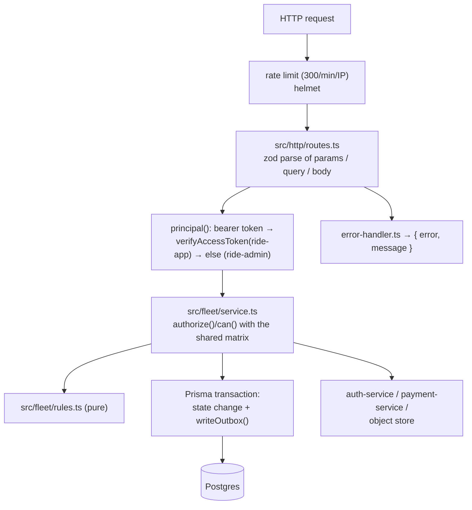
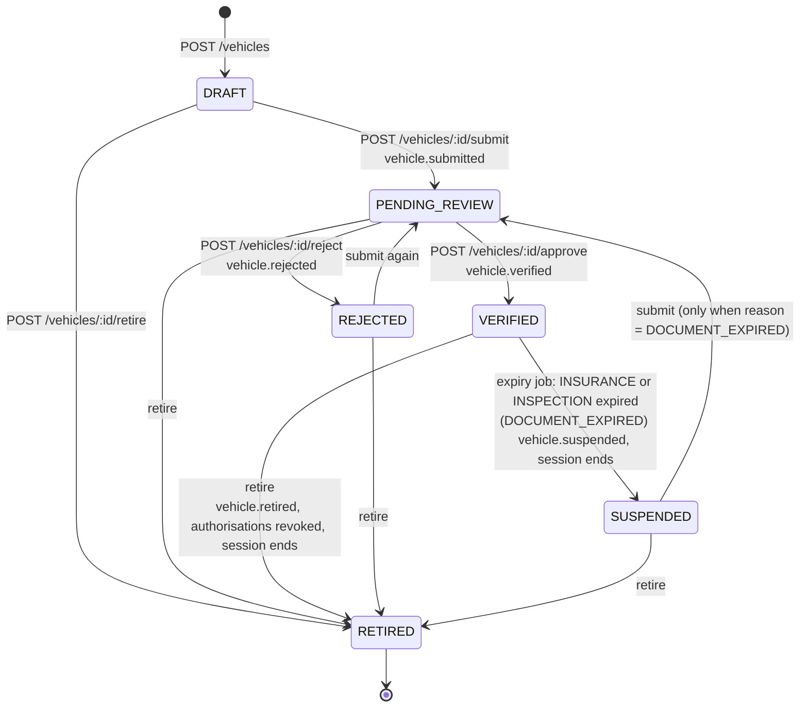
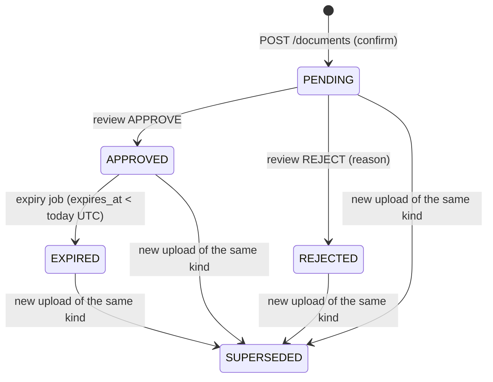

# Architecture

How fleet-service is put together and how its main flows work. Routes in detail: [api.md](api.md). Tables: [data-model.md](data-model.md).

## 1. Folders and modules

| Path | Role |
|---|---|
| `src/server.ts` | Process entry: loads config, builds the container and the app, starts the outbox relay, the Kafka consumer, the settings client, the expiry job, the daily idempotency purge and the permission-matrix sync, then listens. Handles `SIGTERM` / `SIGINT` |
| `src/app.ts` | Fastify instance: error handler, `@fastify/helmet`, `@fastify/rate-limit` (300 / min), body limit 32 KB, `maxParamLength` 1024, health routes, then `registerRoutes` |
| `src/container.ts` | Composition root used by the server, the seed script and the tests. Builds the Prisma client, Redis, the two HMAC signers, the object store, the auth / balance / settings clients, the fleet service and the token verifier. Every dependency can be swapped through `ContainerOptions` |
| `src/config/index.ts` | zod schema for the environment ([configuration.md](configuration.md)) |
| `src/db.ts` | `createDb()`: `PrismaClient` over `@prisma/adapter-pg` |
| `src/http/routes.ts` | Every HTTP route. Parses input with zod, resolves the caller (`principal()`), calls the fleet service. Also the local-storage file routes and the `/internal/*` routes (which query the database directly) |
| `src/fleet/service.ts` | All business logic: drivers, vehicles, authorisations, documents, review, sessions, expiry, stats. Every public method takes the caller's `Principal` and authorises before touching data |
| `src/fleet/rules.ts` | Pure rules: document kinds per subject, which kinds expire, vehicle types and seat ranges, plate normalisation, `currentDocuments`, `missingForSubmit`, `missingForApproval`, `driveDenial` (going-online decision) and its messages |
| `src/lib/clients.ts` | HTTP clients for auth-service and payment-service |
| `src/lib/crypto.ts` | AES-256-GCM licence encryption, HMAC blind index, compact HMAC-signed tickets |
| `src/lib/storage.ts` | `ObjectStore` interface; `s3Store` and `localStore`; upload limits |
| `src/lib/idempotency.ts` | `withIdempotency()` and `purgeIdempotencyKeys()` |
| `src/lib/errors.ts` | `AppError` helpers: `badRequest`, `forbidden`, `notFound`, `conflict`, `unauthorized` |
| `src/middlewares/error-handler.ts` | Maps errors to `{ error, message }` JSON |
| `src/outbox/outbox.ts` | Event types (`FleetEvent`), `writeOutbox()`, `audit()` |
| `src/outbox/relay.ts` | Publishes outbox rows to Kafka |
| `src/events/consumer.ts` | Kafka consumer for `driver.connection_lost` |
| `src/jobs/expiry.ts` | Hourly timer: `expireDocuments()`, and `remindExpiring()` once per UTC day |
| `src/dev/seed.ts` | `pnpm seed:dev` ([operations.md](operations.md#seed-data)) |
| `src/generated/prisma/` | Generated Prisma client (`prisma generate`, also on `postinstall`). Don't edit |
| `prisma/schema.prisma`, `prisma/migrations/` | Schema and the single SQL migration |
| `tests/unit/`, `tests/integration/` | Vitest suites ([operations.md](operations.md#tests)) |

## 2. Layers and request flow



1. Fastify runs the rate limiter and helmet, then the route.
2. The route parses its input with zod. A `ZodError` becomes `400 validation_error` with `issues`.
3. `principal(req)` reads `Authorization: Bearer …`. Missing → `401 unauthorized`. It verifies the token as `ride-app`; if that fails with `invalid_token` it tries `ride-admin`. `token_revoked` (user in the Redis deny list) and `token_outdated` (token's `pv` older than Redis `pv:{userId}`) are returned as 401 straight away.
4. The service method authorises (see §11), loads rows, and for any state change opens a Prisma transaction that writes the new state **and** its events (`writeOutbox`). The relay publishes them later.
5. Errors: `AppError` → its status and code; `AuthorizationError` → `403 forbidden`; `TokenError` → 401 with its code; `TokenCheckUnavailable` (Redis lookup failed) → `503 auth_unavailable` with `retry-after: 5`, logged at warn; Fastify 4xx → passed through; anything else → logged and `500 internal_error`. Unknown routes → `404 not_found`.

Note the order in most routes: the body is parsed **before** the token is checked, so an unauthenticated request with an invalid body gets 400, not 401.

## 3. Driver lifecycle

`driver_profile.status`, enforced by `ck_driver_status`. `status_reason` is `SAFETY` (manual suspension) or `DOCUMENT_EXPIRED` (expiry job); `review_note` holds the last officer note. (`ONBOARDING` is listed in the schema comment but never written.)

```mermaid
stateDiagram-v2
  [*] --> APPLIED: POST /drivers/apply<br/>driver.applied
  APPLIED --> PENDING_REVIEW: POST /drivers/me/submit<br/>(no kind missing / rejected / expired)<br/>driver.submitted
  PENDING_REVIEW --> ACTIVE: POST /drivers/:id/approve<br/>(every kind APPROVED and in date;<br/>auth-service adds DRIVER)<br/>driver.activated
  PENDING_REVIEW --> APPLIED: POST /drivers/:id/request-changes<br/>driver.changes_requested
  ACTIVE --> SUSPENDED: POST /drivers/:id/suspend (SAFETY)<br/>or expiry job: LICENSE expired (DOCUMENT_EXPIRED)<br/>driver.suspended, session ends
  APPLIED --> SUSPENDED: suspend (SAFETY)
  PENDING_REVIEW --> SUSPENDED: suspend (SAFETY)
  SUSPENDED --> PENDING_REVIEW: POST /drivers/me/submit<br/>(only when reason = DOCUMENT_EXPIRED)
  SUSPENDED --> ACTIVE: POST /drivers/:id/reinstate<br/>(every kind APPROVED and in date)<br/>driver.reinstated
```

Details from `src/fleet/service.ts`:

- **Apply** needs `driver:apply @ SELF` (held by `RIDER`), a city in `CITIES`, and a licence that normalises (spaces and dashes removed, upper case) to 5–20 letters/digits. One profile per user (`already_applied`); a licence whose blind index already exists is refused (`licence_registered`), which also catches banned drivers' licences because profiles are never deleted.
- **Submit** works from `APPLIED`, or from `SUSPENDED` with `status_reason = DOCUMENT_EXPIRED` (renewal). It clears `status_reason`, sets `submitted_at`.
- **Approve** requires both `driver:verify` and `driver:activate` in the driver's city. Inside the transaction (timeout 15 s) it updates the profile, writes `driver.activated` + an audit entry, then calls auth-service `POST /internal/drivers/:id/role {active:true}`. If that call fails the transaction rolls back and the officer gets `503 dependency_unavailable` (or `409 user_not_found` when auth-service answers 404). `activated_at` is set only the first time.
- **Request changes** only from `PENDING_REVIEW`; it does not touch documents. Rejecting a document does **not** move the driver back on its own: the officer calls request-changes.
- **Suspend** (`driver:suspend @ CITY`) works from any status except `SUSPENDED` (idempotent: returns the current view). It ends the open session (`SUSPENDED`). Inside the transaction (timeout 15 s) it also calls auth-service `POST /internal/drivers/:id/role {active:false}`, which removes `DRIVER` and bumps the permission version; if that call fails, nothing changes and staff retry. The expiry job's licence suspension does not call auth-service.
- **Reinstate** (`driver:reinstate @ CITY`) needs every driver document approved and in date; otherwise `409 documents_not_approved` and the driver must upload and resubmit. Inside the transaction (timeout 15 s) it calls auth-service `POST /internal/drivers/:id/role {active:true}` (ACTIVE means holding `DRIVER`, whatever state the suspension started from); a failure rolls back.

## 4. Vehicle lifecycle

`vehicle.status`, enforced by `ck_vehicle_status`. `version` is incremented on every status change (it is not used for optimistic locking).



- **Register**: `vehicleType` must be `economy` (3–4 seats), `comfort` (3–4) or `minivan` (5–8); `year` between 1990 and next year (UTC). The plate is normalised (trimmed, inner whitespace collapsed, upper case) and unique (`plate_registered`).
  - `INDIVIDUAL`: allowed with `vehicle:register @ SELF` (`DRIVER`) or `driver:apply @ SELF` (an applicant). The caller must have a driver profile (`not_a_driver`); the vehicle takes the profile's city.
  - `ORGANIZATION`: `vehicle:register @ ORG` for `ownerOrgId`; auth-service must return the organisation with `kind = FLEET` (`not_a_fleet`) and `status = VERIFIED` (`org_not_verified`); the vehicle takes the organisation's city.
- **Submit**: by the owner-driver or anyone with `vehicle:register @ ORG` on the owning fleet. Allowed from `DRAFT`, `REJECTED`, or `SUSPENDED` + `DOCUMENT_EXPIRED`.
- **Approve / reject**: `vehicle:verify @ CITY`, only from `PENDING_REVIEW`. Approval needs all three vehicle documents approved and in date; for a fleet car the organisation must still be `VERIFIED`.
- **Retire**: by the owner-driver or `vehicle:retire @ ORG`. Ends the open session (`VEHICLE_UNAVAILABLE`), revokes every active authorisation, writes `vehicle.retired`. Retiring a retired vehicle returns it unchanged. Staff cannot retire vehicles.
- There is no manual vehicle suspension route; `SUSPENDED` only comes from the expiry job. Ownership transfer (`vehicle:transfer`) is not implemented.

Owner-driver access is decided by `owner_user_id === caller` alone (no permission check), so the owner can submit and retire their car whatever their roles.

## 5. Documents, checklists and uploads

### Kinds

| Subject (`subject_type`) | Required kinds | Kinds with a required expiry date |
|---|---|---|
| `DRIVER` (subject id = user id) | `LICENSE`, `NATIONAL_ID`, `PHOTO` | `LICENSE` |
| `VEHICLE` (vehicle id) | `REGISTRATION`, `INSURANCE`, `INSPECTION` | `INSURANCE`, `INSPECTION` |
| `ORGANIZATION` (org id) | `BUSINESS_LICENSE`, `TIN` | — |

All kinds are required (`required: true` in every checklist entry).

### Document status



The **current** document of a kind is the newest one that isn't `SUPERSEDED` (`currentDocuments` in `src/fleet/rules.ts`). Two derived lists appear in every checklist:

- `missingForSubmit`: kinds with no current document, or whose current document is `REJECTED`, `EXPIRED`, or past its date.
- `missingForApproval`: kinds whose current document is not `APPROVED`, or is past its date.

A document expiring today is still valid today (dates are whole UTC days, `dayOf()`).

### Upload flow

1. `POST /api/fleet/documents/upload-url` with `{ subjectType, subjectId, kind, contentType, sizeBytes, sha256 }`. The service checks the kind belongs to the subject, the size (≤ 10 MB) and who may upload (`uploadScope`):
   - `DRIVER`: only the driver themself (`subjectId` must equal the caller), with `document:upload @ SELF` or `driver:apply @ SELF`; the driver profile must exist.
   - `VEHICLE`: the owner-driver (same permission rule as above), or `document:upload @ ORG` on the owning fleet; not for retired vehicles.
   - `ORGANIZATION`: `document:upload @ ORG` (fleet owner or corporate admin); auth-service must return an organisation of kind `FLEET` or `CORPORATE`.
2. It builds the object key `{subject}/{subjectId}/{kind}/{uuidv7}.{jpg|png|pdf}`, asks the store for a pre-signed PUT (5 min), and signs an **upload ticket** (HMAC, valid 15 min) holding the key, the announced type, size, SHA-256, the subject's city and the caller's id.
3. The client `PUT`s the bytes to `uploadUrl` with the returned `headers` (`content-type`).
4. `POST /api/fleet/documents { ticket, expiresAt? }`. The service verifies the ticket and that it was issued to this caller, requires `expiresAt` for expiring kinds and refuses a date in the past, `HEAD`s the object (`upload_missing` if absent), compares the size, and — **only with local storage** — the SHA-256 (the S3 store's `stat` returns the size only, so the hash is not checked on S3). In one transaction it marks every non-superseded document of that subject and kind `SUPERSEDED` and inserts the new one as `PENDING`. Confirming the same ticket twice returns the existing row.

Replacing a document does not change the driver's or vehicle's status. An `ACTIVE` driver or `VERIFIED` vehicle that uploads a new document keeps its status while the new document is `PENDING`; the going-online check only looks at whether the current licence is missing, `EXPIRED` or past its date, so a pending licence with a future date does not block going online.

### Storage drivers (`src/lib/storage.ts`)

| | `STORAGE=s3` | `STORAGE=local` |
|---|---|---|
| Upload URL | S3 pre-signed `PutObject` (5 min, `ContentType` and `ContentLength` in the signature) | `/api/fleet/files/{ticket}` — relative path, ticket signed with the `file-link` sub-key, 5 min, `op: put` with type and size |
| View URL | S3 pre-signed `GetObject` (5 min) | `/api/fleet/files/{ticket}` with `op: get` (5 min) |
| `stat` | `HeadObject` → size | reads the file → size and SHA-256 |
| `health` | `HeadBucket` | `mkdir -p` on the directory |
| Where | `S3_BUCKET` (AWS, or MinIO with `S3_ENDPOINT` + path style) | `STORAGE_DIR` (default `.dev-data/uploads`); keys that would leave the directory are refused |
| Allowed | anywhere | refused by config when `NODE_ENV=production` |

The local `PUT` route accepts `image/jpeg`, `image/png`, `application/pdf` bodies up to 10 MB and refuses a body whose type or length differs from the ticket (`upload_mismatch`). The local `GET` route serves the file with `cache-control: private, no-store` and `content-disposition: inline`.

## 6. Review queue

`GET /api/fleet/review/queue?cityId=` (`queue()`): the caller needs `driver:read`, `vehicle:read` or `document:review` in that city. It returns, for that city:

| Field | Content | Shown when the caller has |
|---|---|---|
| `drivers` | Profiles in `PENDING_REVIEW`, oldest `submitted_at` first, max 200, masked licence, `pendingDocuments` count | `driver:read @ CITY` |
| `vehicles` | Vehicles in `PENDING_REVIEW`, oldest first, max 200, `pendingDocuments` | `vehicle:read @ CITY` |
| `organizations` | Organisations with `PENDING` documents: `{ orgId, pendingDocuments, oldest }`, oldest first | always |
| `expiringSoon` | Count of `APPROVED` documents with `expires_at` ≤ today + `documents.expiryWarningDays` (includes ones already past their date that the job hasn't processed yet) | always |

A document's `city_id` is copied from its subject at upload time (driver profile, vehicle, or organisation), and that city is the reviewer's scope (`document:review @ CITY`, `document:read @ CITY`).

Reviewing (`POST /documents/:id/review`) only works on `PENDING` documents. Approve may set or override `expiresAt`; an expiring kind must end up with a date and the date must not be past. Reject requires a reason of at least 3 characters. Each review writes an `audit.recorded` entry (`document:approve` / `document:reject`). There is no check that the subject itself is in review.

## 7. Vehicle authorisations (fleet cars)

`vehicle_authorization` (primary key `vehicle_id, driver_user_id`) says which fleet driver may drive which fleet car (rule V7).

- **Grant** (`POST /vehicles/:id/authorizations`): only `ORGANIZATION` vehicles (`not_a_fleet_vehicle`), `vehicle:authorize_driver @ ORG` of the owner, vehicle not retired. auth-service must return a membership of the driver in that organisation whose roles include `fleet_driver` (`not_a_fleet_driver`). Optional `validUntil` must be in the future. Upsert: re-granting re-activates the row, resets `granted_by`, `valid_until`, `revoked_at`. Writes `vehicle.driver_authorized`.
- **Revoke** (`DELETE …/authorizations/:driverUserId`): sets `REVOKED` + `revoked_at`, ends that driver's open session in that car (`VEHICLE_UNAVAILABLE`), writes `vehicle.driver_unauthorized`. Revoking a missing or already revoked authorisation returns `{status:"REVOKED"}` without writing anything.
- **Lapsing**: `valid_until` is not swept by a job; it is checked at going-online time (`validUntil <= now` → `not_authorized_for_vehicle`). An open session is not ended when `valid_until` passes.
- **Fleet portal** (`GET /organizations/:id/overview?members=`): `vehicle:read @ ORG`. Returns every vehicle of the fleet with checklist, authorisations and session; and for up to 100 of the given member ids that auth-service confirms as members (any role), the driver profile summary (only with `driver:read @ ORG`) and open session. The web app supplies the member list (it gets it from auth-service).

## 8. Driving sessions

A session is "online with one vehicle". `ended_at IS NULL` means open; the partial unique indexes `ux_session_vehicle_active` and `ux_session_driver_active` allow one open session per vehicle (V4) and per driver (V5).

### Going online (`startSession`)

1. Load the driver profile and vehicle (`404` if the vehicle doesn't exist).
2. If the driver already has an open session: same vehicle → return it (201); other vehicle → `409 already_online`.
3. `driveDenial()` (`src/fleet/rules.ts`), first failing rule wins:

| Order | Rule | Code | HTTP |
|---|---|---|---|
| 1 | Profile exists and is `ACTIVE` | `driver_not_active` | 403 |
| 2 | Current `LICENSE` exists, isn't `EXPIRED`, isn't past its date | `documents_expired` | 403 |
| 3 | Vehicle `VERIFIED` | `vehicle_not_verified` | 403 |
| 4a | `INDIVIDUAL`: owner is the caller (V6) | `not_your_vehicle` | 403 |
| 4b | `ORGANIZATION`: the token carries `FLEET_DRIVER` or `FLEET_OWNER` @ that org (V7) | `not_in_this_fleet` | 403 |
| 4c | `ORGANIZATION`: authorisation `ACTIVE` and `valid_until` empty or in the future | `not_authorized_for_vehicle` | 403 |
| 5 | No other driver's open session on the vehicle (V4) | `vehicle_in_use` | 409 |

   Ownership is checked before availability so a stranger can't learn whether a car is out driving. Fleet membership comes from the **token's** role claims, not from auth-service.
4. Balance: `GET /internal/balances/state` on payment-service for the beneficiary (`ORGANIZATION` + org id for fleet cars, else `INDIVIDUAL` + driver id). `BLOCKED` → `403 balance_blocked`. If payment-service fails or times out (2 s) the session starts anyway with `balanceState: "OK"`, `cashAllowed: true`, and a warning is logged.
5. Insert the session and write `driver.online` in one transaction. A unique violation (race between two devices or two drivers) → `409 vehicle_in_use`.

`POST /sessions` accepts an `Idempotency-Key` (§10). `GET /drivers/me/vehicles` runs the same `driveDenial()` over every non-retired owned car and every actively authorised fleet car, returning `canDrive`, `denial`, `message` per vehicle (it does not ask payment-service).

### Going offline

`endSession()` / `endSessionTx()` set `ended_at` and `end_reason` and write `driver.offline { driverId, reason }`. Reasons produced by this code:

| `end_reason` | Produced by |
|---|---|
| `DRIVER` | `DELETE /sessions/current` |
| `CONNECTION_LOST` | Kafka `driver.connection_lost` |
| `SUSPENDED` | Manual driver suspension; licence expiry |
| `VEHICLE_UNAVAILABLE` | Vehicle retired; authorisation revoked; vehicle suspended by document expiry |
| `FLEET_SUSPENDED`, `BALANCE_BLOCKED` | Declared in the type and the schema comment, **never produced** (nothing consumes `org.suspended` or `balance.state_changed`) |

Sessions are ended immediately; fleet-service does not know about trips, so it does not wait for a current trip to finish.

## 9. Expiry job and reminders

`src/jobs/expiry.ts` starts one timer per process (every hour, and once at start):

1. `expireDocuments()`: up to 500 `APPROVED` documents with `expires_at < today (UTC)`. Each in its own transaction: document → `EXPIRED`; then
   - `VEHICLE` subject currently `VERIFIED` → `SUSPENDED` / `DOCUMENT_EXPIRED`, open session ended (`VEHICLE_UNAVAILABLE`), `vehicle.suspended` with `reason: "<KIND> expired"`, `byUserId: null`.
   - `DRIVER` subject, kind `LICENSE`, profile `ACTIVE` → `SUSPENDED` / `DOCUMENT_EXPIRED`, `review_note = "Driving licence expired"`, open session ended (`SUSPENDED`), `driver.suspended`.
   - `ORGANIZATION` documents: only marked `EXPIRED` (none of their kinds take a date anyway).
2. `remindExpiring()`, when the UTC date differs from the last run in this process: every `APPROVED` document whose `expires_at` is exactly today + N days for each N in `documents.reminderDays` (default `[30, 7, 1]`) → one `document.expiring` event each, in one transaction.

The "last reminder day" is kept in memory, so a restart sends that day's reminders again, and every replica runs both steps (there is no lock). Renewal: upload the new document, submit the subject again, an officer approves the document and the subject.

## 10. Caching and idempotency

**Caching.** There is no response or data cache. In-memory state that is refreshed in the background:

- The permission matrix (`libs/shared-authz` `createAuthzSync`): fetched from auth-service `/internal/authz/snapshot` at start, re-fetched on Redis `authz:changed` messages and every 30 s. If auth-service is down at start the built-in matrix (`libs/shared-authz/src/matrix.ts`) stays in force.
- Live settings (`libs/shared-settings` `createSettingsClient`): fetched from platform-service `/internal/settings/snapshot`, re-fetched on `settings:changed` and every 30 s; falls back to the env default, then the registry default.
- The JWKS (`jose` `createRemoteJWKSet`, its own caching).

**Idempotency** (`src/lib/idempotency.ts`), used only by `POST /api/fleet/sessions`:

- No `Idempotency-Key` header → the request just runs.
- Key must match `^[A-Za-z0-9_-]{8,100}$` (`400 bad_request`).
- The request hash is SHA-256 of `JSON.stringify({ url, body })`. The key is stored per user (`idempotency_key` primary key `user_id, key`).
- First request inserts `IN_PROGRESS`, runs, stores `DONE` + status code + body. A retry with the same key and hash gets the stored response; a concurrent one gets `409 request_in_progress`; a different body or URL gets `422 idempotency_mismatch`. A failed request deletes the key so it can be retried.
- Rows older than 24 h are deleted by a timer every 24 h after start.

Apart from that, many actions are naturally idempotent: starting a session with the vehicle you're already online with, suspending a suspended driver, retiring a retired vehicle, revoking a revoked authorisation, confirming the same upload ticket twice.

## 11. Security model

### Authentication

- Public routes: an access token from auth-service (ES256 JWT, issuer `AUTH_ISSUER`, keys from `AUTH_JWKS_URL`), audience `ride-app` or `ride-admin`. Roles not belonging to the token's audience are dropped when parsing claims (`parseRoleClaims`).
- With `REDIS_URL`: a token of a user in `deny:{userId}` is refused (`token_revoked`), and a token whose `pv` claim is older than `pv:{userId}` is refused (`token_outdated`). A failed lookup (Redis down) refuses the token with `503 auth_unavailable`. Without Redis, suspensions and role changes only take effect when tokens expire.
- `/internal/*`: `Authorization: Bearer <INTERNAL_SERVICE_TOKEN>`, compared in constant time (`timingSafeEqual`). The `Bearer ` prefix is optional in the comparison. The shared token is the same across services.
- Local file routes `/api/fleet/files/:ticket`: no token; the HMAC-signed ticket in the path is the credential (5 min, one operation, one key).
- Upload tickets: HMAC-signed with a sub-key of `UPLOAD_SIGNING_KEY` (`HMAC(key, "upload-ticket")`); file links use another sub-key (`"file-link"`), so one can't be used as the other.

### Authorisation

Every service method calls `authorize(principal, permission, scope)` or `can()` from `libs/shared-authz`. Scope letters: `S` (own: `ownerUserIds` contains the caller), `O` (the assignment's org equals the resource's org), `C` (assignment's city equals the resource's city, or the assignment is `GLOBAL`), `G` (everywhere). Relevant grants in the built-in matrix (the live matrix may differ):

| Role | Fleet-related permissions |
|---|---|
| `RIDER` | `driver:apply` S |
| `DRIVER` | `vehicle:register`, `vehicle:retire`, `document:upload` S |
| `FLEET_OWNER` | `vehicle:register`, `vehicle:read`, `vehicle:authorize_driver`, `vehicle:retire`, `driver:read`, `document:upload` O |
| `FLEET_DRIVER` | none (membership marker, used for V7 from the token) |
| `CORPORATE_ADMIN` | `document:upload` O |
| `ONBOARDING_OFFICER` | `user:read_pii`, `driver:read`, `driver:verify`, `driver:activate`, `driver:suspend`, `driver:reinstate`, `vehicle:read`, `vehicle:verify`, `document:read`, `document:review`, `report:read` C |
| `SAFETY_OFFICER` | `user:read_pii`, `driver:read`, `driver:suspend`, `driver:reinstate`, `vehicle:read`, `report:read` C |
| `SUPPORT_AGENT` | `user:read_pii`, `report:read` C |
| Other staff | `report:read` (dispatcher, ops manager, marketing, analyst C; finance, super admin, auditor G) |

The resource's scope always comes from the database (the driver's, vehicle's or document's `city_id`, the vehicle's `owner_org_id`) or from auth-service (an organisation's city), never from the request — except list endpoints, where the requested `cityId` / `ownerOrgId` is itself what gets authorised.

### PII

- Licence numbers: AES-256-GCM with a random 12-byte IV, stored as `version(1) · iv(12) · tag(16) · ciphertext` (`src/lib/crypto.ts`). The blind index is HMAC-SHA256 of the normalised licence with a separate key. The last 4 characters are stored in clear for display and search.
- The full licence is returned to the driver themself (`apply`, `submit`, `GET /drivers/me`, `GET /drivers/:ownId`) and to staff with `user:read_pii @ CITY` on `GET /drivers/:userId`, which writes an `audit.recorded` (`user:read_pii`, reason `licence number`) each time. Everyone else sees `•••• 1234`.
- Event payloads carry ids and facts only, never licence numbers or file contents.

### Document view audit

`GET /documents/:id/url` decides access with `readAccess()`: the driver for their own documents, the vehicle's owner-driver or fleet (`vehicle:read @ ORG`), the organisation's uploaders (`document:upload @ ORG`) count as owners; otherwise `document:read @ CITY` of the document is required and the access counts as **staff**. Every staff view writes `audit.recorded { action: "document:view", outcome: "ALLOWED" }` before the URL is returned. Listing documents (`GET /documents`) uses the same access rule but is not audited (it returns metadata, no URL).

### Other protections

- `@fastify/helmet` default headers; `cache-control: no-store` on view URLs.
- Rate limit 300 requests / minute per client IP (`trustProxy: true`, so the `X-Forwarded-For` address behind Kong), on every route including `/internal/*` and health. Kong adds 120 / minute on `/api/fleet`.
- Body limit 32 KB except the local upload route (10 MB).
- Error responses never include stack traces; unexpected errors are logged with the request id.
