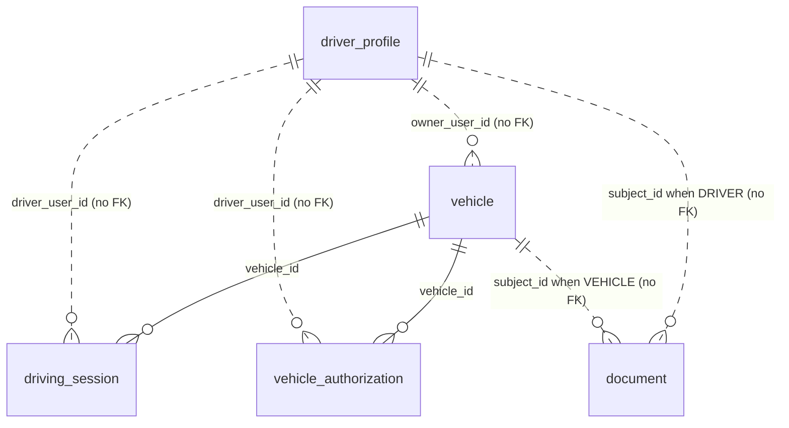

# Data model

Database `fleet_service` on Postgres. Schema: `prisma/schema.prisma` (Prisma 7, generated client in `src/generated/prisma/`). Constraints Prisma can't express are hand-written at the end of `prisma/migrations/20261027120000_init/migration.sql`. Tables and columns are snake_case (`@map`); the Prisma model names are in brackets.

Ids default to `uuidv7()`, a built-in function from Postgres 18 (the dev compose file uses `postgis/postgis:18-3.6-alpine`). There are no foreign keys to other services' databases: user, organisation and city ids are plain values.



## `driver_profile` (`DriverProfile`)

One per user who applied to drive. Never deleted by the code (which is what makes the licence blind index catch re-applications).

| Column | Type | Null | Default | Notes |
|---|---|---|---|---|
| `user_id` | uuid | no | — | **PK**. The auth-service user id |
| `status` | text | no | `'APPLIED'` | `ck_driver_status`: `APPLIED`, `PENDING_REVIEW`, `ACTIVE`, `SUSPENDED` |
| `status_reason` | text | yes | | `SAFETY` or `DOCUMENT_EXPIRED` when suspended (schema comment also lists `ONBOARDING`, unused) |
| `review_note` | text | yes | | Last officer note (changes requested, suspension reason, "Driving licence expired") |
| `full_name` | text | no | | As on the licence |
| `license_number` | bytea | no | | AES-256-GCM: `0x01 · iv(12) · tag(16) · ciphertext` |
| `license_hash` | bytea | no | | HMAC-SHA256 blind index of the normalised licence. **Unique** (`driver_profile_license_hash_key`) |
| `license_last4` | text | no | | Clear last 4 characters, for display and search |
| `city_id` | text | no | | Chosen at apply time |
| `submitted_at` | timestamptz | yes | | Last submission |
| `activated_at` | timestamptz | yes | | First activation (kept on later approvals) |
| `created_at` | timestamptz | no | `CURRENT_TIMESTAMP` | |
| `updated_at` | timestamptz | no | | Set by Prisma (`@updatedAt`) |

Indexes: `driver_profile_city_id_status_idx (city_id, status)`.

## `vehicle` (`Vehicle`)

| Column | Type | Null | Default | Notes |
|---|---|---|---|---|
| `id` | uuid | no | `uuidv7()` | **PK** |
| `plate_number` | text | no | | Normalised (trim, collapse spaces, upper case). **Unique** (`vehicle_plate_number_key`) |
| `owner_type` | text | no | | `INDIVIDUAL` or `ORGANIZATION` |
| `owner_user_id` | uuid | yes | | Owner-driver |
| `owner_org_id` | uuid | yes | | Fleet organisation |
| `vehicle_type` | text | no | | `economy`, `comfort`, `minivan` (checked in code, not in the database) |
| `make`, `model`, `color` | text | no | | |
| `year` | integer | no | | 1990 … next year (code) |
| `seats` | integer | no | | `ck_vehicle_seats`: 1–20; per type in code (3–4 / 3–4 / 5–8) |
| `status` | text | no | `'DRAFT'` | `ck_vehicle_status`: `DRAFT`, `PENDING_REVIEW`, `VERIFIED`, `REJECTED`, `SUSPENDED`, `RETIRED` |
| `status_reason` | text | yes | | `DOCUMENT_EXPIRED` when suspended by the job |
| `review_note` | text | yes | | Rejection reason |
| `city_id` | text | no | | From the driver profile or the organisation |
| `submitted_at`, `verified_at` | timestamptz | yes | | |
| `version` | integer | no | `0` | Incremented on every status change; not read anywhere |
| `created_at` | timestamptz | no | `CURRENT_TIMESTAMP` | |
| `updated_at` | timestamptz | no | | `@updatedAt` |

Constraints and indexes:

- `ck_vehicle_single_owner` (rule V1): `(owner_type = 'INDIVIDUAL' AND owner_user_id IS NOT NULL AND owner_org_id IS NULL) OR (owner_type = 'ORGANIZATION' AND owner_org_id IS NOT NULL AND owner_user_id IS NULL)`.
- `vehicle_city_id_status_idx (city_id, status)`.
- `ix_vehicle_owner_user (owner_user_id) WHERE owner_user_id IS NOT NULL`.
- `ix_vehicle_owner_org (owner_org_id) WHERE owner_org_id IS NOT NULL`.

## `vehicle_authorization` (`VehicleAuthorization`)

A fleet driver allowed to drive one fleet vehicle (rule V7). One row per pair, re-used on re-grant.

| Column | Type | Null | Default | Notes |
|---|---|---|---|---|
| `vehicle_id` | uuid | no | | **PK** part. FK → `vehicle.id` (`ON DELETE RESTRICT ON UPDATE CASCADE`) |
| `driver_user_id` | uuid | no | | **PK** part |
| `granted_by` | uuid | no | | Who granted it last |
| `status` | text | no | `'ACTIVE'` | `ck_authorization_status`: `ACTIVE`, `REVOKED` |
| `valid_until` | timestamptz | yes | | Checked when going online |
| `created_at` | timestamptz | no | `CURRENT_TIMESTAMP` | First grant |
| `revoked_at` | timestamptz | yes | | |

Indexes: PK `(vehicle_id, driver_user_id)`, `vehicle_authorization_driver_user_id_idx (driver_user_id)`.

## `driving_session` (`DrivingSession`)

Online with one vehicle. Rows are kept after they end.

| Column | Type | Null | Default | Notes |
|---|---|---|---|---|
| `id` | uuid | no | `uuidv7()` | **PK** |
| `driver_user_id` | uuid | no | | |
| `vehicle_id` | uuid | no | | FK → `vehicle.id` (`RESTRICT` / `CASCADE`) |
| `started_at` | timestamptz | no | `CURRENT_TIMESTAMP` | |
| `ended_at` | timestamptz | yes | | Null = open |
| `end_reason` | text | yes | | `DRIVER`, `CONNECTION_LOST`, `SUSPENDED`, `VEHICLE_UNAVAILABLE` produced; `FLEET_SUSPENDED`, `BALANCE_BLOCKED` declared only. No CHECK constraint |

Indexes:

- `ux_session_vehicle_active UNIQUE (vehicle_id) WHERE ended_at IS NULL` — one open session per vehicle (V4).
- `ux_session_driver_active UNIQUE (driver_user_id) WHERE ended_at IS NULL` — one open session per driver (V5).
- `driving_session_driver_user_id_started_at_idx (driver_user_id, started_at DESC)`.

## `document` (`Document`)

Metadata only; the file is in object storage.

| Column | Type | Null | Default | Notes |
|---|---|---|---|---|
| `id` | uuid | no | `uuidv7()` | **PK** |
| `subject_type` | text | no | | `ck_document_subject`: `DRIVER`, `VEHICLE`, `ORGANIZATION` |
| `subject_id` | uuid | no | | Driver user id, vehicle id or organisation id |
| `kind` | text | no | | `LICENSE`, `NATIONAL_ID`, `PHOTO`, `REGISTRATION`, `INSURANCE`, `INSPECTION`, `BUSINESS_LICENSE`, `TIN` (checked in code) |
| `object_key` | text | no | | Key in the store (layout below). Not unique in the database; the code looks it up to make confirmation idempotent |
| `content_type` | text | no | | `image/jpeg`, `image/png`, `application/pdf` |
| `size_bytes` | integer | no | | ≤ 10 MB |
| `sha256` | bytea | no | | Hash announced by the client |
| `expires_at` | date | yes | | Required for `LICENSE`, `INSURANCE`, `INSPECTION` |
| `status` | text | no | `'PENDING'` | `ck_document_status`: `PENDING`, `APPROVED`, `REJECTED`, `EXPIRED`, `SUPERSEDED` |
| `reject_reason` | text | yes | | |
| `city_id` | text | no | | The subject's city at upload time; the reviewer's scope |
| `uploaded_by` | uuid | no | | |
| `reviewed_by` | uuid | yes | | |
| `reviewed_at` | timestamptz | yes | | |
| `created_at` | timestamptz | no | `CURRENT_TIMESTAMP` | |

Indexes:

- `document_subject_type_subject_id_idx (subject_type, subject_id)` — checklists.
- `ix_document_review (city_id, created_at) WHERE status = 'PENDING'` — review queue.
- `ix_document_expiring (expires_at) WHERE status = 'APPROVED'` — expiry job and reminders.

## `idempotency_key` (`IdempotencyKey`)

HTTP idempotency for `POST /api/fleet/sessions`.

| Column | Type | Null | Default | Notes |
|---|---|---|---|---|
| `user_id` | uuid | no | | **PK** part |
| `key` | text | no | | **PK** part. The `Idempotency-Key` header |
| `request_hash` | bytea | no | | SHA-256 of `{ url, body }` |
| `status` | text | no | `'IN_PROGRESS'` | `ck_idempotency_status`: `IN_PROGRESS`, `DONE` |
| `status_code` | integer | yes | | Stored response status |
| `response` | jsonb | yes | | Stored response body |
| `created_at` | timestamptz | no | `CURRENT_TIMESTAMP` | Rows older than 24 h are purged daily |

## `outbox` (`Outbox`)

Transactional outbox, published by the relay ([events.md](events.md)).

| Column | Type | Null | Default | Notes |
|---|---|---|---|---|
| `id` | uuid | no | `uuidv7()` | **PK** |
| `topic` | text | no | | Kafka topic |
| `key` | text | no | | Kafka message key |
| `payload` | jsonb | no | | Envelope + event body |
| `created_at` | timestamptz | no | `CURRENT_TIMESTAMP` | Publish order |
| `published_at` | timestamptz | yes | | Null = waiting |

Index: `ix_outbox_unpublished (created_at) WHERE published_at IS NULL`. Published rows are not cleaned up (not found in code).

## `vehicle_transfer` (`VehicleTransfer`) — phase 2D

Ownership transfer requests (rule V9, maker–checker). `id` uuidv7, `vehicle_id` (FK → vehicle), `city_id` (the vehicle's when asked: the officers' scope), `from_owner_type`/`from_owner_id`, `to_owner_type`/`to_owner_id` (`INDIVIDUAL` | `ORGANIZATION`), `status` (`REQUESTED` | `PENDING` | `EXECUTED` | `REJECTED` | `CANCELLED` | `EXPIRED`), `reason`, `requested_by` (owner who asked), `maker_id` (proposing officer), `checker_id` (approving/rejecting officer), `decision_note`, `expires_at` (+7 days), `decided_at`, `created_at`. Indexes `(city_id, status)`, `(vehicle_id, created_at DESC)`; CHECKs `ck_transfer_status`, `ck_transfer_owner_types`, `ck_transfer_new_owner` (not to the same owner), `ck_transfer_maker_checker` (checker ≠ maker); unique partial `ux_transfer_vehicle_open (vehicle_id) WHERE status IN ('REQUESTED','PENDING')`.

`vehicle.status_reason` also takes `ONBOARDING` (manual suspension for documents) and `TRANSFERRED` (status `DRAFT` after an approved transfer).

## Migrations

| Order | Folder | What it does |
|---|---|---|
| 1 | `prisma/migrations/20261027120000_init/` | Creates the seven tables, the Prisma-generated unique and plain indexes and the two foreign keys, then (hand-written) the CHECK constraints `ck_driver_status`, `ck_vehicle_status`, `ck_vehicle_seats`, `ck_vehicle_single_owner`, `ck_authorization_status`, `ck_document_subject`, `ck_document_status`, `ck_idempotency_status`, and the partial indexes `ix_vehicle_owner_user`, `ix_vehicle_owner_org`, `ux_session_vehicle_active`, `ux_session_driver_active`, `ix_document_review`, `ix_document_expiring`, `ix_outbox_unpublished` |
| 2 | `prisma/migrations/20261027180000_vehicle_transfer/` | Creates `vehicle_transfer` with its FK, indexes, CHECKs and `ux_transfer_vehicle_open` |

`migration_lock.toml` pins the provider to PostgreSQL. `prisma.config.ts` reads `DATABASE_URL` (via `dotenv`) and points at `prisma/migrations`. Apply with `pnpm exec prisma migrate deploy` (what `make db-migrate` runs) or `pnpm prisma migrate dev` while developing.

## Redis keys

fleet-service writes no Redis keys. It reads:

| Pattern | Type | TTL | Purpose |
|---|---|---|---|
| `deny:{userId}` | string `"1"` | set by auth-service (bounded by the token lifetime) | Suspended user: refuse their tokens |
| `pv:{userId}` | string (integer) | 24 h, set by auth-service | Permission version: refuse older tokens |
| channel `authz:changed` | pub/sub | — | Reload the permission matrix |
| channel `settings:changed` | pub/sub | — | Reload live settings |

## Object-storage layout

Key: `{subject_type lower}/{subject_id}/{kind lower}/{uuidv7}.{ext}`, with `ext` `jpg` / `png` / `pdf` from the content type (`EXTENSION` in `src/lib/storage.ts`). Examples:

```
driver/<userId>/license/<uuidv7>.pdf
vehicle/<vehicleId>/insurance/<uuidv7>.jpg
organization/<orgId>/business_license/<uuidv7>.png
```

- `STORAGE=s3`: objects in `S3_BUCKET` under those keys. No prefix, no server-side encryption or lifecycle settings in code.
- `STORAGE=local`: files under `STORAGE_DIR` (default `.dev-data/uploads`, relative to the working directory) with the same relative paths.
- Superseded or rejected files are never deleted (not found in code).
