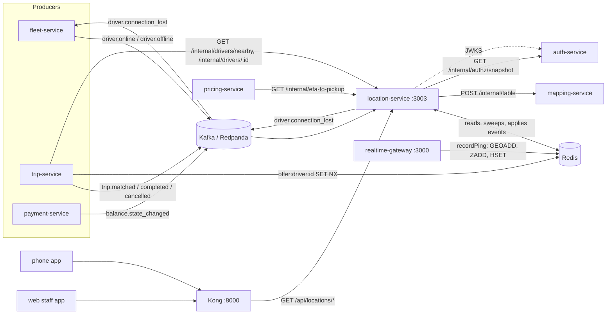

# location-service: reference documentation

location-service is the **read side of live driver location**. Its Redis state is what matching, quotes, the ops map and the rider's trip screen read. It has no database: all state lives in Redis and can be rebuilt from events and the next pings.

The service's [README](../README.md) has the quick start. These pages describe what the code does, with source paths. Design intent lives in [Database.md §10](../../../docs/design/Database.md#10-hot-path-live-location-in-redis), [workflow 04 (driver shift)](../../../docs/design/workflows/04-driver-shift.md) and [workflow 06 (trip execution)](../../../docs/design/workflows/06-trip-execution.md). Where the design and the code differ, these pages follow the code.

## What it owns

| Area | How | Code |
|---|---|---|
| Driver live state (`driver:{id}` hash: status, city, vehicle type, trip, cash eligibility, balance state) | Applied from Kafka events `driver.online`, `driver.offline`, `trip.matched`, `trip.completed`, `trip.cancelled`, `balance.state_changed` | `src/events/handlers.ts`, `libs/shared-location/src/drivers.ts` |
| Matching candidates ("who is near this pickup?") | `GEOSEARCH` on the `available` geo set, then filters | `GET /internal/drivers/nearby`, `nearbyAvailable()` |
| ETA to pickup for quotes | OSRM table through mapping-service, straight-line fallback | `GET /internal/eta-to-pickup`, `src/locations.ts` |
| Anonymous cars around the rider (home screen) | Grid-rounded positions, max 15, 2 km | `GET /api/locations/nearby` |
| Ops map for staff | All drivers seen in a city | `GET /api/locations/cities/:cityId/drivers` |
| Driver position for a trip (rider fallback while the socket reconnects) | `trip:{id}:last` hash | `GET /api/locations/trips/:tripId/driver` |
| Staleness sweeper | 20 s → out of the geo index; 10 min → `driver.connection_lost` | `src/sweeper.ts`, `sweepCity()` |

## What it does not own

| Not here | Where |
|---|---|
| Writing pings into Redis | realtime-gateway calls `recordPing()` from the same lib (`libs/shared-location`). location-service never receives pings |
| Driving sessions (going online/offline) | fleet-service, which publishes `driver.online` / `driver.offline` |
| Offers and the offer lock `offer:driver:{id}` | trip-service writes it; location-service only reads it to skip offered drivers |
| Ranking candidates by ETA, choosing a driver | trip-service's matcher |
| Routing / OSRM | mapping-service (`POST /internal/table`) |
| GPS history / traces | Not persisted anywhere in code. realtime-gateway publishes `driver.location` to Kafka, but no consumer was found in code |
| Pushing positions to riders | realtime-gateway (`driver:location` to room `trip:{id}`) |

## Neighbours

## Index

| Page | Contents |
|---|---|
| [architecture.md](architecture.md) | Internal structure, the driver state machine, ping validation, nearby search, ETA, public cars, trip view, balance mirror, sweeper, key decisions |
| [api.md](api.md) | Every HTTP route: parameters, responses, errors, auth, rate limits |
| [events.md](events.md) | Kafka topics consumed and produced, payload schemas, consumer group, ordering, Redis pub/sub |
| [data-model.md](data-model.md) | Every Redis key: pattern, type, fields, TTL, writer, reader |
| [integrations.md](integrations.md) | Callers and callees, timeouts, failure behaviour, Kong, sequence diagrams |
| [configuration.md](configuration.md) | Every environment variable |
| [operations.md](operations.md) | Running, testing, building, scaling, health, logging, failure modes |

There is no Prisma schema and no migration folder: the service has no SQL database (see [data-model.md](data-model.md)).
