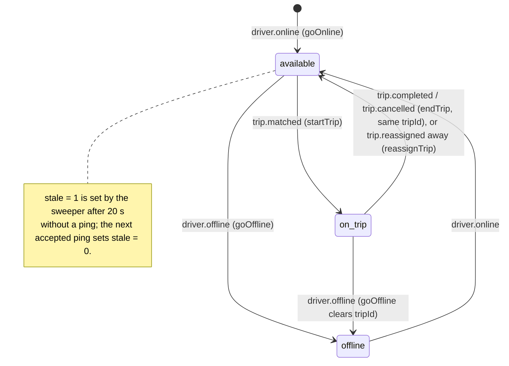

# location-service: architecture

## 1. Layout

```
services/location-service/src/
├── server.ts                 wiring: config, Redis, Kafka, sweeper, HTTP app, authz sync, shutdown
├── app.ts                    Fastify instance: error handler, helmet, global rate limit, /health*
├── config/index.ts           env → typed config (Zod)
├── http/routes.ts            /internal/* (service token) and /api/locations/* (JWT)
├── locations.ts              read side: nearby, ETA, public cars, ops map, trip view
├── sweeper.ts                staleness sweeper with a per-city Redis lock
├── events/handlers.ts        Kafka payload schemas (Zod) → shared-location writes
├── events/kafka.ts           consumer (group location-service) + driver.connection_lost producer
├── lib/mapping.ts            mapping-service client (OSRM table)
├── lib/errors.ts             AppError helpers
├── middlewares/error-handler.ts  error → JSON response mapping
└── utils/logger.ts           pino logger with LOG_LEVEL override
```

Most of the logic is in **`libs/shared-location`**:

| File | Contents |
|---|---|
| `src/keys.ts` | The Redis key layout and the `assertCity` / `assertVehicleType` guards |
| `src/drivers.ts` | `recordPing` (used by realtime-gateway), `goOnline`, `goOffline`, `startTrip`, `endTrip`, `reassignTrip`, `applyBalanceState`, `nearbyAvailable`, `cityDrivers`, `sweepCity`, `LOCATION_TIMING` |
| `src/geo.ts` | `haversineMeters`, `isValidLatLng`, `checkPing`, `PING_LIMITS` |
| `src/cities.ts` | Served cities as bounding boxes (`addis-ababa`, `hawassa`), `cityAt()` |

realtime-gateway (the writer of pings) and location-service (the reader and event applier) both import this lib, so they share one key layout.

## 2. Startup (`src/server.ts`)

1. `loadConfig()` parses the environment. Blank values count as unset. Failure exits the process.
2. Creates one ioredis client (`maxRetriesPerRequest: 2`).
3. If `KAFKA_BROKERS` is set: creates the Kafka consumer/producer and calls `start()` (creates topics outside production, subscribes, runs). Otherwise logs a warning and consumes nothing.
4. Starts the sweeper (`setInterval`, `SWEEP_INTERVAL_MS`). The `onLost` callback publishes `driver.connection_lost` only when Kafka is configured.
5. Builds the Fastify app. Dev routes are registered only when `NODE_ENV=development`.
6. Starts `createAuthzSync`: loads the permission matrix from auth-service (`GET /internal/authz/snapshot`), re-fetches on the Redis channel `authz:changed`, polls every 30 s. If auth-service is unreachable, the built-in matrix from `libs/shared-authz/src/matrix.ts` stays in force (logged).
7. Listens on `0.0.0.0:PORT`.

Shutdown on `SIGTERM`/`SIGINT`: stop authz sync, stop sweeper, close Fastify, disconnect Kafka, disconnect Redis, exit 0.

## 3. Driver state

Each driver has a hash `driver:{driverId}` (fields in [data-model.md](data-model.md)). `status` is one of `available`, `on_trip`, `offline` (`DriverStatus` in `drivers.ts`). Staleness is a **separate flag** (`stale = "1"`), not a status.



Where each set membership comes from:

| Status | Geo set the driver's pings go to | In matching? |
|---|---|---|
| `available` | `geo:{city}:{type}:available` | Yes, if fresh, not stale, no offer, not `BLOCKED`, and cash-eligible when `cashOnly` |
| `on_trip` | `geo:{city}:{type}:busy` | No |
| `offline` | none: `recordPing` refuses with `not_online` | No |

Notes from the code:

- **A ping can't create a driver.** `recordPing` reads `driver:{id}` first; no hash or `status = offline` → `{ accepted: false, reason: "not_online" }`. Only `driver.online` (or the development route) creates the hash.
- **The client can't choose its set or trip.** The set comes from `status`, and the trip from `tripId` in the hash, which only `trip.matched` writes.
- **`goOnline`** deletes and rewrites the hash. It keeps `status = on_trip` and `tripId` if the driver was on a trip (so a session restart mid-trip doesn't free the driver). If the city or vehicle type changed, the driver is removed from the old city's geo sets and `seen` set. The driver has no position until the first ping, so they are not in any geo set yet.
- **`goOffline`** removes the driver from both geo sets and `seen:{city}`, removes them from `beneficiary:{id}:drivers`, sets `status = offline`, `tripId = ""`, and refreshes the 15 min TTL. Later pings get `not_online`.
- **`startTrip`** adds rider and driver (and `bookedById` when the event carries one) to `trip:{tripId}:members` (12 h), stores `billingOrgId` in `trip:{tripId}:billing_org` (same TTL) for company trips, deletes `offer:driver:{id}`, sets `on_trip` + `tripId` (unless offline), and moves the driver from `available` to `busy` right away if they have a fresh position. The members set is written even when the driver hash is missing.
- **`endTrip`** shortens `trip:{id}:members`, `trip:{id}:billing_org` and `trip:{id}:last` to 300 s (the rider screen can still show the final position for 5 min). It frees the driver only if `status = on_trip` **and** `tripId` matches the event's trip, so an old event can't free a driver from a newer trip.
- **`reassignTrip`** (`trip.reassigned`) moves the live trip from `fromDriverId` to `toDriverId`: the old driver leaves the members set, goes back to `available` if still on this trip, and their position is dropped from `trip:{id}:last`; the new driver joins the members set and becomes `on_trip` (unless on another trip), and `trip:{id}:last` is seeded from their current position. Without `toDriverId` (back to matching) only the old-driver half runs; the next `trip.matched` does the rest.
- The hash TTL is 15 min (`LOCATION_TIMING.stateTtlSeconds`), refreshed on every ping and on `goOnline`/`goOffline`. `startTrip`, `endTrip` and `applyBalanceState` do not refresh it.

## 4. Ping validation (done in realtime-gateway, defined here)

`recordPing(redis, driverId, ping, now)` in `libs/shared-location/src/drivers.ts`, with `checkPing` from `geo.ts`. realtime-gateway also applies a per-socket minimum interval before calling it (see the gateway's [architecture.md](../../realtime-gateway/docs/architecture.md)).

| Check | Rule | Rejection reason |
|---|---|---|
| Driver online | `driver:{id}` exists and `status != offline` | `not_online` |
| Coordinates | finite numbers, `|lat| ≤ 85.05112878` (Redis GEO limit), `|lng| ≤ 180`, `at` finite | `invalid` |
| Accuracy | if given, `accuracy ≤ 100` m (`PING_LIMITS.maxAccuracyMeters`) | `inaccurate` |
| Clock | `at ≤ now + 5 s` (`maxClockSkewMs`) | `future` |
| Order | `at > previous.at` (previous accepted ping, device time) | `out_of_order` |
| Plausible speed | distance from the previous accepted ping / elapsed device time ≤ 200 km/h (`maxSpeedMps`) | `too_fast` |

There is no minimum interval in the lib itself. `speed` is accepted in the `Ping` type but not checked or stored. `heading` is stored only when finite.

An accepted ping runs one pipeline: `GEOADD` into the status's set, `ZREM` from the other set, `ZADD seen:{city} <server now>`, `HSET driver:{id}` (`lat`, `lng`, `at` = device time, `stale = 0`, `heading`), `EXPIRE` 15 min, and, while `on_trip`, `HSET trip:{tripId}:last` (+ `driverId`) with `EXPIRE` 3600 s.

Two clocks are used: `seen:{city}` scores use the **server** time; the hash's `at` is the **device** time (the gateway uses server time when the app sends no `at`).

## 5. Nearby search (`nearbyAvailable`)

1. `GEOSEARCH geo:{city}:{type}:available FROMLONLAT lng lat BYRADIUS r m ASC COUNT min(limit*2, 100) WITHCOORD WITHDIST`.
2. One pipeline: `HGETALL driver:{id}` and `EXISTS offer:driver:{id}` for each hit.
3. Drop a candidate if: no state, `status != available`, `stale`, an offer is open, `at` missing or `now - at > 20 s`, `cashOnly` and not `cashAllowed`, or `balanceState = BLOCKED`.
4. Return at most `limit`, nearest first. Distance is rounded to whole metres. Coordinates come from the geo set.

Because over-fetching is 2×, a heavily filtered area can return fewer than `limit` drivers even if more exist further out in the radius. The freshness check compares server time with the device-time `at`, so a phone whose clock runs more than 20 s slow is filtered out even while it pings.

## 6. ETA to pickup (`etaToPickup`)

Used by pricing-service on the quote screen.

1. `nearbyAvailable` with radius **6000 m**, limit **5** (and `cashOnly` if passed).
2. No drivers → `{ etaSeconds: null, driversNearby: 0, approximate: false }`, no mapping call.
3. mapping-service `POST /internal/table` (sources = drivers, destination = pickup), timeout 2.5 s. `etaSeconds` = the minimum non-null duration, rounded. `approximate` comes from mapping-service.
4. On any mapping error (timeout, non-2xx): straight-line estimate per driver, `haversine × 1.35 / (22 km/h)`, `approximate: true`, logged as a warning.

## 7. Public nearby cars (`nearbyPublic`)

For the rider home screen (the phone app polls it every 10 s, `apps/phone-app/lib/features/maps/nearby_cars_layer.dart`).

| Rule | Value |
|---|---|
| City | `cityAt(lat,lng)` from the bounding boxes in `cities.ts`. Outside every served city → `{ cars: [], etaSeconds: null, driversNearby: 0, approximate: false }` |
| Vehicle types | the requested one, or every type in `vtypes:{city}` |
| Radius / cap | 2000 m, 15 per vehicle type, then merged, sorted by distance, cut to **15** |
| Anonymisation | no driver id, vehicle id or plate. `lat`/`lng` rounded to a 0.0003° grid (about 33 m north–south), then to 4 decimals. `heading` rounded to whole degrees |
| ETA | for the nearest car only, through mapping-service; fallback as in §6 |
| Cash filter | none (`cashOnly` is not applied) |
| Rate limit | 30 requests/min per user id (from the token), plus the global 300/min per IP, plus Kong's 120/min |

## 8. Ops map (`cityDrivers`)

`authorize(principal, "location:read_live", { cityId })` on a `ride-admin` token, then every id in `seen:{city}` with a non-offline state and a position. Stale drivers are included with `stale: true` until the sweeper forgets them (10 min). The web app polls this every 5 s (`apps/web/src/lib/hooks.ts`, `useCityDrivers`).

In the built-in matrix (`libs/shared-authz/src/matrix.ts`), `location:read_live` at city scope belongs to `DISPATCHER` and `SAFETY_OFFICER`. The live matrix from auth-service can differ.

## 9. Trip driver position (`tripDriver`)

The rider's fallback while the socket is reconnecting (the app polls every 5 s only while not joined to the trip room, `active_trip_controller.dart`).

1. Read `trip:{tripId}:last` and check `trip:{tripId}:members` for the caller (rider, driver and, for phone or company bookings, the booker).
2. Not a member → allowed if either:
   - the trip's driver (from `last.driverId`) has a `fleetOrgId`, is **currently** on this trip, and the caller has `location:read_live` for that org (`FLEET_OWNER`); or
   - `trip:{tripId}:billing_org` is set (a company-billed trip) and the caller has `trip:read` for that org (the company's bookers and admins).

   Otherwise **404 `trip not found`**, never 403, so the trip's existence isn't confirmed. Code: `tripDriver()` in `src/locations.ts`.
3. A member with no position yet (no ping since the match) → **404 `driver position not found`**.

Members don't need any permission besides membership. The fleet owner path stops working once the trip ends (the driver's `tripId` changes), while members and the billing-org path keep access for the 5 min grace period (`endTrip` shortens both keys to 300 s).

## 10. Balance-state mirror

payment-service publishes `balance.state_changed` per beneficiary (a fleet organisation or an owner-driver). `applyBalanceState`:

1. Stores `balance:{beneficiaryId}` = `{ state, cashAllowed, at }`, TTL 30 days.
2. For every driver in `beneficiary:{id}:drivers`: if the driver's hash still has this `beneficiaryId`, copy `balanceState` and `cashAllowed`; otherwise remove them from the set.

`goOnline` then prefers `balance:{beneficiaryId}` over the values in `driver.online`, because payment-service's event can be newer than fleet-service's lookup.

Effect in matching (`nearbyAvailable`): `BLOCKED` → never a candidate. `cashAllowed = false` (the contract in `libs/shared-types/src/events.ts` says only `OK` and `WARNING` may take cash) → excluded from `cashOnly` searches. `WARNING` has no effect here.

## 11. Staleness sweeper (`src/sweeper.ts`, `sweepCity`)

Every `SWEEP_INTERVAL_MS` (default 5 s), on every replica:

1. `SMEMBERS location:cities`.
2. Per city: `SET lock:sweep:{city} <owner uuid> PX max(1000, interval-500) NX`. Only the replica that gets the lock sweeps that city this round. The lock is not released; it expires.
3. `ZRANGEBYSCORE seen:{city} -inf now-20s` → stale ids.
4. For each: remove from the `available` and `busy` sets of **every** vehicle type in `vtypes:{city}` (plus the driver's own type), and set `stale = 1`.
5. If the last ping is older than 10 min **and** the driver is not `on_trip`: remove from `seen:{city}` and report as lost. A driver on a trip is never reported lost.
6. Lost drivers → `driver.connection_lost` (only when Kafka is configured). A publish error is logged; the driver is already out of `seen`, so it is not retried.

location-service does not set `status = offline` for lost drivers. fleet-service ends the session and publishes `driver.offline` (reason `CONNECTION_LOST`), which then runs `goOffline`. Without Kafka, lost drivers just disappear from `seen` and keep a stale hash until its TTL.

## 12. Persistence of traces

None. Positions exist only as the latest value in Redis (`driver:{id}`, the geo sets and `trip:{id}:last`). realtime-gateway publishes every accepted ping to the Kafka topic `driver.location`; no consumer of that topic was found in code. The design docs mention ClickHouse and trip-service polylines from this stream; not found in code.

## 13. Key decisions (from code comments)

| Decision | Where | Why given |
|---|---|---|
| Key layout in a shared lib, used by writer and reader | `libs/shared-location` | Writer and reader can't disagree |
| Geo sets split by city and vehicle type; city keys hash-tagged `{city}` | `keys.ts` | A search touches a smaller set; a city's keys share a cluster slot |
| Ping = one read (`HGETALL`) then one pipeline, not a Lua script | `drivers.ts`, Database.md §10 implementation table | Keys depend on the state; a script would touch undeclared keys, which Redis Cluster forbids |
| 15 min hash TTL instead of 60 s | `LOCATION_TIMING` | Longer than the 10 min lost rule, so the sweeper still knows the city and type |
| One sweeper per city via `SET NX PX` | `sweeper.ts` | Replicas can all run the loop safely |
| 404 instead of 403 for other people's trips | `locations.ts` | Don't confirm someone else's trip exists |
| Invalid Kafka events are skipped; Redis errors are rethrown | `events/kafka.ts` | One bad message can't block a partition; transient failures retry |
| Mapping failure falls back to a straight-line estimate | `locations.ts` | Quotes still get an ETA, flagged `approximate` |
