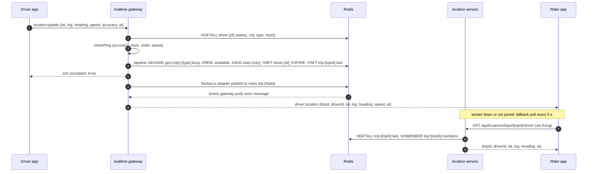
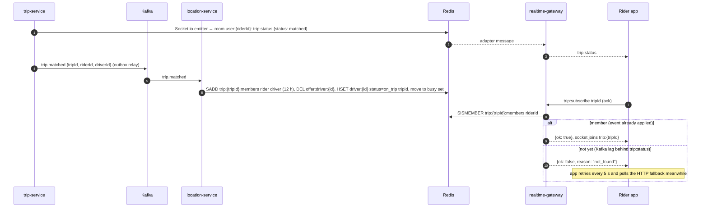
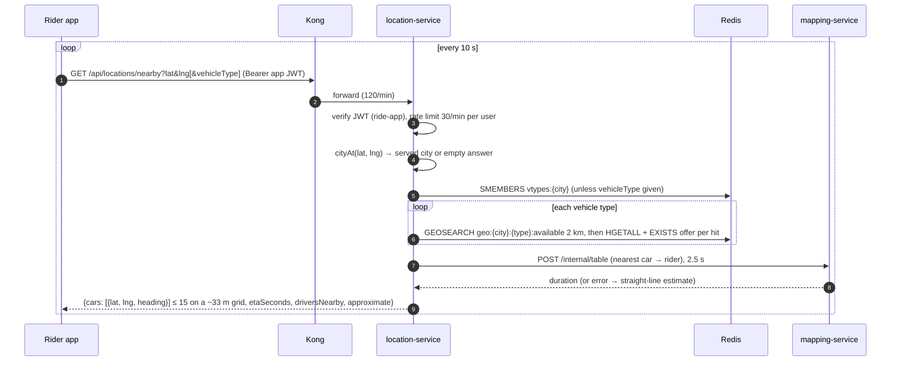

# location-service: integrations

## Who calls location-service

| Caller | Route | Client code | Timeout | Failure behaviour on the caller's side |
|---|---|---|---|---|
| trip-service (matcher) | `GET /internal/drivers/nearby` | `services/trip-service/src/lib/clients.ts` `locationClient.nearby` | 2.5 s (`call()`) | logged `location-service unavailable, retrying`; the matcher retries the trip in 2 s (`matcher.ts`) |
| trip-service (match, arrive, no-show, complete, share page) | `GET /internal/drivers/:driverId` | `locationClient.driver` | 2.5 s | 404 → `null` (driver unknown). Other errors: `matchDriver` and `livePosition` answer 503-style `unavailable`; `complete` and the share page treat it as "no position" |
| pricing-service (quotes) | `GET /internal/eta-to-pickup` | `services/pricing-service/src/lib/location.ts` | 1.5 s | the quote is still returned; its ETA is unknown (comment in that file) |
| platform-service (system page) | `GET /health/ready` | `services/platform-service/src/system/health.ts` | (its own) | shown as down |
| phone app, rider home | `GET /api/locations/nearby` via Kong | `packages/core/lib/src/api/service_apis.dart` | app default | polled every 10 s (`nearby_cars_layer.dart`) |
| phone app, active trip | `GET /api/locations/trips/:tripId/driver` via Kong | same | app default | first fix on open, then every 5 s while the socket isn't joined to the trip room (`active_trip_controller.dart`) |
| web app, ops map | `GET /api/locations/cities/:cityId/drivers` via Kong (or Vite proxy in dev) | `apps/web/src/lib/hooks.ts` `useCityDrivers` | | polled every 5 s |

All internal calls send `Authorization: Bearer $INTERNAL_SERVICE_TOKEN` (the same value across services; `make secrets` copies it).

## Whom location-service calls

| Callee | What | Code | Timeout | On failure |
|---|---|---|---|---|
| mapping-service | `POST /internal/table` `{ sources, destinations }` → `{ durations[][], approximate }` | `src/lib/mapping.ts` | 2.5 s (`AbortSignal.timeout`) | straight-line estimate (`haversine × 1.35 / 22 km/h`), `approximate: true` |
| auth-service | `GET /internal/authz/snapshot` (service token) | `libs/shared-authz/src/sync.ts` | 3 s | keeps the current (or built-in) matrix, logged; retried every 30 s and on `authz:changed` |
| auth-service | JWKS at `AUTH_JWKS_URL` | `jose` `createRemoteJWKSet` in `libs/shared-authz/src/verify.ts` | jose defaults | token verification fails → 401 |
| Redis | everything | ioredis, `maxRetriesPerRequest: 2` | | HTTP routes answer 500; `/health/ready` 503; Kafka handlers rethrow so the event is retried |
| Kafka | consume / produce | `src/events/kafka.ts` | kafkajs defaults | see [events.md](events.md) |

location-service never calls realtime-gateway, and realtime-gateway never calls location-service over HTTP. They share Redis through `libs/shared-location`.

## Kong

`infra/kong/kong.yml` (production) and the generated `infra/kong/kong.dev.yml` (`make dev-gateway`, upstreams on `host.docker.internal`):

| Kong service | Upstream | Route | Methods | Plugins |
|---|---|---|---|---|
| `location-service` | `http://location-service:3003` | `location-routes`: prefix `/api/locations`, `strip_path: false` | `GET` | `rate-limiting` 120/min, `policy: local` |

So `/api/locations/nearby`, `/api/locations/trips/:id/driver` and `/api/locations/cities/:id/drivers` are reachable through Kong (the route comment mentions only the ops map and trip view, but the prefix covers `nearby` too). `/internal/*` has no Kong route. Kong doesn't verify JWTs; the service does.

In development the web app's Vite proxy forwards `/api/locations` to `LOCATION_URL` or `http://localhost:3003` (`apps/web/vite.config.ts`).

## Sequence: driver ping → location state → rider sees the car

## Sequence: trip matched → rider joins the trip room

## Sequence: nearby cars on the rider home screen

