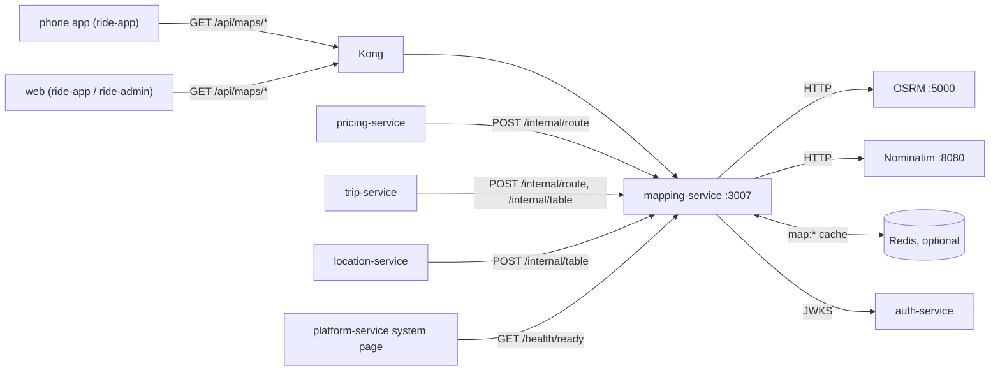

# mapping-service documentation

mapping-service is the only service that talks to the self-hosted map engines: **OSRM** (routing) and **Nominatim** (geocoding). It listens on port 3007. It has **no database** and **no events**.

Everything here comes from the code in `services/mapping-service/` and the libraries it uses. Where something could not be found in the code, the page says so.

## What it owns

| Area | Engine call | Endpoint here |
|---|---|---|
| Road distance, time, polyline, turn-by-turn steps | OSRM `/route/v1/driving` | `POST /internal/route`, `GET /api/maps/route` |
| Driving-time / distance matrix | OSRM `/table/v1/driving` | `POST /internal/table` |
| Snap a point to the nearest road | OSRM `/nearest/v1/driving` | `GET /api/maps/snap` |
| Address / place search | Nominatim `/search` | `GET /api/maps/search` |
| Label for a point | Nominatim `/reverse` | `GET /api/maps/reverse` |
| Fallbacks, caching, timeouts, circuit breakers, service-area checks | — | `src/maps.ts`, `src/engines/http.ts`, `src/lib/cache.ts` |

## What it does not own

| Not here | Where |
|---|---|
| The engines and their data | `infra/mapping-stack` (Docker images), `scripts/map-data.sh` (`make map-data`) |
| Map tiles | TileServer GL in `infra/mapping-stack`; mapping-service does not proxy tiles |
| The service area and city boxes | `libs/shared-location/src/cities.ts` (re-exported by `src/regions.ts`) |
| Prices, ETAs to drivers | pricing-service, location-service |
| Persistent data | none: no database, no Prisma |
| Events | none: no Kafka client, no outbox, no Redis pub/sub. There is no `events.md` for this reason |

## Neighbours

## Index

| Page | Contents |
|---|---|
| [architecture.md](architecture.md) | Layout, engine clients, fallbacks, polyline, breaker, caching, service area, security |
| [api.md](api.md) | Every route with shapes, limits and errors |
| [data-model.md](data-model.md) | No database; Redis cache keys |
| [integrations.md](integrations.md) | Callers, engines, Kong, sequence diagrams |
| [configuration.md](configuration.md) | Environment variables |
| [operations.md](operations.md) | Run (incl. `make map-data`), test, build, health, failure modes |

## Related docs

- [Architecture overview §10, mapping stack](../../../docs/architecture/overview.md#10-mapping-stack)
- [Workflow 05, ride booking and matching](../../../docs/design/workflows/05-ride-booking-matching.md) (approximate estimates when routing is down)
- `infra/mapping-stack/README.md`
