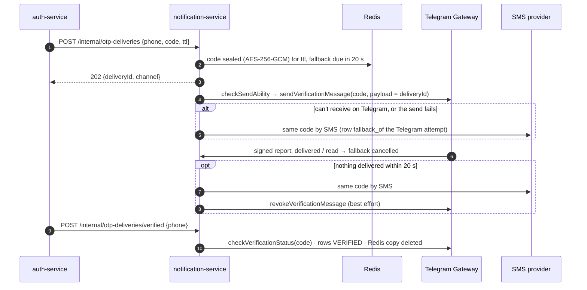

# notification-service

Sends everything Anbessa says to people outside the apps:

- **Login codes** for auth-service: **Telegram Gateway** first, **SMS** fallback ([Auth.md §9.7](../../docs/design/Auth.md#97-otp-delivery-telegram-gateway-first-sms-fallback)). auth-service generates and verifies the code; this service only delivers it.
- **Event notifications** from Kafka: SMS and push (Firebase Cloud Messaging), each sent **at most once per event**.
- **Device tokens** that signed-in apps register for push.

What was built and where it differs from the design: [Auth.md §17](../../docs/design/Auth.md#17-implementation-notes-v1).

## Quick start (standalone)

Requires Node 24 (`nvm use`) and pnpm via `corepack enable`.

```bash
# 1. Start the infra this service needs (Postgres, Redis, Redpanda)
docker compose -f docker-compose.dev.yml up -d

# 2. Install dependencies (once)
pnpm install

# 3. Create .env with PHONE_HASH_KEY, OTP_ENCRYPTION_KEY and the INTERNAL_SERVICE_TOKEN shared with auth-service
make -C ../.. secrets

# 4. Create the notification_service database and tables
pnpm prisma migrate dev

# 5. Start with hot reload
pnpm dev
```

Service URL: http://localhost:3006 · health: `/health`, `/health/ready` (checks the database).

Without `TELEGRAM_GATEWAY_TOKEN` the Telegram channel is skipped. With `SMS_PROVIDER=console` (the default) every SMS, login codes included, is printed in the log. To send real login codes through this service locally, set `OTP_DELIVERY=notification` in `services/auth-service/.env` and restart auth-service.

> **Working across the full stack?** From the repo root, run `make dev-services` instead.

---

## How a login code is delivered



- **One code, two channels.** The SMS carries the same code, so the user just types whatever arrived first.
- **A resend** while the previous Telegram code is still unread goes **straight to SMS**.
- **The fallback schedule lives in Redis** (a sorted set). A restart doesn't lose it, and with several replicas `ZREM` lets exactly one of them send.
- **What's stored:**
  - Postgres `otp_delivery` holds the channel, status, cost and the HMAC of the phone number. **Never the code and never the number**: a database check enforces a 32-byte hash.
  - Redis holds the sealed code only until it expires or is verified.
  - Rows are deleted after 30 days.
- **Delivery reports** (`POST /api/webhooks/telegram-gateway`) need a valid `X-Request-Signature` (HMAC-SHA256 with key SHA256(token) over `timestamp\nbody`) and a timestamp under 5 minutes old. A status only moves forward (`SENT → DELIVERED → READ → VERIFIED`), so replays and out-of-order reports are harmless.

## Event notifications

| Topic (producer) | Notification | Channel |
|---|---|---|
| `org.member_invited` (auth-service) | "Selam Fleet PLC invites you to drive with them on Anbessa. Open the Anbessa app to accept." | SMS to the invited phone |
| `role.granted` with `role = DRIVER` (auth-service) | "You're approved to drive" | push to the user's devices |

- Each send is recorded in `notification` with `dedupe_key = eventId:channel`. A redelivered or replayed event never sends twice.
- If a send fails, the handler throws and Kafka redelivers the event. After 5 attempts the send is recorded as `FAILED` and the consumer moves on. Malformed messages are logged and skipped.
- Push goes to every registered device of the user, and tokens that FCM reports as unregistered are deleted.
- Trip and payment notifications (workflows 05, 07, 08, 10) get handlers in `src/notify/handlers.ts` once trip-service and payment-service publish those events.

## HTTP API

| Route | Auth | Purpose |
|---|---|---|
| `POST /internal/otp-deliveries` | `Bearer $INTERNAL_SERVICE_TOKEN` | Deliver a login code. `{ phoneNumber, code, ttlSeconds, purpose }` → `202 { deliveryId, channel }` |
| `POST /internal/otp-deliveries/verified` | `Bearer $INTERNAL_SERVICE_TOKEN` | The code was used: close the delivery |
| `POST /api/webhooks/telegram-gateway` | Telegram's HMAC signature | Delivery reports (only exists when `TELEGRAM_GATEWAY_TOKEN` is set) |
| `POST /api/notifications/devices` | app access token (`aud=ride-app`) | Register a push token `{ token, platform: android \| ios \| web }`. Up to 10 per user. The last user signed in on a device owns its token |
| `POST /api/notifications/devices/remove` | app access token | Remove your own token (call it on sign-out) |

Kong routes `/api/notifications` and the webhook. `/internal/*` is never exposed.

---

## Project layout

```
src/
├── otp/            Telegram Gateway client + report signatures, Redis store, delivery logic
├── channels/       SMS (Twilio, console) and push (FCM HTTP v1, console) providers
├── notify/         Kafka consumer, per-topic handlers, deduplicating notifier, templates
├── http/           internal, webhook and device routes
├── lib/            phone HMAC, AES-256-GCM sealing, errors
├── config/         env → typed config (Zod). Refuses insecure settings in production
├── middlewares/    error handler (registered before routes)
├── generated/      Prisma client output (gitignored)
├── container.ts    composition root
├── app.ts          builds the Fastify instance (no listen(), testable)
└── server.ts       config, fallback poller (1 s), 30-day purge, consumer, graceful shutdown
```

## Common commands

| Command | What it does |
|---------|-------------|
| `pnpm dev` | Start with hot reload (tsx watch) |
| `pnpm build` | Compile TypeScript → dist/ (build libs first: `pnpm turbo run build --filter=@ride-app/notification-service...`) |
| `pnpm start` | Run compiled output (production) |
| `pnpm test` | Unit tests: report signatures, sealing, phone hashing, templates, config rules |
| `pnpm test:integration` | The real app on a throwaway `notification_service_test` database, with fake Telegram/SMS/push and a movable clock (needs Postgres: `make infra-up`) |
| `pnpm lint` / `pnpm typecheck` | ESLint / type-check |
| `pnpm prisma migrate dev --name <change>` | New migration after editing `schema.prisma` |

## Docker image

Build from the **repo root**:

```bash
docker build -f services/notification-service/Dockerfile -t ride-app/notification-service .
```

## Environment variables

See `.env.example`: every variable is documented there. Production refuses to start with console SMS or push, without Kafka, or with Telegram enabled but no token or no https callback URL. See [docs/production/README.md](../../docs/production/README.md#5-configuration-reference).
Never commit a `.env` file with real secrets.
