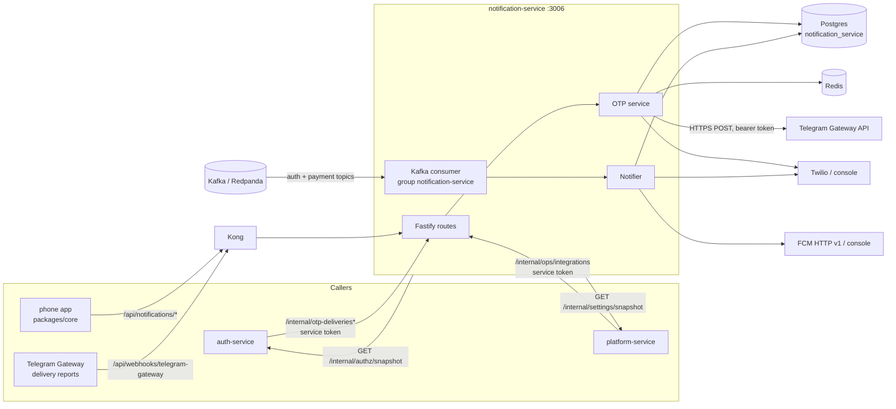

# notification-service: reference documentation

Reference for engineers working on `services/notification-service`. Everything here describes what the code does today; source paths are relative to the service folder unless they start with a repo-level folder (`libs/`, `infra/`, `docs/`). For the intent behind the design, read [Auth.md §9.7](../../../docs/design/Auth.md#97-otp-delivery-telegram-gateway-first-sms-fallback), [Auth.md §17](../../../docs/design/Auth.md#17-implementation-notes-v1) and [Database.md §7.5](../../../docs/design/Database.md).

## What it owns

| Area | What the service does | Main code |
|---|---|---|
| Login-code (OTP) delivery | Receives a code from auth-service and delivers it: Telegram Gateway first, SMS fallback. Tracks each attempt in `otp_delivery`. Never generates or verifies codes | `src/otp/` |
| Telegram delivery reports | Public, signature-checked webhook that moves delivery attempts forward (`SENT → DELIVERED → READ`) and cancels the SMS fallback | `src/http/routes.ts`, `src/otp/telegram-gateway.ts` |
| Event notifications | Consumes 11 Kafka topics from auth-service and payment-service and sends one SMS or push per event and channel, deduplicated in `notification` | `src/notify/` |
| Push device tokens | Signed-in apps register and remove FCM tokens (`device_token`) | `src/http/routes.ts` |
| Ops status | `GET /internal/ops/integrations` for platform-service's system page | `src/http/routes.ts`, `src/otp/otp-service.ts` (`status()`) |

## What it does not own

- **Generating, storing and checking login codes, OTP rate limits.** auth-service (Better Auth) does that. This service only receives the code over an internal call. It does not rate-limit OTP requests (`/internal/otp-deliveries` has `rateLimit: false`; the comment says auth-service already limits per number and per IP).
- **Deciding who gets a notification.** Producers put the user id or phone number in the event; this service only maps it to a template.
- **Trip notifications.** No handler exists for any `trip.*` topic except `trip.settled` (produced by payment-service). See [events.md](events.md).
- **Message templates in a database, translations.** Templates are English-only TypeScript functions (`src/notify/templates.ts`). The `template` table listed in Database.md §7.5 does not exist.
- **In-app / realtime messages.** realtime-gateway does that.

## Neighbours

## Index

| File | Contents |
|---|---|
| [architecture.md](architecture.md) | Modules and layers, OTP delivery state machine, fallback scheduler, notifier, dedupe and retries, push, templates, security model |
| [api.md](api.md) | Every HTTP route with auth, shapes and status codes |
| [events.md](events.md) | Kafka topics consumed (none produced), payload fields used, consumer behaviour |
| [data-model.md](data-model.md) | Tables, constraints, indexes, migration, Redis keys |
| [integrations.md](integrations.md) | auth-service, platform-service, Telegram Gateway, Twilio, FCM, Kong; sequence diagrams |
| [configuration.md](configuration.md) | Every environment variable and its validation |
| [operations.md](operations.md) | Running, testing, building, health checks, logs, failure modes |

The service's top-level [README](../README.md) has the quick start.
